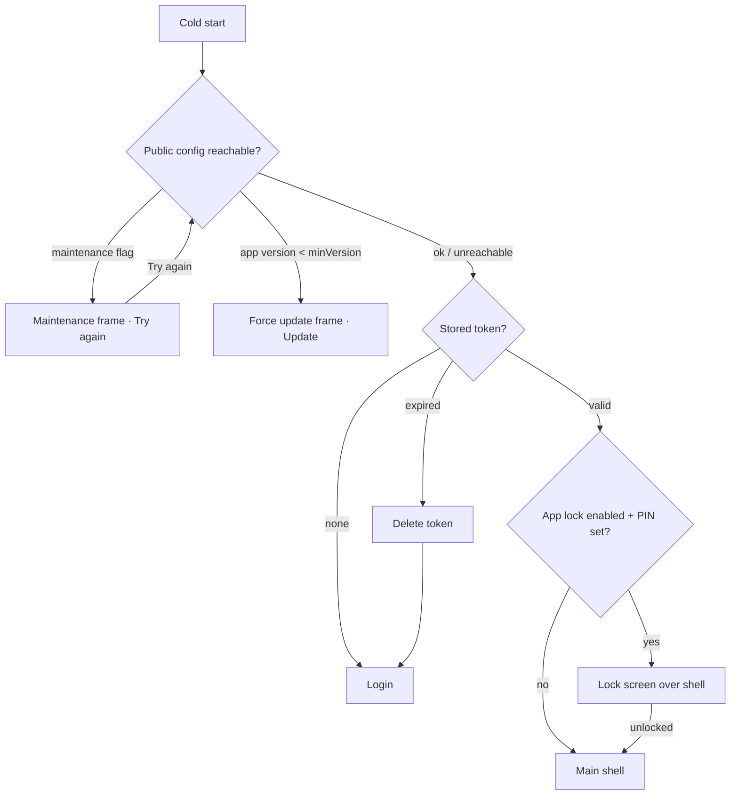

# Splash / bootstrap (incl. force update and maintenance)

| | |
|---|---|
| Area | 01 Launch, auth & shell |
| Who sees it | Both roles, every tier (before anything about the user is known) |
| Reached from | Cold start of the app; also the fallback for any unknown route (see §2) |
| Screen type | Full screen (no app bar, no system back) |
| Current Flutter source | `lib/features/auth/presentation/splash_screen.dart`, `lib/main.dart`, `lib/state/auth/auth_controller.dart` (restoreSession) |
| Spec | `docs/kmp-spec/01-architecture-core-auth-shell.md` §1.1, §1.4, §2.9; ticket AUTH-01 |

## 1. Purpose
The first thing a doctor sees on every cold start. It brands the launch, decides silently whether a usable session already exists on the device, and sends the doctor either into the app or to Login. Seen daily; it must never feel like a wait.

## 2. Entry points
- Cold start of the app (always). Nothing arrives with the user.
- Cold start from a push-notification tap: the splash still runs; the notification payload is parked and consumed once the shell exists (see `20-push-deep-link-landing.md`).
- Any unknown in-app route falls back to this screen (defensive; should not happen in normal use).
- It replaces nothing and is itself replaced (never kept on the back stack).

## 3. Layout, top to bottom (phone portrait)
1. Full-bleed background that animates from brand teal to white over the duration of the animation (today 1.6 s, ease-in-out).
2. Two large blurred teal "blobs" that drift outward (bottom-left and top-right) and slowly rotate. Decorative only.
3. Centred Shifa logo (SVG, 96 × 96 dp) fading in and scaling from 96 % to 100 %.
4. No text, no version number, no progress indicator, no button. Nothing is tappable.
5. No status-bar styling is set today (defaults). Design should specify light/dark status-bar icons for the teal and the white phase.

Target additions (not in the current app, needed for the rewrite):
6. **Force update** frame: logo, title, body, one primary button that opens the store. No dismiss.
7. **Maintenance** frame: logo, title, body, "Try again" button. No dismiss.

## 4. Data and formats
| Field | Source | Format rule |
|---|---|---|
| Stored session token | secure storage on device | Opaque; only "exists / expired / valid" matters. Expiry is checked locally with a 30 s grace after the token's expiry time. |
| Role (DOCTOR / CLINIC_STAFF) | inside the token | Decides which shell opens; not shown on splash. |
| Minimum supported version, maintenance flag | **UNVERIFIED** – there is no such endpoint in the current app. `GET /api/public/config` exists but returns only an AI-feedback flag. Backend request needed (`minVersion`, `storeUrl`, `maintenance`, `maintenanceMessage`). |
| App version | build info | Shown nowhere today; design may add a small version label at the bottom. |

## 5. Primary flow (happy path)
1. App opens, logo animation plays.
2. Today: when the animation finishes (1.6 s) plus a fixed 200 ms pause, the app reads the stored token. **Target:** the token check starts immediately in parallel; the animation may be cut short (≤ 1.6 s, skippable) when a valid session exists, so a returning doctor reaches the shell in under 2 s.
3. Valid token → the main shell opens and replaces the splash (`16-main-shell-doctor.md` or `18-main-shell-clinic-staff.md` by role).
4. No token or expired token → the Login screen replaces the splash (`02-login.md`). An expired token is deleted.
5. If app lock is enabled and a PIN exists, the lock screen covers the shell immediately after it appears (`12-app-lock-enter-pin.md`). The splash itself is never locked.

The maintenance / force-update branches are **target** behaviour; today the app goes straight from `A` to `C`.

## 6. Screen states
- First load (skeleton): n/a – the splash *is* the loading state. No skeleton, no spinner.
- Empty: n/a.
- Error on load: n/a today (the session check is local and cannot fail). Target: if the public config call fails or times out (5 s), continue as if the flag were absent – never block launch on it.
- Offline: identical to online. Session restore is local. Offline is first noticed on the next screen (shell shows cached content plus an offline banner, see `19-global-banners-offline.md`).
- Refreshing: n/a.
- Partial data: n/a.
- Permission needed: none. Notification permission is **not** asked here (today Firebase asks on web only; target: ask after first login in the shell, never on splash).
- Locked by tier: n/a.
- Role difference: none on this screen; the role only decides the destination.
- **Force update (target)**: logo, "Update required" title, short body, single "Update" button → store listing. No way past it.
- **Maintenance (target)**: logo, "We'll be right back" title, body from backend when present, "Try again" button that re-runs the check.

## 7. Interactions and secondary flows
- Tap anywhere → nothing today. Target: tapping skips the remaining animation (does not skip the checks).
- System back → ignored (Android would exit the app; acceptable).
- Rotation → the animation restarts from zero today (the whole screen rebuilds). Target: lock the splash to portrait or keep progress across rotation.
- "Update" (target) → opens Play Store / App Store page; on return the app re-checks the version.
- "Try again" (target) → re-fetches public config; button shows progress for the duration; result replaces the frame.

## 8. Edge cases
- Returning doctor with a valid token still waits the full 1.8 s today – fix (target step 2).
- Token present but malformed → treated as valid today (expiry cannot be read so it is "not expired"); the first API call then returns 401 and logs out. Target: malformed token = no token.
- Token valid locally but the account was disabled on the server → shell opens, first call fails with 403 "Account is disabled" → forced logout to Login (`14-session-expired-forced-logout.md`). The splash cannot know this.
- Clinic-staff token → today on phones lands on a "web only" block screen; target lands on the 4-tab staff shell.
- Push tap while the app is dead → splash runs normally, then the deep link fires after the shell is mounted. The user sees splash → shell (correct tab) with no intermediate Home flash expected; see `20-push-deep-link-landing.md` for the appointment case that shows a loading dialog today.
- App lock enabled: lock screen appears over the shell about one frame after it; design the transition so the shell content is not visible before the lock (today it can flash).
- Very slow device: the 1.6 s animation is time-based, not frame-based; fine.
- 200 % font size: no text today; force-update / maintenance copy must wrap, button stays full width above the home indicator.
- Language: the splash renders before the saved language is loaded; its target frames must use the saved language, so load language first (today language loads asynchronously and may switch mid-frame on the next screen).
- Cold start auto-switches a previously *auto-detected* language back to the region default (e.g. a phone that moved to Uzbekistan silently becomes Uzbek). Target: only an unset language is detected; a saved one is kept.
- Screen reader: announce "Shifa Doctor, loading" once; the frame has no focusable element.
- Double launch / app resumed during splash → animation continues; no duplicate navigation (navigation is guarded today).
- Web admin host detection does not exist on mobile; nothing to design.

## 9. Validation and messages
| Field/action | Rule | When checked | Message (English) | Where shown |
|---|---|---|---|---|
| Stored token | exists and not expired (30 s grace) | on launch | – (silent, goes to Login) | – |
| App version (target) | ≥ `minVersion` from backend | on launch, when config is reachable | "A newer version of Shifa Doctor is required to continue." | Force-update frame |
| Maintenance (target) | flag false | on launch | "Shifa Doctor is temporarily unavailable for maintenance. Please try again in a few minutes." | Maintenance frame |

## 10. Navigation out
- → Main shell (replace; splash removed from the stack).
- → Login (replace).
- → Store (external, target).
Nothing to keep or discard; nothing on a previous screen to refresh.

## 11. Copy
- No strings today.
- **NEW** `updateRequiredTitle` "Update required"
- **NEW** `updateRequiredBody` "A newer version of Shifa Doctor is required to continue."
- **NEW** `updateNow` "Update"
- **NEW** `maintenanceTitle` "We'll be right back"
- **NEW** `maintenanceBody` "Shifa Doctor is temporarily unavailable for maintenance. Please try again in a few minutes."
- `retry` "Retry" (exists; use for "Try again")

## 12. Known problems in the current app (do not carry over)
- Fixed 1.6 s + 200 ms wait even when a valid session exists – wasted time on every launch.
- No force-update or maintenance handling at all – a breaking backend change cannot be communicated.
- Animation restarts on rotation.
- Notification permission prompt (where Firebase works) fires during bootstrap, before the doctor has logged in.
- Saved non-explicit language is overwritten by region detection at every cold start.
- Firebase (push) never initialised on Android/iOS in the Flutter build, so splash-time push setup was web-only; the rewrite must configure it for both platforms.

## 13. Open questions for design
- Keep the blob animation or replace with a simpler logo reveal? Either way ≤ 1.6 s and skippable.
- Should the splash show the app version in small text at the bottom (useful for support)?
- Force-update frame: do we also want a soft "Update available" banner in the shell for non-blocking versions? Needs a second backend field (`latestVersion`).
- Dark-mode variant of the splash (the app has no dark theme today).
