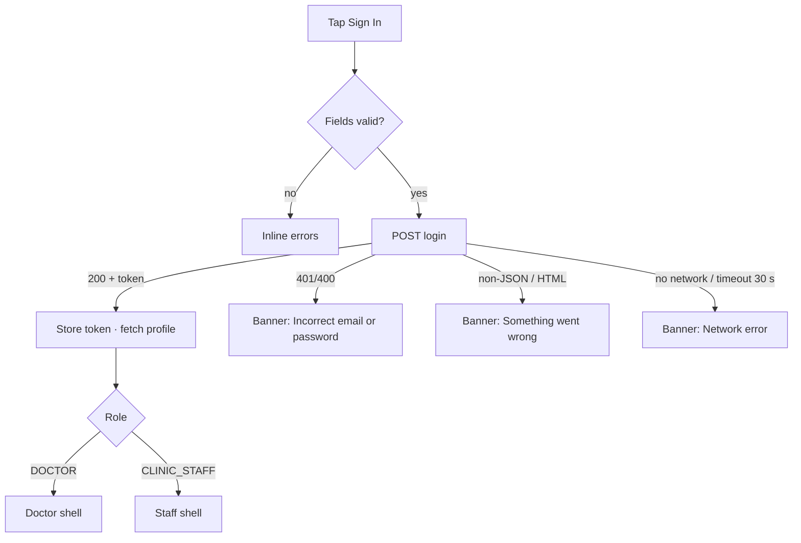

# Login (email or phone + password)

| | |
|---|---|
| Area | 01 Launch, auth & shell |
| Who sees it | Both roles (the role is known only after login), every tier |
| Reached from | Splash (no session), forced logout, inactivity timeout, Sign out, 5 failed PIN attempts; back from the email / registration screens |
| Screen type | Full screen |
| Current Flutter source | `lib/features/auth/presentation/login_screen.dart`, `lib/state/auth/auth_controller.dart` (login) |
| Spec | `docs/kmp-spec/01-architecture-core-auth-shell.md` §2.1, §2.10; tickets AUTH-02, AUTH-09 |

## 1. Purpose
The hub of unauthenticated navigation. A doctor signs in with the username (email or phone) and password; from here they can also choose a passwordless email code, reset a forgotten password, or start registration with an invitation key. Seen rarely by an individual doctor (sessions last 30 days on phones) but it is the first real screen for every new user.

## 2. Entry points
- Splash → no or expired session (replaces splash).
- Any forced logout (401, expired token, account disabled, inactivity, PIN lockout) → the whole stack is cleared and Login becomes the only route. Target: a reason banner is shown at the top (see `14-session-expired-forced-logout.md`).
- "Sign out" from the More sheet → same, no banner.
- Back from Email input, Verify key, Create account.
- Nothing arrives as context today. Target: an optional `reason` (expired / inactivity / disabled / locked-out) and an optional pre-filled identifier (last used email, if product agrees).

## 3. Layout, top to bottom (phone portrait)
1. Transparent app bar: back arrow on the left (today it pops the route – which usually does nothing because Login is the root; target: hide it when there is nothing to go back to), language mini-toggle pill on the right (EN / UZ / ЎЗ / RU dropdown, see `15-language-settings.md`).
2. Centred Shifa logo 80 × 80 dp.
3. Title "Sign In" (28 sp bold, centred).
4. Form, stretched to full width (max 520 dp on tablets), 24 dp side padding:
   - Text field, hint "Email or Phone number" (plain text keyboard, next action).
   - Text field, hint "Password", obscured, eye icon toggles visibility, done action submits.
5. Right-aligned text link "Forgot Password?".
6. Primary button "Sign In" (full width; shows a 16 dp spinner inside and disables while loading).
7. Secondary (outlined) button "Sign in with Email" with an envelope icon.
8. Secondary (outlined) button "Create account".
9. The column is vertically centred; it does not scroll today. Target: scrollable so the keyboard never covers the primary button.

Target banner slot: directly under the app bar, above the logo, for forced-logout reasons and for errors (replaces today's bottom SnackBar).

## 4. Data and formats
| Field | Source | Format rule |
|---|---|---|
| Email or phone | user input | Trimmed; sent as-is to the backend as `username`. No phone normalisation. |
| Password | user input | Trimmed (!) before sending – a password with leading/trailing spaces cannot log in. Target: do not trim passwords. |
| Language pill | saved language; on open, region detection may switch an unset language to Uzbek | Shows EN / UZ / ЎЗ / RU. |
| Error text | backend `message` or `error`, else the raw body, prefixed "Login failed (code): " | Target: map to localised copy; never show raw bodies or HTML. |

## 5. Primary flow (happy path)
1. Screen opens; if the language was never chosen and the phone looks like Uzbekistan (region UZ, Uzbek locale, or +998), the UI switches to Uzbek instantly.
2. Doctor types identifier and password, taps "Sign In" (or keyboard Done on the password field).
3. Client validation runs (see §9). Errors show inline under the field; nothing is sent.
4. Button enters loading state; all three buttons and the links are disabled.
5. Request `POST /api/auth/login`. On 200 with a token: the token is stored securely, the profile is fetched in the background, the app language is synced to the backend, the FCM token is uploaded.
6. Today only: if the process still holds registration extras from an earlier sign-up, they are PATCHed to the profile (bug, see §12).
7. Main shell replaces Login (Login removed from the stack). Doctor role → 5-slot bottom bar; clinic staff → 4-tab shell.

## 6. Screen states
- First load (skeleton): n/a – static form, renders instantly. The language pill may change text once (region detection) within the first frame.
- Empty: the default state (empty fields).
- Error on load: n/a.
- Offline: form is usable; submitting shows the network-error banner after the request fails (immediately, or after the 30 s timeout on a dead connection). Target: show the offline banner proactively and keep the button enabled (retry is cheap).
- Refreshing: n/a.
- Partial data: n/a.
- Permission needed: none.
- Locked by tier: n/a.
- Role difference: none on the screen; destination differs.
- Loading: primary button with spinner, other actions disabled, fields remain editable but ignored.
- Forced-logout reason banner (target): info/warning banner under the app bar, dismissible, e.g. "Your session has expired. Please sign in again."

## 7. Interactions and secondary flows
- Tap eye icon → toggles password visibility; icon switches between "visibility_off" and "visibility".
- Keyboard Next on identifier → focus password. Keyboard Done on password → submits (ignored while loading).
- Tap "Forgot Password?" → pushes Email input in reset mode (`03-email-input.md`). Disabled while loading.
- Tap "Sign in with Email" → pushes Email input in sign-in mode. Disabled while loading.
- Tap "Create account" → pushes Verify invitation key (`06-verify-invite-key.md`). Disabled while loading.
- Tap language pill → anchored dropdown with EN, UZ, ЎЗ, RU; selecting re-renders the screen immediately and marks the language as explicitly chosen.
- Back arrow / system back → pops if possible; on the root it does nothing (Android: exits the app).
- Double tap "Sign In" → second tap ignored (button disabled during loading).
- Long-press in fields → standard paste; autofill hints are not set today (target: `username` + `password` autofill so password managers work).

## 8. Edge cases
- Very long email (60+ chars) → single-line field scrolls horizontally; fine. Error messages under fields may wrap to 2 lines in Russian – reserve space.
- Password shorter than 6 characters → inline "Minimum 6 characters" before any request (so a valid 4-char legacy password could never log in – UNVERIFIED whether such accounts exist).
- Wrong credentials → today a bottom SnackBar with the raw backend message, e.g. "Login failed (401): Bad credentials". Target: top banner "Incorrect email or password."
- Backend returns an HTML page (proxy error) → today a multi-line developer message with the API URL. Target: "Something went wrong. Please try again."
- Slow network → spinner for up to 30 s, then timeout banner. No cancel. Target: allow leaving the screen; cancel in-flight on dispose.
- Session expired mid-flow: not applicable (no session yet).
- Leaving mid-request (back) → today the request completes in the background and may navigate from a disposed screen (guarded by `mounted`); target cancels.
- Rotation → field contents kept (controllers survive); loading state kept.
- 200 % font → the fixed, non-scrolling column overflows on small phones today; target scrolls.
- Language switch while an error banner is visible → banner text must re-render in the new language (store the key, not the string).
- Screen reader order: logo (decorative, skipped) → title → identifier → password → eye toggle → forgot link → Sign In → Sign in with Email → Create account; language pill is last in the app bar group.
- Password with surrounding spaces is trimmed today → login fails silently against a correct password. Target: send verbatim.
- Clinic-staff credentials on a phone today → after login the app shows a "web only" block screen with Sign out; target opens the staff shell.
- A doctor who previously *registered* on this device and then logs in with a different account: the old registration extras (DOB, gender, clinic, profession) are PATCHed onto the new account today – data corruption bug; target drops extras after first successful registration.
- 5 failed PIN attempts bring the user here with no explanation today; target banner "Too many incorrect PIN attempts. Please sign in again."

## 9. Validation and messages
| Field/action | Rule | When checked | Message (English) | Where shown |
|---|---|---|---|---|
| Email or phone | not empty after trim | on submit | "Enter email or phone" | inline under field |
| Password | ≥ 6 characters after trim | on submit | "Minimum 6 characters" | inline under field |
| Sign In | backend rejects (401/400) | after response | today: raw "Login failed (401): …"; target: "Incorrect email or password." (**NEW** `invalidCredentials`) | top banner |
| Sign In | non-JSON / HTML response | after response | "Something went wrong" | top banner |
| Sign In | no connection / DNS failure | after response | "Network error. Please check your connection." | top banner |
| Sign In | timeout 30 s | after 30 s | "Request timed out. Please try again." | top banner |

## 10. Navigation out
- → Main shell: replaces Login; nothing to keep.
- → Email input (sign in / reset), → Verify key: pushed on top; the typed identifier/password stay in the fields when the user comes back (controllers persist).
- System back on root: exits app (Android). No confirmation.

## 11. Copy
`signIn` "Sign In" · `emailOrPhone` "Email or Phone number" · `password` "Password" · `enterEmailOrPhone` "Enter email or phone" · `minimum6Characters` "Minimum 6 characters" · `forgotPassword` "Forgot Password?" · `signInWithEmail` "Sign in with Email" · `createAccount` "Create account" · `somethingWentWrong` "Something went wrong" · `networkError` "Network error. Please check your connection." · `requestTimeout` "Request timed out. Please try again."
**NEW** `invalidCredentials` "Incorrect email or password." · **NEW** `sessionExpiredBanner` "Your session has expired. Please sign in again." · **NEW** `signedOutInactivity` "You were signed out after a long period of inactivity." · **NEW** `pinLockoutBanner` "Too many incorrect PIN attempts. Please sign in again." · **NEW** `accountDisabledBanner` "This account has been disabled. Contact your clinic administrator."

## 12. Known problems in the current app (do not carry over)
- Errors are bottom SnackBars carrying raw backend/English developer text (URLs, HTML hints).
- Password is trimmed before sending.
- Back arrow shown on a root screen with nothing to pop.
- Registration extras re-PATCHed on every password login for the life of the process; plaintext password kept in memory.
- Non-scrolling layout overflows with the keyboard open or at large font sizes.
- No autofill hints, so iOS/Android password managers do not offer credentials.
- Phone-OTP login code exists but is unreachable; it is not a design target (open decision AUTH-10).
- No explanation on the Login screen after an automatic sign-out.

## 13. Open questions for design
- Should "Sign in with Email" be a tab/segment on the same screen (Password | Email code) instead of a second screen?
- Is "Create account" prominent enough as a secondary button, given most doctors arrive with an invitation key in an email? Consider a text link "Have an invitation key?".
- Remember the last used identifier on the device (convenience vs shared-device privacy)?
- Biometric quick sign-in after a forced logout is out of scope (biometrics only unlock the app lock, they never log in).
