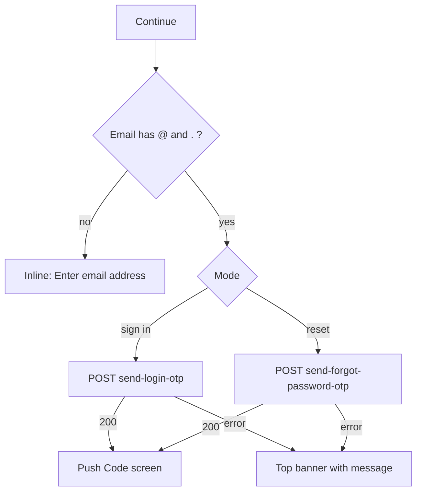

# Email input (sign in with email code / reset password)

| | |
|---|---|
| Area | 01 Launch, auth & shell |
| Who sees it | Both roles (unauthenticated), every tier |
| Reached from | Login → "Sign in with Email" (sign-in mode) or Login → "Forgot Password?" (reset mode) |
| Screen type | Full screen (pushed on top of Login) |
| Current Flutter source | `lib/features/auth/presentation/email_login/email_input_screen.dart`; `auth_controller.dart` (sendLoginOtp, sendForgotPasswordOtp) |
| Spec | `docs/kmp-spec/01-architecture-core-auth-shell.md` §2.2, §2.4; tickets AUTH-03, AUTH-04 |

## 1. Purpose
Collect the e-mail address to which a 6-digit code is sent. One widget, two modes that differ only in title and in which backend endpoint receives the address: passwordless sign-in, or the first step of resetting a forgotten password. Used rarely.

## 2. Entry points
- Login → "Sign in with Email": mode = sign in. Nothing pre-filled.
- Login → "Forgot Password?": mode = reset password. Nothing pre-filled (target: pre-fill with whatever the doctor typed in the Login identifier field if it contains "@").
- Back from the code screen (`04-email-otp-code.md`) returns here with the address still in the field.
- Pushed on top of Login; Login stays underneath.

## 3. Layout, top to bottom (phone portrait)
1. Transparent app bar with back arrow only (no language pill on this screen today – inconsistent with Login; target: keep the pill everywhere in the auth flow).
2. Title, 24 sp bold, left-aligned: "Sign in with Email" or "Reset Password" depending on mode.
3. Subtitle, grey 14 sp: "Enter your email address to receive a verification code."
4. Outlined text field: envelope prefix icon, hint "Email", e-mail keyboard, e-mail autofill hint, Done action submits.
5. Primary button "Continue" (full width, spinner while sending).
6. Content vertically centred, max width 520 dp, 24 dp padding; does not scroll today.

## 4. Data and formats
| Field | Source | Format rule |
|---|---|---|
| Email | user input | Trimmed and lower-cased before sending. Minimal check: contains "@" and ".". |
| Mode | navigation argument | Decides title and endpoint: `send-login-otp {email}` vs `send-forgot-password-otp {identifier, app:"doctor"}`. |
| Error text | backend `message`, else "Failed to send verification code" | Target: localised. |

## 5. Primary flow (happy path)
1. Doctor types the address, taps "Continue" (or keyboard Done).
2. Client validation (§9). Invalid → inline error, no request.
3. Button shows spinner; request sent.
4. 200 → the Code screen is pushed with the address and the mode (`04-email-otp-code.md`). This screen stays on the stack so back returns here.
5. Non-200 → banner with the backend message (today SnackBar).

## 6. Screen states
- First load (skeleton): n/a – static form.
- Empty: default state.
- Error on load: n/a.
- Offline: form usable; send fails → network banner. Target: offline banner shown proactively.
- Refreshing: n/a.
- Partial data: n/a.
- Permission needed: none.
- Locked by tier: n/a.
- Role difference: none. (Backend decides whether the address belongs to a doctor or staff account; the client cannot tell.)
- Sending: button spinner, field still editable (target: lock the field while sending to avoid sending to A and showing the code screen for B).

## 7. Interactions and secondary flows
- Keyboard Done → submit (ignored while sending).
- Back arrow / system back / iOS swipe → pop to Login; typed address is discarded (controller disposed). Target: keep it in flow state so returning from Login → same mode restores it.
- Tap outside field → keyboard dismiss (standard).
- Double tap Continue → second tap ignored.

## 8. Edge cases
- Address with uppercase letters → lower-cased silently; the Code screen shows the lower-cased form. Fine but mention in copy preview.
- Address with spaces inside ("a b@c.d") → passes the "@ and ." check and is rejected by the backend with its own message. Target: a proper email pattern check.
- Unknown e-mail → backend decides. UNVERIFIED whether it returns 200 (anti-enumeration) or 404 with a message; design both: success path shows the Code screen, error path shows the banner text verbatim.
- Rate limiting by the backend (too many sends) → message banner; the client has no cooldown on this screen (the 60 s cooldown lives on the Code screen).
- Slow network → spinner up to 30 s then timeout banner.
- Leaving mid-request → request completes in the background; no navigation happens on a disposed screen.
- Rotation → text kept; spinner state kept.
- 200 % font → title wraps to two lines; non-scrolling column may overflow with keyboard open – target scrolls.
- Language switch: no pill here today; if added, the title/subtitle re-render.
- Screen reader: title → subtitle → field → Continue.
- Deep link / push while open: a push tap replaces the whole stack with the shell only if a session exists – not the case here; the push is ignored (target: ignored, notification stays in the tray).
- Reset mode for a clinic-staff address: `app:"doctor"` is sent; UNVERIFIED whether staff can reset through this path.
- Autofill suggests an address with trailing whitespace → trimmed; fine.
- Doctor pastes the full "Name <mail@x.y>" from a mail client → fails the backend check; target pattern check rejects it inline before sending.
- Back-and-forth between sign-in mode and reset mode (Login → Email → back → Forgot) → two separate screens, two separate fields; the address is not shared. Target: shared flow state so it is pre-filled in both.
- Same address submitted twice quickly (double tap guarded) → one request; a second "Continue" after returning from the Code screen sends a second code and starts a second cooldown – acceptable, backend may rate-limit.
- Screen opened from a forced logout with a reason banner on Login → the banner belongs to Login and is not carried here.
- iOS: the e-mail keyboard has no Done key on some layouts – keep the primary button visible above the keyboard (scroll).
- Font scaling + Russian title "Вход по электронной почте" → 2 lines; subtitle 3 lines; the field must not jump when the inline error appears (reserve error space).

## 9. Validation and messages
| Field/action | Rule | When checked | Message (English) | Where shown |
|---|---|---|---|---|
| Email | not empty | on submit | "Enter email address" | inline |
| Email | contains "@" and "." (target: full pattern) | on submit | "Enter email address" (target **NEW** `invalidEmail` "Enter a valid email address") | inline |
| Continue | backend non-200 | after response | backend `message` or "Failed to send verification code" (**NEW** key `failedToSendCode`) | top banner |
| Continue | network / timeout | after response | "Network error. Please check your connection." / "Request timed out. Please try again." | top banner |

## 10. Navigation out
- → Code screen (push; this screen kept for back).
- ← Login (pop; address discarded today).
Nothing on Login needs refreshing.

## 11. Copy
`signInWithEmail` "Sign in with Email" · `resetPassword` "Reset Password" · `enterEmailForOtp` "Enter your email address to receive a verification code." · `email` "Email" · `enterEmail` "Enter email address" · `continue` "Continue" · `networkError` · `requestTimeout`
**NEW** `invalidEmail` "Enter a valid email address" · **NEW** `failedToSendCode` "Failed to send verification code"

## 12. Known problems in the current app (do not carry over)
- Error shown as bottom SnackBar with English fallback text.
- No language pill although Login and registration have one.
- Address discarded on back; the doctor retypes it after a typo on the Login screen.
- Email check is "@ and ." only.
- Field stays editable while the request is in flight.

## 13. Open questions for design
- Merge this screen into Login as a segmented "Email code" mode (one less screen)?
- Show a hint about where the code comes from ("Check spam") here or on the Code screen?
- In reset mode, should the identifier also accept a phone number (backend parameter is called `identifier`)? Today the field validates e-mail only.
