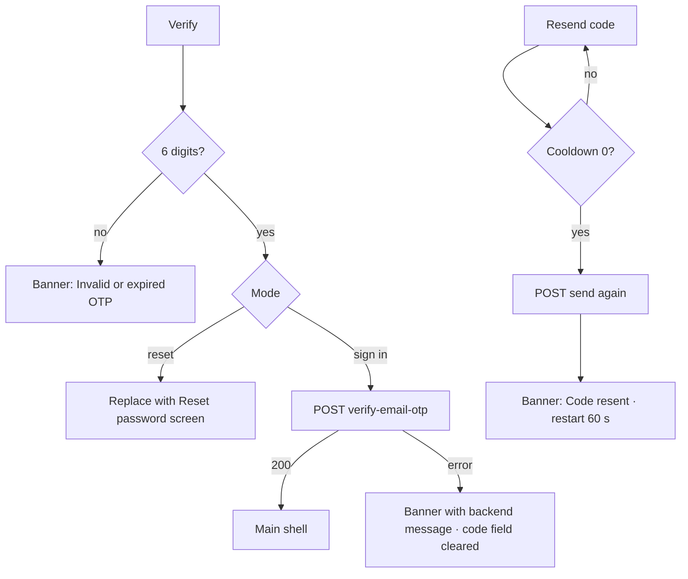

# Email code entry (6-digit OTP)

| | |
|---|---|
| Area | 01 Launch, auth & shell |
| Who sees it | Both roles (unauthenticated), every tier |
| Reached from | Email input (sign-in mode or reset mode) after the code was sent |
| Screen type | Full screen (pushed on top of Email input) |
| Current Flutter source | `lib/features/auth/presentation/email_login/email_otp_screen.dart`; `auth_controller.dart` (loginWithEmailOtp) |
| Spec | `docs/kmp-spec/01-architecture-core-auth-shell.md` §2.2, §2.4; tickets AUTH-03, AUTH-04 |

## 1. Purpose
Enter the 6-digit code received by e-mail. In sign-in mode a correct code logs the doctor in; in reset mode the code is only collected and carried to the new-password screen (it is verified there, together with the new password). Rare.

## 2. Entry points
- Email input → Continue (200). Arrives with: e-mail address (lower-cased) and mode.
- Pushed on top of Email input. In reset mode it is *replaced* by the Reset password screen on success (so back from Reset password returns to Email input, not here).

## 3. Layout, top to bottom (phone portrait)
1. Transparent app bar, back arrow only.
2. Title "Enter OTP" (24 sp bold).
3. Subtitle grey 14 sp: "A 6-digit code has been sent to {email}. Check your inbox."
4. Outlined text field: numeric keyboard, hint "000000", max 6 characters, no counter, Done submits. A single box today; design may use 6 separate cells (target: one-time-code autofill from mail/SMS keyboards).
5. Centred text button "Resend code" – during cooldown shows "Resend code (59 s)" counting down every second and is disabled.
6. Primary button "Verify" (full width, spinner while verifying).
7. Vertically centred, max width 520 dp, 24 dp padding, non-scrolling.

## 4. Data and formats
| Field | Source | Format rule |
|---|---|---|
| Email | previous screen | Shown verbatim inside the subtitle; long addresses wrap. |
| Code | user input | Non-digits stripped; must be exactly 6 digits. |
| Resend cooldown | local timer | 60 s, starts when the screen opens and again after every resend. Display "(N s)" today; target "Resend code in 0:59" (`resendCodeIn`) for consistency with the registration dialog. |
| Code expiry | backend | UNVERIFIED – no expiry countdown on the client; the backend message "Invalid or expired OTP." covers it. |
| Error text | backend `message`, else "Verification failed (code)" | Target: localised. |

## 5. Primary flow (happy path)
1. Screen opens with the cooldown already running (60 s).
2. Doctor types/pastes the code (digits only kept). Target: auto-submit when the 6th digit is entered.
3. Taps "Verify" → client check (6 digits) → spinner.
4. Sign-in mode: `POST verify-email-otp {email, code}` → 200 + token → session stored, profile fetched → main shell replaces the whole auth stack.
5. Reset mode: **no request**; the Reset password screen replaces this one, carrying e-mail + code (`05-reset-password.md`).

## 6. Screen states
- First load (skeleton): n/a – static.
- Empty: default (empty code, cooldown running).
- Error on load: n/a.
- Offline: verify/resend fail with network banner; cooldown keeps counting.
- Refreshing: n/a.
- Partial data: n/a.
- Permission needed: none.
- Locked by tier: n/a.
- Role difference: none.
- Verifying: button spinner; resend disabled; field editable (target: read-only during request).
- Cooldown: resend disabled with countdown; after 0 → enabled "Resend code".
- Resent confirmation: today a SnackBar "Code resent."; target a short success banner.

## 7. Interactions and secondary flows
- Typing → non-digits dropped; max 6. Target: auto-advance between cells and auto-submit at 6.
- Paste a 6-digit code → accepted; target: paste into cells distributes digits.
- Keyboard Done → Verify.
- "Resend code" (cooldown over) → spinner on the primary button today (shared loading flag – looks odd); request re-sent; on success "Code resent." and the cooldown restarts; on failure banner with message, cooldown **not** restarted.
- Back arrow / system back → pop to Email input (address still there). The cooldown is lost; reopening starts a fresh 60 s. Target: keep the cooldown per address in flow state so back-and-forth cannot bypass it.
- Wrong code → banner; field cleared? Today the field keeps the wrong code. Target: clear and focus.

## 8. Edge cases
- Backend code length ≠ 6 → UNVERIFIED; client hard-codes 6.
- Expired code → backend message "Invalid or expired OTP." (same key as the client-side length error) – acceptable.
- Multiple resends → each restarts 60 s; the backend may rate-limit; message shown verbatim.
- Mail delayed > 60 s → doctor resends; both codes may be valid – backend policy UNVERIFIED.
- Resend while verifying → blocked (shared loading flag).
- Rotation → code and cooldown kept (state survives) – fine.
- App backgrounded to read mail and resumed → cooldown timer continues (periodic timer keeps running); no re-check against wall clock – after a long background the countdown may lag; target: compute from a timestamp.
- Code arrives as a push/mail notification → tapping it leaves the app; on return the field is still there.
- 200 % font → subtitle with a long e-mail wraps to 3–4 lines; keep the field visible; scroll.
- Language switch: no pill here; if added, the countdown label re-renders.
- Screen reader: announce countdown changes politely, not every second (aria-live polite with throttling on Android TalkBack).
- Session: in sign-in mode a success logs in; if the app lock is enabled from a previous session on this device, the lock screen appears immediately after the shell (PIN from the previous user – see `12-app-lock-enter-pin.md` §8).
- Deep link while open → ignored (no session).
- Double tap Verify → ignored while loading.
- In reset mode the code is never checked here, so a wrong code is only discovered after the doctor has typed a new password twice (§12).

## 9. Validation and messages
| Field/action | Rule | When checked | Message (English) | Where shown |
|---|---|---|---|---|
| Code | exactly 6 digits | on Verify | "Invalid or expired OTP." | today SnackBar; target inline under field |
| Verify (sign in) | backend non-200 | after response | backend `message` or "Verification failed" (**NEW** `verificationFailed`) | top banner |
| Resend | cooldown must be 0 | on tap | – (button disabled, shows countdown) | button label |
| Resend | backend non-200 | after response | backend `message` or "Failed to send verification code" | top banner |
| Resend | success | after response | "Code resent." | success banner (today SnackBar) |

## 10. Navigation out
- → Main shell (sign-in mode): replaces the entire auth stack.
- → Reset password (reset mode): replaces this screen; e-mail + code carried forward.
- ← Email input: pop; code discarded.

## 11. Copy
`enterOtp` "Enter OTP" · `otpSentToEmail` "A 6-digit code has been sent to {email}. Check your inbox." · `resendCode` "Resend code" · `resendCodeIn` "Resend code in {{time}}" · `otpResent` "Code resent." · `verify` "Verify" · `invalidOtp` "Invalid or expired OTP."
**NEW** `verificationFailed` "Verification failed. Please try again."

## 12. Known problems in the current app (do not carry over)
- Two different countdown formats in the app ("(59 s)" here, "0:59" in the registration dialog).
- Resend shares the Verify button's spinner.
- Reset mode does not verify the code here; the doctor learns about a wrong code only after typing a new password twice. Target: either verify here (needs a backend endpoint – request it) or make the Reset password screen's error clearly say the code was wrong and offer "Back to code".
- Cooldown resets when the user goes back and forward.
- SnackBars for errors and the resent confirmation.
- No one-time-code autofill.

## 13. Open questions for design
- Six cells vs one field (cells are standard on mobile and enable autofill/paste UX).
- Show the remaining code validity (needs backend to return `expiresInSeconds`)?
- Offer "Change email" link that pops back, instead of relying on the back arrow?
