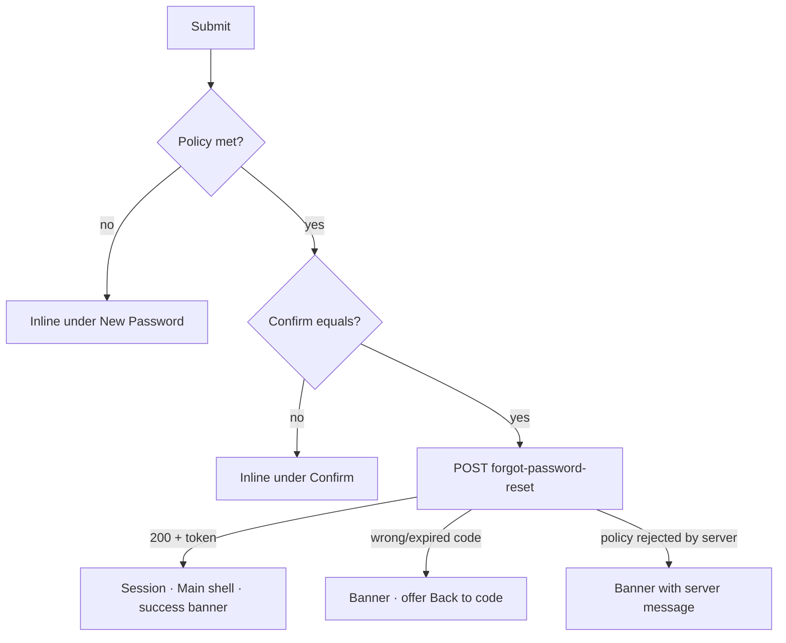

# Reset password (new password after email code)

| | |
|---|---|
| Area | 01 Launch, auth & shell |
| Who sees it | Both roles (unauthenticated), every tier |
| Reached from | Email code entry in reset mode (replaces it) |
| Screen type | Full screen |
| Current Flutter source | `lib/features/auth/presentation/email_login/email_reset_password_screen.dart`; `auth_controller.dart` (resetPasswordWithEmailOtp) |
| Spec | `docs/kmp-spec/01-architecture-core-auth-shell.md` §2.4; ticket AUTH-04 |

## 1. Purpose
Set a new password using the e-mailed code. Success both resets the password and logs the doctor in (the backend returns a session token), so the doctor lands in the app without typing the new password again. Rare.

## 2. Entry points
- Email code entry (reset mode) → Verify: arrives with e-mail (lower-cased) and the 6-digit code. Replaces the code screen; back goes to Email input.
- Not reachable any other way. (A legacy variant fed by Firebase phone verification exists in code and is unreachable – not designed.)

## 3. Layout, top to bottom (phone portrait)
1. Transparent app bar, back arrow only.
2. Title "Reset Password" (24 sp bold).
3. Helper text, grey 12 sp: today it reuses the *error* string "Password must be at least 8 characters with 1 uppercase and 1 number." as a hint. Target: a live requirements checklist identical to registration (8–128 chars, upper, lower, digit, special) – see `07-create-account-step1.md` §3.
4. Outlined field "New Password" with eye toggle; Next action.
5. Outlined field "Confirm password" with its own eye toggle; Done submits.
6. Primary button "Submit" (full width, spinner).
7. Vertically centred, non-scrolling, max width 520 dp.

## 4. Data and formats
| Field | Source | Format rule |
|---|---|---|
| Email, code | previous screen | Not displayed today. Target: show the e-mail in a subtitle so the doctor knows which account is being reset. |
| New password | user input | Today: ≥ 8, one uppercase, one digit (weaker than registration). **Target: the full policy** (8–128, upper, lower, digit, special). Sent verbatim (not trimmed) – good. |
| Confirm | user input | Must equal new password exactly. |
| Error text | backend `message` or "Reset password failed (code)" | Target: localised. |

## 5. Primary flow (happy path)
1. Doctor types the new password; the checklist (target) ticks requirements live.
2. Types confirmation; taps "Submit" (or keyboard Done).
3. Client checks (§9) → spinner.
4. `POST forgot-password-reset {email, emailOtp, app:"doctor", newPassword}` → 200 + token.
5. Session stored, profile fetched, success message "Password updated successfully" (today SnackBar shown a frame before navigation – effectively invisible). Target: success banner shown **in the shell** after landing, or a brief full-screen success state with "Continue".
6. Main shell replaces the entire auth stack.

## 6. Screen states
- First load (skeleton): n/a.
- Empty: default.
- Error on load: n/a.
- Offline: submit fails → network banner; typed passwords stay.
- Refreshing: n/a.
- Partial data: n/a.
- Permission needed: none.
- Locked by tier: n/a.
- Role difference: none (staff accounts UNVERIFIED on this endpoint with `app:"doctor"`).
- Submitting: spinner, fields locked (target).
- Success (target): either a transient banner in the shell or a dedicated frame "Password updated" → "Continue".

## 7. Interactions and secondary flows
- Eye icons → toggle each field independently.
- Keyboard Next → Confirm; Done → Submit.
- Back arrow / system back → pops to Email input (the code screen was replaced). Typed passwords are discarded. Target: ask "Discard new password?" only if something was typed – or simply discard (low cost); recommended: discard without prompt.
- Double tap Submit → ignored while loading.

## 8. Edge cases
- Wrong or expired code → only discovered now; the banner must say so and give a way back to the code screen (today: back pops to Email input and the doctor must request a new code – acceptable but explain it).
- New password equals old password → backend policy UNVERIFIED; show server message.
- Password of 129+ characters → today accepted client-side, rejected by the server; target client check.
- Leading/trailing spaces → kept (not trimmed) – consistent with target login behaviour.
- Mismatch → today shown twice: inline under Confirm *and* as a SnackBar. Target: inline only.
- Rotation → fields kept.
- 200 % font → helper text / checklist wraps; scroll.
- Password managers → set autofill hint `newPassword` so they offer to save the new credential.
- Slow network → spinner up to 30 s; timeout banner; no cancel.
- Session: after success the app lock may already be enabled on this device (previous user) → lock screen appears; see `12-app-lock-enter-pin.md` §8.
- Screen reader: title → (email subtitle) → checklist (live region) → New password → eye → Confirm → eye → Submit.
- Deep link while open → ignored (no session).
- Language switch → no pill; if added, the checklist re-renders.
- Doctor backgrounds the app to read the code mail *after* reaching this screen (code already typed on the previous screen) → nothing changes; on return the fields are intact (state kept). App lock cannot trigger (no session yet).
- Doctor submits, the reset succeeds server-side, but the response is lost (timeout) → the next tap "Submit" fails with "code already used"; the doctor must sign in with the new password from Login. Target banner text should hint: "If you already changed it, sign in with your new password."
- Caps-lock / predictive text may alter the password on some keyboards – the eye toggle is the mitigation; keep it.
- Reset for an account with 2FA enabled (settings `twoFA`) → UNVERIFIED whether the backend requires extra steps; today nothing in the client.

## 9. Validation and messages
| Field/action | Rule | When checked | Message (English) | Where shown |
|---|---|---|---|---|
| New password | today: ≥ 8, 1 uppercase, 1 digit; target: 8–128, upper, lower, digit, special | on submit (target: live checklist + on submit) | today "Password must be at least 8 characters with 1 uppercase and 1 number."; target first failing rule: "Password must be at least 8 characters" / "One uppercase letter" / "One lowercase letter" / "One number" / "One special character (!@#$%^&* etc.)" / "Password must be at most 128 characters" | inline |
| Confirm | not empty | on submit | "Confirm password" (today reuses the label – target "Please confirm your password") | inline |
| Confirm | equals new password | on submit | "Passwords do not match." | inline (today also SnackBar) |
| Submit | backend non-200 | after response | backend `message` or "Reset password failed" (**NEW** `resetPasswordFailed`) | top banner |
| Submit | success | after response | "Password updated successfully" | success banner in shell (target) |

## 10. Navigation out
- → Main shell: replaces everything; the doctor is logged in with the new password.
- ← Email input: pop (code screen was replaced); passwords discarded.

## 11. Copy
`resetPassword` "Reset Password" · `newPassword` "New Password" · `confirmPassword` "Confirm password" · `submit` "Submit" · `passwordMismatch` "Passwords do not match." · `passwordUpdatedSuccessfully` "Password updated successfully" · `passwordTooWeak` (legacy helper) · `passwordRequirementMinLength` "At least 8 characters" · `passwordRequirementUppercase` "One uppercase letter" · `passwordRequirementLowercase` "One lowercase letter" · `passwordRequirementDigit` "One number" · `passwordRequirementSpecialChar` "One special character (!@#$%^&* etc.)" · `passwordRequirementMaxLength` "At most 128 characters" · `passwordTooShort` · `passwordTooLong` · `pleaseConfirmPassword` "Please confirm your password"
**NEW** `resetPasswordFailed` "Could not reset the password. Please try again." · **NEW** `wrongOrExpiredCodeBackToCode` "The code is wrong or has expired. Request a new code."

## 12. Known problems in the current app (do not carry over)
- Weaker password rule than registration (no lowercase/special requirement) – the server may reject what the client accepted.
- Error string used as helper text.
- Success SnackBar fires a frame before navigation and is never seen.
- Mismatch error duplicated (inline + SnackBar).
- The e-mail being reset is not shown.
- No autofill hints.

## 13. Open questions for design
- Dedicated success frame vs banner in the shell after auto-login?
- Should "Back to code" be an explicit link on the error banner?
- Show/hide both fields with a single toggle (iOS pattern) vs per-field eye icons?
