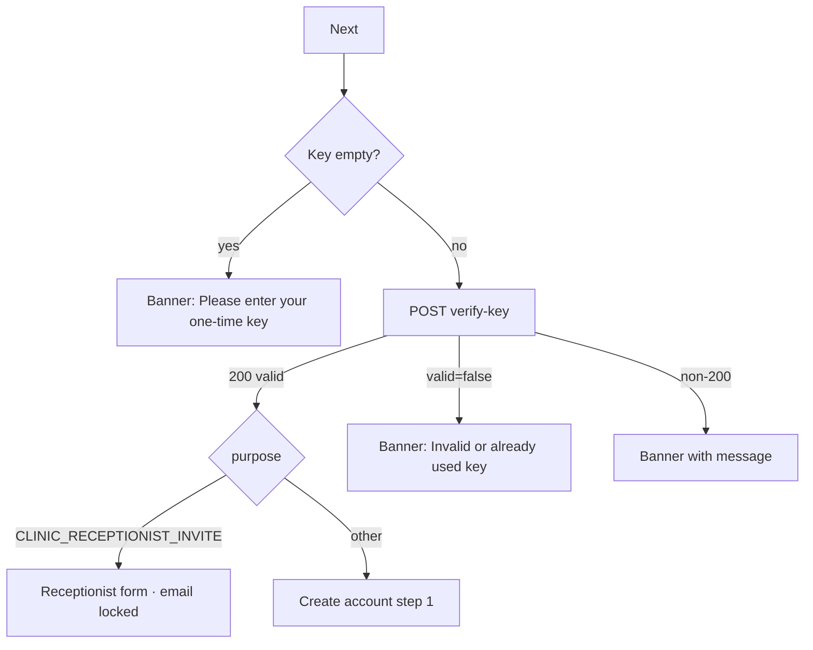

# Verify invitation key

| | |
|---|---|
| Area | 01 Launch, auth & shell |
| Who sees it | Prospective doctors and clinic receptionists (unauthenticated) |
| Reached from | Login → "Create account"; also the guard target when a registration step finds no key |
| Screen type | Full screen (pushed on top of Login) |
| Current Flutter source | `lib/features/auth/presentation/verify_key_screen.dart`; `lib/state/auth/registration_state.dart` (verifyKey) |
| Spec | `docs/kmp-spec/01-architecture-core-auth-shell.md` §2.5; ticket AUTH-05 |

## 1. Purpose
Registration is invitation-only. The user pastes the one-time key they received (by e-mail from Shifa, or from a clinic that invited a receptionist). A valid key unlocks the right registration form: doctor (2 steps) or clinic receptionist (1 step, e-mail locked). Once per user.

## 2. Entry points
- Login → "Create account" (push).
- Create account step 1 / Receptionist form → "Next"/"Create account" when the in-memory key is missing (e.g. after process restart): a banner "Please verify your invitation key first." and this screen is pushed. Target: the registration flow should be unreachable without a key, so this guard disappears.
- Target: deep link from the invitation e-mail (`shifa://invite?key=…`) opens this screen with the key pre-filled and auto-verifies. UNVERIFIED – no deep-link scheme exists today.
- Nothing arrives today.

## 3. Layout, top to bottom (phone portrait)
1. Transparent app bar: back arrow (left), centred title "Verify", language pill (right).
2. Centred Shifa logo 120 × 120 dp.
3. Single text field, hint "One-time key" (plain keyboard, Done submits). No helper text, no paste button.
4. Primary button "Next" (full width, spinner while verifying).
5. Column vertically centred, max 520 dp, 24 dp padding; no scroll.

Target: a one-line explanation above the field ("Enter the invitation key from your e-mail") and a "Paste" affordance.

## 4. Data and formats
| Field | Source | Format rule |
|---|---|---|
| Key | user input | Trimmed; any characters; length/format UNVERIFIED (backend decides). |
| Verify response | `POST /api/auth/verify-key` | `valid` (bool), `purpose` (e.g. `CLINIC_RECEPTIONIST_INVITE`), `clinicId`, `clinicName`, `emailSentTo`. |
| Error text | backend `message`, else "Request failed (code)"; `valid=false` → "Invalid or already used key" (English literal) | Target: localised key `invalidInviteKey`. |

## 5. Primary flow (happy path)
1. User pastes/types the key, taps "Next".
2. Empty → banner "Please enter your one-time key." (no request).
3. Spinner; request.
4. 200 and `valid=true` → key, purpose, clinic and target e-mail are kept in registration state (today also persisted to device prefs – target: memory only).
5. Purpose = receptionist invite → **replace** this screen with the Receptionist form (`10-receptionist-create-account.md`); otherwise replace with Create account step 1 (`07-create-account-step1.md`). Back from those forms returns to Login, not here.

## 6. Screen states
- First load (skeleton): n/a – static.
- Empty: default (empty field).
- Error on load: n/a.
- Offline: verify fails → network banner; key stays in the field.
- Refreshing: n/a.
- Partial data: n/a.
- Permission needed: none (clipboard read on iOS shows the system paste notice – acceptable).
- Locked by tier: n/a.
- Role difference: the response decides the role of the account being created; the screen looks the same.
- Verifying: spinner; field editable (target: read-only).

## 7. Interactions and secondary flows
- Keyboard Done → Next.
- Back arrow (uses "maybe pop") / system back → Login; key discarded.
- Language pill → switch language in place.
- Double tap Next → ignored while loading.
- Long-press field → paste.

## 8. Edge cases
- Key with surrounding whitespace or line breaks from an e-mail copy → trimmed; internal spaces kept (backend decides).
- Already used key → `valid=false` → "Invalid or already used key". The same message covers typos; design one neutral error.
- Key valid but the doctor abandons the flow and returns later: today the key is stored in prefs but never restored (the restore function is never called), so they must re-enter it; a second verify of an unused key is fine, of a used key fails. Target: memory only + clear message.
- Process killed between Verify and Create account → on return there is no key; the Create-account guard pushes this screen again. Target: the flow restarts at Login anyway.
- Receptionist invite without `emailSentTo` → the receptionist form shows "—" instead of an e-mail and submit fails with "Enter email address". Backend contract issue; UNVERIFIED frequency. Design the locked e-mail block for an empty state anyway.
- Very long key → single-line field scrolls; fine.
- Slow network → spinner up to 30 s then timeout banner.
- Rotation → key kept.
- 200 % font → logo 120 dp plus field plus button fit on most phones; the title "Verify" in the app bar may truncate in Russian ("Подтвердить") – allow 2 lines or shrink.
- Language switch while an error banner is shown → re-render from key.
- Screen reader: title → logo (decorative) → field → Next.
- Deep link while open → ignored (no session).
- Session expiry: n/a.
- Double verification of the same key in two tabs/devices → second one fails; message as above.
- Key for a *different* clinic/purpose than expected (e.g. a doctor key pasted by a receptionist) → the form that opens is decided by the backend purpose; the user may be surprised – the invited-clinic confirmation (see §13) mitigates.
- Backend down (5xx) → "Request failed" banner; retry by tapping Next again (key kept).
- Keyboard autocorrect capitalises or "fixes" the key → disable autocorrect and suggestions on this field (target).
- User pastes a URL from the e-mail instead of the key → fails; if the e-mail contains a deep link the URL should open the app directly (target).

## 9. Validation and messages
| Field/action | Rule | When checked | Message (English) | Where shown |
|---|---|---|---|---|
| Key | not empty after trim | on Next | "Please enter your one-time key." | today SnackBar; target inline |
| Next | `valid=false` | after response | "Invalid or already used key" (**NEW** key `invalidInviteKey`) | top banner |
| Next | non-200 | after response | backend `message` or "Request failed" (**NEW** `requestFailed`) | top banner |
| Next | network / timeout | after response | `networkError` / `requestTimeout` | top banner |

## 10. Navigation out
- → Create account step 1 or Receptionist form: **replaces** this screen; key and invite data carried in flow state.
- ← Login: pop; key discarded.

## 11. Copy
`verify` "Verify" · `oneTimeKey` "One-time key" · `pleaseEnterOneTimeKey` "Please enter your one-time key." · `next` "Next" · `networkError` · `requestTimeout`
**NEW** `inviteKeyHint` "Enter the invitation key from your e-mail." · **NEW** `invalidInviteKey` "This key is invalid or has already been used." · **NEW** `requestFailed` "Request failed. Please try again." · **NEW** `paste` "Paste"

## 12. Known problems in the current app (do not carry over)
- "Invalid or already used key" and "Request failed (n)" are English literals.
- Key persisted to device preferences for no benefit (never read back).
- No explanation of what a one-time key is or where it comes from.
- SnackBar errors.
- The guard from later steps can push this screen *on top* of a half-filled registration form, creating a confusing stack (Login → Create account → Verify).

## 13. Open questions for design
- Should the key field be segmented (if the backend uses fixed-length codes)? Needs the key format from backend.
- Deep link from the invitation e-mail – worth asking backend for a URL scheme now, it removes this screen for most users.
- Show the invited clinic's name as confirmation before moving on (data is in the response) – a short "You've been invited by {clinic}" interstitial or a banner on the next screen?
