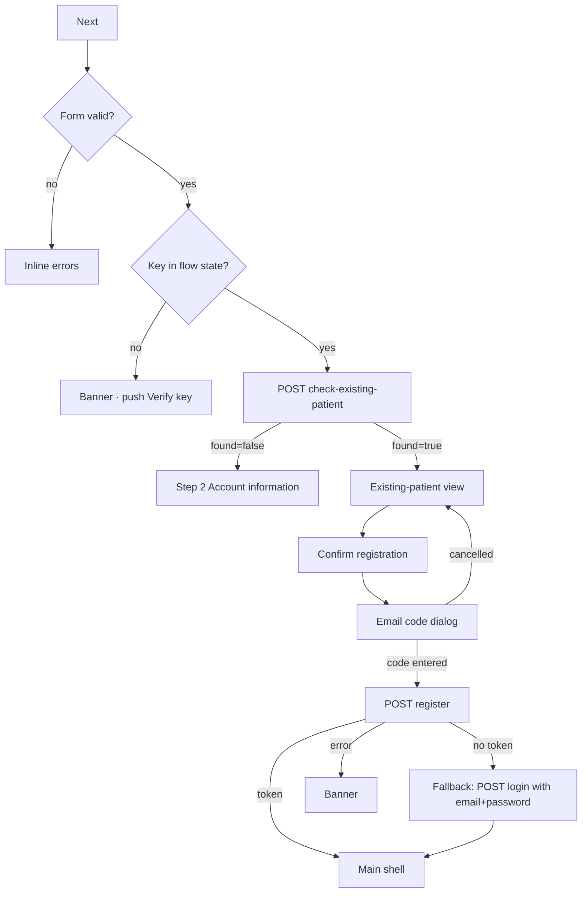

# Create account – step 1 (identity, password) incl. existing-patient confirmation

| | |
|---|---|
| Area | 01 Launch, auth & shell |
| Who sees it | Prospective doctors (unauthenticated) |
| Reached from | Verify invitation key (doctor purpose) |
| Screen type | Full screen; contains a second full-screen variant ("existing patient" confirmation) |
| Current Flutter source | `lib/features/auth/presentation/create_account/create_account_screen.dart`; `lib/state/auth/registration_state.dart`; `lib/core/utils/password_validation.dart` |
| Spec | `docs/kmp-spec/01-architecture-core-auth-shell.md` §2.6; ticket AUTH-06 |

## 1. Purpose
Collect the mandatory identity fields and the password for a new doctor account. Before moving on, the app asks the backend whether a *patient* with the same name/e-mail/phone already exists in Shifa; if so, the doctor account is created on top of that patient identity through a shortened confirmation view instead of step 2. Once per user.

## 2. Entry points
- Verify key → valid doctor key (replaces Verify key; back goes to Login).
- Back from step 2 (Account information) returns here with all fields intact.
- Context: the verified key (shown as a "Key verified" chip).

## 3. Layout, top to bottom (phone portrait)
### 3a. Form view (default)
1. Transparent app bar: back arrow, language pill.
2. Title "Create account" (32 sp bold, centred).
3. Chip "✓ Key verified" (teal outline, light teal fill) – only when a key is present.
4. Fields (16 dp apart, hints as labels, 2 lines of error space each):
   - First name (required)
   - Last name (required)
   - Email (required, e-mail keyboard)
   - Phone Number (Optional) (phone keyboard)
   - Password (obscured, eye toggle)
   - **Live checklist** (appears once the password field is non-empty): 6 rows with a check/cross icon and 12 sp text – "At least 8 characters", "One uppercase letter", "One lowercase letter", "One number", "One special character (!@#$%^&* etc.)", "At most 128 characters". Teal when satisfied, grey otherwise.
   - Confirm password (obscured, eye toggle, Done submits)
5. Progress dots: today **3** dots (1 active). Target: **2** (the third "schedule" step is dead).
6. Primary button "Next" (full width; spinner while checking for an existing patient).
7. Whole body scrolls.

### 3b. Existing-patient confirmation view (same route, swapped in place)
1. Transparent app bar: back arrow (returns to 3a, disabled while submitting), language pill.
2. Title "Create account".
3. Avatar 96 dp: patient photo from the backend, else grey person icon.
4. Info card (teal border, light teal fill): "There is already a patient with this information. We are creating a doctor account for this patient."
5. Practice timezone: small spinner while detecting (device timezone), then a searchable dropdown pre-filled with the detected IANA zone (fallback "UTC").
6. Password field (eye toggle) – **pre-filled** with what was typed in 3a (same controller).
7. Confirm password – pre-filled likewise.
8. Primary button "Confirm registration" (spinner while submitting).
9. Scrollable.

## 4. Data and formats
| Field | Source | Format rule |
|---|---|---|
| First/last name | input | Trimmed; no length limit client-side. |
| Email | input | Trimmed; check "@ and ."; sent verbatim (not lower-cased here, unlike the e-mail login). |
| Phone | input | Optional. If non-empty: digits count ≥ 10 else error. Sent raw (with "+", spaces) only when it has ≥ 10 digits; otherwise silently dropped from the payload. Target: E.164 normalisation. |
| Password | input | Policy 8–128, upper, lower, digit, special. **Trimmed** before storing (bug; target verbatim). |
| Existing-patient check | `POST check-existing-patient {firstName,lastName,email,phone?}` | `found`, `fullName`, `photoUrl`, `email`. Non-200 is treated as "not found". |
| Timezone (3b) | device, via platform API | IANA id; "UTC" fallback. List for the dropdown: ~47 common zones plus the detected one. |
| Registration call (3b only) | `POST /api/auth/register {firstName,lastName,email,password,key,phone?,timeZone?}` | 200/201 + token logs in directly. |

## 5. Primary flow (happy path)
1. Doctor fills the form; the checklist updates per keystroke.
2. Taps "Next" → client validation (§9).
3. Spinner; existing-patient check.
4. `found=false` → data stored in flow state → step 2 pushed (`08-account-information-step2.md`).
5. `found=true` → view 3b replaces the form in place; timezone detection starts.
6. In 3b: doctor confirms/edits timezone, confirms password, taps "Confirm registration".
7. E-mail verification dialog opens (`09-registration-email-otp-dialog.md`); on confirm the account is registered, the session is stored, (today) extras are PATCHed, and the main shell replaces the whole stack.

## 6. Screen states
- First load (skeleton): n/a – static form. In 3b the timezone row shows a small spinner until detection returns (target: a skeleton line in the dropdown, ~100 ms).
- Empty: default form.
- Error on load: n/a.
- Offline: "Next" fails → the check is treated as "not found"?? No – a network exception surfaces as a banner with the raw error. Target: network banner, stay on form.
- Refreshing: n/a.
- Partial data: existing-patient response without `photoUrl` → icon avatar; without `fullName` → the typed names are used (today the typed names are always used).
- Permission needed: none.
- Locked by tier: n/a.
- Role difference: n/a (doctor flow only).
- Checking: spinner on Next; fields editable.
- Submitting (3b): spinner on Confirm; back arrow disabled.

## 7. Interactions and secondary flows
- Eye toggles per password field.
- Keyboard Next moves down the fields; Done on Confirm password submits.
- Back arrow (3a) / system back → Login (Verify key was replaced). All input lost. Target: confirm "Discard registration?" when any field is non-empty.
- Back arrow (3b) → returns to 3a with all fields intact; the existing-patient result is forgotten (tapping Next re-checks).
- Language pill → re-render; checklist labels re-render.
- Timezone dropdown (3b) → search dialog (list of zones, text filter); selecting closes and shows the zone id.
- Double tap Next/Confirm → ignored while loading.

## 8. Edge cases
- Names with apostrophes/hyphens/Cyrillic → accepted; shown verbatim later in the shell.
- Very long names (50+ chars) → fields scroll; the avatar view does not show names at all.
- Email already registered as a *doctor* → the existing-patient check returns `found=false` (UNVERIFIED) and the failure comes later from `register` with a backend message on step 2 – the doctor has filled two screens for nothing. Target: ask backend to reject duplicate doctor e-mails in `check-existing-patient` (or a dedicated check) so the error shows on this screen under the Email field.
- Phone with 9 digits → inline "Please enter a valid phone number"; phone with 10+ digits but letters → digits counted only; sent raw.
- Password 129 chars → inline "Password must be at most 128 characters"; the checklist's last row turns grey.
- Password and confirm differ only by trailing space → today both are trimmed so they "match" and a trimmed password is registered; target: compare and send verbatim.
- Check-existing endpoint returns 500 → treated as not found → flow continues to step 2 (silent). Acceptable fallback; keep.
- `found=true` but the doctor wants a *separate* account → no way out except back; target: a secondary action "This is not me" that proceeds to step 2 anyway (needs product decision – the backend may still merge).
- Timezone detection fails (3b) → "UTC" pre-selected; a doctor who does not notice gets UTC schedules. Target: never silently default to UTC – highlight the row and require confirmation when detection failed.
- Dialog cancelled (3b) → stays on 3b with everything intact.
- `register` returns 200 without a token → the app falls back to a password login with the typed credentials (legacy backend); if that fails the error banner shows. Keep as hidden fallback.
- Session: after success, app lock from a previous user on this device may appear (`12-app-lock-enter-pin.md` §8).
- Rotation → all fields and the view mode kept.
- 200 % font → checklist rows wrap (text is 12 sp; allow 2 lines, icon top-aligned); progress dots and button stay below the fold – the body scrolls.
- Screen reader: checklist is a live region announcing "satisfied / not satisfied" per rule on change (throttle); the "Key verified" chip is read once.
- Leaving mid-submit (3b) → back disabled; system back on Android is not blocked today – target: block during submit.
- Deep link while open → ignored (no session).
- Process death → registration state lost; restarts from Login.

## 9. Validation and messages
| Field/action | Rule | When checked | Message (English) | Where shown |
|---|---|---|---|---|
| First name | not empty | on Next | "Enter first name" | inline |
| Last name | not empty | on Next | "Enter last name" | inline |
| Email | not empty; contains "@" and "." | on Next | "Enter email address" | inline |
| Phone | empty, or ≥ 10 digits | on Next | "Please enter a valid phone number" | inline |
| Password | not empty | on Next | "Password is required" | inline |
| Password | 8–128, upper, lower, digit, special | live checklist + on Next | first failing: "Password must be at least 8 characters" / "Password must be at most 128 characters" / "One uppercase letter" / "One lowercase letter" / "One number" / "One special character (!@#$%^&* etc.)" | inline + checklist |
| Confirm password | not empty | on Next | "Please confirm your password" | inline |
| Confirm password | equals password | on Next | "Passwords do not match" | inline |
| Next | no key in flow state | on Next | "Please verify your invitation key first." | banner, then Verify key pushed |
| Next | check call throws (network) | after response | today raw exception text; target `networkError` | top banner |
| Confirm registration (3b) | email must contain "@" | on tap | "Enter email address" | banner |
| Confirm registration | register non-200 | after response | backend `message` or "Request failed (code)" | top banner |
| Confirm registration | missing required flow fields | before request | "Please provide: first name, …" (English literal – target never happens) | top banner |

## 10. Navigation out
- → Step 2: push; this screen kept with its fields.
- → Main shell (from 3b): replaces everything.
- ← Login: pop; all input discarded (target: confirm when dirty).
- → Verify key (guard): push; target removed.

## 11. Copy
`createAccount` "Create account" · `keyVerified` "Key verified" · `firstName` "First name" · `lastName` "Last name" · `email` "Email" · `phoneNumber` "Phone Number" · `optional` "Optional" · `password` "Password" · `confirmPassword` "Confirm password" · `next` "Next" · `enterFirstName` "Enter first name" · `enterLastName` "Enter last name" · `enterEmail` "Enter email address" · `invalidPhone` "Please enter a valid phone number" · `passwordRequired` "Password is required" · `passwordRequirementMinLength` · `passwordRequirementUppercase` · `passwordRequirementLowercase` · `passwordRequirementDigit` · `passwordRequirementSpecialChar` · `passwordRequirementMaxLength` · `passwordTooShort` · `passwordTooLong` · `pleaseConfirmPassword` "Please confirm your password" · `passwordsDoNotMatch` "Passwords do not match" · `pleaseVerifyInvitationKeyFirst` "Please verify your invitation key first." · `existingPatientCreatingDoctorAccount` "There is already a patient with this information. We are creating a doctor account for this patient." · `practiceTimezone` "Practice timezone" · `practiceTimezonePlaceholder` "Practice timezone (e.g. Europe/Berlin)" · `confirmRegistration` "Confirm registration" · `detecting` "Detecting…"
**NEW** `discardRegistrationTitle` "Discard registration?" · **NEW** `discardRegistrationBody` "Your entries will be lost." · **NEW** `notMe` "This is not me" · **NEW** `timezoneDetectionFailed` "We could not detect your timezone. Please choose it."

## 12. Known problems in the current app (do not carry over)
- Three progress dots for a two-step flow.
- Passwords trimmed; plaintext password kept in process memory after registration.
- Raw exception text in SnackBars (e.g. "Exception: Please provide: verification key.").
- Email not lower-cased here but lower-cased in the e-mail login – inconsistent identifiers.
- Duplicate doctor e-mail only detected two screens later.
- Guard pushes Verify key on top of the form instead of restarting cleanly.
- Timezone falls back to UTC silently.
- Avatar in 3b loads with an uncached network image.

## 13. Open questions for design
- Split step 1 into "Who are you" (names, e-mail, phone) and "Password" to shorten the scroll on phones?
- Show the checklist always (greyed) or only after typing starts (today)?
- 3b: is the existing-patient case common enough to deserve its own illustration, or is a simple card enough?
- Should the practice timezone be asked already in step 1 for both branches (today it is on step 2 for new users, on 3b for existing patients)?
