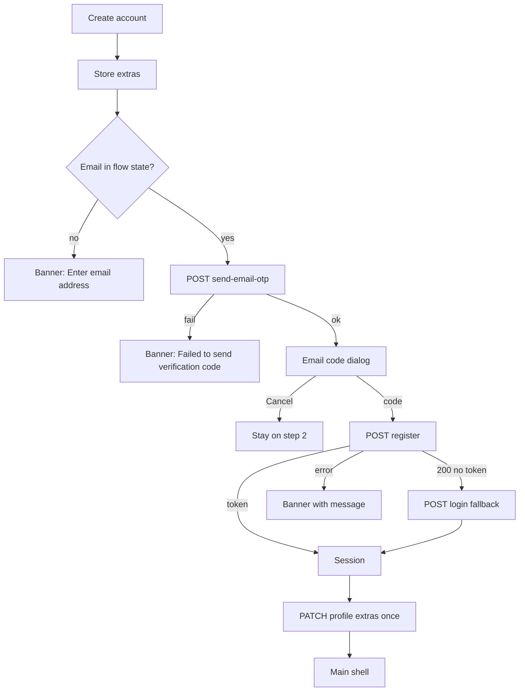

# Create account – step 2 (account information)

| | |
|---|---|
| Area | 01 Launch, auth & shell |
| Who sees it | Prospective doctors (unauthenticated) – only when no existing patient matched in step 1 |
| Reached from | Create account step 1 → Next (`found=false`) |
| Screen type | Full screen (pushed on top of step 1) |
| Current Flutter source | `lib/features/auth/presentation/create_account/account_information_screen.dart`; `registration_state.dart` (setAccountInfo, submitRegistration, applyOptionalProfileExtrasAfterLogin); `searchable_clinic_dropdown.dart`; `features/profile/presentation/searchable_profession_dropdown.dart`, `searchable_timezone_dropdown.dart` |
| Spec | `docs/kmp-spec/01-architecture-core-auth-shell.md` §2.6; ticket AUTH-07 |

## 1. Purpose
Optional profile details (birth date, gender, address, clinic, professions) plus the one important field, the **practice timezone**, which every schedule and appointment time in the app depends on. Ends with e-mail verification and account creation. Once per user.

## 2. Entry points
- Step 1 → Next (push). Context: names, e-mail, phone, password already in flow state.
- Back from here returns to step 1 with its fields intact; this screen's own entries are lost today (target: keep in flow state).

## 3. Layout, top to bottom (phone portrait)
1. Transparent app bar: back arrow, language pill.
2. Title "Account Information" (32 sp bold, centred).
3. Fields, 16 dp apart, all optional except timezone (which always has a value):
   - Date of Birth – read-only field with calendar icon; tap opens the platform date picker (range 1900 – today, initial = 25 years ago). Shows `YYYY-MM-DD` once chosen. Target: show in the app language's date format, send ISO.
   - Gender – dropdown: Male / Female / Other.
   - Address – free text, single line.
   - Clinic – searchable dropdown: tap opens a dialog with a search field; local filtering of the loaded list, then a remote search `GET /api/public/clinics?search=` as you type; single select; shows the clinic name.
   - Profession – searchable **multi**-select dropdown: dialog with search ("Search profession..."), list from `GET /api/public/professions` (fallback ~150 built-in entries), checkboxes; selected items shown as chips inside the field; stored joined with ", ".
   - Practice timezone – while detecting: outlined box labelled "Practice timezone" with text "Detecting…" and a small spinner; then a searchable dropdown pre-filled with the detected IANA zone (fallback "UTC").
4. Progress dots: today 3 (2nd active). Target 2 (2nd active).
5. Primary button "Create account" (full width; spinner while submitting).
6. Scrollable body.

## 4. Data and formats
| Field | Source | Format rule |
|---|---|---|
| Date of birth | picker | Sent as `YYYY-MM-DD`; today displayed in the same ISO form. Picker locale = app language (script stripped for Uzbek Cyrillic). |
| Gender | dropdown | Backend values `Male` / `Female` / `Other` (English), labels localised. |
| Address | input | Trimmed; empty omitted. |
| Clinic | dialog | `clinicId` (int) preferred; falls back to the free-text name if no id. |
| Professions | dialog | Multi; joined with ", " into one string. |
| Timezone | detected / chosen | IANA id; "UTC" fallback. Sent **twice**: in `register` and again in the extras PATCH. |
| Extras | flow state | After login: `PATCH /api/doctors/me/profile {dob, gender, address, clinicId|clinic, profession, timeZone}` – only non-empty keys. Today never cleared (bug). |

## 5. Primary flow (happy path)
1. Screen opens; timezone detection runs (< 1 s) and fills the dropdown.
2. Doctor fills what they want; taps "Create account".
3. Extras are stored in flow state; spinner.
4. E-mail verification dialog (`09-registration-email-otp-dialog.md`) – sends the code first, then opens. Cancel → back to this screen, spinner stops.
5. Code entered → `POST /api/auth/register` → 200/201 + token → session stored (fallback: password login).
6. Extras PATCHed once. Target: clear them afterwards.
7. Main shell replaces the whole auth stack. A new doctor lands on Home with an empty schedule; Profile and Schedule setup are the natural next steps (areas 08 / 04).

## 6. Screen states
- First load (skeleton): timezone row shows "Detecting…" + spinner (target: skeleton line inside the field for the ~100–500 ms detection). Other fields static.
- Empty: default – every field empty except timezone.
- Error on load: clinic/profession lists fail silently → clinic dialog shows an empty list (no error, no retry); professions fall back to the built-in list. Target: inline "Couldn't load – Retry" inside the dialog.
- Offline: fields work; clinic search returns nothing; submit fails at the send-code step with a network banner.
- Refreshing: n/a.
- Partial data: detection fails → "UTC". Target: highlighted, must be confirmed.
- Permission needed: none.
- Locked by tier: n/a.
- Role difference: n/a.
- Submitting: spinner on the button, dialog on top.

## 7. Interactions and secondary flows
- Tap Date of Birth → platform date picker; Cancel keeps the previous value.
- Gender dropdown → standard menu.
- Tap Clinic → full dialog: search field (hint "Search"), list; typing filters locally and queries the backend; tap selects and closes; today there is no "None/clear" option (target: add).
- Tap Profession → dialog with search and checkboxes; "Done" closes; chips show selections; removing a chip = reopening the dialog today (target: chip delete icon).
- Tap Practice timezone → dialog with search over ~47 zones (+ detected); select closes.
- Back arrow / system back → step 1 (fields there intact); entries here lost today – target kept.
- Language pill → re-render; picker locale follows.
- Double tap Create account → ignored while loading.

## 8. Edge cases
- Detection returns a zone not in the common list (e.g. `Asia/Samarkand`) → it is inserted at the top of the dropdown list; fine.
- Doctor changes timezone to a wrong one → nothing warns; later Calendar shows a "device differs from practice zone" hint (area 04). Acceptable.
- Birth date today or in the future → picker prevents future; today allowed (accepted).
- Many professions selected (5+) → chips wrap to several rows inside the field; the field grows; keep the label visible.
- Very long clinic names → ellipsis in the field, full in the dialog list.
- Clinic search with 1 character → remote query per keystroke (no debounce). Target: 300 ms debounce, min 2 chars.
- 0 clinics returned → empty list with no message. Target: "No results".
- 100+ clinics → dialog list scrolls; fine.
- Register fails because e-mail already exists (doctor) → banner with backend message after the dialog; the doctor is stuck on step 2 with a dead e-mail. Target: link "Change e-mail" back to step 1 (see 07 §8).
- Register succeeds but extras PATCH fails (e.g. 500) → today the error banner shows *and* the doctor is already logged in but still on this screen; tapping again re-sends the code and tries to register again (fails: key used). Target: registration success is final – navigate to the shell and show a non-blocking banner "Some profile details could not be saved; you can edit them in Profile."
- Dialog cancelled → spinner must stop (it does today).
- Session: app lock from a previous user may appear after landing in the shell.
- Rotation → selections kept; dialogs keep their search text.
- 200 % font → chips wrap; dropdown labels may clip – allow 2 lines.
- Screen reader: date field announces "Date of Birth, button"; chips are individually focusable; dialogs trap focus.
- Leaving mid-submit → back arrow is not disabled during submit today; target: disable.
- Deep link / push → ignored (no session until the very end).
- Process death → everything lost; back to Login.

## 9. Validation and messages
| Field/action | Rule | When checked | Message (English) | Where shown |
|---|---|---|---|---|
| Practice timezone | non-empty (always true; UTC fallback) | on submit | – (target: if detection failed, "We could not detect your timezone. Please choose it.") | inline |
| Create account | e-mail in flow state must contain "@" | on submit | "Enter email address" | banner (should never fire) |
| Create account | send-code non-200 | after response | "Failed to send verification code" (**NEW** `failedToSendCode`) | top banner |
| Create account | register non-200 | after response | backend `message` or "Request failed (code)" | top banner |
| Create account | extras PATCH non-200 | after response | today: error banner, stuck; target: **NEW** `profileExtrasNotSaved` "Some profile details could not be saved. You can edit them in Profile." | banner in shell |
| Clinic dialog | list load failed | on open | **NEW** `couldNotLoadRetry` "Couldn't load. Retry" | inline in dialog |
| Clinic / profession / timezone dialog | no matches | while typing | **NEW** `noResults` "No results" | inline in dialog |

## 10. Navigation out
- → E-mail code dialog (modal on top).
- → Main shell: replaces everything.
- ← Step 1: pop; this screen's entries lost today (target kept while the flow is alive).

## 11. Copy
`accountInformation` "Account Information" · `dateOfBirth` "Date of Birth" · `gender` "Gender" · `male` "Male" · `female` "Female" · `other` "Other" · `address` "Address" · `clinic` "Clinic" · `profession` "Profession" · `searchProfession` "Search profession..." · `selectProfession` "Select Profession" · `search` "Search" · `practiceTimezone` "Practice timezone" · `practiceTimezonePlaceholder` "Practice timezone (e.g. Europe/Berlin)" · `detecting` "Detecting…" · `createAccount` "Create account" · `enterEmail` "Enter email address"
**NEW** `failedToSendCode` · **NEW** `profileExtrasNotSaved` · **NEW** `couldNotLoadRetry` · **NEW** `noResults` · **NEW** `none` "None" (clear selection) · **NEW** `timezoneDetectionFailed`

## 12. Known problems in the current app (do not carry over)
- Extras are never cleared and are re-PATCHed on every later password login (possibly onto a different account).
- Timezone sent twice; UTC fallback silent.
- Third progress dot for a step that does not exist.
- ISO date shown to the user.
- Clinic search fires per keystroke, no debounce, no empty/error states, no way to clear a selection.
- Failure after a successful register leaves a logged-in user stranded on a registration screen.
- Public lookups fall back to `localhost:8080` when called without app context (guaranteed failure on device).
- Address and other optional fields are PATCHed only after login; a failing PATCH loses them with no retry path.

## 13. Open questions for design
- Is this step needed at sign-up at all, or should it move to a post-login "Complete your profile" checklist on Home? (The spec keeps it; product may simplify.)
- Make practice timezone the **first** field with an explanation, since it is the only one that matters for scheduling?
- Multi-profession: cap the number (e.g. 3)?
- Date picker: platform native (iOS wheel / Android calendar) vs a custom one for consistency.
