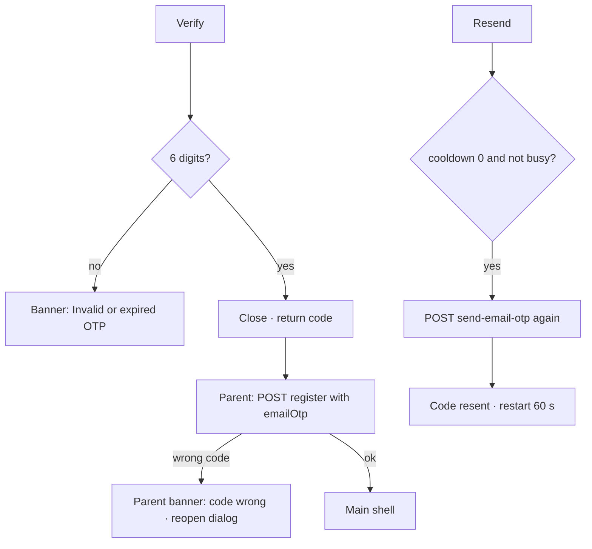

# Registration e-mail verification dialog

| | |
|---|---|
| Area | 01 Launch, auth & shell |
| Who sees it | Prospective doctors (unauthenticated) |
| Reached from | Create account step 2 → "Create account"; Existing-patient view (step 1b) → "Confirm registration" |
| Screen type | Modal dialog (not dismissible by tapping outside); target: bottom sheet on phones |
| Current Flutter source | `lib/features/auth/presentation/create_account/registration_email_verification.dart` |
| Spec | `docs/kmp-spec/01-architecture-core-auth-shell.md` §2.6 (step 2), §13.3; ticket AUTH-06 |

## 1. Purpose
Prove ownership of the e-mail address before the account is created. A 6-digit code is sent, the doctor types it, and registration proceeds. **Today the code is collected but never verified** – neither by the client nor sent to the backend (verified bug). The rewrite must either send the code with `register` (backend contract to confirm) or drop this dialog. Design it as a real verification step. Once per user.

## 2. Entry points
- Step 2 → Create account: after `POST send-email-otp {email, purpose: REGISTRATION}` returns 200. If sending fails the dialog never opens (banner on the parent).
- Step 1b (existing patient) → Confirm registration: same.
- Arrives with the e-mail address. Opens on top of the parent, which keeps its spinner running.

## 3. Layout, top to bottom (phone portrait)
1. Dialog (420 dp wide on tablets; full width minus margins on phones). Title "Enter OTP".
2. Grey 13 sp text: "A 6-digit code has been sent to {email}. Check your inbox."
3. Outlined numeric field, hint "000000", max 6, no counter, Done submits. Target: 6 cells + one-time-code autofill.
4. Centred text button: "Resend code in 0:59" counting down (m:ss), then "Resend code".
5. Actions row: text button "Cancel" (left), primary button "Verify" (right, spinner while busy).
6. Keyboard pushes the dialog up; the dialog is not scrollable today (short enough).

## 4. Data and formats
| Field | Source | Format rule |
|---|---|---|
| Email | parent | Shown in the body text; long addresses wrap. |
| Code | input | Non-digits stripped; exactly 6. |
| Cooldown | local | 60 s from open and after each resend, shown `m:ss`. |
| Verify | today: none – dialog simply returns "confirmed" | Target: `emailOtp` included in `POST /api/auth/register` (or a dedicated `verify-email-otp` with purpose REGISTRATION) – backend to confirm which. |

## 5. Primary flow (happy path)
1. Code sent by the parent; dialog opens with the cooldown running.
2. Doctor types the code; taps "Verify".
3. 6 digits → dialog closes returning the code; parent continues with `register`.
4. Target: the parent sends the code with `register`; a wrong code yields a backend error on the parent (banner) – or the dialog itself verifies and stays open on a wrong code with an inline error.

## 6. Screen states
- First load (skeleton): n/a – the dialog opens only after the send call succeeded.
- Empty: default (empty code, cooldown running).
- Error on load: n/a (send failure prevents opening; parent shows banner).
- Offline: resend fails → banner (today SnackBar on the *parent* scaffold, hidden behind the dialog barrier on some phones). Target: inline error text inside the dialog.
- Refreshing: n/a.
- Partial data: n/a.
- Permission needed: none.
- Locked by tier: n/a.
- Role difference: n/a (doctor registration only; the receptionist form has no e-mail verification).
- Busy: Verify spinner; Cancel and Resend disabled.
- Cooldown: Resend disabled with countdown.

## 7. Interactions and secondary flows
- Keyboard Done → Verify.
- "Cancel" → dialog closes returning "not verified"; parent stops its spinner; nothing is sent. The code already e-mailed remains valid (backend policy UNVERIFIED).
- Tap outside / system back → today: back **does** close the dialog (barrier dismiss is off but back is not intercepted) returning null → treated as cancel. Fine; target: same.
- "Resend code" (after cooldown) → re-sends; "Code resent." confirmation; countdown restarts; failure keeps the countdown at 0.
- Paste 6 digits → accepted.

## 8. Edge cases
- Code never verified today: any 6 digits pass. Design must assume real verification.
- Wrong code with real verification: if verified in the parent's `register`, the dialog is already closed – the parent must reopen it with an error state ("The code is wrong. Try again.") rather than re-sending a new code automatically.
- Code expired → backend message; offer resend.
- Cooldown reaches 0 while busy → Resend stays disabled until busy ends.
- Resend spam → backend rate limit message shown inline.
- Dialog open when the app is backgrounded (to read mail) and resumed → stays open; countdown continues (periodic timer) – target: compute from timestamp.
- Mail app deep link back into Shifa with the code (iOS "From Mail" suggestion) → one-time-code autofill fills the field.
- Rotation → dialog rebuilds; code and countdown preserved (state object survives) – verify on device.
- 200 % font → body text 4+ lines; dialog may exceed the viewport with keyboard open – make the dialog scrollable or use a bottom sheet.
- Language switch → not possible while modal (pill is behind the barrier). Fine.
- Screen reader: focus moves into the dialog; title announced; countdown live region polite.
- Session: none.
- Double tap Verify → ignored while busy.
- The parent's spinner keeps spinning behind the barrier for as long as the dialog is open – looks like a hang on slow readers; target: the parent button returns to normal while the sheet is open.
- E-mail typed with a typo in step 1 → the code never arrives; the only recovery is Cancel → back → fix e-mail → re-submit (a second send to the new address). Target: show the address prominently with a "Change e-mail" link that returns to step 1 directly.
- Two registration attempts for the same e-mail within the cooldown → backend may refuse to resend; message inline.

## 9. Validation and messages
| Field/action | Rule | When checked | Message (English) | Where shown |
|---|---|---|---|---|
| Code | exactly 6 digits | on Verify | "Invalid or expired OTP." | today SnackBar behind the dialog; target inline under the field |
| Verify (target) | backend accepts code | after register / verify | "The code is wrong or has expired. Request a new code." (**NEW** `wrongOrExpiredCodeBackToCode`) | inline in dialog |
| Resend | cooldown 0 and not busy | on tap | – (disabled) | button |
| Resend | send non-200 | after response | "Failed to resend code" (**NEW** `failedToResendCode`) | inline |
| Resend | success | after response | "Code resent." | inline success text |

## 10. Navigation out
- Close with code → parent continues registration.
- Cancel / back → parent, unchanged, spinner stopped.
- No other exits; the dialog never navigates by itself.

## 11. Copy
`enterOtp` "Enter OTP" · `otpSentToEmail` "A 6-digit code has been sent to {email}. Check your inbox." · `resendCodeIn` "Resend code in {{time}}" · `resendCode` "Resend code" · `otpResent` "Code resent." · `cancel` "Cancel" · `verify` "Verify" · `invalidOtp` "Invalid or expired OTP."
**NEW** `verifyYourEmail` "Verify your e-mail" (suggested title instead of "Enter OTP") · **NEW** `wrongOrExpiredCodeBackToCode` · **NEW** `failedToResendCode` "Failed to resend code"

## 12. Known problems in the current app (do not carry over)
- The code is never verified – the step is theatre.
- Errors and confirmations are SnackBars shown on the parent, behind the modal barrier.
- Title "Enter OTP" uses jargon.
- Parent spinner runs for the entire time the dialog is open.
- Not scrollable; overflows at large font sizes with the keyboard open.
- Different countdown format from the login code screen.

## 13. Open questions for design
- Bottom sheet instead of a centred dialog on phones (keyboard friendliness)?
- Should e-mail verification happen *before* the long form (right after e-mail is typed in step 1) so a wrong address is caught early?
- Backend decision needed: verify inside `register` or via a separate endpoint – it changes whether the dialog can show an inline error or must be reopened.
