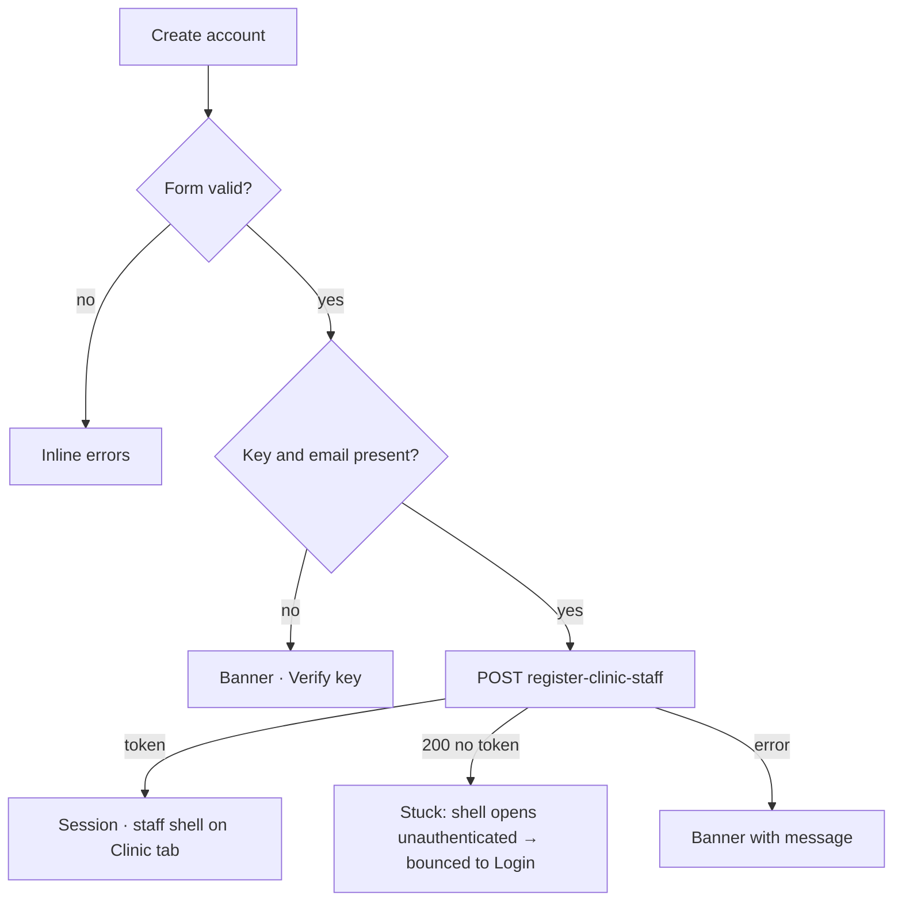

# Receptionist (clinic staff) create account

| | |
|---|---|
| Area | 01 Launch, auth & shell |
| Who sees it | Invited clinic staff (unauthenticated); becomes role CLINIC_STAFF |
| Reached from | Verify invitation key when the key's purpose is a clinic receptionist invite |
| Screen type | Full screen (replaces Verify key) |
| Current Flutter source | `lib/features/auth/presentation/receptionist_create_account_screen.dart`; `registration_state.dart` (setClinicStaffSignup, submitClinicStaffRegistration) |
| Spec | `docs/kmp-spec/01-architecture-core-auth-shell.md` §2.7, §2.8; tickets AUTH-08, SHELL-02 |

## 1. Purpose
One-step account creation for a receptionist invited by a clinic. The e-mail is fixed by the invitation; the person adds a name, confirms the timezone and sets a password. On success they are logged in and land in the clinic-staff shell. Once per user.

## 2. Entry points
- Verify key → purpose `CLINIC_RECEPTIONIST_INVITE` (replaces Verify key; back goes to Login).
- Context: key, clinic name, clinic id, invited e-mail (`emailSentTo`).
- Guard: on submit without a key → banner and Verify key pushed (target: unreachable).

## 3. Layout, top to bottom (phone portrait)
1. Standard app bar (not transparent – inconsistent with the other auth screens; target: match): back, title "Create account" (bold), language pill.
2. Header text (black87, body size): clinic name on the first line, invited e-mail on the second – only lines that exist.
3. Label "Enter email address" (used as a caption – wrong string, see §12) above a read-only outlined box showing the e-mail (or "—" when missing).
4. First name (hint "Enter first name", words capitalised).
5. Last name (hint "Enter last name").
6. Practice timezone – searchable dropdown; pre-filled from device detection, else the flow's timezone, else "UTC".
7. Password with eye toggle, then the live requirements checklist (same 6 rows as the doctor form, text may wrap).
8. Confirm password with eye toggle; Done submits.
9. Primary button "Create account" (full width, spinner).
10. Scrollable body, centred, max 520 dp.

## 4. Data and formats
| Field | Source | Format rule |
|---|---|---|
| Email | invitation (`emailSentTo`) or flow e-mail | Read-only; must contain "@" at submit. |
| Clinic name | invitation | Display only. |
| First/last name | input | Trimmed, required. |
| Timezone | device → flow → "UTC" | IANA id. |
| Password | input | Full policy 8–128, upper, lower, digit, special; **trimmed** today (target verbatim). |
| Submit | `POST /api/auth/register-clinic-staff {firstName,lastName,email,password,key,phone?,timeZone?}` | 200/201 + token → session. **No fallback login** when the token is missing (then the user is stuck – see §8). |

## 5. Primary flow (happy path)
1. Screen shows clinic + e-mail; receptionist fills name, confirms timezone, sets password.
2. "Create account" → client validation (§9) → spinner.
3. Request → token → session stored.
4. Staff shell start tab is set to Clinic workspace; main shell replaces the whole stack (`18-main-shell-clinic-staff.md`). Today on phones this immediately shows the "web only" block screen (dropped in the rewrite).

## 6. Screen states
- First load (skeleton): timezone row may briefly show "UTC" before detection replaces it (sub-second). Target: skeleton line until detected.
- Empty: default.
- Error on load: n/a.
- Offline: submit fails → network banner.
- Refreshing: n/a.
- Partial data: no clinic name → header shows only the e-mail; no e-mail → "—" and submit is blocked with "Enter email address" (dead end; backend must always send `emailSentTo`).
- Permission needed: none.
- Locked by tier: n/a (staff have no tier).
- Role difference: this *is* the staff variant of registration; there is no e-mail verification dialog here (doctors have one).
- Submitting: spinner; fields remain editable (target locked).

## 7. Interactions and secondary flows
- Eye toggles; keyboard Next/Done.
- Timezone dropdown → search dialog.
- Back / system back → Login; entries lost (target: confirm when dirty).
- Language pill → re-render.
- Double tap → ignored while busy.

## 8. Edge cases
- Register returns 200 without a token → no login fallback; the app still navigates to the shell, which has no token: the first API call gets 401 → nothing happens (no token sent, logout skipped) → the shell sits empty. Target: treat "no token" as an error banner and stay.
- Invitation e-mail already has an account → backend message; shown in banner; no way to change the e-mail (correct – the clinic must re-invite).
- Name fields with only spaces → "Enter first name".
- Detected timezone differs from the clinic's timezone → no warning; staff see clinic times in clinic TZ anyway (area 09). Acceptable; copy could explain "your timezone, used for your own notifications".
- Password trimmed → see doctor flow.
- Slow network → spinner up to 30 s; timeout banner.
- Rotation → kept.
- 200 % font → checklist rows wrap (already `Expanded`); header lines wrap.
- Screen reader: header read as static text; e-mail box announced as "read only".
- Deep link / push → ignored.
- Session: after success the app lock from a previous user may appear.
- The staff start tab is set *before* navigation; a later start-tab preference is never applied to staff (correct).

## 9. Validation and messages
| Field/action | Rule | When checked | Message (English) | Where shown |
|---|---|---|---|---|
| First name | not empty | on submit | "Enter first name" | inline |
| Last name | not empty | on submit | "Enter last name" | inline |
| Password | not empty; policy | live + on submit | "Password is required"; policy messages as in step 1 | inline + checklist |
| Confirm | not empty; equals | on submit | "Please confirm your password" / "Passwords do not match" | inline |
| Submit | key present | on submit | "Please verify your invitation key first." | banner |
| Submit | e-mail present with "@" | on submit | "Enter email address" | banner |
| Submit | non-200 | after response | backend `message` or "Request failed (code)" | top banner |
| Submit | 200 without token (target) | after response | **NEW** `registrationIncomplete` "Your account was created but sign-in failed. Please sign in with your new password." → Login | banner on Login |

## 10. Navigation out
- → Staff shell (Clinic tab): replaces everything.
- ← Login: pop; entries lost.

## 11. Copy
`createAccount` "Create account" · `enterEmail` "Enter email address" (misused as caption – target **NEW** `emailLabel` "Email") · `enterFirstName` "Enter first name" · `enterLastName` "Enter last name" · `practiceTimezone` · `practiceTimezonePlaceholder` · `password` · `confirmPassword` · password policy keys (see 07) · `pleaseVerifyInvitationKeyFirst`
**NEW** `invitedBy` "You were invited by {clinic}" · **NEW** `registrationIncomplete`

## 12. Known problems in the current app (do not carry over)
- After success, phones show a "Clinic staff portal is available on the web" dead-end screen; the rewrite allows staff on mobile (00-README decision).
- No token in the response → silent dead end.
- "Enter email address" used as a field caption.
- Different app-bar style from every other auth screen.
- Password trimmed.
- `clinicStaffMobileTitle` / `clinicStaffMobileBody` strings have no value in any language (render as raw keys) – irrelevant once the block screen is dropped.

## 13. Open questions for design
- Show the clinic as a card with logo/name ("You've been invited to join {clinic}") rather than two plain lines?
- Ask for the timezone at all for staff (they operate in clinic time)? Could default silently to the device zone and be editable later in Profile.
- Do we want e-mail verification for staff too (doctors have it; backend may require it)?
