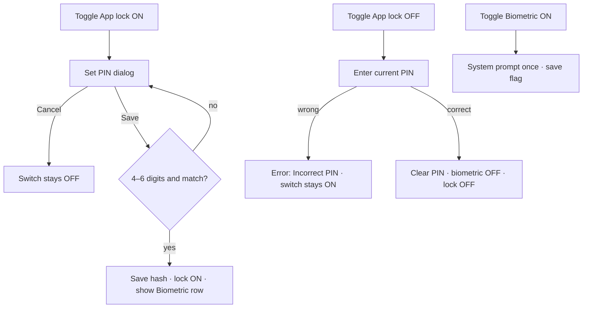

# App lock settings – enable, set PIN, biometrics

| | |
|---|---|
| Area | 01 Launch, auth & shell |
| Who sees it | Both roles (authenticated), every tier; native phones only |
| Reached from | Profile → Settings panel (bottom card "App lock") – area 08 owns the Settings panel, this file owns the card and its dialogs |
| Screen type | Settings card + modal dialog ("Set PIN" / "Enter PIN") |
| Current Flutter source | `lib/features/settings/presentation/app_lock_settings_section.dart`; `lib/core/services/app_lock_service.dart`, `app_lock_provider.dart` |
| Spec | `docs/kmp-spec/01-architecture-core-auth-shell.md` §7.1, §13.1; ticket LOCK-01; `08-profile-settings-reports-legal.md` §6.2, SET-03 |

## 1. Purpose
Let the doctor protect the app with a 4–6 digit PIN (and optionally Face ID / fingerprint) so that patient data is not exposed when the phone is handed over or picked up. Set up once; rarely changed.

## 2. Entry points
- Profile tab → Settings panel → scroll to the "App lock" card. The card is hidden on web and desktop.
- Target: first-run nudge after the first login on a new device ("Protect patient data with a PIN?") – optional, product decision.
- No context arrives.

## 3. Layout, top to bottom (phone portrait)
### 3a. Card inside Settings
1. Switch row: title "App lock", subtitle "Require PIN when reopening the app", teal switch.
2. (Only when lock is on **and** the device supports biometrics) Switch row: "Biometric unlock". Today its value is read asynchronously each build (brief flicker to off).
3. Target additions: row "Change PIN" (when on); helper text explaining the 5-attempt rule.

### 3b. "Set PIN" dialog (enable)
1. Title "Set PIN".
2. Field "PIN": numeric keyboard, obscured, max 6 characters, counter "0/6" visible today (Material default), Next action.
3. Field "Confirm PIN": same, Done action.
4. Actions: "Cancel" (text), "Save" (filled).
5. On phones the dialog is shown full-screen by the shared scrollable-form-dialog helper; on tablets a centred dialog.
Target: a PIN pad with dots (same visual as the lock screen) in two sub-steps "Create PIN" → "Confirm PIN", with length chosen implicitly by tapping "Continue" after 4–6 digits.

### 3c. "Enter PIN" dialog (disable)
Same dialog with one field, title still "Set PIN" today (wrong; target "Enter your current PIN").

## 4. Data and formats
| Field | Source | Format rule |
|---|---|---|
| PIN | input | 4–6 digits only. Today stored **in plaintext** in secure storage; target: salted hash. |
| Lock enabled | secure storage flag | Drives the switch and the lock behaviour. |
| Biometric enabled | secure storage flag | Only meaningful when lock is enabled; cleared when the lock is disabled. |
| Biometric availability | platform | Face ID / Touch ID / fingerprint enrolled and hardware supported; checked once when the card appears. |
| Attempts | – | Max 5 wrong PINs on the lock screen ⇒ forced sign-out (see `12-app-lock-enter-pin.md`). |

## 5. Primary flow (happy path)
1. Doctor toggles "App lock" on.
2. Set PIN dialog opens. Types 4–6 digits, repeats them, taps Save.
3. If invalid or mismatch: today **nothing happens** – the dialog just stays open with no message (bug). Target: inline error.
4. Valid → PIN saved, lock flag on, switch shows on; the "Biometric unlock" row appears if available.
5. Doctor toggles "Biometric unlock" on → flag saved; no system prompt is triggered to confirm (target: trigger one biometric prompt immediately to verify it works).
6. Next time the app is opened cold or returns from background after ≥ 5 s, the lock screen appears.

## 6. Screen states
- First load (skeleton): the card renders instantly; the biometric row may flicker from off to on while its flag loads. Target: read both flags before rendering the card (skeleton rows otherwise).
- Empty: lock off → single switch row.
- Error on load: secure storage unreadable (rare) → today flags read as false. Target: same, plus the dialog shows a generic error if saving fails.
- Offline: fully local; no change.
- Refreshing: n/a.
- Partial data: n/a.
- Permission needed: biometrics need enrolment, not a runtime permission. If none enrolled → the row is hidden. Target: show the row disabled with "No Face ID / fingerprint set up on this phone".
- Locked by tier: n/a.
- Role difference: none (staff can also lock).
- Dialog validation error (target): inline red text under the field.

## 7. Interactions and secondary flows
- Switch on → Set PIN dialog; Cancel reverts the switch.
- Switch off → Enter PIN dialog; wrong PIN → today a SnackBar "incorrectPin" (raw key!) and the switch stays on; correct → lock disabled, PIN and biometric flag cleared.
- Biometric switch → toggles the flag; no confirmation.
- Keyboard Done in the dialog → Save.
- System back in the dialog → Cancel.
- Target "Change PIN" → Enter current PIN → Set PIN.

## 8. Edge cases
- PIN of 5 or 6 digits → can be *set* today but can **never unlock** (lock screen auto-verifies at 4 digits) → the doctor is locked out after 5 attempts and force-signed-out. Critical bug; target lock screen requires explicit submit (or knows the stored length).
- PIN "0000" / "1234" → accepted. Product may want a weak-PIN warning (not blocking).
- Non-digit input → the keyboard is numeric but paste can insert letters; today saving silently fails (no message). Target: filter to digits.
- Mismatch between PIN and Confirm → silent today; target inline error.
- PIN and lock flag are **not** cleared on sign-out. A second user who logs in on the same phone meets the first user's lock screen and must know their PIN or be signed out after 5 attempts. Target: clear app-lock data on explicit sign-out and on forced logout, or scope the PIN to the account id.
- Biometrics enrolled after enabling the lock → the row appears on the next visit to Settings (availability is checked when the card mounts).
- Biometrics removed (face data deleted) → the lock screen's biometric attempt fails silently and falls back to PIN. Fine.
- Device without secure hardware → secure storage still works (software-backed); nothing to design.
- Dialog open when the app goes to background ≥ 5 s → the lock screen covers the dialog (lock layer wraps everything) – if the lock is already on. On enabling for the first time this cannot happen (lock not yet on).
- 200 % font → the dialog is full-screen on phones and scrolls; fine.
- Rotation → dialog content kept.
- Screen reader: switches announce state; the dialog fields announce "PIN, secure text".
- Language switch while the dialog is open → impossible (modal).
- Today every label on this card and in the dialogs has **no translation in any language** – users see raw keys like `appLock`, `setPin`, `incorrectPin`. Copy below is the English to add.

## 9. Validation and messages
| Field/action | Rule | When checked | Message (English) | Where shown |
|---|---|---|---|---|
| PIN | 4–6 digits | on Save | today none (silent); target **NEW** `pinLengthRule` "PIN must be 4 to 6 digits" | inline |
| Confirm PIN | equals PIN | on Save | today none; target **NEW** `pinsDoNotMatch` "PINs do not match" | inline |
| Disable lock | PIN matches stored | on Save | "Incorrect PIN" (`incorrectPin`, **value missing today**) | today SnackBar; target inline |
| Biometric toggle (target) | system prompt succeeds | on toggle | system UI; on failure switch reverts, banner **NEW** `biometricSetupFailed` "Biometric unlock could not be enabled" | top banner |

## 10. Navigation out
- Dialogs close back to the Settings panel; the card reflects the new state immediately.
- No navigation away; the lock screen itself is a separate overlay (`12-app-lock-enter-pin.md`).

## 11. Copy
All keys below exist in code but have **no value in any locale** – add them in en/uz/ru:
`appLock` "App lock" · `appLockSubtitle` "Require PIN when reopening the app" · `biometricUnlock` "Biometric unlock" · `setPin` "Set PIN" · `pin` "PIN" · `confirmPin` "Confirm PIN" · `incorrectPin` "Incorrect PIN"
Existing: `cancel` "Cancel" · `save` "Save"
**NEW** `enterCurrentPin` "Enter your current PIN" · **NEW** `changePin` "Change PIN" · **NEW** `pinLengthRule` · **NEW** `pinsDoNotMatch` · **NEW** `appLockAttemptsHint` "After 5 wrong attempts you will be signed out." · **NEW** `biometricsNotEnrolled` "No Face ID or fingerprint is set up on this phone." · **NEW** `biometricSetupFailed`

## 12. Known problems in the current app (do not carry over)
- 5/6-digit PINs can be set but never used (lock screen auto-submits at 4).
- PIN stored in plaintext.
- No validation feedback in the Set PIN dialog; title "Set PIN" reused for the disable prompt.
- Every label renders as a raw key (no translations).
- Biometric row flickers; enabling biometrics does not verify with a prompt.
- Lock data survives sign-out and leaks to the next user of the phone.
- Dialog uses a generic form dialog with a visible "0/6" counter and plain text fields instead of a PIN pad.

## 13. Open questions for design
- Fixed PIN length (6 digits, like banking apps) instead of 4–6? Simplifies the lock screen (auto-submit at 6) and removes the length bug class entirely. **Recommended.**
- Offer biometrics-first ("Use Face ID", PIN as fallback) with a single toggle, as iOS users expect?
- Should enabling the lock be suggested right after first login (nudge card on Home)?
