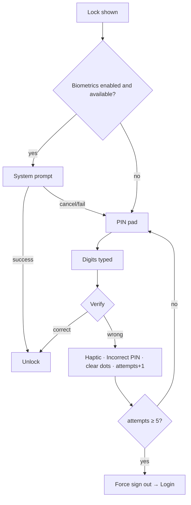

# App lock screen – enter PIN / biometrics

| | |
|---|---|
| Area | 01 Launch, auth & shell |
| Who sees it | Both roles (authenticated) with app lock enabled; native phones only |
| Reached from | Automatically: cold start with a session, or return from background after ≥ 5 s |
| Screen type | Full-screen overlay above the entire app (covers dialogs, sheets, video calls) |
| Current Flutter source | `lib/core/widgets/app_lock_layer.dart` (AppLockScreen, AppLockLifecycleLayer); `lib/core/services/app_lock_provider.dart` (LockManager); `app_lock_service.dart` |
| Spec | `docs/kmp-spec/01-architecture-core-auth-shell.md` §7.1, §6.6, §13.1; ticket LOCK-01 |

## 1. Purpose
Gate the already-signed-in app behind a PIN or biometric check whenever it is reopened. Seen many times a day by doctors who enable it; must be fast (biometric prompt first, PIN as fallback).

## 2. Entry points
- Cold start: as soon as the session is restored (first frame after Splash decides "valid token"), if lock is enabled and a PIN exists. Checked once per process.
- Resume: the app was in background ≥ 5 s (measured from pause to resume), the user is authenticated, lock enabled with PIN, and no feature has temporarily disabled the lock (hook exists for pickers; no consumer today).
- Right after login / registration / password reset on a phone where a previous user enabled the lock (lock data is not cleared on sign-out – see §8).
- Never from a user action. Covers whatever was on screen; that content is restored unchanged on unlock.

## 3. Layout, top to bottom (phone portrait)
1. Background: app "cardboard" colour, safe-area padded, 24 dp margins. No app bar, no back.
2. Flexible top space.
3. Shifa logo 64 × 64 dp (PNG today; SVG elsewhere – unify).
4. Title "Enter PIN" (title-large).
5. Row of **6 dots** (14 dp, 12 dp gaps) – always 6 regardless of PIN length; filled teal as digits are typed, grey otherwise.
6. Error text in red under the dots when present ("Incorrect PIN").
7. Flexible space.
8. PIN pad: 3 × 4 grid (1–9, empty, 0, ⌫), light grey rounded keys, 24 sp digits, 12 dp gaps, aspect 1.4. No biometric key, no "Forgot PIN", no "Sign out".
Target: add a biometric button (face / fingerprint icon) in the empty bottom-left slot, a "Sign out" text link at the bottom, and a remaining-attempts hint.

## 4. Data and formats
| Field | Source | Format rule |
|---|---|---|
| Typed PIN | pad input | Max 6 digits. Today **auto-verified as soon as 4 digits are entered** (so only 4-digit PINs work). Target: verify on explicit "Continue"/⏎ key, or when the typed length equals the stored length. |
| Stored PIN | secure storage | Today plaintext compare; target hash compare. |
| Failed attempts | widget state | Max 5 ⇒ forced sign-out. Counter lives in the widget and **resets if the screen is rebuilt** (e.g. rotation) – target: persist per lock session. |
| Biometric | platform prompt, "biometric only", sticky | Reason text hardcoded English "Unlock Shifa Doctor"; target localised. |
| Background threshold | 5 s | Measured with device wall clock. |

## 5. Primary flow (happy path)
1. Lock screen appears over the app.
2. If biometrics are available **and** enabled: the system prompt opens automatically after the first frame. Success → unlock immediately, no PIN shown long enough to notice.
3. Prompt cancelled or failed → PIN pad stays; nothing is announced (target: show the biometric retry button).
4. Doctor taps digits; dots fill; haptic on wrong PIN.
5. Correct PIN → overlay removed; the previous content is exactly where it was.

## 6. Screen states
- First load (skeleton): n/a – renders instantly; the biometric prompt may cover it within ~100 ms.
- Empty: no digits, no error (default).
- Error on load: secure storage unreadable → verification always fails → 5 attempts → sign out. Acceptable fallback (rare).
- Offline: fully local; identical.
- Refreshing: n/a.
- Partial data: n/a.
- Permission needed: biometrics need enrolment only. If the prompt throws (e.g. lockout after too many OS-level failures), it is swallowed and the PIN pad remains. Target: show "Use PIN" hint.
- Locked by tier: n/a.
- Role difference: none.
- Error state: red "Incorrect PIN" under the dots, dots cleared; target also "N attempts left" when ≤ 2 remain.
- Final attempt state (target): a short interstitial/toast is not possible because the app navigates to Login; show the reason banner on Login instead (`14-session-expired-forced-logout.md`).

## 7. Interactions and secondary flows
- Digit key → appends; clears the error text; at 4 digits today verification fires automatically.
- ⌫ → removes the last digit.
- Biometric button (target) → re-opens the system prompt.
- "Sign out" (target) → confirmation dialog → full logout → Login. Today the only way out is 5 wrong PINs.
- System back → **not** handled today: on Android it pops the route *underneath* the overlay (the lock stays, but the app state changes invisibly) or exits the app. Target: back does nothing on the lock screen.
- App backgrounded while locked and resumed → stays locked; biometric prompt is **not** retried automatically (only on first frame). Target: retry on resume.
- Incoming push tap while locked → the deep link navigates underneath the overlay; after unlock the user is already on the target screen. Acceptable; design nothing extra.

## 8. Edge cases
- Stored PIN has 5 or 6 digits → never unlockable today (auto-verify at 4 → mismatch → cleared). Target fixes by explicit submit or known length.
- 5 wrong attempts → forced sign-out: token cleared, Login shown with no explanation today. Target: Login banner "Too many incorrect PIN attempts. Please sign in again." The PIN itself is **kept** – the next login will be locked with the same PIN again. Target: clear lock data on forced sign-out (or offer "Reset PIN by signing in").
- Rotation mid-entry → widget rebuilt: typed digits **and the attempt counter reset**. Target: keep both.
- Lock appears while a video call is running → audio may continue underneath (overlay only hides UI). Target: either keep video excluded via the temporary-disable hook or auto-mute; decide with area 05.
- Lock appears over an open bottom sheet / dialog / date picker → restored intact after unlock. OS pickers (Android date picker is in-app; iOS share sheet is a system overlay) may themselves trigger pause/resume ≥ 5 s → lock after returning from a share sheet. The temporary-disable hook exists for this; no feature uses it. Target: wire it for share/camera/file pickers.
- Camera / file picker for document upload takes > 5 s → coming back shows the lock; the picked file must survive (state is kept underneath).
- Phone call during use → pause ≥ 5 s → lock on return. Expected.
- Background < 5 s (quick app switch) → no lock.
- Time-zone or clock change while backgrounded → elapsed measured with wall clock; a backwards clock jump can skip the lock. Target: monotonic clock.
- Lock enabled by user A, user B logs in on the same phone → B sees A's PIN screen. See `11-app-lock-set-pin.md` §8.
- Session token expires while locked → unlock succeeds, then the first API call forces logout → Login. Fine; the Login banner explains it.
- Biometric prompt open when the app is backgrounded → "sticky" keeps it alive on Android; on iOS the prompt is dismissed and the PIN pad shows.
- 200 % font → "Enter PIN" and the error wrap; the pad is a fixed-aspect grid – ensure it still fits above the home indicator on small phones (shrink key height).
- Screen reader: title → dots (announce "N of 6 digits entered") → error → pad keys ("1", … "delete") → biometric → sign out. Haptic on error is supplementary.
- Language switch → not reachable while locked; strings follow the app language.
- Today the title and error have **no translation in any language** → raw keys `enterPin` / `incorrectPin` on screen.

## 9. Validation and messages
| Field/action | Rule | When checked | Message (English) | Where shown |
|---|---|---|---|---|
| PIN | 4–6 digits typed | today at 4 digits; target on submit | – | – |
| PIN | matches stored | on verify | "Incorrect PIN" (`incorrectPin`, value missing today) | red text under dots + haptic |
| PIN | attempts reach 5 | on 5th failure | – (sign-out; target banner on Login **NEW** `pinLockoutBanner`) | Login banner |
| Biometric | system result | on prompt | system UI only | – |
| Attempts hint (target) | ≤ 2 left | after failure | **NEW** `attemptsLeft` "{n} attempts left" | under error |

## 10. Navigation out
- Unlock → overlay removed; underlying screen untouched; nothing refreshed by the lock itself (the shell's own resume hooks refresh notifications/clinics/appointments).
- Forced sign-out → Login replaces everything.
- "Sign out" (target) → same as the More-sheet sign-out.

## 11. Copy
`enterPin` "Enter PIN" · `incorrectPin` "Incorrect PIN" (both **missing values today**)
**NEW** `unlockReason` "Unlock Shifa Doctor" (biometric prompt reason, currently hardcoded English) · **NEW** `useBiometrics` "Use Face ID / fingerprint" · **NEW** `usePin` "Use PIN" · **NEW** `attemptsLeft` "{n} attempts left" · **NEW** `pinLockoutBanner` "Too many incorrect PIN attempts. Please sign in again." · `signOut` "Sign Out" · `signOutConfirm` "Are you sure you want to sign out?"

## 12. Known problems in the current app (do not carry over)
- Auto-verify at 4 digits breaks 5/6-digit PINs (users get locked out and signed out).
- Attempt counter and typed digits reset on rebuild/rotation.
- No way to leave the lock screen except failing 5 times; no "Sign out", no biometric retry button.
- Biometric reason hardcoded in English; title/error strings untranslated.
- Android back not handled on the overlay.
- Lock data not cleared on sign-out; next user inherits it.
- Always shows 6 dots even for a 4-digit PIN (reveals nothing but looks unfinished).
- PNG logo here vs SVG elsewhere.

## 13. Open questions for design
- Dots: show exactly the stored PIN length (reveals length) or always 6 (today)? With a fixed 6-digit policy the question disappears.
- Blur the underlying content in the app switcher (privacy screenshot) – usually paired with app lock; needs a platform flag, cheap to add.
- Should the lock also cover the Splash→shell transition with a branded frame so no patient data flashes before the overlay (today one frame can leak)?
