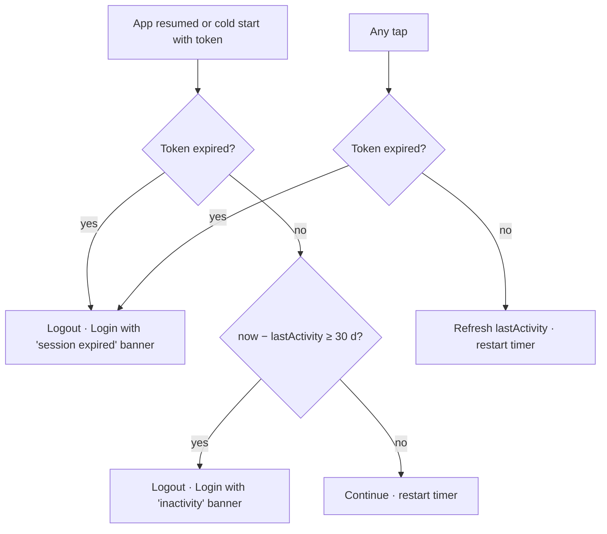

# Inactivity timeout (automatic sign-out)

| | |
|---|---|
| Area | 01 Launch, auth & shell |
| Who sees it | Both roles (authenticated), every tier |
| Reached from | Automatic: no touch activity for 30 days on phones (1 h on web); checked on every tap, on app resume and by a running timer |
| Screen type | Behaviour – no screen of its own; its visible result is the Login screen (with a reason banner in the target design) |
| Current Flutter source | `lib/core/services/inactivity_timer_service.dart`; `lib/core/widgets/activity_tracker.dart` |
| Spec | `docs/kmp-spec/01-architecture-core-auth-shell.md` §7.2; ticket LOCK-02 |

## 1. Purpose
Limit how long an unattended signed-in session stays valid. On phones the limit is 30 days without any touch; in practice it mostly matters for a device left in a drawer. On web (shared browsers) it is 1 hour. The doctor should understand *why* they were signed out when it happens.

## 2. Entry points
- Timer: restarted on every pointer down/up anywhere in the app; fires after the timeout while the app is in the foreground (rare on phones – the OS kills the process long before 30 days).
- Resume: when the app returns to the foreground the last-activity timestamp (memory, else disk) is compared with now; if ≥ timeout → sign out. Also, if the session token is already expired → sign out.
- Any tap: if the token is expired at the moment of a tap → sign out immediately (even before the request).
- Result: full logout (token cleared, caches cleared) and navigation to Login, stack cleared. Nothing else is shown today.

## 3. Layout, top to bottom (phone portrait)
n/a – no dedicated screen. The visible artefacts are:
1. Target: a dismissible info banner at the top of the Login screen: "You were signed out after a long period of inactivity." (or the expiry variant).
2. Nothing in the shell beforehand (no "you will be signed out in…" warning – a 30-day limit does not warrant one).

## 4. Data and formats
| Field | Source | Format rule |
|---|---|---|
| Timeout | constant | Phones: 30 days. Web: 1 h. (Design treats 30 days as the default; product may shorten.) |
| Last activity | memory; persisted to device prefs at most every 5 minutes | Wall-clock milliseconds. Cleared on sign-out. |
| Token expiry | inside the session token | Checked with 30 s grace. UNVERIFIED how long backend tokens live; if shorter than 30 days the token expiry, not inactivity, is what signs people out. |
| Reason (target) | in-memory flag passed to Login | `inactivity` / `expired` / `disabled` / `pinLockout` / `unauthorized`. |

## 5. Primary flow (happy path)
1. Doctor uses the app; every touch silently refreshes the activity timestamp (disk write at most every 5 min).
2. Doctor stops using the app for 30 days.
3. On the next open (resume or cold start): the shell appears for a frame, the resume check runs, logout fires, Login replaces everything. Target: the check runs *before* the shell is shown (in Splash, from the persisted timestamp) so no patient data flashes, and Login shows the reason banner.

## 6. Screen states
- First load (skeleton): n/a.
- Empty: n/a.
- Error on load: timestamp unreadable → treated as "no information" → no timeout enforced (fail open). Keep.
- Offline: fully local; the check works offline. The following API calls will fail separately.
- Refreshing: n/a.
- Partial data: n/a.
- Permission needed: none.
- Locked by tier: n/a.
- Role difference: none (staff have the same limit).
- Target Login banner: info style, dismissible, auto-hides after the first successful input? (Design choice – recommend staying until dismissed.)

## 7. Interactions and secondary flows
- None directly. Interaction with the app lock: the lock screen's taps also count as activity (touch listener wraps everything) – fine.
- Interaction with background audio/video (video call in progress): no touches for a long time are still far below 30 days; irrelevant.
- Sign out → timer stopped and timestamp cleared; next login starts fresh.

## 8. Edge cases
- Process killed after 29 days, reopened on day 31 → cold start path: today Splash restores the session (token valid), shell opens, *then* the resume hook is not triggered (no pause→resume transition on cold start) – the persisted timestamp is only read on resume. **So on phones the 30-day inactivity rule is effectively only enforced after a background→foreground transition, not on cold start.** Target: enforce in Splash from the persisted timestamp.
- Clock set back by the user → inactivity cannot trigger; clock set forward → immediate sign-out on resume. Target: monotonic time where available; otherwise accept.
- Timestamp persisted only every 5 min → the recorded last activity can be up to 5 min older than reality; irrelevant at a 30-day scale.
- Token lifetime shorter than 30 days → the doctor is signed out by expiry, not inactivity; the reason banner should then say "session expired" (same remedy, different wording).
- Active use but token expires mid-session (e.g. 24 h token) → the very next tap signs out without warning, even in the middle of typing a note. Target: a pre-flight check before *saving* actions and a soft warning banner 5 min before expiry ("Your session ends soon – save your work"); needs token lifetime from backend (UNVERIFIED).
- Timer and app-lock both due on resume → logout wins (auth becomes false, lock layer unmounts); Login shows.
- Logout while a bottom sheet / dialog is open → stack cleared; sheet disappears without animation. Acceptable.
- Logout while a file upload is in progress → upload aborted by the 401 on completion; nothing to show.
- Multiple rapid taps → timer restarted each time; no disk churn (5 min throttle).
- Web 1 h limit is out of scope for the phone design; mention only in README.
- Screen reader: banner on Login announced once.
- Language: banner text follows the app language.
- Clinic-staff accounts share the same 30-day limit; shared reception tablets may need a much shorter limit – see §13.
- App lock enabled + long inactivity: on resume the app lock would normally appear, but the inactivity logout wins and the Login screen is shown unlocked (the lock protects a session; there is none). Correct; make sure no lock frame flashes first.
- The activity listener counts *any* pointer event, including taps on the lock screen's PIN pad and on system-level dialogs rendered by the app – a doctor who only ever fails the PIN still counts as "active". Acceptable.
- A background video call with no touch for hours → still far below the limit; irrelevant on phones (relevant on web with 1 h – the call UI should count as activity there).

## 9. Validation and messages
| Field/action | Rule | When checked | Message (English) | Where shown |
|---|---|---|---|---|
| Inactivity | now − lastActivity ≥ 30 d | on resume (target: also on cold start) | **NEW** `signedOutInactivity` "You were signed out after a long period of inactivity." | Login banner (target) |
| Token expiry | exp + 30 s < now | on resume, on tap, before each request | **NEW** `sessionExpiredBanner` "Your session has expired. Please sign in again." | Login banner (target) |
| Session ending soon (target, optional) | 5 min before exp | timer | **NEW** `sessionEndingSoon` "Your session ends in 5 minutes. Save your work." | shell top banner |

## 10. Navigation out
- Automatic → Login (stack cleared). Unsaved input anywhere is lost; nothing asks. Target: at least the reason banner; a "save draft" mechanism is per-feature (areas 05/07).

## 11. Copy
No strings today.
**NEW** `signedOutInactivity` · **NEW** `sessionExpiredBanner` · **NEW** `sessionEndingSoon` (optional)

## 12. Known problems in the current app (do not carry over)
- No feedback at all: the doctor lands on Login without knowing why.
- Inactivity is not enforced on cold start (only on resume), so the rule is weaker than stated.
- Tap-triggered expiry check can sign out mid-typing with no save.
- Shell tab index is not reset by timeout logouts; the next login may open on a stale tab (target: reset shell state on every logout).
- Patient data can flash for a frame before the resume logout.

## 13. Open questions for design
- Is 30 days the right limit for a healthcare app on a personal phone? (Clinics may require 24 h or less; could become a backend/clinic policy setting.)
- Do we want a "session ending soon" warning at all, given tokens cannot be refreshed (no refresh token exists)?
- Banner style on Login: info (blue) for inactivity, warning (amber) for expiry, error (red) for disabled/locked-out?
- Should the inactivity limit be configurable per clinic (backend setting) and shown in Profile → Security ("You will be signed out after N days without use")?
- If a short limit is chosen, do we need the "session ending soon" warning with a "Stay signed in" action (which only resets the inactivity clock, not the token)?

## Appendix – what counts as activity (for engineering and QA)
| Event | Resets inactivity? | Checks token expiry? |
|---|---|---|
| Pointer down / up anywhere | yes | yes (logout if expired) |
| Pointer move / scroll | no | no |
| App resumed from background | yes (after the check passes) | yes |
| Push received in foreground | no | no |
| Cold start | no (timestamp not read today; target: read and enforce) | yes (via session restore) |
| Background timer firing | n/a (fires logout) | – |
