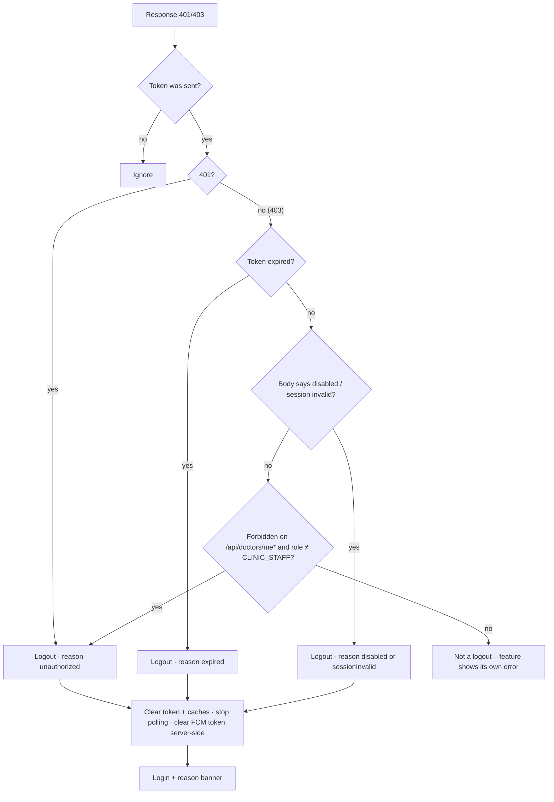

# Session expired / forced logout (401, disabled account, PIN lockout)

| | |
|---|---|
| Area | 01 Launch, auth & shell |
| Who sees it | Both roles (authenticated), every tier |
| Reached from | Any API response that invalidates the session; token expiry detected locally; 5 failed PIN attempts; explicit Sign out |
| Screen type | Behaviour + confirmation dialog (explicit sign-out) + reason banner on Login (target) |
| Current Flutter source | `lib/core/api/api_client.dart` (401/403 rules), `lib/state/auth/auth_controller.dart` (logout), `lib/app/app.dart` (auth listener), `main_shell.dart` (More-sheet logout dialog) |
| Spec | `docs/kmp-spec/01-architecture-core-auth-shell.md` §2.10, §3; tickets AUTH-09, CORE-04 |

## 1. Purpose
Define what the doctor experiences when the session ends for any reason other than inactivity (covered in `13-inactivity-timeout.md`): the server rejects the token, the account is disabled, the token expired, the PIN was entered wrongly 5 times, or the doctor chose to sign out. One consistent exit: everything cleared, Login shown, and (target) a banner that says why.

## 2. Entry points
Automatic (no user intent):
- Any request returns **401** while a token was sent.
- A request returns **403** *and* one of: the token is expired; the body says "Account is disabled" / "Session invalid" / "Session expired or signed out"; or it is a plain "Forbidden" on a `/api/doctors/me…` call for a non-staff role. Other 403s (e.g. staff calling doctor-only endpoints, tier gates) do **not** log out.
- Local pre-flight: a request is about to be sent but the token is already expired (30 s grace) → logout without network.
- A tap while the token is expired (activity tracker).
- 5 wrong PINs on the lock screen.
User-initiated:
- More sheet → "Sign Out" → confirmation dialog → confirm.
- (Today) the "web only" staff screen → Sign out.
Target context passed to Login: a reason code.

## 3. Layout, top to bottom (phone portrait)
### 3a. Sign-out confirmation dialog (from More sheet)
1. Title "Sign Out".
2. Body "Are you sure you want to sign out?".
3. Actions: "Cancel" (text, left) · "Sign Out" (red text, right). Target: destructive button red, right-aligned, per 00-README.
### 3b. Login with reason banner (target)
See `02-login.md` §3 – banner slot under the app bar.
### 3c. Nothing else
There is no "session expired" screen or dialog; the transition is immediate.

## 4. Data and formats
| Field | Source | Format rule |
|---|---|---|
| Reason | the trigger | `unauthorized` (401), `expired` (local or 403-expired), `disabled` ("Account is disabled"), `sessionInvalid` (the two "Session…" bodies), `pinLockout`, `userSignOut` (no banner). |
| What is cleared | logout routine | Token (secure storage + memory), FCM token on the server (best effort, fire-and-forget `PUT …/fcm-token ""`), profile, clinics, appointments, patients caches. **Not** cleared today: shell tab (only by the More-sheet path), registration flow state, workspace mode, app-lock PIN, language, OTP rate-limit history. Target: clear everything session-scoped except language and (product decision) app-lock data. |
| Navigation | auth listener in the app root | `pushNamedAndRemoveUntil(login)` on the next frame. The More-sheet path *also* navigates itself → two navigations (harmless but sloppy). |

## 5. Primary flow (happy path – automatic case)
1. Doctor is anywhere in the app (tab root, nested screen, sheet, dialog, video call).
2. A request fails with 401 (or a logout-worthy 403).
3. The client marks the session dead, clears token and caches, and the auth state flips to signed-out.
4. On the next frame the root navigator replaces the entire stack with Login. Open sheets/dialogs vanish.
5. Target: Login shows the banner for the reason; it stays until dismissed or until a successful sign-in.
6. Background work that completes later (uploads, polling) fails silently; no error banners are shown after logout (requests without a token never trigger another logout – loop protection).

## 6. Screen states
- First load (skeleton): n/a.
- Empty: n/a.
- Error on load: n/a.
- Offline: no 401 can arrive offline; local expiry still logs out. The FCM-clear call fails silently (push may keep arriving on this device until the token expires server-side – acceptable, but the OS-level notification should then not deep-link into a signed-out app; see `20-push-deep-link-landing.md`).
- Refreshing: n/a.
- Partial data: a screen with several parallel calls may receive 401 on one and 200 on others → logout wins; the 200 data is discarded.
- Permission needed: n/a.
- Locked by tier: tier-related 403s are *not* logouts; the feature shows an upgrade message instead.
- Role difference: staff get 403 on doctor-only endpoints routinely – never a logout. Staff do get logged out for "Account is disabled" and 401.
- Dialog (3a): default and confirming (buttons disabled while logging out – instantaneous today).

## 7. Interactions and secondary flows
- More sheet → Sign Out → dialog → Cancel: sheet is already closed (dialog opened on top of the sheet? – the dialog is shown from the sheet's context; the sheet stays under it and both close on confirm). Target: close the sheet first, then show the dialog from the shell.
- Confirm → logout → Login (no banner).
- System back on the dialog → Cancel.
- Reason banner on Login → dismiss (×) or sign in.

## 8. Edge cases
- 401 in the middle of a multi-step save (e.g. end-appointment pipeline, treatment-plan wizard) → the app is thrown to Login mid-sequence; partial server state may exist. Per-feature concern (areas 05/09), but the banner on Login should at least be honest: "Your session has expired. Some unsaved changes may be lost."
- 401 while the app lock overlay is showing → logout unmounts the overlay; Login appears (unlocked). Fine.
- 401 during a video call → call screen disappears; the Daily session must be left/cleaned up by the call feature on dispose (area 05).
- Several requests fail with 401 at once (polling + screen load) → logout runs several times; navigation is deduplicated by the "was authenticated → now not" transition; make the logout idempotent.
- "Account is disabled" at the very first call after Splash (account disabled while the app was closed) → shell flashes, then Login with the disabled banner. Target: no flash – show a neutral frame until the first profile call succeeds? (Costs a round trip on every launch; alternative: accept the flash but keep the banner.)
- Staff token on a `/api/doctors/me` call (should not happen; the staff profile uses `/api/me/profile`) → not a logout by rule.
- A doctor whose role claim is missing from the token → treated as doctor; a Forbidden on `/api/doctors/me` logs them out. Acceptable.
- Push arrives after logout → tapping opens the app on Login (no session) → the deep link must be discarded, not parked (today it is parked until the shell exists – and the *next* user's shell would consume it!). Target: discard pending deep links on logout.
- Chat unread polling continues to run every 5 s with "0" while signed out (stream keeps looping) – harmless but wasteful; target: stop all polling on logout.
- Sign out with pending uploads → aborted; no warning. Target: the confirmation dialog mentions "Unsaved changes will be lost" only when a feature reports dirty state (optional).
- Double tap "Sign Out" in the dialog → second tap after pop does nothing.
- Rotation while the dialog is open → dialog persists.
- 200 % font → dialog body wraps; buttons may stack vertically (Material default) – acceptable.
- Language switch → not possible during the transition; banner uses the current language key.
- Screen reader: on arriving at Login, focus goes to the banner first (if present), then the title.
- Registration flow state (names, **plaintext password**) survives logout for the process lifetime today → cleared in target.
- Shell tab index not reset on automatic logouts → next login may open on e.g. Tasks for a user without that tier → the shell bounces to Home. Target: reset shell state in logout.

## 9. Validation and messages
| Field/action | Rule | When checked | Message (English) | Where shown |
|---|---|---|---|---|
| Any request | 401 with token | on response | **NEW** `sessionExpiredBanner` "Your session has expired. Please sign in again." | Login banner (target) |
| Any request | 403 "Account is disabled" | on response | **NEW** `accountDisabledBanner` "This account has been disabled. Contact your clinic administrator." | Login banner |
| Any request | 403 "Session invalid" / "Session expired or signed out" | on response | **NEW** `signedOutElsewhere` "You were signed out. Please sign in again." | Login banner |
| Lock screen | 5 failed attempts | on 5th | **NEW** `pinLockoutBanner` "Too many incorrect PIN attempts. Please sign in again." | Login banner |
| Sign out | confirmation | on tap | "Are you sure you want to sign out?" | dialog |

## 10. Navigation out
- Always → Login, stack cleared. Unsaved input everywhere is discarded without prompt (automatic cases) – unavoidable; the banner is the mitigation.
- Nothing to refresh on Login.

## 11. Copy
`signOut` "Sign Out" · `signOutConfirm` "Are you sure you want to sign out?" · `cancel` "Cancel" · `unauthorized` "Unauthorized. Please login again." (exists, used by the error sanitiser; prefer the new banner keys)
**NEW** `sessionExpiredBanner` · **NEW** `accountDisabledBanner` · **NEW** `signedOutElsewhere` · **NEW** `pinLockoutBanner` · **NEW** `unsavedMayBeLost` "Some unsaved changes may be lost."

## 12. Known problems in the current app (do not carry over)
- Four copies of the sign-out dialog (sidebar ×3 variants + More sheet) with slightly different clean-up; two navigation paths to Login.
- No reason shown after an automatic logout.
- Session-scoped state leaks across logins (shell tab, registration data incl. password, workspace mode, pending deep links).
- Polling streams keep running while signed out.
- Error-sanitiser fallback texts are English literals (`?? 'Unauthorized…'`).
- FCM token clearing is fire-and-forget with no retry; push can keep arriving for a signed-out device.
- Patient data can be visible for a frame before an automatic logout completes.

## 13. Open questions for design
- Should an automatic logout show a brief full-screen interstitial ("Signed out – your session expired") instead of a banner on Login, to make the context switch less jarring?
- Keep the app-lock PIN across sign-out (convenient for the same doctor) or clear it (safe on shared devices)? Recommend: clear on *forced* logout and PIN lockout, keep on user sign-out, and always clear when a *different* account signs in.
- Dialog copy: "Sign out" vs "Log out" – the app uses both ("Logout" key also exists); pick one.
