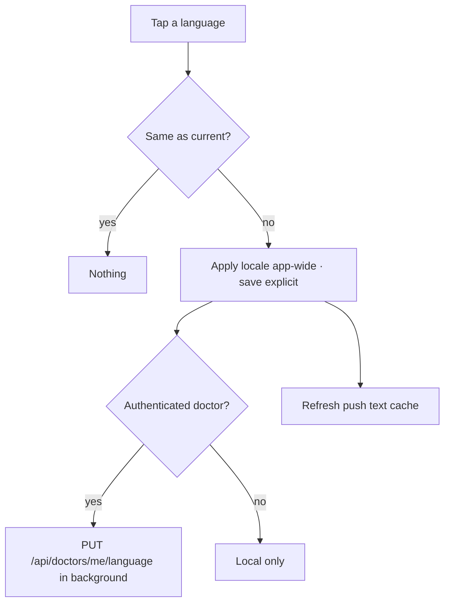

# Language settings (full screen) and language mini-toggle

| | |
|---|---|
| Area | 01 Launch, auth & shell |
| Who sees it | Both roles; also unauthenticated users via the mini-toggle on auth screens |
| Reached from | More sheet → "Language" (full screen); mini-toggle pill on Login / Verify key / registration screens and on top of every non-Home tab in the shell |
| Screen type | Full screen (pushed inside the shell, tab bar hidden) + anchored dropdown menu (mini-toggle) |
| Current Flutter source | `lib/features/settings/presentation/language_settings_screen.dart`; `lib/core/widgets/language_mini_toggle.dart`; `lib/core/providers/language_provider.dart`; `lib/core/localization/locale_detection.dart` |
| Spec | `docs/kmp-spec/01-architecture-core-auth-shell.md` §8; tickets LANG-01, LANG-02; `08-profile…` §6.1, SET-02 |

## 1. Purpose
Choose the interface language: English, Uzbek (Latin), Uzbek (Cyrillic – an automatic transliteration of the Latin strings), Russian. The choice applies instantly to the whole app, is remembered on the device, and is synced to the doctor's profile so e-mails/pushes use it. Set once; the pill exists so a new user can switch before reading anything.

## 2. Entry points
- More sheet → "Language" row (shows the current code as subtitle) → pushes this screen into the current tab's stack; the bottom bar is hidden.
- Mini-toggle pill: top-right of Login, Verify key, Create account steps, Receptionist form; inside the shell at the top-right of every tab except the doctor's Home tab (hidden there), and not while Intelligence mode is open. Tap → anchored dropdown EN / UZ / ЎЗ / RU.
- Profile → Settings panel also has a language dropdown (area 08) that writes the same setting.
- No context arrives.

## 3. Layout, top to bottom (phone portrait)
### 3a. Language settings screen
1. App bar (cardboard background, black foreground): back arrow, title "Select Language".
2. List with 8 dp gaps, 16 dp side padding, 4 cards (12 dp radius, white; selected card tinted teal 8 %):
   - "English"
   - "Uzbek (UZ)" – label built from `uzbek` + " (UZ)"
   - "Uzbek (Cyrillic)"
   - "Russian"
   Each row: label (16 sp, semibold when selected) left, radio icon right (teal when selected).
3. No save button – tap applies immediately.
Target: show each language in its own tongue ("O‘zbekcha", "Ўзбекча", "Русский", "English") with the current-language name as a subtitle, as platform conventions suggest.

### 3b. Mini-toggle pill
1. White pill, hairline border, soft shadow: 2-letter code (EN / UZ / ЎЗ / RU, 12 sp bold) + chevron-down in brand colour.
2. Tap → Material dropdown anchored to the pill with the four codes as plain text items.

## 4. Data and formats
| Field | Source | Format rule |
|---|---|---|
| Current language | device prefs `doctor_language` (`en` / `uz` / `uz-Cyrl` / `ru`) + flag `doctor_language_explicit` | Default when unset: Uzbek if the phone's region is UZ, its language is Uzbek, or (web) the timezone is Tashkent; otherwise English. |
| Backend sync | `PUT /api/doctors/me/language {language}` | `uz-Cyrl` is sent as `uz`. Sent whenever authenticated and the code changes (deduplicated). Staff: UNVERIFIED whether the endpoint accepts them (it is a doctor endpoint – likely 403, ignored). |
| Uzbek Cyrillic | runtime transliteration of Uzbek Latin strings | Placeholders preserved; digraphs sh/ch/ng/o‘/g‘ mapped. Material system strings (date picker etc.) fall back to English for Uzbek. |
| Date/number formats | follow the language (script stripped for Cyrillic) | – |

## 5. Primary flow (happy path)
1. Doctor opens More → Language.
2. Taps "Russian".
3. The whole app re-renders in Russian instantly (including this screen's title and the tab labels underneath).
4. Confirmation "Language changed successfully" (today a SnackBar; target a short success banner – or no message at all, since the change is self-evident).
5. Preference saved as explicit; backend sync fires in the background; push-notification text cache refreshed.
6. Back → returns to the tab the sheet was opened from.

## 6. Screen states
- First load (skeleton): n/a – local data, instant.
- Empty: n/a (always 4 options).
- Error on load: n/a.
- Offline: fully functional locally; the backend sync fails silently and is retried on the next change or login (today: retried only when the code changes again – target: retry on next app start if unsynced).
- Refreshing: n/a.
- Partial data: n/a.
- Permission needed: none.
- Locked by tier: n/a.
- Role difference: none visible; staff sync may be rejected silently.
- Selected state per row; no loading state (instant).

## 7. Interactions and secondary flows
- Tap row → apply (see §5). Tapping the already-selected row does nothing.
- Back arrow / system back / swipe → pop to the tab.
- Mini-toggle: tap pill → dropdown; pick → apply; tap outside → close.
- Language change while a text field has focus elsewhere → the field keeps its text; hints re-render.

## 8. Edge cases
- First launch in Uzbekistan → Uzbek Latin preselected automatically; the doctor may not expect Cyrillic to exist – the full list makes it discoverable.
- Non-explicit auto-detected language is re-evaluated at **every cold start** today: a doctor who travels (SIM/region changes) sees the language flip. Target: detect once, then treat the result as a saved choice.
- Switching to Uzbek Cyrillic: strings with no Uzbek translation fall back to the raw key (not even English) today in uz/ru (91 keys affected, e.g. all app-lock labels). Target: fall back to English.
- Long labels at 200 % font (e.g. "Uzbek (Cyrillic)" in Russian "Узбекский (кириллица)") → row height grows; icon stays vertically centred.
- Russian text is ~30 % longer: tab labels in the bottom bar ("Календарь", "Пациенты") must not truncate – allow 2 lines or smaller type (design the bar for Russian first).
- Dropdown anchored at the very top-right on notched phones → the menu must stay within the safe area (today uses the root overlay; verify on device).
- Language change while a bottom sheet or dialog is open → they re-render in place (OK) except text already typed by the user.
- Language change during a video call → UI strings change; the call continues.
- The More-sheet subtitle shows the code ("RU") not the name – fine for a 2-letter hint; target could show the name.
- Date pickers in Uzbek show English month names (no Material Uzbek bundle) – UNVERIFIED on KMP; design should not rely on native picker localisation for Uzbek.
- Screen reader: rows are radio buttons in a group ("Russian, radio button, selected, 4 of 4").
- Rotation → list re-renders; selection kept.
- Pill hidden on the doctor Home tab (overlaps the header) but shown on Calendar/Patients/Chat – inconsistent floating element over content. Target: remove the floating pill inside the shell entirely; language lives in More → Language and in Profile settings.
- Backend sync race: switching languages quickly fires one PUT per distinct code; the last one wins server-side – fine.
- Sign-out does not reset the language (correct; it is a device preference).

## 9. Validation and messages
| Field/action | Rule | When checked | Message (English) | Where shown |
|---|---|---|---|---|
| Select language | differs from current | on tap | "Language changed successfully" | today SnackBar; target: none or brief success banner |
| Backend sync | PUT fails | background | – (silent, logged) | – |

## 10. Navigation out
- ← previous tab screen (pop). Nothing to keep; the whole app already reflects the choice.
- The More sheet is already closed when this screen opens; returning lands on the tab content, not the sheet.

## 11. Copy
`selectLanguage` "Select Language" · `english` "English" · `uzbek` "Uzbek" · `uzbekCyrillicMenu` "Uzbek (Cyrillic)" · `russian` "Russian" · `language` "Language" · `languageChanged` "Language changed successfully"
Target native labels (**NEW** or reuse): `languageNativeEn` "English" · `languageNativeUz` "O‘zbekcha" · `languageNativeUzCyrl` "Ўзбекча" · `languageNativeRu` "Русский"

## 12. Known problems in the current app (do not carry over)
- Auto-detected language overwritten on every cold start unless the user picked one explicitly.
- Missing uz/ru keys render as raw English keys (no English fallback).
- Floating pill over tab content, hidden on one tab only; the dropdown shows bare codes.
- "Uzbek (UZ)" label built by string concatenation.
- SnackBar confirmation for a change that is visible everywhere.
- Three different places set the language (pill, this screen, Profile settings dropdown) with no single visual pattern.

## 13. Open questions for design
- Keep the pill on auth screens only (recommended) and drop it inside the shell?
- Show languages in their native names, with a subtitle in the current language?
- Should Uzbek Cyrillic be presented as a sub-option of Uzbek (script switch) rather than a fourth language?
