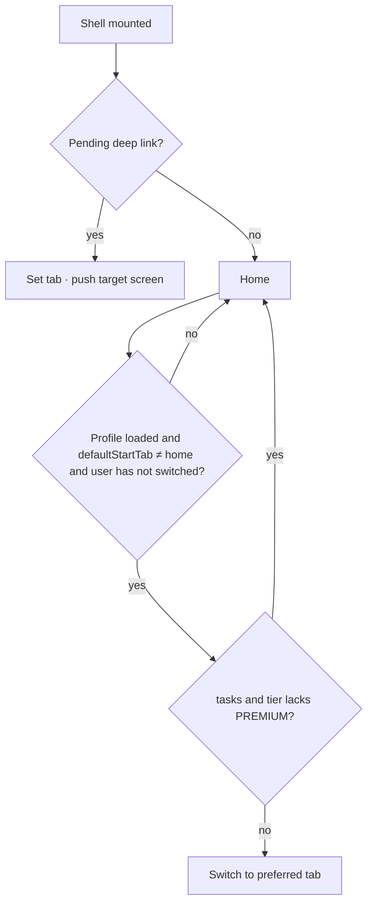

# Main shell – doctor (5-slot bottom bar)

| | |
|---|---|
| Area | 01 Launch, auth & shell |
| Who sees it | Doctor role, every tier (Tasks and Intelligence entries are tier-gated inside More) |
| Reached from | Splash (valid session), Login / email code / reset password / registration (success), push-notification tap, any "back to app" navigation |
| Screen type | Tab root container (persistent bottom bar; nested stack per tab) |
| Current Flutter source | `lib/features/shell/presentation/main_shell.dart` (`_MobileBottomNav`, `_ShellTabContent`, resume hooks), `shell_scope.dart`, `lib/state/shell/shell_controller.dart`, `features/shell/domain/doctor_start_tab.dart` |
| Spec | `docs/kmp-spec/01-architecture-core-auth-shell.md` §6, §5.3–5.4; tickets SHELL-01, SHELL-03, SHELL-04, SHELL-05 |

## 1. Purpose
The frame around everything a signed-in doctor does: a bottom bar with the four daily destinations plus "More", badges for unread chat (and notifications inside More), and the plumbing that keeps each tab's screen alive while switching. Used constantly.

## 2. Entry points
- After any successful authentication or session restore (replaces the auth stack).
- Push tap: arrives with a target tab index and, often, a screen to push inside that tab (`20-push-deep-link-landing.md`).
- Start tab: defaults to Home; once per session, after the profile loads, a saved preference (`defaultStartTab`: chat / home / calendar / patients / clinic / tasks / reports / notifications / profile) is applied – unless a deep link is pending or the user already switched tabs. A `tasks` preference is ignored when the tier does not allow tasks.
- Intelligence mode (Shifa AI) replaces the tab content area entirely while active; the bar stays (area 03).

## 3. Layout, top to bottom (phone portrait)
1. Status bar + safe area (top inset owned by the content).
2. **Content area**: the current tab's screen (each tab keeps its own nested back stack; pushed screens hide the bottom bar – today the bar stays visible on nested routes; **target: hidden**, per 00-README).
3. Floating language pill top-right on every tab except Home (today; target: removed, see 15).
4. **Bottom navigation bar**, 68 dp, white, 5 slots, rounded 16 dp teal-tinted indicator on the selected slot, 12 sp labels, 24 dp icons:
   1. Home (house)
   2. Calendar (calendar)
   3. Patients (people)
   4. Chat (speech bubble) with a red count badge when unread > 0
   5. More (⋯) – opens the More sheet (`17-more-sheet.md`); highlighted whenever the active tab is one of the "More" tabs (Clinic, Tasks, Reports, Notifications, Profile)
5. Home indicator inset below the bar.
No top app bar belongs to the shell; each tab draws its own header.

Hidden tabs reachable only via More: Clinic workspace (only if the doctor belongs to a clinic), Tasks (PREMIUM only), Reports, Notifications, Profile. All nine screens are kept alive in an indexed stack once built.

## 4. Data and formats
| Field | Source | Format rule |
|---|---|---|
| Unread chat count | polled every 10 s (5 s retry when no token; 0 on error) | Badge shows the number; today no cap – target cap at "99+". |
| Unread notifications | refreshed on app resume and on foreground push (no polling) | Shown inside the More sheet row and on the Notifications tab (staff only in the bar). |
| Active tasks count | task list loaded once at shell start | Desktop-only pill today; target: small count on the More → Tasks row. |
| Has clinic workspace | `GET /api/me/clinics` memoised per session | Shows/hides the Clinic row in More. |
| Tier | profile `subscription.tier`; **missing ⇒ PREMIUM today** | Target: treat "unknown" as "not yet" – hide gated rows until the profile arrives (open decision 2). |
| Current location chip | derived every 60 s from today's calendar entries (in practice timezone) or the saved active location | Shown in More; target: computed on demand, no polling. |
| Avatar | profile photo with cache-buster | Used by the staff bar only; doctor bar has no avatar. |

## 5. Primary flow (happy path)
1. Shell appears on Home (or the preferred start tab a moment later).
2. Doctor taps Calendar → content switches instantly (already built screens are kept; a first-time tab shows its own skeleton).
3. Doctor opens a patient inside Patients → pushed on the Patients stack; bar hidden (target).
4. Doctor taps Chat in the bar → Chat tab shown; Patients stack is kept.
5. Tapping Patients again → returns to the patient screen that was open? Today: tapping a bar item first **pops the current tab's stack to root**, then switches. So re-tapping the active tab = "pop to root"; switching tabs also resets the tab you leave. Target: keep per-tab stacks (switch without popping; re-tap active tab pops to root / scrolls to top).

## 6. Screen states
- First load (skeleton): the bar renders immediately with no badges; each tab's content shows its own skeleton (area files). The More-sheet gated rows (Clinic, Tasks) appear once the profile/clinics calls return – target: skeleton rows in the sheet while unknown, never "appear later".
- Empty: n/a for the frame itself.
- Error on load: profile fails → tabs still work with their own errors; tier unknown ⇒ today everything unlocked. Target: gated rows hidden + retry via pull-to-refresh on Home.
- Offline: bar works; badges freeze at last values; an offline banner appears at the top of the content area (`19-global-banners-offline.md`).
- Refreshing: on app resume the shell silently refreshes notifications count, clinics, appointments; content must not jump.
- Partial data: clinics call fails → Clinic row hidden for the session (memoised as "unknown → false"). Target: retry on next resume.
- Permission needed: notification permission (target: asked once here after first login, with a pre-prompt explaining appointment reminders / chat). Denied permanently → no prompt again; a hint in Profile → Settings.
- Locked by tier: Tasks row hidden below PREMIUM; Intelligence row shows but tapping shows an error snack today ("Error") – target: row visible with a lock icon and an upgrade message, or hidden (00-README allows either; say which per row: Tasks hidden, Intelligence dimmed with "PRO required").
- Role difference: staff see a different bar (`18-main-shell-clinic-staff.md`).

## 7. Interactions and secondary flows
- Tap bar item → switch tab (today also pops that tab's stack to root and resets Intelligence mode to normal).
- Tap active bar item → today same as above (pop to root). Target: pop to root; if already at root, scroll to top.
- Tap More → bottom sheet.
- System back (Android): **not handled today** – on any tab root the app exits (or returns to a leftover auth route). Target: on a nested screen → pop it; on a non-Home tab root → go to Home; on Home → exit (no confirmation).
- iOS swipe-back → pops the nested screen (standard); on a tab root does nothing.
- App resume → background refresh (see §6) and app-lock check (`12-app-lock-enter-pin.md`).
- Push received in foreground → local notification shown; badges refreshed.
- Tier changes after a profile refresh while on Tasks → bounced to Home silently. Target: banner "Tasks are no longer available on your plan".

## 8. Edge cases
- 0 unread → no badge; 1–99 → number; 100+ → today "100", "1234" widens the badge – cap "99+".
- Deep link to a tab whose screen has not been built yet → the tab is switched, the screen builds, then the nested push happens (retries up to 5 frames). Design: no intermediate flash of Home – show the target tab's skeleton.
- Preferred start tab arrives after the user already tapped another tab → ignored (correct).
- Preferred start tab = `clinic` but the doctor has no clinic → the Clinic tab shows an empty workspace state (area 09). Target: fall back to Home.
- Profile call slow (> 3 s): More sheet rows appear late; see §6.
- Deep link while the More sheet is open → sheet dismissed by the full-stack replacement; target: close the sheet explicitly before navigating.
- Deep link while a nested screen has unsaved input (e.g. half-written note) → today the whole stack is replaced without asking. Target: ask "Discard changes?" only when the destination differs; otherwise switch silently. Minimum: never lose a draft silently (per-feature drafts).
- Rotation → tab and nested stacks kept; the bar stays at the bottom (no rail in landscape on phones; tablets may use a rail – area 04 design-system question).
- 200 % font → 5 labels at 12 sp; Russian "Календарь"/"Пациенты" must fit – allow label wrap to 2 lines or hide labels at the largest sizes. Bar height may grow to ~80 dp.
- Language switch → labels re-render; badge numbers unaffected.
- Screen reader: bar items announce "Home, tab, 1 of 5, selected"; Chat badge announces "3 unread messages"; More announces "More options, button".
- Session expiry → whole shell replaced by Login (14).
- Two taps in quick succession on different bar items → last wins; no double navigation.
- Intelligence mode active + tap on a bar item → leaves Intelligence and switches tab (appointment caches refreshed because AI may have booked).
- The 60-second location ticker fires calendar + locations requests all session long today – not a design concern but the chip's value may change under the user; target: static until a slot boundary.
- Chat tab badge polls even while the Chat tab is open (double counting is avoided by the chat screen marking read). Fine.
- First login of a brand-new doctor: Home is empty; no onboarding exists. Design opportunity (area 02).

## 9. Validation and messages
| Field/action | Rule | When checked | Message (English) | Where shown |
|---|---|---|---|---|
| Intelligence entry | tier ≥ PRO | on tap | today "Error"; target **NEW** `requiresProPlan` "Shifa Intelligence requires the PRO plan." | banner / dimmed row subtitle |
| Tasks tab | tier = PREMIUM | on tab resolve | silent bounce today; target **NEW** `tasksNotOnPlan` "Tasks are not available on your plan." | banner |
| Notification permission (target) | not yet decided | once after first login | **NEW** `notifPrePromptTitle` "Stay informed" · **NEW** `notifPrePromptBody` "Get reminders for appointments and new patient messages." · "Allow" / "Not now" | pre-prompt sheet |

## 10. Navigation out
- → Login on logout/expiry (stack cleared).
- → Full-screen routes that are intentionally outside the shell (video call today is pushed on the root navigator in some paths) – return restores the shell with its state.
- Tab switches keep everything; nothing is discarded by the shell itself.

## 11. Copy
Tab labels (values live only in the embedded map, **absent from `strings/en.json` export**): `home` "Home" · `calendar` "Calendar" · `patients` "Patients" · `chat` "Chat" · `more` "More" · `tasks` "Tasks" · `navReports` "Reports" · `notifications` "Notifications" · `profile` "Profile" · `clinicNavClinic` "Clinic" · `shifaIntelligence` "Shifa Intelligence" · `error` "Error"
**NEW** `requiresProPlan` · **NEW** `tasksNotOnPlan` · **NEW** `notifPrePromptTitle` · **NEW** `notifPrePromptBody` · **NEW** `allow` "Allow" · **NEW** `notNow` "Not now" · **NEW** `unreadCountCap` "99+"

## 12. Known problems in the current app (do not carry over)
- No Android back handling in the shell (exits the app from any tab root; may surface a stale auth route).
- Switching tabs pops the tab you leave to its root – per-tab stacks are effectively lost.
- Bottom bar stays visible on nested screens.
- Tier unknown ⇒ PREMIUM (gated rows flash in/out as data arrives; staff resolve to PREMIUM).
- 60 s polling of calendar + locations for a sidebar chip.
- Floating language pill over content, hidden on one tab only.
- Desktop sidebar and phone bar expose different tab sets (no Chat/Notifications on desktop) – phone set is the design target.
- Notifications count only refreshes on resume/push; a stale badge after reading notifications in-app is possible (the Notifications screen invalidates it – verify).
- Eleven dead navigation widgets and four logout dialogs in the shell file.

## 13. Open questions for design
- Which four tabs deserve the bar? Current: Home, Calendar, Patients, Chat. Alternative: swap Chat for Notifications (chat badge then moves to More). Usage data would decide; default to current.
- Badge on "More" when Notifications has unread (today none – the user cannot see unread notifications without opening More)? Recommended: dot badge on More.
- Tablet: bottom bar vs navigation rail (00-README says tablets get wider gutters, not split panes – rail is still a bar variant; decide in area 04).
- Should the current-location chip appear in the Home header instead of More?
