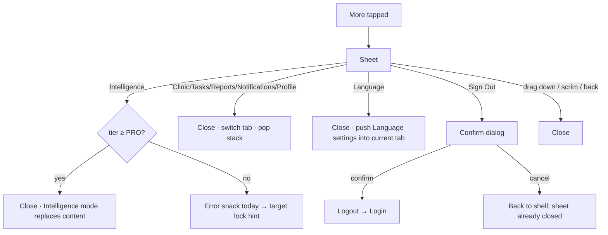

# More sheet (doctor and clinic staff)

| | |
|---|---|
| Area | 01 Launch, auth & shell |
| Who sees it | Doctor (full list) – staff have no More slot today (their 4 tabs fit the bar); the sheet code supports a reduced staff list that is unreachable |
| Reached from | Bottom bar → "More" (5th slot) |
| Screen type | Modal bottom sheet (drag handle, scrim, scrollable) |
| Current Flutter source | `lib/features/shell/presentation/main_shell.dart` (`_showMobileMoreSheet`, `_MobileMoreSheetTile`, `_MobileMoreLogoutButton`) |
| Spec | `docs/kmp-spec/01-architecture-core-auth-shell.md` §6.1 (mobile More sheet), §5.3, §5.4; ticket SHELL-01 |

## 1. Purpose
Overflow for the five destinations that do not fit the bar (Clinic, Tasks, Reports, Notifications, Profile), the Shifa Intelligence entry, a glance at the current practice location, the language setting and Sign out. Opened several times a day.

## 2. Entry points
- Bar → More (tap). Context: current tab (to highlight the matching row), clinic membership, tier, location label, unread notifications.
- Opens over the current tab content; the bar remains visible under the scrim.

## 3. Layout, top to bottom (phone portrait)
1. Drag handle (system style), safe-area aware, 16 dp side padding.
2. **Shifa Intelligence** row: sparkle icon, title "Shifa Intelligence", subtitle "Talk with AI". Doctor only.
3. Divider.
4. **Current location** row (only when a label exists): location pin icon – or camera icon when today's current slot is a video slot – title = location label (e.g. "Shifa Clinic Tashkent" / "Video Call"), subtitle "Current Location". Not tappable. Doctor only.
5. Divider.
6. **Clinic** row (hospital icon) – only when the doctor belongs to a clinic. Highlighted when active.
7. **Tasks** row (check icon) – only when tier = PREMIUM. Highlighted when active. Target: active-task count on the right.
8. **Reports** row (analytics icon).
9. **Notifications** row (bell icon). Target: unread count on the right (today none – the only unread signal for notifications on phones is missing).
10. **Profile** row (person icon).
11. Divider.
12. **Language** row (globe icon): title "Language", subtitle current code (EN / UZ / ЎЗ / RU), chevron.
13. **Sign Out** row (logout icon, brand colour text) – opens the confirmation dialog.
Rows: 16 sp title, 13 sp grey subtitle, 12 dp radius, selected tint teal 8 %. The sheet scrolls when taller than the viewport (≤ 92 % height).

## 4. Data and formats
| Field | Source | Format rule |
|---|---|---|
| Location label | derived: the calendar entry whose time window contains "now" in practice timezone, else the next one today, else the last one; else the saved active location (by saved id → primary → first) | Any location containing "video" becomes "Video Call". Recomputed every 60 s today. |
| Clinic visibility | `GET /api/me/clinics` non-empty | – |
| Tasks visibility | tier PREMIUM (unknown ⇒ shown today) | Target: hidden until known. |
| Language code | current locale | EN / UZ / ЎЗ / RU. |
| Unread notifications (target) | notifications unread count | "99+" cap. |

## 5. Primary flow (happy path)
1. Doctor taps More; sheet slides up (~250 ms), scrim darkens.
2. Taps "Profile" → sheet closes, Profile tab becomes active (bar highlights More), Profile stack popped to root.
3. Back/bar tap elsewhere returns to the previous tab.

## 6. Screen states
- First load (skeleton): the sheet is built from already-known values; if the profile/clinics are still loading (first seconds after login), Clinic/Tasks rows are missing and appear only next time. Target: skeleton rows for gated entries while unknown.
- Empty: n/a (always has Reports, Notifications, Profile, Language, Sign out).
- Error on load: clinics unknown → Clinic hidden; no error inside the sheet.
- Offline: fully usable; navigation is local; location label may be stale.
- Refreshing: the sheet does not live-update (values captured at open). Target: reactive rows.
- Partial data: no location label → the row is omitted (no empty row).
- Permission needed: none.
- Locked by tier: Tasks hidden; Intelligence shown but fails on tap below PRO. Target: Intelligence dimmed with subtitle "PRO plan required"; Tasks hidden (or dimmed with "PREMIUM plan required" – decide).
- Role difference: staff variant (unreachable today, but coded): no Intelligence, no location, no Clinic/Tasks/Reports rows; only Notifications, Profile, Language, Sign out. If staff keep a 4-tab bar in the rewrite, they still need Language and Sign out somewhere → see `18-main-shell-clinic-staff.md` §13.

## 7. Interactions and secondary flows
- Row tap → close sheet, then act (order matters: the sheet pops first so the navigation happens on the shell).
- Drag handle down / tap scrim / system back → close, nothing changes.
- Language → the Language screen is pushed into the *current tab's* stack (bar remains highlighted on that tab).
- Sign Out → dialog shown **from the sheet's context** (sheet stays open underneath); confirm closes both and signs out; cancel closes the dialog, sheet still open. Target: close the sheet first.
- Location row → nothing. Target: tap opens Profile → Locations (area 08) or the Calendar day.

## 8. Edge cases
- Location label very long (clinic address) → single line ellipsis today; allow 2 lines.
- Doctor with 0 locations and no appointments today → row absent.
- Multiple appointments at different locations today → label changes at slot boundaries (today checked each minute).
- Timezone mismatch phone vs practice → "now" is computed in practice timezone (correct); a doctor abroad sees their home-clinic status.
- Tier downgraded while the sheet is open → rows do not update until reopened.
- Clinic membership granted after login → Clinic row appears only after a resume (clinics refreshed on resume) or next login.
- 200 % font → rows grow; the sheet scrolls; the Sign out row must remain reachable (it is at the bottom of the scroll).
- Rotation with the sheet open → sheet re-lays out; stays open.
- Deep link while the sheet is open → the stack replacement dismisses it; target: close explicitly.
- Screen reader: sheet announces "More options"; rows are buttons; the location row is static text ("Current location: …").
- Language switch inside the sheet is not possible (the row navigates away).
- Double tap a row → second tap lands on the shell behind (sheet already closing) – harmless; design the row with a brief disabled state after tap.
- Sign-out dialog on top of the sheet on small screens → readable but cluttered (two layers of scrim).
- Unread notifications unknown (never fetched yet) → no count; do not show "0".

## 9. Validation and messages
| Field/action | Rule | When checked | Message (English) | Where shown |
|---|---|---|---|---|
| Intelligence | tier ≥ PRO | on tap | today "Error"; target "Shifa Intelligence requires the PRO plan." | row subtitle / banner |
| Sign Out | confirm | dialog | "Are you sure you want to sign out?" · "Cancel" · "Sign Out" | dialog |

## 10. Navigation out
- → Tab (Clinic / Tasks / Reports / Notifications / Profile): sheet closed; destination tab popped to root.
- → Intelligence mode: content area replaced; bar stays.
- → Language settings: pushed in the current tab.
- → Sign-out dialog → Login.
- Close: nothing changes.

## 11. Copy
`shifaIntelligence` "Shifa Intelligence" (embedded-map only) · `sidebarAiCta` "Talk with AI" · `currentLocation` "Current Location" · `videoCall` "Video Call" · `clinicNavClinic` "Clinic" · `tasks` "Tasks" · `navReports` "Reports" · `notifications` "Notifications" · `profile` "Profile" · `language` "Language" · `signOut` "Sign Out" · `signOutConfirm` · `cancel` · `more` "More"
**NEW** `proPlanRequired` "PRO plan required" · **NEW** `premiumPlanRequired` "PREMIUM plan required"

## 12. Known problems in the current app (do not carry over)
- Values captured at open; rows do not react to data arriving later.
- No unread indicator for Notifications anywhere on the phone bar/sheet.
- Intelligence tap below PRO shows a generic "Error" SnackBar.
- Sign-out dialog stacks on top of the open sheet.
- Location row is informational only, with a 60 s polling cost behind it.
- Staff variant unreachable; staff on phones were blocked.

## 13. Open questions for design
- Grid of icons (2 × 3 tiles) vs list rows? List is cheaper and scales to 200 % font.
- Put the doctor's avatar + name + tier badge at the top of the sheet (quick identity check, doubles as Profile entry)?
- Should "Sign Out" live only in Profile (safer against accidental taps) rather than in the sheet?
- Is "Current location" worth the row, or should it move to the Home header / Calendar?
