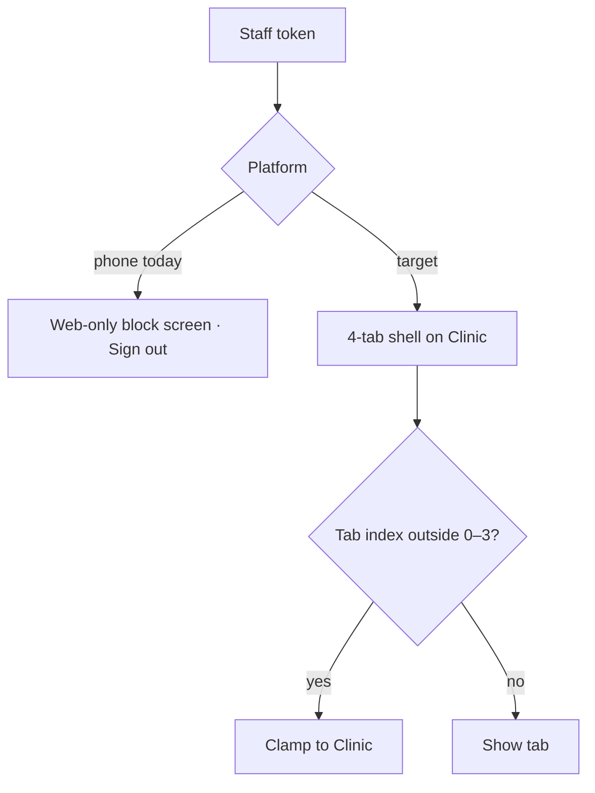

# Main shell – clinic staff (4-tab bar)

| | |
|---|---|
| Area | 01 Launch, auth & shell |
| Who sees it | Clinic staff role (CLINIC_STAFF); no tiers |
| Reached from | Login / email code / reset password / receptionist registration with a staff token; session restore |
| Screen type | Tab root container (persistent 4-slot bottom bar) |
| Current Flutter source | `lib/features/shell/presentation/main_shell.dart` (staff branches: `screens` list, `_MobileBottomNav` staff bar, index clamps), `lib/features/auth/presentation/clinic_staff_web_only_screen.dart` (current phone block – dropped) |
| Spec | `docs/kmp-spec/01-architecture-core-auth-shell.md` §6.1, §6.4, §2.8; tickets SHELL-02, AUTH-08; `00-README.md` scope decision "Clinic staff" |

## 1. Purpose
A reduced shell for receptionists: Chat with patients, the Clinic workspace (bookings on behalf of doctors, clinic patients, finance per clinic role), Notifications and their own Profile. No Home dashboard, no personal calendar, no AI, no tasks, no reports. **Today phones show a "web only" block screen instead; the rewrite allows staff on mobile.** Used constantly by staff.

## 2. Entry points
- After authentication with a token whose role is CLINIC_STAFF (replaces auth stack). Start tab: Clinic workspace (index 1) – set explicitly after registration; after plain login the default is also Clinic (the doctor's "Home" index 1 maps to Clinic for staff). The saved start-tab preference is **never** applied for staff.
- Push taps: chat and notification deep links work; task deep links are discarded for staff; appointment / document / patient links switch to doctor tab indexes (2 / 3) which for staff are Notifications / Profile – wrong destination (see §8, `20-push-deep-link-landing.md`).
- Session restore.

## 3. Layout, top to bottom (phone portrait)
1. Content area (the active tab's screen; nested stacks as for doctors).
2. Floating language pill top-right on every tab today (target: removed; staff need Language in Profile).
3. Bottom bar (Material default navigation bar; 4 slots):
   1. Chat (speech bubble, red count badge)
   2. Clinic (hospital icon)
   3. Notifications (bell, red count badge)
   4. Profile – the slot icon is the staff member's **avatar** (24 dp circle, photo or person icon)
No More slot today. Language and Sign out are therefore reachable only via the Profile screen (verify in area 08 that the staff Profile exposes Sign out and Language; the sheet variant for staff exists in code but has no trigger).

## 4. Data and formats
| Field | Source | Format rule |
|---|---|---|
| Identity | `GET /api/me/profile` (firstName, lastName, photoUrl) – staff must never call `/api/doctors/me` (it 403s and the client is careful not to log them out for it) | Avatar with cache-buster. |
| Unread chat | same 10 s poll as doctors | Badge; cap "99+" (target). |
| Unread notifications | refreshed on resume/push | Badge on slot 3. |
| Tier | none; the tier provider resolves to PREMIUM for staff because the doctor profile throws | Must not matter: no gated entry exists in the staff shell. Target: tier provider returns "n/a" for staff. |
| Clinic role (OWNER / CLINIC_ADMIN / RECEPTIONIST / …) | clinic membership (area 09) | Gates actions inside Clinic workspace, not the shell. |

## 5. Primary flow (happy path)
1. Receptionist logs in → Clinic workspace opens (clinic selector if several clinics – area 09).
2. Taps Chat → patient conversations; badge clears as threads are read.
3. Taps Notifications → inbox; badge clears.
4. Taps the avatar → Profile (name, photo, language, sign out – area 08).

## 6. Screen states
- First load (skeleton): bar immediately; avatar slot shows the person icon until the profile loads (target: skeleton circle); tab content shows its own skeleton.
- Empty: a staff member with no clinic membership yet → Clinic tab shows the workspace empty state (area 09); the shell itself is unchanged.
- Error on load: `me/profile` fails → avatar icon, name blank in Profile; retry inside Profile.
- Offline: same as doctor shell; offline banner at top of content.
- Refreshing: resume refreshes notifications and clinics.
- Partial data: n/a.
- Permission needed: notification permission pre-prompt once (same as doctor).
- Locked by tier: n/a – nothing gated.
- Role difference: this *is* the role variant. Inside tabs, clinic roles further restrict finance actions (area 09).
- Today-only state: the block screen – computer icon, title "Clinic staff portal", body "The clinic receptionist portal is available on the web…", filled "Sign Out" button. **Not designed** (dropped), listed for completeness.

## 7. Interactions and secondary flows
- Tap slot → switch tab (same pop-to-root behaviour as the doctor shell today; target: per-tab stacks).
- System back → not handled today (exits). Target: nested pop → Clinic → exit.
- Avatar tap → Profile tab.
- Long-press avatar → nothing (could open a quick account sheet – optional).
- App resume → refresh counts.

## 8. Edge cases
- Deep link types that assume doctor indexes: appointment pushes call "tab 2" (Notifications for staff) and then set calendar state that no staff screen reads; document/patient pushes call "tab 3" (Profile for staff) and push a Patients route that *does* exist in the nested router → a Patients screen opens inside the Profile tab. Target: a staff-aware router: appointment → Clinic workspace calendar of that clinic; patient/document → Clinic patients; unknown → Notifications.
- Staff member who is also a doctor (two accounts) → separate logins; nothing to design.
- Staff token with an index remembered from a previous doctor session on the same device (e.g. 5 = Tasks) → clamped to Clinic. Fine.
- 0 clinics (membership revoked) → Clinic tab empty state; Chat may still list old conversations. Product decision whether such an account can even log in.
- Chat badge counts conversations across all clinics – UNVERIFIED backend scoping for staff.
- Notifications for staff: the 18-type catalogue is doctor-centric; staff receive a subset (UNVERIFIED which). Design the inbox generically.
- Long names in Profile slot → the slot shows only the avatar; label "Profile" stays short.
- 200 % font → 4 labels fit more easily than 5; still design for Russian.
- Language switch → labels re-render; staff language sync to backend is UNVERIFIED (doctor endpoint).
- Session expiry / disabled account → same forced-logout behaviour (14).
- Screen reader: "Profile, tab, 4 of 4" – the avatar image needs the label, not "image".
- Rotation → kept.
- Deep link while a nested screen is open → same rules as doctor shell.
- Avatar photo URL expired/404 → fall back to the person icon (today a broken image could appear; use a cached image with error builder).
- Staff member switching between two clinics inside Clinic workspace → the shell is unaffected; the selected clinic is remembered per staff id (area 09).
- Push "chat" with a conversation the staff member no longer has access to → Chat opens the list and the thread 404s; show the standard "no longer available" banner.
- Shared reception tablet with several staff accounts → each logout must clear everything session-scoped (14) and ideally the app-lock PIN; design the Profile sign-out as prominent for staff.
- Staff in landscape on a tablet → the 4-slot bar stays at the bottom (no rail) unless area 04 decides otherwise.

## 9. Validation and messages
| Field/action | Rule | When checked | Message (English) | Where shown |
|---|---|---|---|---|
| Tab index | 0–3 | on build | – (silent clamp) | – |
| Block screen (today only) | role = staff on phone | on build | "Clinic staff portal" / "The clinic receptionist portal is available on the web. Please sign in at your clinic workspace in a browser." (keys `clinicStaffMobileTitle` / `clinicStaffMobileBody`, **no values in any locale**) | full screen – **dropped** |

## 10. Navigation out
- → Login on logout/expiry.
- Everything else is tab switching inside the shell.

## 11. Copy
`chat` "Chat" · `clinicNavClinic` "Clinic" · `notifications` "Notifications" · `profile` "Profile" · `signOut` "Sign Out"
Dropped: `clinicStaffMobileTitle`, `clinicStaffMobileBody` (never translated).
**NEW** (only if a staff More/overflow is added): `language` "Language" exists.

## 12. Known problems in the current app (do not carry over)
- Phones block staff entirely with an untranslated screen.
- Push deep links use doctor tab indexes for staff and land on wrong tabs.
- No Language / Sign out affordance outside Profile (and the floating pill).
- Tier resolves to PREMIUM for staff by accident (profile call throws).
- Start-tab preference silently ignored for staff (acceptable, but the Profile settings should then hide the control for staff – verify in area 08).
- Material default bar styling for staff vs custom themed bar for doctors – two looks for one component.

## 13. Open questions for design
- Should staff get a 5th "More" slot for consistency (Language, Sign out, Help), or is Profile enough?
- Is the avatar-as-tab-icon pattern desired for doctors too (consistency), or should both use a person icon?
- Staff Home: do receptionists need a dashboard (today's bookings, waiting patients) instead of landing directly in the Clinic workspace? Area 09 question, affects slot 2 naming.
