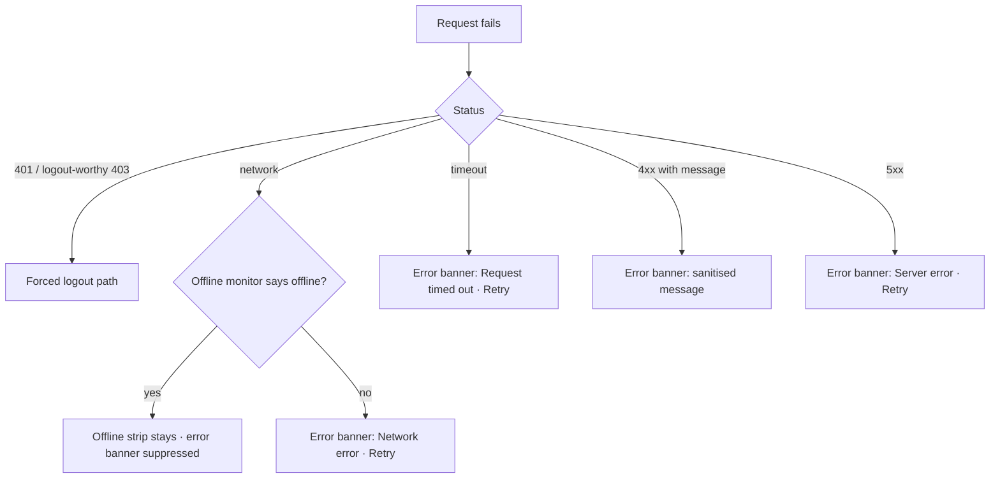

# Global banners and offline behaviour

| | |
|---|---|
| Area | 01 Launch, auth & shell |
| Who sees it | Both roles, every tier, on every screen |
| Reached from | System events (connectivity lost/restored, request failures, confirmations) – not navigated to |
| Screen type | Overlay component: top banner that slides in under the app bar; plus an offline banner pinned under the app bar |
| Current Flutter source | No banner component exists. Today: `ScaffoldMessenger.showSnackBar` at ~410 call sites; errors sanitised by `lib/core/utils/error_formatter.dart`; no connectivity detection anywhere; 30 s timeouts only on GET/POST (`lib/core/api/api_client.dart`) |
| Spec | `docs/kmp-spec/04-design-system-and-ui-kit.md` §"SnackBars → banners", §"Spinners → skeletons"; `01-…` §3 (timeouts), §13.11, §13.17; tickets CORE-04, CORE-05 |

## 1. Purpose
One feedback pattern for the whole app, replacing bottom toasts: errors, confirmations and connectivity changes appear as a banner that slides in from under the app bar (or from the top safe area when a screen has no app bar), can carry one action, and never covers the bottom bar or input fields. Also defines what the app does when the network is gone. Seen daily.

## 2. Entry points
- Any failed request on the current screen (after the feature decides it is not a full-screen error).
- Confirmations after an action (saved, sent, deleted) – when the result is not visible in place.
- Connectivity lost / restored (target; no detection today).
- Forced-logout reasons on Login (14).
- Tier notices (16).
- Pre-prompt for notification permission (sheet, not a banner – 16).

## 3. Layout, top to bottom (phone portrait)
1. **Transient banner** (error / success / info / warning):
   - Anchored directly under the app bar (or under the status bar if none); full width minus 12 dp side margins, 12 dp radius, 12–16 dp padding; leading icon per severity; 14 sp text, up to 3 lines; optional trailing text action ("Retry", "Undo", "View"); close "×" for persistent variants.
   - Slides down 200 ms, auto-dismisses after 4 s (errors 6 s); a banner with an action waits 8 s; persistent banners stay until dismissed.
   - A new banner replaces the current one (no stacking; queue at most one pending).
2. **Offline banner** (persistent while offline): slim strip under the app bar, grey/warning tint, cloud-off icon, "You're offline. Showing saved data." No dismiss; disappears 1 s after connectivity returns, replaced by a brief success banner "Back online" only if something was blocked while offline.
3. **Loading** is never a banner and never a centred spinner for first loads – skeletons shaped like the final layout. A spinner survives only *inside* buttons (16 dp) and for indeterminate in-place refreshes.
4. Banners must not overlap the keyboard, the bottom bar, or a bottom sheet's content; inside a bottom sheet the banner renders at the top of the sheet.

## 4. Data and formats
| Field | Source | Format rule |
|---|---|---|
| Error text | backend `message` → sanitiser → localised key | Never show raw bodies, HTML, URLs, status codes or stack traces. Map: 401 → session banner (14); 403 (non-logout) → "Access denied"; 404 → "Resource not found"; 5xx → "Server error. Please try again later."; network → "Network error. Please check your connection."; timeout (30 s) → "Request timed out. Please try again."; anything > 100 chars or containing HTML/JSON → "Something went wrong". |
| Severity | caller | error (red), warning (amber), success (green), info (teal/blue). |
| Offline state | connectivity monitor (target) + last request failure | Debounce 1 s to avoid flicker on brief drops. |
| Cached data | per-feature caches (profile, lists) | Shown greyed? No – shown normally with the offline strip; write actions disabled with a hint. |

## 5. Primary flow (happy path – error on a save)
1. Doctor taps Save on any form; button spinner.
2. Request fails with 500.
3. Button returns to normal; red banner slides in under the app bar: "Server error. Please try again later." with action "Retry".
4. Retry re-submits; success → green banner "Saved" (if the result is not visible in place) → auto-dismiss.

## 6. Screen states
- First load (skeleton): rule for every screen – skeleton in the shape of the content; no banner.
- Empty: feature-specific empty states; not a banner.
- Error on load: full-content error state with Retry when nothing can be shown; banner + stale content when cached data exists.
- Offline: offline strip; cached content visible; buttons that need the network disabled with helper text, or enabled and failing fast with the banner (prefer disabled + hint for destructive/payment actions, enabled for cheap reads).
- Refreshing: pull-to-refresh indicator or silent; no banner on success unless nothing changed visibly.
- Partial data: banner "Some information could not be loaded" + Retry, while the loaded parts render.
- Permission needed: not a banner; inline card or system prompt; permanently denied → inline card with "Open settings".
- Locked by tier: inline lock card / dimmed content with upgrade text; a banner only for transient notices (bounce from Tasks).
- Role difference: none.

## 7. Interactions and secondary flows
- Swipe up on a transient banner → dismiss.
- Tap action → perform; banner dismisses.
- Tap "×" on a persistent banner → dismiss (remembered for the session where it makes sense, e.g. tier notice).
- Offline strip tap → nothing (optional: opens system network settings – avoid).
- Screen change while a banner is visible → banner is scoped to the screen that raised it and disappears with it; global banners (offline, session) persist across screens.

## 8. Edge cases
- Two errors in quick succession (e.g. three parallel loads fail) → one banner with a generic message, not three.
- Banner raised from a bottom sheet that then closes → banner moves to the parent screen (re-raised) or is dropped; prefer: re-raised once at the parent.
- Banner while the app lock overlay is up → suppressed until unlock (queue it).
- Banner during a video call → shown over the call UI only for call-related errors; others suppressed.
- Very long backend messages (validation lists) → truncated to 3 lines with "Details" action opening a dialog with the full text.
- Offline during an upload → upload paused/failed; the feature shows its own retry; the strip explains why.
- Offline at launch with a valid session → shell with cached profile; tabs with no cache show their offline-empty state ("No saved data. Connect to load.").
- Connectivity flapping → debounce; never animate the strip more than once per 2 s.
- Captive portal (connected but no internet) → requests time out after 30 s; treat 2 consecutive timeouts as offline-equivalent for the strip (heuristic).
- PUT/PATCH/DELETE/multipart have **no timeout today** – a save can spin forever on a dead connection. Target: 30 s on all verbs (multipart: 120 s).
- RTL: not supported (no RTL language); banner leading icon stays left.
- 200 % font → banner text wraps to 3 lines; action moves to a second row below the text.
- Screen reader: banners are live regions (polite for success/info, assertive for errors); the offline strip is announced once on appearance and once on disappearance.
- Language switch while a banner is visible → re-render from key.
- Reduced motion → fade instead of slide.
- Deep link arriving while a banner shows → banner dropped with the screen.

## 9. Validation and messages
| Field/action | Rule | When checked | Message (English) | Where shown |
|---|---|---|---|---|
| Any request | network failure | on response | "Network error. Please check your connection." (`networkError`) | error banner |
| Any request | 30 s timeout | on response | "Request timed out. Please try again." (`requestTimeout`) | error banner |
| Any request | 5xx | on response | "Server error. Please try again later." (`serverError`) | error banner |
| Any request | 404 | on response | "Resource not found" (`notFound`) | error banner / inline |
| Any request | 403 (non-logout) | on response | "Access denied" (`accessDenied`) | error banner / inline |
| Any request | unparseable / long body | on response | "Something went wrong" (`somethingWentWrong`) | error banner |
| Connectivity | lost (debounced 1 s) | continuous | **NEW** `offlineBanner` "You're offline. Showing saved data." | offline strip |
| Connectivity | restored | continuous | **NEW** `backOnline` "Back online" | success banner (only if something was blocked) |
| Partial load | one of several calls failed | after loads | **NEW** `partialLoadError` "Some information could not be loaded." + "Retry" | warning banner |
| Offline action | needs network | on tap | **NEW** `needsConnection` "This action needs an internet connection." | inline helper / banner |

## 10. Navigation out
n/a – banners never navigate except through their explicit action (e.g. "View" → the relevant screen, "Open settings" → system settings).

## 11. Copy
`networkError` · `requestTimeout` · `serverError` · `notFound` · `accessDenied` · `somethingWentWrong` · `unauthorized` · `failedToLoad` "Failed to load" · `retry` "Retry" · `loading` "Loading..." (avoid showing text for loading)
**NEW** `offlineBanner` · **NEW** `backOnline` · **NEW** `partialLoadError` · **NEW** `needsConnection` · **NEW** `details` "Details" · **NEW** `undo` "Undo" · **NEW** `openSettings` "Open settings"

## 12. Known problems in the current app (do not carry over)
- ~410 bottom SnackBars, often with raw exception text, English literals or developer hints (URLs, "check your backend").
- ~155 centred spinners for first loads.
- No connectivity detection; offline looks like random failures after 30 s (or forever for PUT/PATCH/DELETE/multipart which have no timeout).
- Success SnackBars fired a frame before navigation (never seen) or for self-evident changes.
- Error sanitiser falls back to English literals when a key is missing.
- Errors raised from dialogs/sheets appear on the parent scaffold behind the modal barrier.

## 13. Open questions for design
- Banner anchored under the app bar vs a top "toast" over the status bar area (iOS style)? 00-README fixes "under the app bar".
- Should success feedback be a banner at all, or mostly in-place (checkmark morph on the button)? Recommend in-place by default, banner only when the result is off-screen.
- Haptics on error banners (light) – yes/no?
- Offline strip colour: neutral grey (calm) vs amber (warning)?
