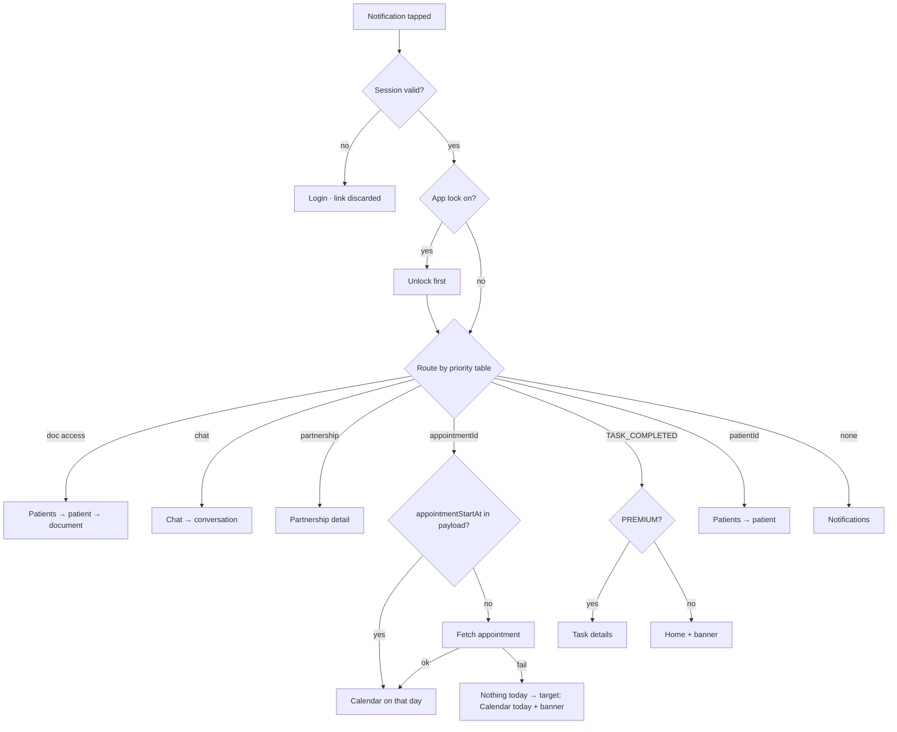

# Push-notification deep-link landing

| | |
|---|---|
| Area | 01 Launch, auth & shell |
| Who sees it | Both roles (authenticated); doctors get the full routing table, staff a subset |
| Reached from | Tap on a system notification (app killed, in background, or in foreground via the local notification) |
| Screen type | Behaviour: tab switch + nested push inside the main shell; one transient loading dialog today |
| Current Flutter source | `lib/app/app.dart` (tap handler, `_openCalendarToAppointment`), `lib/core/services/push_notification_service.dart`, `lib/state/shell/shell_controller.dart` (pending task / conversation), `main_shell.dart` (pending task consumer), `shell_scope.dart` (`pushIntoShell`) |
| Spec | `docs/kmp-spec/07-chat-notifications-tasks.md` §2.3 (type catalogue + tap routes); `01-…` §1.2, §6.4; tickets CORE-06, SHELL-01 |

## 1. Purpose
Define exactly which screen opens when the doctor taps a push notification, what they see while the app gets there, and what happens when the app cannot honour the link (no session, wrong role, missing data). Daily for active doctors.

## 2. Entry points
- Tap on a notification while the app is **killed**: splash runs, session restored, the payload is parked and delivered one frame after the shell mounts.
- Tap while in **background**: app comes to foreground; handler runs immediately (app lock may cover the result).
- Tap on the **foreground** local notification (the app re-posts incoming pushes as local notifications with localised text).
- Payload keys: `type`, `notificationId|id`, `appointmentId`, `appointmentStartAt`, `patientId`, `documentId`, `documentTitle`, `documentAccessRequestId`, `taskId`, `chatId|conversationId|entityId`, `partnershipId`.
- Side effect on every tap: the notification is marked read on the backend (best effort) so it does not reappear in the inbox as unread.

## 3. Layout, top to bottom (phone portrait)
There is no landing screen of its own. What the user sees, in order:
1. (Killed app) Splash → shell.
2. For appointment links **when not already in the shell**: a centred card dialog with a spinner and the English text "Opening appointment..." while the appointment's day is fetched (only when `appointmentStartAt` is missing from the payload). Target: no dialog – open the Calendar tab with its skeleton and jump to the day when known.
3. The target tab, with the target screen pushed on top of it where applicable.
Target feedback: a brief top banner on the landing screen for non-obvious jumps, e.g. "Opened from notification: Appointment cancelled by Aziza K." (optional).

## 4. Data and formats
Routing priority today (first match wins):

| # | Condition | Doctor lands on | Staff (today) | Staff (target) |
|---|---|---|---|---|
| 1 | type ∈ DOCUMENT_ACCESS_REQUEST / APPROVED / REJECTED **and** patientId + documentId | Patients tab → patient opened → document highlighted; for APPROVED the document viewer opens directly | tab 3 = Profile with a Patients screen pushed inside it (wrong) | Clinic workspace → clinic patients → patient → document |
| 2 | type ∈ CHAT_MESSAGE / NEW_MESSAGE with a conversation id | Chat tab → that conversation opened | same (index 0 = Chat – correct) | same |
| 3 | type starts with CARE_PARTNERSHIP | Care-partnership detail (by `partnershipId`) or the partnerships list, pushed in the current tab | same push (screen exists; staff relevance UNVERIFIED) | Notifications |
| 4 | any `appointmentId` (APPOINTMENT_* , APPOINTMENT_REMINDER, APPOINTMENT_ASSIGNED, AI_SCRIBE_READY, …) | Calendar tab on the appointment's **day in practice timezone**, appointment highlighted/selected; AI_SCRIBE_READY also refreshes the notes of that appointment | tab 2 = Notifications (wrong) | Clinic workspace calendar of that clinic, on that day |
| 5 | TASK_COMPLETED with `taskId` | Tasks tab → Task details pushed (PREMIUM only; otherwise the shell bounces to Home) | discarded (staff never get tasks) | n/a |
| 6 | any `patientId` (e.g. TASK_ASSIGNED, GENERAL with patient) | Patients tab → patient opened | tab 3 = Profile + Patients pushed (wrong) | Clinic patients → patient |
| 7 | nothing usable | Notifications screen pushed on the **root** navigator (outside the shell – no bottom bar!) | same | Notifications tab |

Day computation: `appointmentStartAt` (UTC) converted to the doctor's practice timezone; if missing, `GET /api/appointments/{id}` is fetched first (dialog shown); if that fails, **nothing happens** (silent).

## 5. Primary flow (happy path – appointment booked by patient)
1. Notification "New appointment booked" arrives; doctor taps it from the lock screen.
2. App opens (splash if killed); app-lock overlay may appear first – unlock.
3. Calendar tab becomes active, scrolled to the appointment's day, the appointment card highlighted.
4. The notification is marked read; the Notifications badge decreases on next refresh.

## 6. Screen states
- First load (skeleton): the destination tab shows its skeleton while data loads; no spinner dialog (target).
- Empty: target entity missing (appointment cancelled and deleted, patient removed) → destination screen's own not-found state + banner "This item is no longer available."; today: silent no-op for appointments, 404 error inside the patient screen for patients.
- Error on load: network failure while resolving the appointment day → today silent; target: Calendar on today + banner "Couldn't open the appointment".
- Offline: tap opens the app; routing is local except the day fetch; destination shows cached data or offline state.
- Refreshing: n/a.
- Partial data: payload without ids → Notifications.
- Permission needed: notification permission itself (16 §6). If denied, no pushes → nothing to land.
- Locked by tier: TASK_COMPLETED below PREMIUM → bounced to Home with no message today.
- Role difference: see table; today staff land on wrong tabs for 3 of 7 cases.

## 7. Interactions and secondary flows
- Tap notification → as above. Swipe-dismiss on the OS → nothing in the app (inbox still unread).
- Foreground push → local notification posted with localised title/body; tapping it uses the same router. The in-app inbox and badge refresh immediately on receipt.
- Multiple taps on stacked notifications → each replaces the whole stack with the shell and re-routes; the last tap wins. Target: do not rebuild the shell if already mounted – just switch tab and push.
- Back after landing → pops the pushed screen to the tab root (the tab the user was on before the tap is gone, because the stack was replaced). Target: keep the previous tab's stack; back from the deep-linked screen returns to the tab root, and the bar lets them return to where they were.

## 8. Edge cases
- Tap while the More sheet or a dialog is open → whole stack replaced; sheet vanishes. Target: dismiss modals explicitly, then route.
- Tap while a form has unsaved input → lost silently today. Target: features keep drafts; routing asks only when a draft cannot be kept.
- Tap while in a video call → call screen replaced → call dropped! Target: during an active call, show an in-app banner "Open after the call" instead of routing.
- Tap while the app lock overlay is up → routing happens underneath; after unlock the user is on the target. OK.
- Tap with an expired session → splash restores nothing → Login; the parked payload is **kept** and would fire for whoever logs in next. Target: discard on logout and when no session.
- Staff account → see table.
- Practice timezone missing from the profile → day computed in UTC → may land on the wrong day near midnight. Target: fall back to device timezone and show the Calendar mismatch hint (area 04).
- Appointment on a day far in the past/future → Calendar jumps there; fine.
- `appointmentStartAt` present but unparseable → falls back to fetching; if fetch fails → silent today.
- AI_SCRIBE_READY → appointment route; the notes refresh happens even if the user is not on that screen – fine.
- CARE_PARTNERSHIP with no id → list screen.
- Notification id missing → no mark-read; inbox stays unread until opened.
- Notification tapped twice (OS allows) → second tap routes again; mark-read repeated; harmless.
- Payload with both patientId and appointmentId (reminder) → appointment wins.
- Doctor without Tasks tier receives TASK_COMPLETED (backend bug) → Home, silent; target banner "Tasks are not available on your plan."
- Android: the local notification channel is "Shifa Doctor Notifications", high importance; iOS: alert + badge + sound. Badge count on the app icon is not managed by the app today (UNVERIFIED); target: iOS badge = unread notifications + unread chats? Product decision.
- Web background pushes never deep-linked (service worker has no click handler) – irrelevant for mobile.
- Screen reader: after landing, focus should move to the pushed screen's title; the transient dialog today is not announced.
- Language: local notification text uses the app language saved on device, not the phone language – consistent with the app; the OS-side push (when the app is killed) shows backend text in the backend's language for that doctor (synced on language change).
- Rotation: n/a.
- Very fast tap after app start, before the shell exists → payload parked and retried up to 5 frames; if the shell still is not there (slow device) the push is **lost** today. Target: park until the shell reports ready, no frame limit.

## 9. Validation and messages
| Field/action | Rule | When checked | Message (English) | Where shown |
|---|---|---|---|---|
| Appointment resolution | day known | on tap | today: "Opening appointment..." (English literal, dialog) – **remove** | – |
| Appointment resolution | fetch failed | on tap | **NEW** `couldNotOpenAppointment` "Couldn't open the appointment." | banner on Calendar |
| Target missing (404) | entity exists | on landing | **NEW** `itemNoLongerAvailable` "This item is no longer available." | banner on destination |
| Tier gate | PREMIUM for tasks | on tap | **NEW** `tasksNotOnPlan` | banner on Home |
| Active call | call in progress | on tap | **NEW** `openAfterCall` "Open after the call" (banner with action) | banner on call screen |

## 10. Navigation out
- All landings end inside the shell (except today's fallback Notifications pushed on the root – target moves it to the Notifications tab).
- Back from a deep-linked screen → its tab root. Unsaved input: n/a.
- The tab the user came from is lost today (stack replaced) – target keeps it.

## 11. Copy
Notification titles/bodies and type labels belong to area 07 (`notificationType*`, `notificationMessage*`). For landing: `notifications` "Notifications" · `calendar` "Calendar" · `patients` "Patients" · `chat` "Chat"
**NEW** `couldNotOpenAppointment` · **NEW** `itemNoLongerAvailable` · **NEW** `openAfterCall` · **NEW** `openedFromNotification` "Opened from notification" (optional banner prefix)

## 12. Known problems in the current app (do not carry over)
- Whole navigation stack replaced on every tap; previous context lost; modals killed.
- English-only "Opening appointment..." spinner dialog.
- Silent failure when the appointment day cannot be resolved.
- Fallback Notifications screen opens outside the shell (no bottom bar, no way back except system back).
- Staff land on wrong tabs (doctor indexes reused).
- Parked payload survives logout and can fire for the next user.
- Payload delivery gives up after 5 frames.
- Deep link during a video call drops the call.
- Firebase/push never initialised on Android/iOS in the Flutter build (web-only config) – the rewrite needs real FCM/APNs setup.

## 13. Open questions for design
- Show a confirmation banner on landing ("Opened from notification") or rely on the obvious context?
- When the target is an appointment, land on the Calendar day (today) or directly on the appointment detail sheet? Detail is one tap closer; Calendar gives context. Recommend: Calendar day with the detail sheet auto-opened.
- iOS app-icon badge policy.
- Grouping/summary notifications (e.g. 5 new messages) – single landing on the Chat list.
