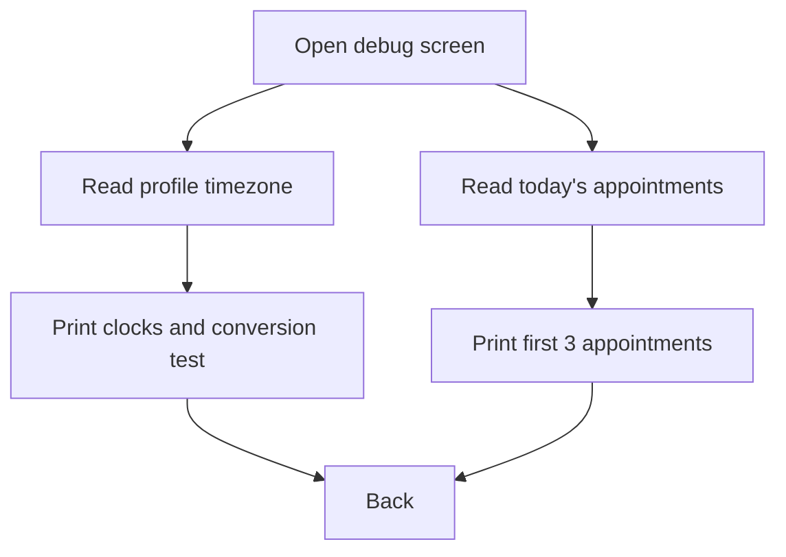

# Timezone debug screen (internal – not designed)

| | |
|---|---|
| Area | 01 Launch, auth & shell |
| Who sees it | Developers only; unreachable in the shipped app |
| Reached from | Nothing – no route, no button references it |
| Screen type | Full screen (dev tool) |
| Current Flutter source | `lib/features/debug/timezone_debug_screen.dart` (self-labelled "TEMPORARY DEBUG SCREEN – Remove after fixing timezone issue") |
| Spec | `docs/kmp-spec/01-architecture-core-auth-shell.md` §13.25 (dead code) |

## 1. Purpose
A developer scratchpad that prints the profile's practice timezone, the current time in device / UTC / practice zone, up to three of today's appointments with their raw and formatted start times, and a fixed UTC→practice conversion test. It exists to debug the "Shifa Global Time Architecture" conversion. **Not a product screen; no Figma frame.** Documented so the designer knows it is intentionally absent.

## 2. Entry points
- None in the current navigation graph (grep confirms the class is never constructed).
- Target: if the rewrite keeps a developer menu (debug builds only), it would live behind a hidden gesture (e.g. 7 taps on the version label in Profile) – engineering decision, not design.

## 3. Layout, top to bottom (phone portrait)
Plain Material page, English hardcoded:
1. App bar "Timezone Debug" with back.
2. Section "PROFILE TIMEZONE:" – zone id or "NULL", its runtime type, whether empty, and the full raw profile map.
3. Section "CURRENT TIME:" – device local, UTC and practice-zone clock (H:M:S, unpadded).
4. Section "APPOINTMENTS:" – first 3 of today's appointments: patient name (!), id, start hour:minute, formatted time; "No appointments today" when empty.
5. Section "TEST CONVERSION:" – converts `2024-03-15T08:00:00Z` into the practice zone and prints the expectation.
Scrollable; no interactions beyond back.

Exact labels on the page (all hardcoded English, listed so nobody searches the string files for them): "Timezone Debug", "PROFILE TIMEZONE:", "Timezone from profile: {tz|NULL}", "Type: {runtimeType}", "Is empty: {bool}", "Full profile: {map}", "CURRENT TIME:", "Device Local: h:m:s", "UTC: h:m:s", "Doctor Timezone ({tz}): h:m:s", "APPOINTMENTS:", "No appointments today", "Patient: {name}", "Appointment ID: {id}", "Start Time (TimeOfDay): h:m", "Formatted: {localised time}", "TEST CONVERSION:", "Input UTC: 2024-03-15T08:00:00Z (08:00 UTC)", "Doctor timezone: {tz}", "Converted TimeOfDay: h:m", "Expected: Should be 08:00 if UTC, or offset by timezone", "Loading profile...", "Error: {text}".

## 4. Data and formats
| Field | Source | Format rule |
|---|---|---|
| Practice timezone | profile `timeZone` | Raw string. |
| Clocks | device now, UTC now, now in practice zone | Unpadded `h:m:s` – debugging only. |
| Appointments | today's appointments provider | Raw patient names – **patient data on a debug screen; must never ship**. |

## 5. Primary flow (happy path)
n/a – open, read, go back.

## 6. Screen states
- First load (skeleton): n/a – shows "Loading profile..." text and a spinner for appointments.
- Empty: "No appointments today".
- Error on load: "Error: …" raw text.
- Offline: errors as above.
- Refreshing: n/a.
- Partial data: sections load independently.
- Permission needed: n/a.
- Locked by tier: n/a.
- Role difference: staff would crash the profile section (doctor profile throws for staff) → "Error:" text.
- Practice timezone missing: the clock section prints "Doctor Timezone (null)" and the conversion falls back to UTC – this is the exact scenario the screen was built to catch; in the product the Calendar hint and the Profile row are the user-facing equivalents.

## 7. Interactions and secondary flows
- Back → previous screen. Nothing else.

## 8. Edge cases
- Not applicable to users. For engineers: the "test conversion" uses a fixed 2024 date; DST-dependent zones give a different offset than today's; the device-local clock leaks into display – all expected for a debug tool.
- If ever shipped by mistake it would expose patient names and the full profile JSON on screen (HIPAA) – reason enough to delete it in the rewrite.

## 9. Validation and messages
| Field/action | Rule | When checked | Message (English) | Where shown |
|---|---|---|---|---|
| n/a | – | – | hardcoded English debug labels | – |

## 10. Navigation out
- Back only.

## 11. Copy
None localised; all labels are hardcoded English and must not be added to the string files.

## 12. Known problems in the current app (do not carry over)
- Dead code with hardcoded English and patient data on screen.
- Uses `DateTime.now()` for display (the very thing the app's timezone rules forbid).

## 13. Open questions for design
- None. Decision: **not designed, delete in the rewrite**. If engineering wants a developer menu, it is a debug-build-only concern with no Figma deliverable; the one user-facing descendant of this screen is the Calendar's "device timezone differs from practice timezone" hint (area 04).

## Why it is listed here
The brief asks every screen in the Flutter tree to be accounted for. This file exists so that "Not designed" in the folder README has a traceable entry and nobody hunts for a missing frame.

## What is worth keeping from it (engineering note, no design impact)
The screen encodes the three facts QA needs when a time looks wrong; they belong in a debug log line, not a screen:

| Fact | Where it should surface in the rewrite |
|---|---|
| Practice timezone from the profile (or missing) | Profile → Timezone row (area 08) shows it; Calendar shows the mismatch hint (area 04); a missing value must block scheduling with an explicit prompt rather than fall back to UTC silently. |
| Device clock vs practice clock | Only the Calendar hint ("Your phone is in Europe/Berlin, your practice is in Asia/Tashkent") – designed in area 04. |
| Raw UTC instant → practice-zone time for an appointment | Unit tests (`TimeZone.of(practiceId)`), never UI. |

QA checklist derived from this screen (run with a non-UTC practice zone such as Asia/Tashkent and the phone set to another zone):
1. Today's appointment list on Home and the Calendar day agree on the same "today".
2. Push landing for an appointment near midnight opens the practice-zone day, not the device day.
3. The location chip in the More sheet changes at the slot boundary in practice time.
4. Chat timestamps, notification grouping and task check-in "missed" states use practice time (verified bugs in areas 07/09 – not this area).
5. After changing the practice timezone in Profile, all of the above update without restarting the app.
