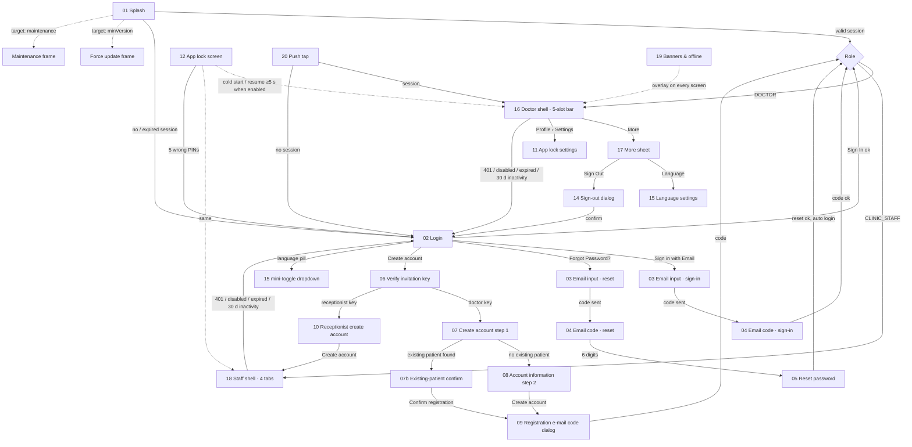

# 01 · Launch, auth & shell — flow map and index

Covers everything from the app icon tap to the signed-in frame: splash and bootstrap, password / e-mail-code login, forgot password, invitation-key registration (doctor and clinic receptionist), app lock (PIN + biometrics), inactivity and forced logout, language, the doctor and clinic-staff shells with the More sheet, global banners / offline, and where push notifications land. Spec: `docs/kmp-spec/01-architecture-core-auth-shell.md` (tickets CORE-*, AUTH-*, SHELL-*, LOCK-*, LANG-*).

## 1. Flow map

Dotted edges are automatic (no user action). "13 Inactivity timeout" and "14 Session expired / forced logout" are behaviours whose only visible frame is the Login screen with a reason banner.

## 2. Files

| File | Screen | Role | Tier | One-line purpose |
|---|---|---|---|---|
| `01-splash.md` | Splash / bootstrap (+ force update, maintenance) | both | all | Brand the launch, restore the session locally, route to shell or Login; target adds version/maintenance gates |
| `02-login.md` | Login (email or phone + password) | both | all | Hub of unauthenticated navigation; password sign-in with links to e-mail code, reset, registration |
| `03-email-input.md` | Email input (sign-in code / reset) | both | all | Collect the address for a 6-digit code in two modes |
| `04-email-otp-code.md` | Email code entry | both | all | Enter the 6-digit code; logs in (sign-in mode) or forwards the code (reset mode); 60 s resend |
| `05-reset-password.md` | Reset password | both | all | New + confirm password with the code; success logs the user in |
| `06-verify-invite-key.md` | Verify invitation key | prospective doctor / staff | – | Gate to invitation-only registration; routes by key purpose |
| `07-create-account-step1.md` | Create account step 1 (+ existing-patient confirm) | prospective doctor | – | Names, e-mail, phone, password with live policy checklist; existing-patient short path |
| `08-account-information-step2.md` | Create account step 2 | prospective doctor | – | Optional profile details and the practice timezone; triggers e-mail verification and registration |
| `09-registration-email-otp-dialog.md` | Registration e-mail code dialog | prospective doctor | – | 6-digit code modal before registration (today never verified – must become real) |
| `10-receptionist-create-account.md` | Receptionist create account | prospective clinic staff | – | One-step staff signup with locked invitation e-mail |
| `11-app-lock-set-pin.md` | App lock settings (set PIN, biometrics) | both | all | Enable/disable the lock, set 4–6 digit PIN, biometric toggle |
| `12-app-lock-enter-pin.md` | App lock screen | both | all | PIN pad + automatic biometric prompt over the whole app; 5 failures sign out |
| `13-inactivity-timeout.md` | Inactivity timeout (behaviour) | both | all | 30-day no-touch sign-out; reason banner on Login (target) |
| `14-session-expired-forced-logout.md` | Session expired / forced logout (+ sign-out dialog) | both | all | 401/403 rules, disabled account, PIN lockout, explicit sign-out; single exit to Login with reason |
| `15-language-settings.md` | Language settings + mini-toggle | both (toggle also pre-login) | all | Pick EN / UZ / ЎЗ / RU; instant app-wide change, synced to profile |
| `16-main-shell-doctor.md` | Doctor main shell | doctor | all (Tasks PREMIUM, AI PRO inside More) | 5-slot bottom bar Home / Calendar / Patients / Chat / More, badges, start tab, back rules |
| `17-more-sheet.md` | More sheet | doctor (staff variant unreachable) | gated rows | Intelligence, location, Clinic, Tasks, Reports, Notifications, Profile, Language, Sign out |
| `18-main-shell-clinic-staff.md` | Clinic-staff main shell | clinic staff | – | 4 tabs Chat / Clinic / Notifications / Profile(avatar); replaces today's web-only block |
| `19-global-banners-offline.md` | Global banners & offline | both | all | Top-banner feedback pattern replacing SnackBars; offline strip; error-message mapping |
| `20-push-deep-link-landing.md` | Push deep-link landing | both | task links PREMIUM | Routing table from notification type to tab + screen; loading and failure behaviour |
| `21-timezone-debug-screen.md` | Timezone debug screen | developers | – | Internal dead screen – **not designed** |

## 3. Not designed

| Screen (Flutter) | Why |
|---|---|
| Phone-OTP login (`phone_login/phone_input_screen.dart`, `otp_screen.dart`) and Firebase-based reset (`phone_login/reset_password_screen.dart`) | Unreachable in the current navigation graph; Firebase never initialised on Android/iOS. Optional ticket AUTH-10 only if product revives it. |
| Registration phone verification dialog (`registration_otp_dialog.dart`, `registration_phone_verification.dart`) | Never called. |
| Schedule setup as registration step 3 (`/create/schedule`) | Never reached from registration ("goes straight to Login"); the schedule screen itself is designed in area 04. |
| Clinic-staff "web only" block screen (`clinic_staff_web_only_screen.dart`) | Dropped by scope decision: staff get the 4-tab shell on mobile. |
| Admin login / forgot password / admin shell | Admin panel stays web (`10-admin-parked.md`). |
| Desktop sidebar / compact icon rail (`main_shell.dart` sidebar branches) | Web/desktop layout; phone-first rewrite uses the bottom bar. Tablets: wider gutters, no sidebar. |
| Patient briefing side panel in the shell | Web/desktop only (hidden on native). |
| Browser tab title badge "(N) SHIFA DOCTOR" | Web only. |
| Timezone debug screen | Dead developer tool (see `21-…`). |
| Web-only language detection by browser timezone | n/a on phones (region/locale detection remains). |

## 4. Area-wide rules the designer must know

1. **Any 401 anywhere ends the session.** Also 403 when the token is expired, when the server says "Account is disabled" / "Session invalid" / "Session expired or signed out", or a plain "Forbidden" on the doctor's own profile endpoints for a non-staff role. Result: everything cleared, Login shown with the whole stack replaced, and (target) a banner saying why. Other 403s (staff on doctor endpoints, tier gates) are **not** logouts – the feature shows its own message. There is **no token refresh**; a session simply ends.
2. **Session length.** The token's own expiry (lifetime UNVERIFIED) with 30 s grace, plus a 30-day no-touch inactivity limit on phones. Expiry is checked before every request, on every tap and on every resume – a sign-out can happen mid-typing; features must keep drafts.
3. **App lock covers the entire app**, including dialogs, sheets and the video call, on cold start (if a session exists) and after ≥ 5 s in background. Biometrics first (automatic prompt), PIN fallback, 5 failures = forced sign-out. Lock settings live in Profile → Settings. Open decision: fixed 6-digit PIN (recommended) vs 4–6.
4. **Roles.** `DOCTOR` → 5-slot bar (Home, Calendar, Patients, Chat, More). `CLINIC_STAFF` → 4 tabs (Chat, Clinic, Notifications, Profile) with no Home, Calendar, AI, Tasks or Reports. Role is known only after login; design both shells for every push landing.
5. **Tiers.** BASIC < PRO < PREMIUM. In this area only two gates exist: Tasks row (PREMIUM) and Shifa Intelligence (PRO). Today an unknown tier counts as PREMIUM; target: hide gated rows until the profile has loaded (open decision 2). Staff have no tier.
6. **Start tab.** Home by default; a saved preference may switch the tab once per session after the profile loads, unless a deep link is pending or the user already navigated. Staff always start on Clinic.
7. **Back behaviour (target, undefined today).** Nested screen → pop; non-Home tab root → Home; Home → exit. Tab stacks persist across tab switches; re-tapping the active tab pops it to root.
8. **Feedback.** Skeletons for first loads, top banners (under the app bar) for errors/confirmations, red destructive button on the right in confirmation dialogs, no bottom toasts. Error copy is always a localised key – never raw backend text, URLs, status codes or HTML.
9. **Offline.** No detection exists today; target: a persistent offline strip under the app bar, cached content visible, network actions disabled with a hint or failing fast with a banner. All requests time out at 30 s (today only GET/POST do).
10. **Language.** EN, UZ (Latin), ЎЗ (Cyrillic transliteration), RU. Default on first run: Uzbek when the phone is set to Uzbekistan/Uzbek, else English – detected once (target), never re-overridden. Instant app-wide switch; synced to the profile for doctors. Design for Russian lengths; bottom-bar labels must survive 200 % font.
11. **Passwords.** One policy everywhere: 8–128 characters, upper, lower, digit, special, with a live checklist; never trimmed. Login only checks "≥ 6" because legacy accounts may exist.
12. **Codes.** E-mail OTP = 6 digits, 60 s resend cooldown shown as `m:ss`, no client-side expiry timer (server message covers expiry). Client never verifies a code locally.
13. **Time.** Everything date-related in this area (push landing day, "today" for the location chip) is computed in the doctor's **practice timezone**, chosen at registration (auto-detected, "UTC" fallback – which must become an explicit confirmation).
14. **Push.** One router; priority document-access → chat → partnership → appointment → task → patient → Notifications. Landing never shows a spinner dialog (target); the previous tab context is preserved (target). Notification permission is asked once in the shell after first login with a pre-prompt, never on splash.
15. **Strings.** All app-lock labels, the staff block screen texts and `enterPin`/`incorrectPin` have **no value in any language** today; several tab labels (`home`, `calendar`, `patients`, `chat`, `profile`, `tasks`, `navReports`, `shifaIntelligence`, `required`) exist only in the embedded Dart map and are missing from `docs/kmp-spec/strings/en.json`. Copy sections list every key and mark new ones **NEW**.
