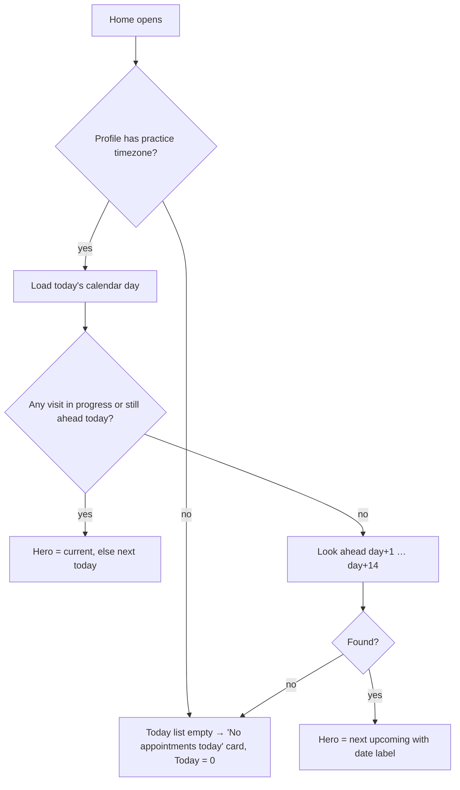

# Home dashboard (tab root)

| | |
|---|---|
| Area | Home & analytics |
| Who sees it | Doctor only (role `DOCTOR`). Clinic staff have no Home tab. Tier: everything BASIC, with PREMIUM-only parts inside the Analytics region and PREMIUM gates on two actions (see region files) |
| Reached from | Bottom tab bar slot 1 "Home"; app start (default start tab); Android back from Intelligence mode; bounce target when a BASIC/PRO doctor lands on the Tasks tab |
| Screen type | Tab root (scrollable page, no app bar) |
| Current Flutter source | `lib/features/home/presentation/home_screen.dart`, `widgets/home_header.dart`, `application/home_dashboard_refresh.dart` |
| Spec | `docs/kmp-spec/02-home-ai-intelligence.md` §1.1–§1.3, §1.10; tickets HOME-01, HOME-02 |

## 1. Purpose
The doctor's start-of-day and between-visits screen. In one scroll it answers: who is next and can I start, what else is on today, what needs my attention (unread notifications, active follow-up tasks), what happened recently, and how the practice is doing (analytics). Opened many times a day, usually for a few seconds.

## 2. Entry points
- **App start / login** → shell opens on Home (factory default tab for doctors; a saved start-tab preference can change this — UNVERIFIED which settings screen exposes it). Replaces the auth stack.
- **Bottom tab "Home"** from any other tab → switches tab; the Home scroll position is kept while the shell lives.
- **Returning from Shifa Intelligence** (close button in the Intelligence app bar) → the shell body switches back to the tab that was active, usually Home, and today's appointments + analytics overview are refreshed (AI may have booked something).
- **Tier bounce:** a doctor on the Tasks tab whose tier turns out not to be PREMIUM is sent to Home silently.
- **Push notifications never land on Home**; they go to the calendar, patient, chat, task or notifications screens (see Attention centre file §7).

## 3. Layout, top to bottom (phone portrait)
Single column, 12 px side gutters, 8 px top padding, one scroll view with pull-to-refresh. No app bar; the status-bar area is plain background. No floating button.

1. **Header row** (static layout, live data): doctor avatar 44 px (photo or initials), title "Home" (20 sp), doctor's display name under it ("Dr. med. First Last", one line, ellipsis), and a 44×44 bell button on the right with an 8 px red dot when the unread notification count is > 0. Bell → Notifications tab. No search button and no AI button on this row today (see §12 and §13).
2. gap 12
3. **Clinical workflow block** → own file `02-next-patient-and-today-schedule.md`: 3 metric cards, next-patient hero (or empty card), "Quick Actions" chip row, "Today's schedule" timeline.
4. gap 20
5. **Attention required card** → `03-attention-centre.md`.
6. gap 20
7. **Patient activity card** → `04-activity-feed.md`.
8. gap 20
9. **Clinic performance card** → `05-analytics-section.md` (contains the date range + export toolbar → `06-date-range-and-export.md`).
10. bottom clearance = tab bar height + system inset + 36 px so the last card clears the bar.

Nothing is sticky. On tablets (≥ 720 px content width) Flutter switches to a 7:3 two-column split; **the rewrite designs phones only** (single column; tablets get wider gutters).

## 4. Data and formats
| Field | Source | Format rule |
|---|---|---|
| Avatar | profile photo URL, else initials from first + last name | 44 px circle; initials = first letter of first and last word; "?" when name empty |
| Doctor name | profile first/last name | "Dr. med." + full name; when both names are empty shows only "Dr. med." (target: show nothing or a skeleton, see §12) |
| Unread badge | notifications unread count endpoint | dot only, no number; hidden at 0 |
| Everything else | see region files | all clock times in the practice timezone |

## 5. Primary flow (happy path)
1. Doctor opens the app → Home renders immediately with the header (name may still be loading), metric cards, hero skeleton, quick-action chips, two card skeletons and the analytics skeleton.
2. Profile arrives → name and avatar fill in; practice timezone becomes known → today's appointments load (one calendar day fetch) → metric "Today" count, hero card and timeline appear; the look-ahead for the next visit runs only when nothing is left today.
3. Notifications list + unread count arrive → bell dot, Attention required items, Patient activity rows.
4. Tasks arrive → "Follow-up" metric and task items in Attention required.
5. Analytics overview arrives → KPI cards; PREMIUM: trend, donut, engagement arrive independently.
6. Doctor taps **Start Appointment** on the hero (or any other action) and leaves Home; coming back within 60 s shows the cached content, later a background refresh runs.

## 6. Screen states
- **First load:** header renders with the title; name line and avatar show placeholders until the profile arrives (today: "Dr. med." and a "Dm" initials avatar — do not copy). Metric values must be skeleton bars, not "0" (today they flash 0). Hero = 180 px skeleton card with 4 shimmer lines; Attention = 160 px skeleton; Activity = 180 px skeleton; analytics = its own skeletons.
- **Empty:** no visits today or in the next 14 days, no notifications, no tasks → "No appointments today" card with "New appointment", "All caught up!", "No recent activity", KPI zeros. See `08-home-loading-empty-first-day.md` for the first-day composition.
- **Error on load:** each region fails independently (partial data below). There is no whole-screen error. Target: a top banner "Could not refresh. Retry" when the today list or notifications fail, plus pull-to-refresh.
- **Offline:** nothing is cached on disk; a cold start offline shows every region in its error state. Target: keep the last successful content in memory for the session and show the global offline banner; actions that need the network (Start, Export) stay enabled and fail with the banner.
- **Refreshing:** pull-to-refresh shows the platform indicator and refreshes notifications, unread count, tasks, today's day, next visit and the analytics overview — not the trend, donut or engagement (target: refresh all). Today the hero and both cards collapse to skeletons during the refresh and the page jumps; target: keep content in place and refresh silently.
- **Partial data:** today list failed → raw "Error: …" text under Quick Actions and the hero shows the *empty* card (misleading, see §12); notifications failed → both cards show the single word "Error"; analytics failed → "Error" inside the KPI area. Target: per-card error row with Retry.
- **Permission needed:** n/a (push permission is asked by the shell, not Home).
- **Locked by tier:** advanced analytics (trend, donut, engagement) hidden for BASIC/PRO; "Prescription" chip and the Follow-up metric lead to PREMIUM-only destinations (see region files). While the tier is unknown the app behaves as PREMIUM; target: hide gated entries until the profile has loaded.
- **Role difference:** clinic staff never see this screen (4-tab shell without Home).

## 7. Interactions and secondary flows
- **Tap avatar / name** → nothing today. Target: open Profile tab (open question §13).
- **Tap bell** → Notifications tab (tab switch, not a push); badge clears after the list is marked read there.
- **Pull down** → refresh as in §6; silently ignored if another refresh is already running (indicator still spins briefly).
- **Return to the Home tab** → background refresh of notifications, tasks, today's list; skipped when the last automatic refresh was < 60 s ago or one is in flight.
- **Scroll** → plain vertical scroll; no collapsing header.
- **Android back on Home** → system behaviour (leave app / shell decides); no in-app back.
- **Keyboard Cmd/Ctrl+K** (web/desktop only) → patient search overlay; unreachable on phones (see `07-patient-search-overlay.md`).
- **Shifa Intelligence entry:** not on Home. On phones it is the first tile of the **More** sheet ("Shifa Intelligence" / "Talk with AI"). Gate: PRO or higher; otherwise a bottom toast saying "Error" (target: explain the upgrade). Opening it replaces the whole shell body with the Intelligence screen; closing it returns to Home and refreshes today's list.

## 8. Edge cases
- Very long doctor name → one line with ellipsis; keep the bell fully visible.
- Doctor without photo and without names (fresh account) → placeholder avatar, no fake initials.
- Unread count 100+ → dot only, never a number here.
- Midnight in the practice timezone while Home is open → "today" is computed at render time; the list does not roll over until a refresh. Target: recompute at midnight (practice timezone) or on next foreground.
- Phone timezone ≠ practice timezone → all visit times in practice timezone; no notice on Home (the Calendar shows one). Notification times today use the phone's clock (bug, see Attention file).
- Slow network (> 3 s) → skeletons stay; no timeout message; after 30 s the request fails and the region shows its error row.
- Rapid tab switching → at most one automatic refresh per 60 s.
- Pull-to-refresh while first load is running → ignored silently.
- Session expired (401) during any Home call → app logs out to the login screen; no partial Home remains.
- Rotation → single column reflows; the scroll position is kept.
- 200 % font → metric cards wrap to one per line if needed (today the three cards are forced side by side and truncate the value); name line truncates; hero buttons stack full width.
- Language switch while open → every string re-renders, including plural "visits"; the date-range label does not (bug, see export file).
- Deep link (push tap) while Home is visible → navigation happens on top of the shell; Home keeps its state.
- Screen reader: order header → bell → metric cards → hero → chips → timeline → cards. The bell announces "Notifications" and the dot must announce the count.

## 9. Validation and messages
| Action | Rule | When | Message (English) | Where |
|---|---|---|---|---|
| Open Shifa Intelligence (More sheet) | tier ≥ PRO | on tap | today "Error"; target **NEW** "Shifa Intelligence needs a Pro subscription." | top banner |
| Region load failure | any 4xx/5xx/network | on response | "Error" today; target "Could not load. Retry" **NEW** | inline in the card |
| Refresh failure | pull-to-refresh | on response | **NEW** "Could not refresh" | top banner |

## 10. Navigation out
- Bell → Notifications tab (Home state kept).
- Metric cards → Calendar / Notifications / Tasks tabs (see workflow file).
- Hero Start → in-person or video call screen pushed inside the tab; on return Home refreshes today's list (completion changes status).
- Open chart / search result → Patients tab with the patient detail pushed.
- Quick actions → Calendar tab or Create task screen.
- Attention item → notification target (calendar day, patient, chat, task, notifications screen).
- Export → system share sheet; Home stays underneath.
- No unsaved input exists on Home.

## 11. Copy
- `home` "Home"; `notifications` "Notifications" (bell tooltip); `more` "More" (tab); `shifaIntelligence` "Shifa Intelligence" + `sidebarAiCta` "Talk with AI" (More-sheet tile); `error` "Error".
- Doctor prefix "Dr. med." is hard-coded in code — **NEW** key needed (and a decision whether the prefix is shown at all for non-MD professions).
- Region copy lives in the region files.

## 12. Known problems in the current app (do not carry over)
- No Intelligence entry, search button or profile shortcut on the Home header; search exists only behind a keyboard shortcut.
- Refresh cooldown is a process-wide variable that survives logout/login; next-visit look-ahead performs up to 14 sequential calendar requests (rewrite: one range query).
- Pull-to-refresh does not refresh trend/donut/engagement; and it turns loaded regions back into skeletons (page jumps).
- Metric values render "0" while loading; the name line shows "Dr. med." and a "Dm" initials avatar before the profile arrives.
- When today's list fails, the hero shows "No appointments today" instead of an error.
- A failed analytics overview throws "Not authenticated" if the token disappears mid-refresh (logout race) → brief "Error" flash.
- Tier fails open to PREMIUM while loading → PREMIUM-only charts flash for BASIC doctors.
- The language mini-toggle is shown top-right on every mobile tab except Home (inconsistent; drop it everywhere, language lives in Settings).
- Tablet two-column (7:3) layout and the desktop sidebar are not part of the phone-first rewrite.

## 13. Open questions for design
- Should the header get an Intelligence orb/button (PRO+) and a search icon, or does the More sheet remain the only AI entry?
- Does tapping the avatar open Profile?
- Order of regions: should Analytics move to the Reports screen entirely, leaving Home purely clinical?
- Greeting ("Good morning, Dr. …") instead of the static "Home" title?
