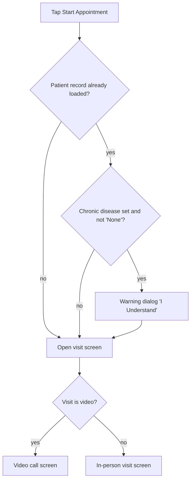

# Next patient, quick actions and today's schedule (clinical workflow block)

| | |
|---|---|
| Area | Home & analytics |
| Who sees it | Doctor only. BASIC+; the "Prescription" chip and the Follow-up metric need PREMIUM (remote-care tasks) |
| Reached from | Top of the Home dashboard, directly under the header |
| Screen type | Region of a tab root (three sub-blocks: metric row, hero, timeline) |
| Current Flutter source | `lib/features/home/presentation/widgets/home_clinical_workflow.dart`, `next_patient_card.dart`, `overview_metric_card.dart`, `quick_action_chip.dart`, `appointment_timeline_tile.dart`, `lib/features/home/application/home_quick_action_navigation.dart`, `lib/features/appointments/application/today_appointments_provider.dart` |
| Spec | `docs/kmp-spec/02-home-ai-intelligence.md` §1.4; tickets HOME-01, HOME-03 |

## 1. Purpose
Get the doctor into the next visit in one tap and give a glance at the rest of the day. Used before every visit; the hero is the most tapped element of the app.

## 2. Entry points
- Rendered as part of Home (see `01-home-dashboard.md`); no direct route.
- Data arrives from the calendar cache for today (shared with the Calendar tab, so switching tabs does not refetch).

## 3. Layout, top to bottom (phone portrait)
1. **Metric row** — three equal cards, 10 px apart, 14 px inner padding: 28 px tinted icon tile + caption label (1 line), value 22 sp, secondary caption (1 line). All three are tappable.
   - "Today" · count of today's appointments · "visit"/"visits" → Calendar tab.
   - "Notifications" · unread count · "unread" → Notifications tab.
   - "Follow-up" · active + draft tasks · "Follow-up task"/"follow-up tasks" → Tasks tab.
2. gap 20
3. **Next patient hero** — one of three:
   - *Skeleton* 180 px while today's list or the look-ahead is loading.
   - *Card* (white, 1.5 px brand border at 35 %, elevated shadow, 16 px padding): title "Next patient" in brand colour, status badge right ("Now" with play icon, or "Confirmed"/"Waiting" with clock icon); row with 56 px avatar, patient name (17 sp, max 2 lines), meta line "[Tue, 18 Aug · ]09:30 · Age 42", two small pills (visit type "Online"/"In Clinic"; place "Video Call" / location name / "In Clinic"); full-width primary "Start Appointment" (disabled until 15 min before start); full-width secondary "Open chart".
   - *Empty card*: 36 px calendar icon, "No appointments today", primary "New appointment".
4. gap 20
5. **"Quick Actions"** heading, then a 44 px high horizontally scrolling row of pill chips (icon 18 + label, 8 px apart): "New appointment", "Video Call", "Prescription". No fade/arrow at the overflow edge.
6. gap 20 (only when the timeline is shown)
7. **"Today's schedule"** heading + subtitle "Your schedule — current and upcoming visits", then the timeline: per visit a 48 px time column (bold), a 10 px dot with a 2 px connector to the next row, and a card (min 56 px) with 36 px avatar, name (1 line), visit icon + label (1 line), and a status chip on the right. The whole block is hidden when there is nothing to list (no "all done" message today).

## 4. Data and formats
| Field | Source | Format rule |
|---|---|---|
| Today count | today's calendar entries that are appointments with an id and a patient name — includes completed, cancelled and no-show | integer; plural noun: en "visit/visits", ru визит/визита/визитов, uz one form |
| Unread | notifications unread count | integer |
| Follow-up | tasks with status active or draft | integer; today draft tasks are counted here but not shown in Attention (which lists active only) |
| Hero pick | first visit with start ≤ now < end and not completed; else first with start ≥ now and not completed; else first eligible visit in the next 14 days (that path skips cancelled; the first two do not — bug) | "now" = practice timezone |
| Date label | only when the hero is not today | medium date in app locale ("Tue, 18 Aug") |
| Time | visit start | locale clock format (24 h in uz/ru, 12 h "9:30 AM" in en on iOS/Android locale rules) |
| Age | patient record birth date | "Age 42", birthday-aware; omitted until the patient record is fetched; uses the phone date (should be practice date) |
| Visit type | location text contains "video" → video | "Online" + "Video Call"; otherwise "In Clinic" + location name (or "In Clinic" again when empty) |
| Status badge (hero) | appointment status | "Now" when in progress or inside the slot; "Confirmed"; everything else (requested, cancelled, no-show) → "Waiting" |
| Status chip (timeline) | appointment status | Complete (green) · Now (brand) · Confirmed (amber) · Cancelled (red) · otherwise Waiting (blue) — no-show shows "Waiting" |
| Patient name | from the calendar entry | fallback "Patient" when empty (today such rows are dropped from everything) |

## 5. Primary flow (happy path)
1. 09:12, practice timezone. Today's list loads → metric "Today 6 visits"; hero shows the 09:30 visit with "Confirmed" badge; Start is enabled (≤ 15 min before).
2. Doctor taps **Start Appointment** → button shows progress → if the patient record is loaded and lists a chronic disease, the warning dialog appears first (§7) → the in-person visit screen (or video call when the visit is a video one) is pushed inside the tab.
3. The visit is completed on that screen → back on Home the today list is refreshed → the hero moves to the next visit, the completed one leaves the timeline, "Today" count stays 6.
4. After the last visit, the hero looks ahead up to 14 days → shows "Thu, 29 Oct · 10:00" with Start disabled; the timeline block disappears.

## 6. Screen states
- **First load:** metric values as skeleton bars (today they show 0); hero skeleton 180 px; chips visible immediately; timeline absent.
- **Empty:** empty hero card with "New appointment"; metrics 0; no timeline. The empty card is also used when the practice timezone is missing from the profile (then no appointments can be loaded at all — target: a card "Set your practice timezone to see today's schedule" linking to Profile).
- **Error on load:** today list failed → today a raw "Error: <technical text>" line appears under the chips and the hero falls back to the empty card. Target: hero becomes an error card "Could not load today's schedule · Retry"; metric "Today" shows "—".
- **Offline:** cached today list (if loaded this session) stays; Start stays tappable and the visit screen handles its own failure.
- **Refreshing:** after completing a visit or pull-to-refresh the hero currently drops to the skeleton again; target: keep the card and swap content.
- **Partial data:** patient record fetch failed → hero without age, no chronic-disease warning. Tasks failed → Follow-up shows the last known count (0 on first load) with no error.
- **Permission needed:** n/a here (camera/mic are requested by the video screen).
- **Locked by tier:** "Prescription" chip for BASIC/PRO → today a toast "Error"; Follow-up metric → Tasks tab, which bounces back to Home silently. Target: chip and metric visible but tapping shows "Remote-care tasks need Premium"; or hide both for non-PREMIUM.
- **Role difference:** doctors only.

## 7. Interactions and secondary flows
- **Metric "Today"** → Calendar tab (today, day view).
- **Metric "Notifications"** → Notifications tab.
- **Metric "Follow-up"** → Tasks tab (PREMIUM) / bounce (see above).
- **Start Appointment** (enabled when start ≤ now + 15 min, or the visit is in progress) → optional chronic-disease dialog → visit screen pushed (tab bar hidden). The dialog: red warning icon 48 px, red title "Patient with Chronic Disease", text "You are dealing with a patient who has a chronic disease:", red box "Patient: <name>" / "Chronic Disease: <localised disease>", advice line, single red button "I Understand"; not dismissible by scrim or back.
- **Start disabled** (> 15 min early) → no feedback today. Target: helper text under the button "Available 15 min before the visit" or a disabled tooltip.
- **Open chart** → Patients tab, patient detail pushed on top.
- **Chip "New appointment"** → Calendar tab (no slot preselected).
- **Chip "Video Call"** → Calendar tab in free-slot mode; the calendar scans today … +29 days for the first free slot that is not in the past, selects it with place "Video Call" prefilled in the booking sheet; if none → toast "No slots available".
- **Chip "Prescription"** → PREMIUM check → Create task screen pushed (the chip's label promises a prescription but opens a remote-care task — §13).
- **Timeline row tap** → only highlights the row (brand tint). Target: open the appointment details sheet (same as Calendar), with Start when applicable.
- **Timeline row long-press / swipe** → nothing today; target n/a.
- **Horizontal swipe on the chip row** → scrolls chips.

## 8. Edge cases
- 0 visits today, 1 visit in 10 days → hero shows that visit with its date; timeline hidden; "Today 0 visits".
- 0 visits in the next 14 days but one in 20 → empty card "No appointments today" (misleading copy; target: "No upcoming appointments").
- 1 visit today, completed → hero looks ahead; timeline hidden; "Today 1 visit".
- All visits completed → same; consider a "Done for today" card (§13).
- 100+ visits a day (clinic schedules) → timeline renders all rows on Home with no cap; target: cap to the next 8 with "See all in Calendar".
- Visit crossing midnight (23:30–00:30) → end is computed on the same day, so it counts as "in progress" for only 30 min and never after midnight.
- Overlapping visits → the first by start time wins as "current"; the other stays "Waiting" in the timeline.
- Cancelled visit whose slot is right now → it becomes the hero as "Now" (bug: cancelled not skipped); target: skip cancelled and no-show for the hero.
- No-show in the past → stays in the timeline as "Waiting" forever today; target: label "No-show", grey.
- Visit with empty location → pills read "In Clinic" twice; target: hide the place pill when it repeats.
- Very long patient name → hero 2 lines, timeline 1 line, both ellipsised; the status chip never shrinks.
- Long location name (clinic address) → 1 line ellipsis in both.
- Patient with photo failing to load → initials fallback.
- Phone timezone ≠ practice timezone → times, "now", "today" all in practice timezone; the date label and age use the phone date today (age wrong on birthday across zones — minor).
- 15-min window crossing while the screen is idle → Start stays disabled until something rebuilds; target: a 1-minute ticker.
- Double tap Start → two pushes possible today; target: disable after first tap until the push completes.
- Tap Start while the patient fetch is still running → no warning shown (bug); target: wait for the fetch (with progress on the button, max ~3 s) then decide.
- Session expired on Start → logout to login.
- Appointment deleted/cancelled meanwhile → visit screen handles 404; Home refreshes on return.
- Rotation / 200 % font → metric cards may need to wrap to a 2+1 grid; hero buttons remain full width; chips scroll.
- Language switch → chip labels, statuses, plural nouns re-render; the time format follows the new locale.
- Screen reader: hero is one container announced "Next patient: <name>"; badge and chips have labels; timeline rows announce time, name, type, status.

## 9. Validation and messages
| Action | Rule | When | Message (English) | Where |
|---|---|---|---|---|
| Start Appointment | start ≤ now + 15 min or in progress | continuous | button disabled; target helper **NEW** "Opens 15 minutes before the visit" | under button |
| Start Appointment | patient has chronic disease | on tap | dialog "Patient with Chronic Disease" … "I Understand" | dialog |
| Prescription chip | tier PREMIUM | on tap | today "Error"; target **NEW** "Remote-care tasks need a Premium subscription" | top banner |
| Video Call chip | a free slot exists in 30 days | after calendar scan | "No slots available" | top banner (today toast) |
| Today list | load failure | on response | target **NEW** "Could not load today's schedule" + Retry | hero error card |

## 10. Navigation out
- Visit screens (in-person / video): pushed in the tab; on return refresh today's list and the analytics overview.
- Patient detail: Patients tab + push; on return nothing to refresh.
- Calendar tab (plain or quick-book): tab switch; Home keeps state.
- Create task: pushed; on return refresh tasks (Follow-up count, Attention items).
- Tasks / Notifications tabs: tab switch.

## 11. Copy
`metricToday` "Today" · `visitsCountLabelOne` "visit" · `visitsCountLabel` "visits" · `notifications` "Notifications" · `unreadCountLabel` "unread" · `metricFollowUp` "Follow-up" · `followUpTask` "Follow-up task" · `followUpTasks` "follow-up tasks" (fix capitalisation) · `nextPatient` "Next patient" · `now` "Now" · `confirmed` "Confirmed" · `waiting` "Waiting" · `onlineVisit` "Online" · `inClinic` "In Clinic" · `videoCall` "Video Call" · `age` "Age" · `startAppointment` "Start Appointment" · `openPatientCard` "Open chart" · `noAppointmentsToday` "No appointments today" · `newAppointment` "New appointment" · `quickActions` "Quick Actions" · `issuePrescription` "Prescription" · `todaysSchedule` "Today's schedule" · `todayTimelineSubtitle` "Your schedule — current and upcoming visits" · `complete` "Complete" · `appointmentStatusCancelled` "Cancelled" · `noSlotsAvailable` "No slots available" · dialog: `patientWithChronicDisease`, `dealingWithChronicDiseasePatient`, `patient`, `chronicDisease`, `takeExtraCareForChronicDiseasePatient`, `iUnderstand`. **NEW:** "No-show" status label, "No upcoming appointments", "Opens 15 minutes before the visit", "Done for today", "See all in Calendar", Premium gate sentence.

## 12. Known problems in the current app (do not carry over)
- Video vs in-person is decided by the word "video" in the location text (README bug 10); the rewrite uses the appointment's type flag.
- Cancelled visits can become the hero; no-show renders as "Waiting"; completed visits vanish from the timeline without any "done" state.
- Chronic-disease warning silently skipped when the patient record is not loaded yet.
- Timeline rows do nothing useful on tap; cancelled chip uses a hard-coded red.
- Metric "Today" counts cancelled/completed visits while the analytics KPI "Appointments Today" comes from the backend — the two numbers can differ on the same screen.
- Follow-up metric counts drafts, Attention centre lists only active tasks.
- "Prescription" chip opens the remote-care task form; label and destination disagree.
- Look-ahead = up to 14 sequential day requests (429 risk); rewrite uses one range query.
- Start button enablement and "today" never tick; no midnight rollover.

## 13. Open questions for design
- Should the timeline row open the appointment sheet, or jump to the Calendar day with that visit selected?
- Keep three quick actions, or expose the dead ones the code still has (Add patient, Upload document, Treatment plan)?
- What does the hero show after the last visit of the day: next day's visit (today) or a "Done for today" summary (completed count, next day's first visit)?
- Rename "Prescription" to "New task" or build a real prescription flow?
