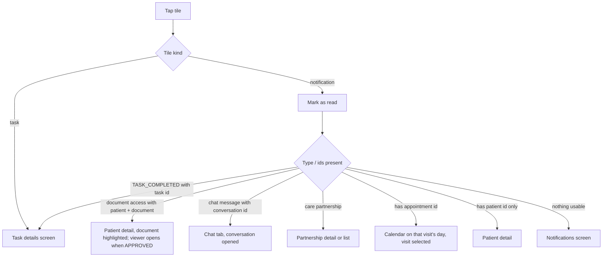

# Attention centre ("Attention required" card)

| | |
|---|---|
| Area | Home & analytics |
| Who sees it | Doctor only. BASIC+ (task items appear only when the doctor has PREMIUM tasks, otherwise the task list is normally empty) |
| Reached from | Home dashboard, after the clinical workflow block |
| Screen type | Region (card) of a tab root |
| Current Flutter source | `lib/features/home/presentation/widgets/home_attention_center.dart`, `lib/features/notifications/presentation/notification_ui_helpers.dart`, `lib/app/app.dart` (notification tap routing) |
| Spec | `docs/kmp-spec/02-home-ai-intelligence.md` §1.5; ticket HOME-04; routing in doc 07 §2.3 |

## 1. Purpose
A short, actionable inbox on Home: the newest unread notifications and the doctor's active follow-up tasks, each one tap away from the thing to do. Looked at a few times a day; it should be empty most of the time.

## 2. Entry points
- Part of Home. The card loads the task list itself when it first appears (one request) and shares the notification list with the Activity feed and the bell badge.
- Refreshed by pull-to-refresh, by returning to the Home tab (60 s cooldown) and after any item is tapped (mark-as-read reloads the whole list).

## 3. Layout, top to bottom (phone portrait)
1. Card header: title "Attention required" (h2), subtitle "Documents, messages, and items needing action".
2. Body, one of:
   - **Skeleton** 160 px, 3 shimmer lines (while notifications load).
   - **List** of up to 6 tiles, 8 px apart. Tile: secondary background, 12 px radius, 1 px border, 12 px padding; 36 px teal-tinted icon tile; title (14 sp semibold, 1 line); subtitle (body 2, 1 line); relative time caption; chevron.
     Order: up to 4 unread notifications (server order, newest first as delivered), then up to 3 active tasks; total capped at 6 (so with 4 unread only 2 tasks fit).
   - **Empty**: 40 px green check icon + "All caught up!" centred with 24 px vertical padding.
   - **Error**: the word "Error" (target: error row with Retry).
3. No "see all" link today (target: footer link "All notifications" → Notifications tab).

## 4. Data and formats
| Field | Source | Format rule |
|---|---|---|
| Icon | notification type | document types → document icon; APPOINTMENT_MISSED / APPOINTMENT_CANCELLED → calendar-busy icon; everything else → bell; tasks → check-task icon |
| Title | type label localised ("New appointment", "Appointment cancelled", "Task completed", …); unknown type → the backend title in English | 1 line |
| Subtitle | localised message built from type + patient name (+ visit date/time converted to practice timezone for bookings) | 1 line |
| Time | notification creation time | "Just now" · "{n} min ago" · "HH:mm" (today) · "Yesterday HH:mm" · "Oct 24 - 09:30"; today computed with the phone clock and phone timezone (bug: use practice timezone) |
| Task tile | task name as title; subtitle fixed "Follow-up task"; no time | task name 1 line |
| Patient name | from the notification; fallback "Patient" | never show raw ids |

## 5. Primary flow (happy path)
1. Card shows 3 tiles: "New appointment · Aliyev N. booked for 27 Oct 10:00 · 5 min ago", "Document uploaded · …", "Blood pressure check · Follow-up task".
2. Doctor taps the booking tile → the notification is marked read (request) → the Calendar opens on 27 Oct with that visit selected.
3. Back on Home the list has reloaded: the tile is gone; the bell dot updates.

## 6. Screen states
- **First load:** 160 px skeleton with 3 lines inside the card frame (header visible).
- **Empty:** green check + "All caught up!".
- **Error on load:** notifications failed → "Error" text today; target: "Could not load notifications · Retry". Task failure is silent (last list kept).
- **Offline:** last loaded list stays for the session; tapping a tile tries the network (mark-as-read fails silently, navigation still happens to cached screens).
- **Refreshing:** today every reload (including after a tap) collapses the card to the skeleton and the page jumps; target: keep tiles, update in place, animate removal of the read tile.
- **Partial data:** notifications ok + tasks failed → notification tiles only; tasks ok + notifications failed → "Error" (tasks not shown even though available) — target: show what loaded.
- **Permission needed:** n/a (push permission is not needed to list notifications).
- **Locked by tier:** none on the card itself; task tiles exist only for PREMIUM doctors in practice; tapping a task tile on a downgraded account opens Task details which may 403 → target banner.
- **Role difference:** doctors only (staff have a Notifications tab instead).

## 7. Interactions and secondary flows
- **Tap notification tile** → mark read + route per §5 diagram; navigation replaces the shell stack for most types (the user returns to Home via the tab bar, not back).
- **Tap task tile** → Task details pushed inside the tab; back returns to Home.
- **Swipe tile** → nothing today; target: swipe-to-dismiss = mark read without navigating (§13).
- **Long-press** → n/a.
- **Pull-to-refresh on Home** → reloads list + tasks.

## 8. Edge cases
- 0 unread, 0 active tasks → empty state; 1 item → single tile, no divider issues.
- 100+ unread → still max 4 shown; no "+96 more" today — target: footer "All notifications (104)".
- 4 unread + 3 tasks → the third task is cut by the 6-item cap; make the cap rule explicit in design (e.g. 4 + 2).
- Long patient or task names → 1 line ellipsis; the time caption keeps its width.
- Notification without patient name → subtitle uses "Patient".
- Unknown notification type → bell icon, English backend title; still tappable (default → Notifications screen).
- Same notification tapped twice quickly → two mark-read requests (idempotent) and a double navigation; target: disable the tile after first tap.
- Tile tapped while its target was deleted (appointment cancelled, document removed) → destination shows its own 404 state; Home list reloads anyway.
- Midnight rollover → relative times switch from "HH:mm" to "Yesterday HH:mm" only on next rebuild.
- Phone timezone ≠ practice timezone → relative/absolute times are wrong by the offset today (phone clock); the booking subtitle's visit time is correct (practice zone). Target: both in practice timezone.
- Slow network → skeleton; tasks arrive later and tiles append at the bottom (content shifts) — acceptable if below the fold, else reserve space.
- Session expired on mark-read → logout.
- Deep link arriving while the task details screen is open → handled by the shell; Home unaffected.
- 200 % font → tile grows to 2 lines per text; time caption may wrap under the chevron; keep min tap height 56.
- Language switch → titles/subtitles/time words re-render; backend English titles for unknown types stay English.
- Screen reader: tile announces "title, subtitle, time, button".

## 9. Validation and messages
| Action | Rule | When | Message (English) | Where |
|---|---|---|---|---|
| Load notifications | failure | on response | target **NEW** "Could not load notifications" + "Retry" | inside card |
| Mark as read | failure | on response | silent (navigation still happens) | — |
| Open task details | tier not PREMIUM / 403 | on open | target **NEW** "Remote-care tasks need a Premium subscription" | top banner on Home |

## 10. Navigation out
- Calendar (day of the visit, visit selected) — tab switch; Home keeps state; on return nothing extra to refresh (list already reloaded).
- Patient detail (document tab, optional viewer) — Patients tab + push.
- Chat conversation — Chat tab with the conversation opened.
- Care partnership detail / list — pushed in the shell.
- Task details — pushed in the current tab; on return refresh tasks.
- Notifications screen — pushed (default fallback).

## 11. Copy
`attentionRequired` "Attention required" · `attentionRequiredSubtitle` "Documents, messages, and items needing action" · `allCaughtUp` "All caught up!" · `followUpTask` "Follow-up task" · `error` "Error" · time words `timeJustNow` "Just now", `timeMinAgo` "{n} min ago", `timeYesterday` "Yesterday {time}" (missing in ru today — add) · notification type labels `notificationType*` and messages `notificationMessage*` (doc 07). **NEW:** "All notifications", "Could not load notifications", "Retry".

## 12. Known problems in the current app (do not carry over)
- Relative times use the phone clock and phone timezone (README bug 9).
- Every tap reloads the full notification list and shows skeletons again.
- Error state hides loaded tasks; no retry anywhere.
- Hard cap of 6 silently drops task tiles; no link to the full inbox or the task list.
- Tasks are loaded by this widget on mount, separately from the Home refresh (double request on first open) — rewrite loads once in the Home view model.
- Unknown types fall back to English backend titles.

## 13. Open questions for design
- Swipe-to-dismiss (mark read) without opening?
- Mixed list (notifications then tasks) or two labelled groups?
- Show a count in the header ("Attention required · 7") when more items exist than are shown?
