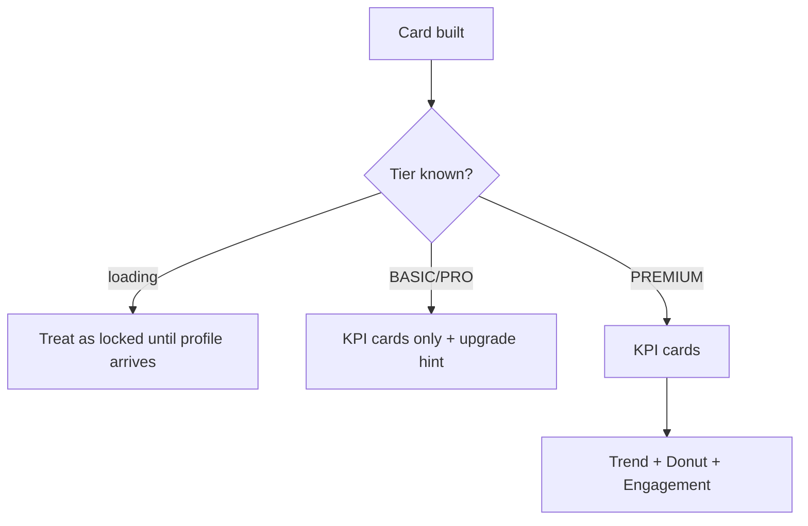

# Analytics section ("Clinic performance" card)

| | |
|---|---|
| Area | Home & analytics |
| Who sees it | Doctor only. KPI cards: BASIC+ (basic analytics). Trend line, visit-type donut, engagement: PREMIUM (advanced analytics). Clinic staff: never |
| Reached from | Bottom of the Home dashboard; the same widgets are reused on the Reports screen (More → Reports) |
| Screen type | Region (card) of a tab root |
| Current Flutter source | `lib/features/home/presentation/widgets/home_analytics_section.dart`, `analytics_kpi_cards.dart`, `analytics_engagement_widget.dart`, `analytics_sms_usage_widget.dart` (Reports only), `lib/core/widgets/appointments_trend_chart.dart`, `visit_type_donut_chart.dart`, `analytics_container.dart`, `lib/features/home/application/home_analytics_providers.dart`, `doctor_analytics_service.dart` |
| Spec | `docs/kmp-spec/02-home-ai-intelligence.md` §1.7, §2; tickets ANALYTICS-01…03 |

## 1. Purpose
Show the doctor how the day and the recent period went: today's visit counts, the booking trend, the split between video and in-person visits, and patient engagement. Looked at daily by solo doctors, weekly by clinic owners; never the reason to open the app.

## 2. Entry points
- Last card on Home. Also rendered on the Reports screen (same toolbar + KPI cards + SMS usage + charts) — design once, reuse.
- Data loads when the card is first built: overview (today's KPIs), trend (for the selected range), consultation types and engagement are four independent requests.

## 3. Layout, top to bottom (phone portrait)
1. Card header "Clinic performance" / "Analytics overview".
2. **Toolbar** (own file `06-date-range-and-export.md`): date-range button over an Export button, stacked full width on phones.
3. gap 16
4. **KPI cards** — four rows (always a column on phones), 12 px apart. Each: 40 px tinted icon tile, value 22 sp bold, title caption (2 lines max).
   - "Appointments Today" (brand, calendar icon)
   - "Completed Today" (green, check)
   - "Cancelled / No-show" (orange, cancel)
   - "New Patients Today" (indigo, person-add)
   KPIs are **today only** and ignore the date range (see §12).
5. PREMIUM only, each in its own white 16 px-radius container with a 14 sp bold title, separated by the section gap (today plus an extra 16 px bottom margin per container — double spacing):
   - **Trend line** "Appointments (Last 7 Days)" — 160 px chart: curved brand line 3 px, dots r 4 with white stroke, horizontal grid lines only, left axis integers (40 px reserved), bottom labels "MM/DD" (10 sp). Y max = 1.2 × max rounded up (10 when all zero); tick step 1 up to 5, else max ÷ 5 rounded up. Title is fixed regardless of the range (bug).
   - **Visit-type donut** "Visit Type Distribution" — 160 px: ring (outer 100 px radius incl. 50 px hole, 2 px gap) in-person = brand, video = brand at 40 %; centre stack "68 %" (20 sp bold brand), "In-person" (11 sp), "32 % Video Call" (10 sp), "17 / 8" (9 sp counts). Period: backend-defined (comment says last 30 days — UNVERIFIED).
   - **Engagement** "Patient Engagement" — two columns: people icon + "12" (18 sp bold) + "Active Patients (30d)" (11 sp, 1 line); document icon + "43" + "Documents Received (30d)".
6. **SMS usage** (Reports screen only, not on Home): hidden when SMS reminders are not allowed and 0 were sent; otherwise "SMS reminders" heading, two tiles "SMS sent" / "Total SMS cost" ("12500 UZS" — raw minor units, not money-formatted), hint "500 UZS per SMS", orange warning "SMS reminders are not enabled for your account. Contact support." when not allowed. Uses the date range (from/to).

## 4. Data and formats
| Field | Source | Format rule |
|---|---|---|
| KPI values | analytics overview (today) | integers; missing → 0; refetched whenever today's appointment list changes |
| Trend points | appointments-trend with `days` = range length clamped 1–90 | list of (date yyyy-MM-dd, count); labels MM/DD; empty list → "No data yet" |
| Types | consultation-types | video, in-person integers; percentages rounded (can sum to 101 %) |
| Engagement | engagement | two integers, 30-day windows per label copy |
| SMS | sms-usage from/to yyyy-MM-dd | sent count, cost minor units + currency (default UZS), price per SMS (default 500), allowed flag |
| Numbers | — | locale digit grouping ("1 250") in the rewrite; money via the shared money formatter |

## 5. Primary flow (happy path)
1. Card appears with the KPI skeleton and (PREMIUM) three chart skeletons.
2. Overview arrives → four KPI rows. Trend arrives → line for the last 7 days. Types → donut. Engagement → two numbers.
3. Doctor changes the range to 30 days (see export file) → only the trend reloads and redraws with 30 points; the title must now read "Appointments (30 days)".
4. Doctor taps Export → share sheet with the CSV.

## 6. Screen states
- **First load:** KPI skeleton = 4 grey 72 px boxes **side by side in a row** today, while the final layout is a column (skeleton does not match); target: 4 stacked skeleton rows. Charts today show a centred 24 px spinner (forbidden); target: chart-shaped skeletons (axis + flat line / ring / two tiles).
- **Empty:** overview zeros render as "0" cards; trend with all-zero counts draws a flat line at 0 (not an empty state); empty trend list → "No data yet"; donut total 0 → "No data yet"; engagement zeros.
- **Error on load:** each block shows "Error" in grey 13 sp; no retry. Target: inline error row with Retry per block.
- **Offline:** last values remain for the session; new range selections fail → error row in the trend only.
- **Refreshing:** pull-to-refresh refetches the overview only (KPI area re-skeletons); trend/types/engagement are never refetched after first load (stale after bookings) — target: refresh all four, in place.
- **Partial data:** blocks are independent; one failing never hides another. Export, however, fails if any of the four is failing (see export file).
- **Permission needed:** n/a.
- **Locked by tier:** BASIC/PRO see KPI cards only; the three advanced blocks are simply absent, with no hint. Target (README convention): show the three blocks dimmed with an overlay "Advanced analytics is available on Premium" + "Upgrade" → subscription screen; or hide with a one-line teaser row. While the tier is unknown: treat as locked (no flash).
- **Role difference:** doctors only.

## 7. Interactions and secondary flows
- **Date range button** → system date-range picker (export file).
- **Export** → CSV share (export file).
- **Tap a KPI card** → nothing today; target: "Appointments Today" → Calendar today; "New Patients Today" → Patients sorted by created; others n/a (§13).
- **Touch the trend line** → no tooltip today; target: tap a dot shows "24 Oct · 7 visits" tooltip.
- **Tap a donut segment** → nothing; counts already in the centre.
- **Tap engagement numbers** → nothing; target: "Active Patients" → Patients tab (§13).

## 8. Edge cases
- Range of 1 day → one trend point: a dot without a line; label single date. Range 90+ days → request clamped to 90 points; 90 labels cannot fit → show every n-th label (≈ 6 labels), today they overlap/vanish (10 sp labels at every index).
- Max count 1 → y axis 0–2 with step 1; max 0 → axis 0–10 flat line; max 1 000 → axis to 1 200, step 240 (non-round; target: nice ticks 250/500).
- Donut 100 % / 0 % → full ring one colour, "100 %" + "0 % Video Call"; 1 / 1 → "50 % / 50 %".
- Percent rounding 33.5/66.5 → 34 % + 67 % = 101 %; accept or round the smaller down.
- Values ≥ 1 000 in KPI (clinic accounts) → "1 250" with grouping; card keeps 22 sp.
- Long translated titles (ru "Отменено / Неявка", "Новые пациенты сегодня") → 2 lines in KPI caption; engagement labels are 1 line with ellipsis today → allow 2 lines.
- Midnight rollover → "today" KPIs are backend-defined (server day, UNVERIFIED which timezone); the client refetches only when today's list changes.
- Phone timezone ≠ practice → trend dates are server dates (yyyy-MM-dd) shown as-is: correct; the range picker uses the phone date (export file).
- Slow network → each block waits independently; a very slow trend keeps its skeleton while KPIs are live.
- Rotation → charts redraw at the new width; the donut stays 160 px tall.
- 200 % font → donut centre text overflows the hole (9–20 sp stack ≈ 70 px → 140 px); target: move counts/legend below the ring at large fonts.
- Language switch → titles re-render; MM/DD labels stay numeric; the KPI title line count may change.
- Session expired → logout.
- Reduce-motion → no chart draw animation.
- Screen reader: each block has a title; chart gets a text summary ("7 days, 3 to 11 visits per day, total 52"); donut announces both percentages and counts.

## 9. Validation and messages
| Action | Rule | When | Message (English) | Where |
|---|---|---|---|---|
| Any block load | failure | on response | today "Error"; target **NEW** "Could not load" + "Retry" | inside block |
| Advanced blocks | tier PREMIUM | on render | target **NEW** "Advanced analytics is available on Premium" + "Upgrade" | overlay / teaser row |
| Trend/donut | no data | on data | "No data yet" | inside block |

## 10. Navigation out
- Export → share sheet (modal) → back to Home.
- Upgrade (target) → Subscription screen in Profile (doc 08); on return re-evaluate tier.
- Optional KPI taps (target) → Calendar / Patients tabs.

## 11. Copy
`clinicPerformance` "Clinic performance" · `clinicPerformanceSubtitle` "Analytics overview" · `appointmentsToday` "Appointments Today" · `completedToday` "Completed Today" · `cancelledToday` "Cancelled / No-show" · `newPatientsToday` "New Patients Today" · `appointmentsLast7Days` "Appointments (Last 7 Days)" → replace with **NEW** "Appointments ({n} days)" · `analyticsNoData` "No data yet" · `visitTypeDistribution` "Visit Type Distribution" · `inPerson` "In-person" · `videoCall` "Video Call" · `engagementSummary` "Patient Engagement" · `activePatients` "Active Patients (30d)" · `documentsReceived` "Documents Received (30d)" · `error` "Error" · Reports only: `reportsSmsTitle` "SMS reminders", `reportsSmsSent` "SMS sent", `reportsSmsSpent` "Total SMS cost", `reportsSmsRateHint` "{{price}} {{currency}} per SMS", `reportsSmsNotAllowed` "SMS reminders are not enabled for your account. Contact support.". **NEW:** upgrade teaser, "Could not load", "Retry", tooltip "{date} · {n} visits", chart text summary. Title casing is inconsistent (Title Case here vs sentence case elsewhere) — normalise to sentence case.

## 12. Known problems in the current app (do not carry over)
- The date range above the KPI cards does not affect them (today-only numbers) — confusing; either label the KPI group "Today" or move the toolbar next to the trend.
- Trend title fixed at "Last 7 Days"; trend only accepts a day count, so a past range (e.g. 1–7 Sep) still shows the last N days ending today (see export file §12).
- Trend/types/engagement are never refreshed after first load; overview refetch re-skeletons the KPI area.
- Chart loading uses spinners; KPI skeleton is a row while content is a column.
- Advanced blocks hidden without explanation for BASIC/PRO; PREMIUM flash while the tier loads.
- Double spacing between chart containers; engagement/analytics containers are white cards inside a white card (card-in-card).
- SMS cost printed as raw minor units with currency code; fallback English copy baked into the widget.
- Dead stub providers with fake numbers exist in code; do not port.
- Analytics overview throws when the token is missing instead of returning an empty state.

## 13. Open questions for design
- Keep analytics on Home at all, or keep only the four KPIs on Home and the full set on Reports?
- Should KPI cards be tappable (Calendar today / Patients)?
- One combined "period" control that drives KPIs, trend and SMS alike (needs a backend change for overview/types), or label KPIs "Today" explicitly?
- Show the SMS usage block on Home for clinics that use reminders?
