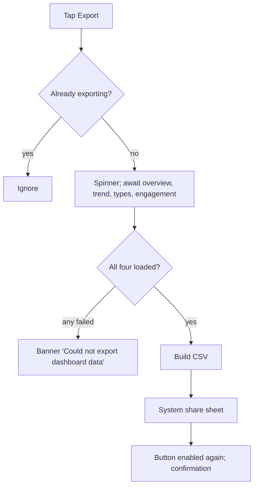

# Analytics date range picker + CSV export / share

| | |
|---|---|
| Area | Home & analytics |
| Who sees it | Doctor only, BASIC+ (the toolbar is shown to every tier; the exported CSV always contains all metrics the backend returns, even the PREMIUM ones the screen hides) |
| Reached from | Toolbar at the top of the "Clinic performance" card on Home and on the Reports screen |
| Screen type | Toolbar + system date-range picker (full-screen on phones) + system share sheet |
| Current Flutter source | `lib/features/home/presentation/widgets/home_dashboard_toolbar.dart`, `lib/features/home/application/home_dashboard_date_range_provider.dart`, `home_dashboard_export_service.dart` |
| Spec | `docs/kmp-spec/02-home-ai-intelligence.md` §1.8; ticket ANALYTICS-02 |

## 1. Purpose
Let the doctor choose the period for the trend chart (and SMS usage on Reports) and take the numbers out of the app as a spreadsheet to send to an accountant or clinic owner. Range changes: weekly at most; export: monthly or rarer.

## 2. Entry points
- Toolbar inside the analytics card (Home and Reports share one selected range: changing it on one screen changes the other).
- Default range on every app start: the last 7 days (today and the 6 days before, phone date). Not persisted.

## 3. Layout, top to bottom (phone portrait)
1. **Date range button** — outlined, 12 px radius, calendar icon 18 px + label "17 Oct – 23 Oct, 2026" (full width on phones).
2. gap 8
3. **Export button** — filled brand, download icon 18 px + "Export" (full width). While exporting: disabled with a 16 px spinner in place of the icon.
4. **Date range picker** (on tap of 1): Material full-screen range picker with help text "Select date range", calendar grid, start/end taps, "Save"/"Cancel" in the app bar; a pencil toggles manual text entry. Bounds: today − 365 days … today + 30 days (phone date). Initial selection = current range.
5. **Share sheet** (after export on phones): the system share sheet with one attachment `shifa_dashboard_2026-10-17_2026-10-23.csv` (text/csv), subject "Shifa dashboard export".

## 4. Data and formats
| Field | Source | Format rule |
|---|---|---|
| Range label | selected start/end | "d MMM – d MMM, yyyy" with an en dash; today always English month abbreviations (bug) → locale month names in the rewrite ("17 окт – 23 окт, 2026", "17-okt – 23-okt, 2026") |
| Range math | inclusive calendar days | dayCount = end − start + 1; end < start rejected |
| Trend request | `days` = dayCount clamped 1–90 | the backend returns the **last N days ending today** — a past range is not honoured (§12) |
| SMS request (Reports) | from/to as yyyy-MM-dd | honoured exactly |
| CSV | overview + engagement + types + trend | see §5 step 4; UTF-8, comma separated, English headers, LF line ends |
| Filename | range | `shifa_dashboard_<start>_<end>.csv`, ISO dates |

## 5. Primary flow (happy path)
1. Doctor taps the range button → picker opens full screen with the current week highlighted.
2. Doctor taps 1 Oct then 31 Oct → "Save" → picker closes; the button reads "1 Oct – 31 Oct, 2026"; the trend chart shows its skeleton and redraws with 31 points; KPIs do not change (today-only); on Reports the SMS block reloads too.
3. Doctor taps **Export** → button disabled with spinner → the app waits for all four analytics results (uses cached ones when loaded) → builds the CSV:
   ```
   SHIFA Dashboard Export
   Period,2026-10-01T00:00:00.000,2026-10-31T00:00:00.000

   Metric,Value
   Appointments today,6
   Completed today,4
   Cancelled today,1
   New patients today,2
   Active patients (30d),41
   Documents received (30d),12
   Video consultations,8
   In-person consultations,17

   Date,Appointments
   2026-10-01,3
   …
   ```
4. The system share sheet opens → doctor picks Mail/Telegram/Files → sheet closes → a confirmation "Export started — check your downloads" is shown (copy is wrong for a share sheet; target "Export ready" or no message at all since the share sheet is the feedback).



## 6. Screen states
- **First load:** both buttons render immediately with the default label; no skeleton needed.
- **Empty:** n/a (export of all-zero data still produces a file).
- **Error on load:** n/a for the toolbar; the export error is a red toast today → top banner "Could not export dashboard data" in the rewrite.
- **Offline:** range change → trend error row; Export → fails if any of the four datasets is not cached → banner. If all four are cached, export works offline (file built locally).
- **Refreshing:** Export disabled + spinner (today the spinner is brand-coloured on a disabled filled button — check contrast). Range button stays enabled during export.
- **Partial data:** one failed dataset blocks the whole export today; target: export what is available and leave failed sections out, or disable Export with a hint while a dataset is in error.
- **Permission needed:** none on Android 10+/iOS (share sheet with in-memory file). Older Android storage permission: n/a (no disk write).
- **Locked by tier:** none; note the CSV includes PREMIUM metrics for BASIC doctors (decide in §13).
- **Role difference:** doctors only.

## 7. Interactions and secondary flows
- **Tap range button** → picker; **Cancel/back** → unchanged; **Save** → new range, trend reload.
- **Pick end before start** → the Material picker swaps/extends automatically; the model additionally rejects end < start silently.
- **Pick a future range** (up to +30 days) → allowed; trend shows the last N days anyway (bug), SMS shows zeros.
- **Tap Export** → flow above; second tap while exporting is ignored.
- **Dismiss the share sheet without choosing** → today still "Export started…" toast; target: no message.
- **Share target fails** (e.g. mail not configured) → handled by the OS.
- **Change range while exporting** → export uses the range captured at tap time; label updates immediately.
- **Language switch** → today the label keeps English months until the range changes; target: re-render.

## 8. Edge cases
- Minimum range 1 day → label "23 Oct – 23 Oct, 2026"; target: collapse to "23 Oct 2026"; trend = 1 point.
- Maximum 365 days back → dayCount up to 396 → trend request clamped to 90 (silently shorter than the label promises); target: cap the picker to 90 days or show "Trend shows the last 90 days of the selected period".
- Range spanning a year boundary → label needs the year on both ends ("28 Dec 2025 – 3 Jan 2026").
- Picker opened at 23:59 and saved after midnight → bounds computed at open time; harmless.
- Phone date ≠ practice date (late evening across zones) → "today" for the default range and picker bounds is the phone date; target: practice date.
- Very long month names in Russian at 200 % font → label wraps to two lines; keep the button height flexible.
- Export with 90 trend points → CSV ≈ 2 KB; no size concern.
- Export double tap → guarded.
- Export during a logout (401) → request fails → banner, then logout.
- Rotation while the picker is open → picker survives (system component); while the share sheet is open → OS handles.
- Deep link (push tap) while the picker is open → picker is dismissed by the navigation; range unchanged.
- Screen reader: range button announces "Date range, 17 October to 23 October 2026, button"; export button announces busy state while exporting.

## 9. Validation and messages
| Field/action | Rule | When | Message (English) | Where |
|---|---|---|---|---|
| Range | start ≤ end | on Save | enforced by the picker; no message | — |
| Range | within −365 … +30 days | in picker | dates outside are disabled | picker |
| Range | ≤ 90 days for trend | on Save (target) | **NEW** "Trend shows up to 90 days" | helper under the button |
| Export | all datasets available | on tap | "Could not export dashboard data" | top banner (today red toast) |
| Export | success | after share sheet | today "Export started — check your downloads"; target none or **NEW** "Export ready" | top banner |

## 10. Navigation out
- Picker: modal; Save/Cancel return to the card; nothing else to refresh except the trend (and SMS on Reports).
- Share sheet: modal; returns to the card.
- Range state is in memory only; leaving Home keeps it until the app restarts.

## 11. Copy
`selectDateRange` "Select date range" (picker help text) · `export` "Export" · `exportStarted` "Export started — check your downloads" (replace, see above) · `exportFailed` "Could not export dashboard data" · Material picker strings come from the platform locale ("Save", "Cancel", "Select range"). CSV content: fixed English headers today ("SHIFA Dashboard Export", "Metric,Value", …) — decide whether to localise (**NEW** keys) or keep English for spreadsheet compatibility. Share subject "Shifa dashboard export" (hard-coded; **NEW** key).

## 12. Known problems in the current app (do not carry over)
- Range label ignores the locale (English months, dead code branch).
- The trend endpoint takes only a day count; the selected start date is ignored, so any past range shows the last N days ending today. Raise with the backend (from/to parameters) — until then the UI must say "last {n} days", not show a start date, or the picker must be a preset chooser (7 / 14 / 30 / 90 days).
- Range longer than 90 days is silently truncated.
- Picker bounds and default range use the phone date.
- Success toast says "check your downloads" on phones where a share sheet was shown; shown even when the share sheet was dismissed.
- Export fails entirely if any of the four datasets failed; it also includes PREMIUM metrics for lower tiers.
- Spinner colour = button colour.
- Range is shared between Home and Reports and resets on restart (decide whether to persist).

## 13. Open questions for design
- Presets (This week / Last 7 / Last 30 / Last 90 / Custom) instead of a free range, given the backend limitation?
- Should BASIC/PRO exports omit the advanced metrics?
- Where does the export feedback live: none (share sheet is enough), or a banner "Export ready"?
- Place the toolbar next to the trend chart (what it actually controls) rather than above the KPI cards?
