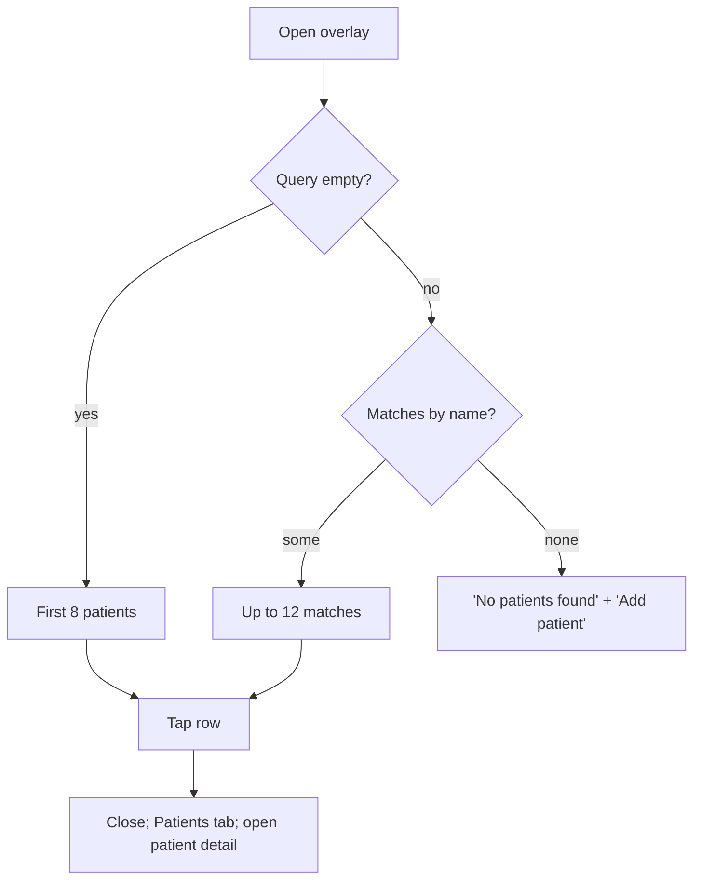

# Patient search overlay

| | |
|---|---|
| Area | Home & analytics |
| Who sees it | Doctor only, BASIC+ (patient management) |
| Reached from | Today: keyboard shortcut Cmd/Ctrl+K on Home (desktop/web only — **no touch entry point**). Target: a search icon in the Home header |
| Screen type | Overlay (today a centred dialog over a dark scrim; target: full-screen search page sliding over the tab) |
| Current Flutter source | `lib/features/home/presentation/widgets/home_search_overlay.dart`, `lib/state/patients/patients_provider.dart` |
| Spec | `docs/kmp-spec/02-home-ai-intelligence.md` §1.9; ticket HOME-05 |

## 1. Purpose
Jump from Home to a patient's chart by typing a few letters, without going through the Patients tab and its filters. A few times a day when a patient calls or walks in.

## 2. Entry points
- **Today:** only the keyboard shortcut while Home has focus → unreachable on Android/iOS. The overlay therefore does not exist for phone users.
- **Target:** search icon button (44×44) in the Home header, left of the bell → opens the overlay on top of Home with the keyboard up. Also reachable from the Patients tab's own search (different screen, doc 06).
- Arrives with no context; the query starts empty.

## 3. Layout, top to bottom (phone portrait)
Today (dialog): a card min(520 px, screen − 48 px) wide, centred; inside:
1. Search field (16 px padding around, 12 px radius, search icon prefix, hint "Search patients, appointments…", autofocus).
2. Result list, max height 360 px, scrolls inside: rows of 40 px initial-letter avatar, patient name, phone number (or blank).
3. 8 px bottom padding. No title, no close button, no empty/loading copy.

Target (full-screen page): app bar with back arrow + search field with clear (×) button; results list full height; keyboard open on entry; recent/first patients under a "Patients" header when the query is empty; "No patients found" state.

## 4. Data and formats
| Field | Source | Format rule |
|---|---|---|
| Candidates | the in-memory full patient list (every page downloaded once per session when the app starts) | not refetched by the overlay |
| Empty query | first 8 patients in list order (server order) | — |
| Query | trimmed, lower-cased; case-insensitive **substring** match on the display name only (not phone, not id); max 12 results | no debounce needed (local) |
| Row | initial letter (first character upper-cased, "?" when empty); name; phone as stored (E.164 today) | target: formatted phone "+998 90 123 45 67"; show birth year or age to disambiguate namesakes |

### Result row anatomy (target)
| Element | Rule |
|---|---|
| Avatar | 40 px, photo if the patient has one, else initials (first + last word), brand-tinted background |
| Title | full name, 1 line, matched substring highlighted in brand colour |
| Subtitle | formatted phone · birth year (e.g. "+998 90 123 45 67 · 1986"); hidden when both are empty |
| Trailing | chevron; for patients with an appointment today a small "Today 10:30" chip (nice-to-have, §13) |
| Height | 64 px min; 8 px vertical gap in list |

## 5. Primary flow (happy path)
1. Doctor taps the search icon → overlay opens, keyboard up, field focused, first 8 patients listed.
2. Types "kar" → list filters instantly to ≤ 12 names containing "kar".
3. Taps "Karimova Dilnoza" → overlay closes → **target:** the Patients tab is selected and that patient's detail opens on top. (Today: only the Patients tab is selected; the patient is not opened — bug.)

## 6. Screen states
- **First load:** instant (local data). If the patient list has not finished loading yet (cold start) the list is empty with no indicator today; target: skeleton rows + "Loading patients…".
- **Empty:** account with 0 patients → empty list, no copy today; target: "No patients yet" + "Add patient".
- **Error on load:** the patient list failed at app start → overlay is empty forever this session; target: error row "Could not load patients · Retry" that triggers the list reload.
- **Offline:** works on the cached list; opening a patient needs the network for the detail (handled there).
- **Refreshing:** n/a (no refresh inside; the list refreshes when the Patients tab reloads).
- **Partial data:** patients without a phone show an empty subtitle; target: hide the subtitle line.
- **Permission needed:** n/a.
- **Locked by tier:** n/a.
- **Role difference:** doctors only (staff search patients inside the Clinic workspace).

## 7. Interactions and secondary flows
- **Type** → list filters on every keystroke; **clear (×)** → back to the first 8.
- **Tap row** → close + open the patient (target).
- **Keyboard "Search"/Done** → today nothing; target: opens the single result when exactly one matches, otherwise just hides the keyboard.
- **Tap scrim / back gesture / Escape** → closes, query discarded.
- **Scroll the list** → keyboard stays (dialog) / dismisses on drag (target page).
- **Long-press a row** → n/a.

## 8. Edge cases
- 0 patients, 1 patient, 1 000+ patients → local filtering stays instant up to a few thousand; the initial "first 8" is arbitrary (server order) — target: most recently seen or alphabetical.
- Query with diacritics / Cyrillic vs Latin ("Каримова" vs "Karimova") → no match today; target: normalise Latin/Cyrillic Uzbek and ignore diacritics and apostrophes (oʻ, gʻ, ').
- Query of spaces only → treated as empty.
- Two patients with the same name → indistinguishable rows today; target: add birth year/phone.
- Very long name → 1 line ellipsis; phone never truncated.
- Patient without a name → "?" avatar and empty title today; the list of patients should never contain such rows (fallback "Patient").
- Typing while the list is still loading → results appear when loading completes (list is reactive).
- Patient deleted on the server since the list was cached → tapping opens a 404 detail; target: detail shows "Patient not found" and the list reloads.
- Rotation → keep query and keyboard.
- 200 % font → rows grow to 2 lines; the dialog's 360 px list height becomes ~3 rows (another reason for a full-screen page).
- Language switch while open → hint re-renders; names unaffected.
- Session expired → nothing happens inside (local) until a patient is opened → logout.
- Deep link while open → overlay dismissed by the navigation.
- Opening the overlay while the Home list is scrolled → Home scroll position preserved under it.
- Opening from a push deep link is not possible (no route); the overlay is UI-only state.
- Paste a phone number into the field → no match today (name only); target: digits-only query matches phone numbers.
- Screen reader: field announces hint; results announce "name, phone, button"; result count announced on change ("12 results").

## 9. Validation and messages
| Field/action | Rule | When | Message (English) | Where |
|---|---|---|---|---|
| Query | none (any text) | — | — | — |
| Results | none match | on change | **NEW** "No patients found" (`noPatientsFound` exists) + **NEW** "Add patient" | list area |
| Patients list | failed to load | on open | **NEW** "Could not load patients" + "Retry" | list area |

## 10. Navigation out
- Row tap → Patients tab + patient detail pushed; overlay removed; Home keeps its scroll position; nothing to refresh.
- Dismiss → Home unchanged.
- "Add patient" (target) → Create patient sheet (doc 06); on save open the new patient.

## 11. Copy
`searchPatientsAppointmentsHint` "Search patients, appointments…" — appointments are **not** searched; change to `searchPatients` "Search patients..." (exists) or extend the scope · `noPatientsFound` "No patients found" · `search` "Search". **NEW:** "Add patient" (reuse the Patients-tab key), "Loading patients…", "Could not load patients", "Retry", "{n} results" (accessibility).

## 12. Known problems in the current app (do not carry over)
- No touch trigger → the feature does not exist on phones.
- Tapping a result only switches to the Patients tab (hard-coded tab index) and never opens the patient.
- Hint promises appointment search; only patient names are matched (no phone, no Cyrillic/Latin normalisation).
- No loading, empty or error state inside the overlay; no close button; first 8 rows in arbitrary server order.
- Relies on the whole patient directory being downloaded at app start (README bug 15); the rewrite should query the server search endpoint with a debounce (~300 ms) once the directory is paginated.

## 13. Open questions for design
- Full-screen search page vs. a sheet from the top; and whether it is the same screen as the Patients-tab search.
- Should it also search appointments (jump to a calendar day) and documents, as the hint implies?
- Recent patients section when the query is empty?
