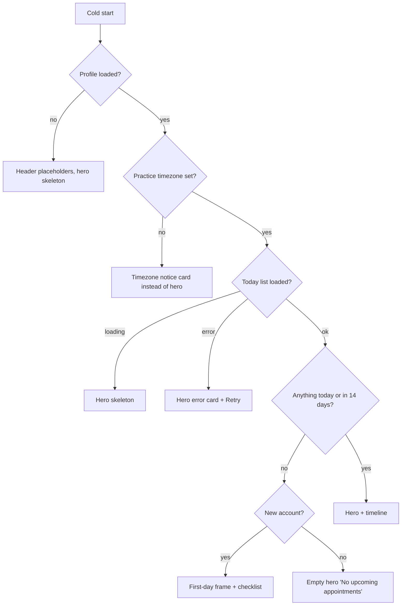

# Home: loading, refresh, empty and first-day states

| | |
|---|---|
| Area | Home & analytics |
| Who sees it | Doctor only; all tiers |
| Reached from | Every Home open; these are the non-happy compositions of `01-home-dashboard.md` |
| Screen type | Tab root — state variants (each is a Figma frame) |
| Current Flutter source | `lib/features/home/presentation/home_screen.dart`, `widgets/dashboard_card.dart` (skeleton), `lib/features/home/application/home_dashboard_refresh.dart`, `lib/features/appointments/application/today_appointments_provider.dart` |
| Spec | `docs/kmp-spec/02-home-ai-intelligence.md` §1.2, §1.4, §1.10; tickets HOME-01, HOME-02 |

## 1. Purpose
Define what the doctor sees when Home has no data yet, no data at all, partial failures, or is refreshing — so the first minute after registration and every cold start feel intentional rather than broken. The first-day frame is also what onboarding screenshots will show.

## 2. Entry points
- Cold start (no data in memory): every region loads in parallel.
- Warm return to the tab: content is already there; a background refresh may run (60 s cooldown).
- Pull-to-refresh: explicit full refresh.
- Fresh account: profile exists, no timezone chosen yet, no patients, no appointments, no notifications.

## 3. Layout, top to bottom (phone portrait) — the five frames
1. **Cold-start skeleton**: header with title "Home", avatar placeholder circle, name placeholder bar (today: "Dr. med." + "Dm" initials), bell without dot; metric row with three cards whose values are shimmer bars (today "0"); hero skeleton 180 px / 4 bars; "Quick Actions" + three chips (static, immediately usable); no timeline; Attention card frame with 160 px / 3-bar skeleton; Activity card frame with 180 px / 4-bar skeleton; Clinic performance card with toolbar (live) + KPI skeleton rows (+ three chart skeletons for PREMIUM). Shimmer: 1.2 s loop, light grey gradient; disabled under reduce-motion.
2. **Progressive fill** (within ~1–2 s): profile → name/avatar; today list → metrics + hero/timeline; notifications → bell dot + both cards; tasks → Follow-up metric + task tiles; analytics → KPI then charts. Regions fill independently; no region waits for another except hero/timeline waiting for the profile's timezone.
3. **First day / empty**: header with the doctor's name; metrics "0 visits · 0 unread · 0 follow-up tasks"; empty hero card ("No appointments today" + "New appointment"); chips; no timeline; Attention "All caught up!"; Activity "No recent activity"; KPIs all 0; PREMIUM charts: trend "No data yet" (or a flat zero line when the backend returns zero-filled points), donut "No data yet", engagement 0 / 0. Target additions: a first-day checklist card above the hero ("Set your practice timezone", "Add your first patient", "Set your availability") shown until all three are done (§13).
4. **No practice timezone** (profile without timezone — possible after registration): today's list cannot be computed → today shows the empty hero and "Today 0" as if the day were empty, even when visits exist. Target frame: hero replaced by a notice card "Set your practice timezone to see today's schedule" with a button to the timezone screen; metrics "—".
5. **Refreshing**: pull-to-refresh indicator at the top; all content stays in place (target). Today the hero and both cards flip back to skeletons and the page height jumps.

## 4. Data and formats
| Field | Source | Format rule |
|---|---|---|
| Skeleton geometry | matches the final region (card frame, same height class) | hero 180, attention 160, activity 180, KPI 4 × 72 stacked, trend 160 + title, donut 160 + title, engagement 100 |
| "First day" trigger | 0 appointments in the next 14 days, 0 notifications, 0 patients (patients list), timezone unset | derived on the client |
| Refresh cooldown | 60 s between automatic refreshes on tab focus; none for pull | scoped to the session in the rewrite |
| Request timeout | 30 s per request | after that the region shows its error row |

## 5. Primary flow (happy path)
1. Cold start → frame 1 (skeleton) for < 1 s on a good network.
2. Profile + today list arrive → metrics, hero, timeline fill (frame 2).
3. Remaining regions fill; the page is stable within ~2 s; no element moves after it has appeared except that cards grow from skeleton height to content height (keep skeleton heights close to typical content).
4. Doctor pulls down → indicator → every region refetches → values update in place → indicator hides.

## 6. Screen states
- **First load:** frame 1; every placeholder is shaped like its content; nothing shows "0" or "Error" before the first response.
- **Empty:** frame 3; for existing accounts with a quiet day, the same frame without the checklist.
- **Error on load:** per region — hero error card "Could not load today's schedule · Retry"; Attention/Activity "Could not load notifications · Retry"; KPI "Could not load · Retry"; plus one top banner "Some content could not be loaded" when ≥ 2 regions fail. Retry re-requests only that region.
- **Offline:** cold start offline → all regions in error with the global offline banner; warm → cached content + banner; pull-to-refresh offline → indicator, then banner "You're offline", content unchanged.
- **Refreshing:** frame 5; the indicator is the only motion. Values crossfade; new timeline rows animate in; removed rows animate out.
- **Partial data:** mixed frame — loaded regions live, failed regions with their inline error; the screen never blanks.
- **Permission needed:** n/a.
- **Locked by tier:** while the tier is unknown the PREMIUM chart skeletons are **not** shown (avoid the flash); they appear only when the profile confirms PREMIUM.
- **Role difference:** n/a (doctors only).

## 7. Interactions and secondary flows
- **Pull-to-refresh** → full refresh (notifications, unread count, tasks, today's day, next visit, all analytics). If a refresh is already running the gesture completes visually but triggers nothing extra.
- **Tap Retry** in a region → that region reloads with its skeleton.
- **Tap "Set practice timezone"** (frame 4) → Profile → timezone screen; on return Home reloads today's list.
- **First-day checklist items** (target) → Profile timezone / Create patient sheet / Schedule setup; each item ticks off when done; the card hides when all are done or when dismissed (× in the corner, remembered per account).
- **Return to the tab** → silent refresh (60 s cooldown); no indicator.
- **App comes to foreground** → treat as tab focus (target; today only tab changes trigger it).

## 8. Edge cases
- Profile loads but today's calendar request is slow (> 3 s) → metrics show "—" or skeleton bars, not 0, until the list arrives.
- Today list ok, look-ahead slow → hero waits for the look-ahead today (skeleton even though today's data is known). Target: show "No appointments today" with a small "Looking for the next visit…" line, then upgrade to the next visit card.
- Notifications ok, tasks failed → Follow-up "0" today; target "—" with the Attention card unaffected.
- 401 during cold start → immediate logout; the half-filled Home must not stay visible behind the login screen.
- Pull-to-refresh right after login (tab-focus refresh still running) → ignored today; target: queue one more refresh or show the indicator for the running one.
- Midnight in practice timezone during a long idle → on the next foreground the today list is for the new day; the "Today" metric and hero update; yesterday's unfinished visits disappear from the timeline (they are not today) — consider a "Yesterday had 2 unfinished visits" hint (§13).
- Phone timezone ≠ practice timezone at cold start → "today" is the practice day; a doctor travelling west may see "today" already ended; the hero then shows tomorrow's first visit with its date label.
- Doctor with timezone set but no availability and no patients (first day) → frame 3 + checklist.
- Account with 500 patients and a quiet Sunday → frame 3 without checklist; "New appointment" leads to the calendar.
- Rotation during skeleton → skeleton reflows; no restart of requests.
- 200 % font → skeleton bars scale with text height; chips wrap or scroll.
- Language switch while loading → skeletons unaffected; copy re-renders on arrival.
- Reduce-motion → no shimmer, static grey bars; no crossfade.
- Screen reader → announce "Loading" once per region, then "Loaded"; never read shimmer bars; the first-day checklist is a list of buttons with state ("done"/"to do").

## 9. Validation and messages
| Action | Rule | When | Message (English) | Where |
|---|---|---|---|---|
| Region load | failure | on response | **NEW** "Could not load today's schedule" / "Could not load notifications" / "Could not load" + "Retry" | inline in region |
| ≥ 2 regions failed | — | after responses | **NEW** "Some content could not be loaded" | top banner |
| Offline refresh | no network | on pull | **NEW** "You're offline" (shared global key) | top banner |
| Timezone missing | profile timeZone empty | on render | **NEW** "Set your practice timezone to see today's schedule" + "Set timezone" | notice card |
| First day | checklist | on render | **NEW** "Welcome, Dr. {lastName}" · "Set your practice timezone" · "Add your first patient" · "Set your availability" · "Dismiss" | checklist card |

## 10. Navigation out
- Retry / pull → stays on Home.
- Timezone notice → Profile → timezone screen (doc 08); back → Home reloads today.
- Checklist → Profile timezone / Create patient sheet / Schedule setup (doc 03); back → checklist re-evaluates.
- "New appointment" → Calendar tab.

## 11. Copy
Existing: `noAppointmentsToday` "No appointments today" · `newAppointment` "New appointment" · `allCaughtUp` "All caught up!" · `noRecentActivity` "No recent activity" · `analyticsNoData` "No data yet" · `error` "Error" · `retry` "Retry". **NEW:** all rows of §9, plus "No upcoming appointments", "Looking for the next visit…".

## 12. Known problems in the current app (do not carry over)
- Metric values show "0" and the name line shows "Dr. med." / "Dm" avatar while loading.
- A missing practice timezone silently produces an empty Home instead of asking for it.
- Errors render as the bare word "Error" (or "Error: Exception(…)") with no retry; a failed today list shows the *empty* hero.
- Every refresh (pull, tab focus, mark-as-read) re-skeletons loaded regions and jumps the page.
- Hero waits for the 14-day look-ahead even when today's list is already known; the look-ahead is 14 sequential requests.
- Chart loading = centred spinners; KPI skeleton is a 4-column row while content is a column.
- PREMIUM charts flash for BASIC doctors while the tier loads (fail-open default).
- Refresh cooldown survives logout/login; app foreground does not trigger a refresh.
- Nothing is cached on disk; cold start offline is all errors.

## 13. Open questions for design
- First-day checklist card: yes/no, and does it also appear on the Calendar?
- Should the hero show today's "done" summary when all visits are completed instead of jumping to tomorrow?
- Keep skeletons per region (progressive) or one page-level skeleton until the first two regions are ready?
- Hint about yesterday's unfinished visits after midnight?
