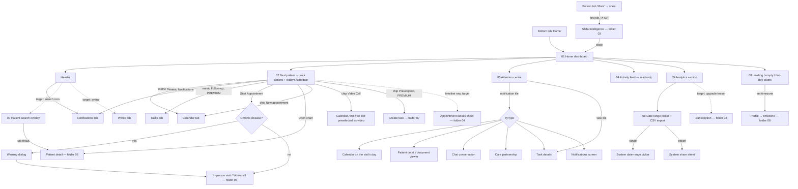

# 02 · Home & analytics — flow map and file index

Doctor-only area. The Home tab is the doctor's command centre; the analytics card at its bottom is reused on the
Reports screen. Clinic staff (`CLINIC_STAFF`) have **no Home tab at all** (their shell is Chat · Clinic ·
Notifications · Profile), so nothing in this folder applies to them.

Spec: `docs/kmp-spec/02-home-ai-intelligence.md` §1–§2 (Home, analytics). The Shifa Intelligence screens that Home
leads to are documented in `03-shifa-intelligence/` (doc 02 §3–§7).

## 1. Flow map — which element on Home leads where

Solid arrows exist today; dotted arrows are target behaviour the rewrite adds.

## 2. Files

| File | Screen | Role | Tier | Purpose |
|---|---|---|---|---|
| [01-home-dashboard.md](01-home-dashboard.md) | Home dashboard (tab root) | Doctor | BASIC+ | Page frame: header, region order, refresh triggers, Intelligence entry via More sheet |
| [02-next-patient-and-today-schedule.md](02-next-patient-and-today-schedule.md) | Clinical workflow block | Doctor | BASIC+ (Prescription chip, Follow-up metric: PREMIUM) | Metric row, next-patient hero with Start/Open chart, quick-action chips, today's timeline, chronic-disease dialog |
| [03-attention-centre.md](03-attention-centre.md) | Attention required card | Doctor | BASIC+ | Up to 4 unread notifications + 3 active tasks (max 6), mark-read + deep-link routing per type |
| [04-activity-feed.md](04-activity-feed.md) | Patient activity card | Doctor | BASIC+ | Read-only list of the 8 newest notifications with type-coloured dots |
| [05-analytics-section.md](05-analytics-section.md) | Clinic performance card | Doctor | KPI: BASIC+; trend, donut, engagement: PREMIUM | Today KPIs, appointments trend line, visit-type donut, engagement, SMS usage (Reports only) |
| [06-date-range-and-export.md](06-date-range-and-export.md) | Date range picker + export | Doctor | BASIC+ | Range selection (−365…+30 d, trend clamped to 90 d), CSV build and system share sheet |
| [07-patient-search-overlay.md](07-patient-search-overlay.md) | Patient search overlay | Doctor | BASIC+ | Name search over the local patient list; opens the patient (today: keyboard-only, tab switch only) |
| [08-home-loading-empty-first-day.md](08-home-loading-empty-first-day.md) | Home state variants | Doctor | all | Cold-start skeleton, progressive fill, first-day/empty, missing-timezone notice, refresh and error compositions |

## 3. Not designed (dead or out of scope) — and why

| Item | Why not |
|---|---|
| `HomeAiCopilot` card, `AskShifaAiOverlay`, `DoctorAiPanel` | Not imported by any live screen; the only live AI surface is the Intelligence screen (folder 03) |
| `HomeGreetingHeader` (greeting + "next in N min" chips), `HomeTimelineSection`, `HomeCurrentAppointmentHero`, `HomeAppointmentCard`, `HomeRemindersPanel` | Dead widgets (spec §11.1); the live Home uses the clinical workflow block instead. Their one useful rule — video join window −5 min … end + 1 h — belongs to the visit screens |
| `HomeQuickActions` (wrap grid) and `HomeFloatingQuickActions` (speed dial) with Add patient / Upload document / Treatment plan | Dead; only three chips are live. Whether to bring the extra actions back is an open question in file 02 |
| Desktop 7:3 two-column Home, sidebar, compact-sidebar variants, Cmd/Ctrl+K shortcut | Phone-first rewrite; tablets get wider gutters only; search gets a visible button |
| `PatientBriefingPanel` floating panel on Home | Not rendered on native mobile today; its mobile surface is designed inside the Intelligence / visit flows (folder 03/05) |
| Legacy stub analytics providers with fake numbers, `AnalyticsCard` widget | Dead code |
| SMS usage block on Home | Lives on the Reports screen only (described briefly in file 05 for reuse) |
| Admin dashboard | Admin panel stays a web product (doc 10) |

## 4. Area rules

- **Who:** doctors only. Clinic staff never see Home, analytics, tasks or Intelligence; do not design staff variants here.
- **Refresh triggers (target):** (1) returning to the Home tab or app foreground → silent refresh of notifications, unread count, tasks, today's list, next visit — at most once per 60 s per session; (2) pull-to-refresh → everything incl. all four analytics datasets, no cooldown, content updated in place; (3) after an action that changes data (visit completed, task created, AI booking, notification tapped) → the affected region refreshes itself; (4) a foreground push about an appointment → today's list refreshes. Never show skeletons for a region that already has content.
- **Time:** every clock time, "today", "now", the 15-minute Start window and midnight rollover use the **practice timezone**. Relative notification times too (today they use the phone clock — bug).
- **Tier:** BASIC sees the whole Home minus advanced analytics; PRO adds Intelligence (via More) and video; PREMIUM adds tasks (Follow-up metric, Prescription chip, task tiles) and advanced analytics. While the tier is unknown, gated items are hidden (no fail-open flash). Locked actions explain the needed tier in a top banner, never a bare "Error".
- **Errors:** per-region inline error rows with Retry; one top banner when several regions fail; raw exception text never reaches the screen.
- **Intelligence entry:** on phones only through the More sheet today (PRO+). Adding an orb/button to the Home header is an open design question (file 01 §13); if added it uses the same gate and the same full-screen Intelligence mode.
- **Numbers to carry as defaults:** metric row 3 cards; attention ≤ 4 unread + ≤ 3 tasks, ≤ 6 total; activity 8 rows; search 8 default / 12 filtered; look-ahead 14 days; Start window 15 min; trend 1–90 days; picker −365…+30 days; refresh cooldown 60 s; request timeout 30 s.
