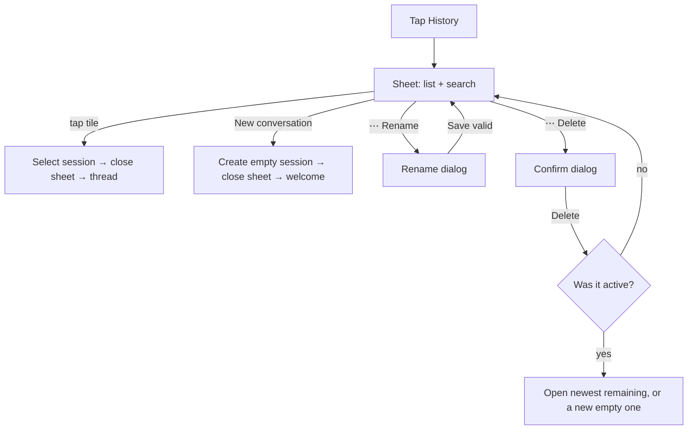

# Conversation history sheet

| | |
|---|---|
| Area | Shifa Intelligence |
| Who sees it | Doctor only · PRO and PREMIUM |
| Reached from | History icon in the Intelligence app bar (welcome or thread); overflow menu "Rename" / "Delete" / "Download conversation" act on the open thread |
| Screen type | Bottom sheet (72 % of screen height) + two dialogs (rename, delete confirm) + share sheet (export) |
| Current Flutter source | `lib/features/intelligence/presentation/intelligence_screen.dart` (`_HistoryPane`, `_downloadConversation`, `_renameActive`, `_deleteActive`), `intelligence_session_tile.dart`, `application/intelligence_chat_store.dart` |
| Spec | `docs/kmp-spec/02-home-ai-intelligence.md` §4.1, §4.2, §4.7, §3.9 · ticket INTEL-02 |

## 1. Purpose
Find and reopen an earlier conversation (e.g. "the one where I booked Karimov"), start a fresh one, tidy up with
rename/delete, or export a thread as text for a colleague or support. A few times a week.

## 2. Entry points
- History icon (app bar) from the welcome or from an open thread → sheet slides up over the current body.
- Overflow menu (app bar, only while a conversation is open): "Download conversation", "Rename", "Delete" — these
  act on the active thread without opening the sheet.
- Recent tiles on the welcome share the tile and its menu with this sheet.

## 3. Layout, top to bottom (phone portrait)
1. **Sheet** with rounded top corners, white, 72 % of the screen height, dismissible by drag and scrim.
2. **Title** "History" (bold).
3. **"New conversation"** outlined button with plus icon, full width.
4. **Search field** "Search conversations" with a leading search icon; filters as you type.
5. **List** of session tiles (newest `updatedAt` first), each in its own bordered rounded box:
   - leading chat-bubble icon;
   - row 1: optional person icon (patient-linked) · title (bold when it is the active conversation) · relative time
     (right, tertiary);
   - row 2: preview (one line, secondary) — hidden when equal to the title;
   - trailing "⋯" menu: Rename, Delete. The active conversation's tile has a tinted background.
6. **Empty copy** inside the list area: "No conversations yet" (no sessions) or "No matching conversations" (search
   has no hits).

Dialogs:
- **Rename conversation**: single text field prefilled with the current title, hint "Conversation title", keyboard
  action Done saves; buttons Cancel · Save.
- **Delete conversation**: body "Delete this conversation? This cannot be undone."; buttons Cancel · Delete. Today
  both are plain text buttons; target: Delete is the red destructive button on the right.

## 4. Data and formats
| Field | Source | Format rule |
|---|---|---|
| Title | custom title if renamed; else first user message shortened to 48 chars; else "New chat" | one line, ellipsis |
| Relative time | `updatedAt` (bumped on every completed turn, **not** on rename) | see file 01 §4 |
| Preview | last non-empty message, 90 chars | one line |
| Search | case-insensitive substring over title, preview and **every message** in the thread | live, no debounce |
| Sort | `updatedAt` descending; the empty "New chat" created on cold start sits at the top until something else is written | — |
| Export filename | `shifa-intelligence-<sessionId>-<ISO timestamp with : and . replaced by ->.txt` | plain text, UTF-8 |
| Export body | header (session id, title, created/updated, message count, exported at), then each message as `--- [i] USER/ASSISTANT @ iso ---` + content + tool name + pretty JSON card payload, then the whole session as JSON | not localised, developer-oriented |

## 5. Primary flow (happy path)
1. Tap History → sheet opens with the list; the active conversation highlighted.
2. Type "Karim" → list filters to threads containing it anywhere.
3. Tap a tile → sheet closes, thread loads with that conversation scrolled to the end.

## 6. Screen states
- **First load:** list is local and instant; no skeleton needed. If the store is still loading (cold start race),
  show three tile skeletons.
- **Empty:** "No conversations yet" under the search field; the New conversation button stays. Note: in practice
  there is always at least the auto-created empty "New chat", which is listed too (§12).
- **Error on load:** n/a (local; corrupt data → empty list).
- **Offline:** fully functional (open, rename, delete, search). Export works offline (local file).
- **Refreshing:** n/a; the list re-renders when a turn finishes in the background (another conversation moves up).
- **Partial data:** n/a.
- **Permission needed:** none. Export uses the system share sheet, no storage permission.
- **Locked by tier:** not reachable below PRO.
- **Role difference:** clinic staff never reach it.

## 7. Interactions and secondary flows
- **Tap tile** → select → sheet dismisses → thread.
- **New conversation** → new empty session becomes active → sheet dismisses → welcome.
- **Search typing** → list filters instantly; clearing restores all; keyboard "Search" just closes the keyboard.
- **⋯ → Rename** → dialog → Save → title updates in place, time unchanged, `titleCustom` set (future first messages
  no longer change the title).
- **⋯ → Delete** → confirm → removed. If it was active: the newest remaining becomes active (thread shows it); if
  the list is now empty a new empty session is created and the welcome shows.
- **Overflow → Download conversation** (open thread): builds the `.txt` and hands it to the share sheet (target).
  Today the mobile build calls a stub, so the result is **UNVERIFIED** and most likely "Could not download
  conversation: …" — see §12. Empty thread → toast "Nothing to download yet — start a conversation first."
- **Overflow → Rename / Delete** on the open thread: same dialogs; no-op when the thread has no messages.
- **Drag down / tap scrim / system back** → sheet closes, nothing changes.
- **Long-press tile:** none today (target: optional long-press = same menu).

## 8. Edge cases
- 100+ sessions: plain scrolling list; search is the only way to find old ones. No pagination needed (local), but
  rendering should be lazy.
- Many empty "New chat" sessions (created by repeated "New conversation"): each is listed; target: never persist
  more than one empty session.
- Deleting the conversation that is currently streaming a reply: the thread is unmounted mid-stream; the HTTP stream
  is not closed today (target: cancel on dispose). Design: disable Delete for the active conversation while it is
  busy, or confirm "Stop the reply and delete?".
- Rename to the same text, empty, or only spaces → ignored silently; target: Save disabled.
- Very long title (custom) → one line with ellipsis in tiles; full text in the rename dialog.
- Title containing only an emoji or digits → shown as is.
- Patient-linked icon appears as soon as any card in the thread names a patient, even if a later card is clinic-wide.
- Timestamps use device local time; a thread written in another timezone shows device-local relative times.
- Language switch while the sheet is open → labels and relative times re-render; titles derived from messages stay
  in the message language; the "New chat" label follows the app language.
- Font 200 %: title and time share one row — time must not push the title to zero width; wrap time under the title.
- Screen reader: tile = one button "Title" / "Title. Patient"; menu = separate button "Conversation options".
- Export of a thread with a large card payload (dental chart) → file of a few hundred KB; fine.
- Export while offline → works (local).
- Sheet open when a push deep link arrives → the shell navigates underneath; the sheet is dismissed by the route
  change; nothing is lost.

## 9. Validation and messages
| Field/action | Rule | When | Message | Where |
|---|---|---|---|---|
| Rename title | trimmed non-empty, ≠ current | Save | — (silent) → target: Save disabled | — |
| Delete | confirm | tap | "Delete this conversation? This cannot be undone." | dialog |
| Export empty thread | ≥ 1 message | tap | "Nothing to download yet — start a conversation first." | banner |
| Export failure | — | after share | "Could not download conversation" + reason | banner |
| Export success | — | after handing to share sheet | "Export started — check your downloads" (web wording; target: no message, the share sheet is the feedback) | — |

## 10. Navigation out
- Select / New → thread or welcome; sheet closes. Unsaved search text is discarded.
- Dismiss → back to whatever was underneath; nothing refreshes.
- Export → system share sheet on top; returning lands on the thread.

## 11. Copy
| Key | English |
|---|---|
| `intelHistory` | History |
| `intelNewConversation` | New conversation |
| `intelSearchConversations` | Search conversations |
| `intelNoConversations` | No conversations yet |
| `intelNoSearchResults` | No matching conversations |
| `intelMoreActions` | Conversation options |
| `intelRename` / `intelRenameConversation` / `intelRenameHint` | Rename / Rename conversation / Conversation title |
| `delete` / `cancel` / `save` | Delete / Cancel / Save |
| `intelDeleteConversation` / `intelDeleteConversationConfirm` | Delete conversation / Delete this conversation? This cannot be undone. |
| `intelDownloadChat` | Download conversation |
| `intelDownloadEmpty` | Nothing to download yet — start a conversation first. |
| `intelDownloadFailed` | Could not download conversation |
| `exportStarted` | Export started — check your downloads |
| `newChat` | New chat |
| `intelPatientConversation` | Patient conversation |
| **NEW** `intelDeleteBusyConfirm` | Stop the current reply and delete this conversation? |

## 12. Known problems in the current app (do not carry over)
- Mobile export uses a stub downloader: the `.txt` is never shared on Android/iOS (behaviour unverified, likely an
  error toast). Target: system share sheet.
- Delete confirm uses two identical text buttons; destructive action is not visually distinct.
- Repeated "New conversation" creates duplicate empty sessions that clutter the list.
- Rename/Delete in the app-bar overflow silently do nothing on an empty thread instead of being hidden.
- Deleting the active, streaming conversation leaves the network stream open.
- Desktop drawer variant exists; not for phones.

## 13. Open questions for design
- Swipe-to-delete on tiles in addition to the menu?
- Should the export be a readable transcript (no JSON) for doctors, with the JSON only in a "for support" option?
- Group list by Today / Yesterday / Earlier?
