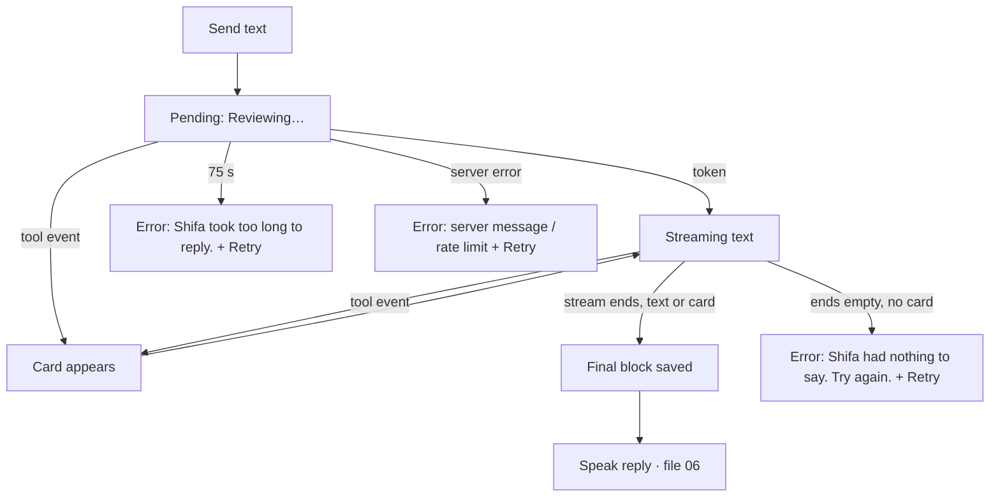

# Chat thread + composer (text mode)

| | |
|---|---|
| Area | Shifa Intelligence |
| Who sees it | Doctor only · PRO and PREMIUM |
| Reached from | Welcome (starter prompt, typed message, recent tile), history sheet (open), any voice/dictation turn |
| Screen type | Full screen (body of the Intelligence screen once the active conversation has content) |
| Current Flutter source | `lib/features/home/presentation/widgets/home_voice_session.dart` (embedded branch: `_UserBubble`, `_AssistantBlock`, `_IntelligenceComposer`, `_PatientContextLine`, `_askMorningAi`, `_sendTyped`, `_retryLast`), `lib/core/api/ai_api.dart`, `lib/features/intelligence/presentation/intelligence_card_text.dart` |
| Spec | `docs/kmp-spec/02-home-ai-intelligence.md` §3.2, §3.3, §3.7, §4.4 (card slot), §0 · tickets AI-01, AI-02, INTEL-04, INTEL-10 |

## 1. Purpose
The conversation itself: the doctor types (or speaks, files 04–05) a request, Shifa streams an answer and often a
structured card (files 07–19). Daily, many times.

## 2. Entry points
- Welcome starter card or typed message → the welcome body is swapped for the thread in place.
- History / recent tile → thread restored from the local store (user and assistant messages, cards included).
- Voice/dictation turns land here too; the thread hosts the orb panel while listening/speaking (file 04).
- No external deep link.

## 3. Layout, top to bottom (phone portrait)
1. **App bar** (as on the welcome) — back arrow now means "Back" (to the welcome), plus the overflow menu
   (Download conversation / Rename / Delete).
2. **Thread** (scrollable, padding 24/20), one block per turn:
   - **User bubble**, right-aligned, max 78 % width, brand tint 12 %, radius 14; a small timestamp above it
     ("Today · 09:41", "Yesterday · 18:02", "24 Oct 2026 · 08:15"). Plain text, no markdown.
   - **Assistant block**, left-aligned, full width: timestamp above, a sparkle icon, then the reply text (line
     height 1.45). Below the text, the **card slot** when the turn carried a tool payload (one card per turn).
   - **Pending block** while waiting for the first token: italic secondary text "Reviewing…" (or "Transcribing…"
     after a dictation).
   - **Streaming block**: the reply text grows token by token in a normal assistant block; the card, if any,
     appears as soon as its tool event arrives — often *before* the text finishes.
   - **Error row** (red caption + "Retry" text button) under the last block when the turn failed.
   - The orb panel (file 04) is inserted at the end of the list while listening / speaking / hands-free thinking.
3. **Patient context line** just above the composer (only when the thread is patient-linked): person icon +
   "Patient · Karimov Anvar" (or just "Patient" when the name is unknown), one line, ellipsis.
4. **Composer** (sticky): white rounded box (radius 16, 1 px border; brand border while listening/dictating):
   - text field, 1–4 lines, hint "Ask Shifa…"; keyboard action = Send;
   - dictation button (record-dot icon; green check while recording; spinner while transcribing);
   - mic button (mic outline; red stop while listening; filled mic while Shifa speaks = interrupt);
   - send button (brand when there is text and nothing is running, 35 % otherwise).
   - Helper lines above the box: red error caption (idle only), "Transcribing your recording…", or
     "Recording… tap the check when you are done. Pauses are fine." Helper line below: "Hands-free is on — the mic
     opens after each reply" while the hands-free loop is armed and idle.
5. **Disclaimer** "AI-generated responses may require review." (caption, centred, tertiary) under the composer.

Scrolling: the list follows the newest content while the doctor is at the bottom (within 72 px); scrolling up
stops following; coming back to within 72 px re-enables it.

## 4. Data and formats
| Field | Source | Format rule |
|---|---|---|
| Timestamps | message `at` (device clock when written) | "Today · HH:mm" / "Yesterday · HH:mm" / "d MMM yyyy · HH:mm", device local time (§12: should be practice time for consistency, but these are the doctor's own message times — keep device time, state it) |
| Reply text | SSE tokens joined, trimmed | shown as sent; **no markdown rendering in the thread today** (target: same lightweight renderer as the briefing: `## headings`, bullets, `**bold**`) |
| Assistant line fallback | when the text is empty but a card arrived: card `statusMessage` (booked) or `spokenHint` | localised through the hint translator; booking/moving lines rebuilt as "Booked {name} at {time} on {date}." |
| Reply language | detected per turn from the typed text; otherwise previous turn's language; first turn = app language | sent to the backend as EN / RU / UZ; cards are labelled in the **app** language regardless |
| Patient context | latest card that names a patient: single search match; or a multi-match whose name words all appear in the last 4 user messages; otherwise latest propose / appointments / documents / viewer / dental / brief card | the backend receives this patient id with every request so bookings stick to the right person |
| History sent to backend | every user message + every assistant message, the latter with hidden tags carrying the previous card's query, listed appointment ids, cancel token or focused appointment | invisible to the doctor; must never be rendered |
| Reply timeout | 75 s for the whole stream | then "Shifa took too long to reply. Try again." |
| Stream errors | code + message from the server | 429 → "You've reached your daily AI usage limit. Try again tomorrow."; others show the server message |

## 5. Primary flow (happy path)
1. Doctor types "How many visits tomorrow?" and taps send (or keyboard Send).
2. Field clears and is disabled; user bubble appears with "Today · HH:mm"; the list jumps to the bottom; pending
   "Reviewing…" block shows.
3. First token arrives (typically 1–3 s): pending block becomes the streaming block; text grows.
4. A tool event may arrive → the card renders under the text immediately (e.g. Schedule card).
5. Stream ends → block is finalised with its timestamp, the turn is saved locally, the spoken version starts
   (file 06) when voice is active — a typed turn is **also spoken** today (§12/§13).
6. Composer re-enables; focus stays off the field (keyboard closed).

## 6. Screen states
- **First load:** restoring a saved thread is instant (local). Target skeleton for the restored thread: none needed;
  render directly.
- **Empty:** never — an empty conversation shows the welcome (file 01).
- **Error on load:** n/a (local).
- **Offline:** the thread and its cards render from the store (cards keep their last status). Sending fails fast
  with the network error text + Retry. Card buttons that call the backend fail with their own red line.
- **Refreshing:** n/a. Background: a card's "booked" status can update the calendar providers.
- **Partial data:** reply text empty but a card present → the assistant line shows the card's spoken hint; card
  present with `error` → card body shows the error text.
- **Permission needed:** none for text. Mic permission is handled in files 04/05.
- **Locked by tier:** screen not reachable below PRO; if the tier drops while open, the whole body renders blank
  today (target: lock banner over a read-only thread).
- **Role difference:** doctor only.

## 7. Interactions and secondary flows
- **Send** (button or keyboard action) → turn starts; text must be non-empty; disabled while busy, listening or
  speaking. Typing a message **ends the hands-free voice loop**.
- **Retry** (error row) → re-sends the last user text; if the failed turn had been added it is removed first, so the
  thread never shows the same question twice.
- **Tap a card action** → see the card's file. Cards keep their own busy/status/error state.
- **Scroll up during streaming** → auto-follow stops; a new token does not pull the view down. Target: show a
  "↓ New reply" pill when content arrives while scrolled up.
- **Tap mic** → file 04. **Tap record** → file 05. **Tap mic while Shifa speaks** → barge-in (file 06).
- **Tap record or mic while "Reviewing…"** → cancels the turn: "Stopped." toast (record button) — the pending
  block disappears, the user bubble stays, no assistant block is added. Today the HTTP stream keeps running in the
  background until the server finishes; target: cancel the request.
- **Long-press a bubble** → nothing today; target: copy text (and "Report" for QA, see file 23 for the pattern).
- **Back arrow** → welcome (conversation stays in history). **System back** → see file 01 §7.
- **Overflow menu** → Download / Rename / Delete (file 02).

## 8. Edge cases
- Empty transcript or empty typed text → nothing sent.
- Very long reply (thousands of characters): streams fine; only the first 560 characters are spoken (cut at the last
  sentence end after 40 chars). Visual: the block grows; keep follow-latest working while the card below also grows.
- Reply contains markdown (`**`, `##`, `-`): shown raw today. Target renderer handles headings, bullets, bold only.
- Reply ends empty with no card → "Shifa had nothing to say. Try again." + Retry; no assistant block saved.
- Tool event with an unknown card type → generic card titled "Shifa Intelligence" showing the spoken hint.
- Two tool events in one turn → only the last payload is kept (one card per turn).
- Network drops mid-stream → partial text stays visible in the streaming block until the error replaces the pending
  state; the partial reply is **not** saved; error row + Retry.
- 75 s with no end → timeout error; a very slow but still-streaming reply is cut.
- Rate limit (429) → fixed English sentence today for every language (§11 NEW key).
- Session expired (401) → today a raw error line in the thread, no logout; target: standard logout flow.
- Double tap on Send → second tap ignored (busy).
- Keyboard open while a reply streams → the list keeps following under the keyboard; composer stays visible.
- Device rotation → thread keeps position; composer draft text survives (controller lives in the composer state).
- Language switched mid-conversation → labels, timestamps, card labels and translated hint sentences re-render in
  the new language; existing reply texts stay as generated; the next reply follows the language of what the doctor
  types, not the app language.
- Thread restored from a previous app version without `titleCustom` → loads fine.
- Conversation deleted (history sheet) while this thread is streaming → view unmounts; stream orphaned (§12).
- 100+ turns in one conversation → whole history is sent to the backend each turn (payload grows; backend trims);
  rendering uses a plain list — target lazy list.
- Font 200 %: bubbles wrap; composer field grows to 4 lines then scrolls; buttons keep 40 dp targets; the three
  icon buttons must not shrink the text field below ~120 dp — allow the icon row to wrap under the field.
- Screen reader: the pending/streaming block must be a live region that announces once per sentence, not per token;
  the orb status is already a live region. Focus order: app bar → thread (reverse chronological is fine) → context
  line → field → record → mic → send.
- Incoming push deep link while open → the shell leaves Intelligence; the in-flight stream is orphaned today.

## 9. Validation and messages
| Field/action | Rule | When | Message | Where |
|---|---|---|---|---|
| Composer text | trimmed non-empty | on send | — (send disabled) | — |
| Reply empty | text and card both missing | stream end | Shifa had nothing to say. Try again. | error row + Retry |
| Reply timeout | 75 s | timer | Shifa took too long to reply. Try again. | error row + Retry |
| Server error | non-200 or `error` event | immediate | server message, or "You've reached your daily AI usage limit. Try again tomorrow." for 429 | error row + Retry |
| Cancel while reviewing | record/mic button | tap | Stopped. | toast → target banner |
| Card errors | per card | per action | see card files | inside card |

## 10. Navigation out
- Back → welcome; thread saved after every finished turn (a turn in progress is lost, the user bubble with it).
- Card "Open calendar" → leaves Intelligence to the Calendar tab; schedule reloaded.
- open_appointment (file 19) → visit screen.
- Leaving to the clinic shell always triggers the appointment/notification/analytics refresh.

## 11. Copy
| Key | English |
|---|---|
| `intelComposerHint` | Ask Shifa… |
| `intelComposerListening` | Listening… |
| `intelComposerSpeaking` | Shifa is speaking… tap the mic to interrupt |
| `transcribing` | Transcribing… |
| `intelReviewing` | Reviewing… |
| `intelEmptyReply` | Shifa had nothing to say. Try again. |
| `intelTookTooLong` | Shifa took too long to reply. Try again. |
| `retry` | Retry |
| `intelStopped` | Stopped. |
| `intelContextPatient` / `intelPatient` | Patient · {name} / Patient |
| `intelDisclaimer` | AI-generated responses may require review. |
| `intelMicTalk` / `intelStopListening` / `intelInterruptSpeak` | Talk with Shifa / Stop listening / Interrupt and speak |
| `intelDictateHint` / `intelTapToSendRecording` | Dictate — records until you tap send. Pauses are OK. / Tap to send this recording |
| `send` | Send |
| `today` / `yesterday` / `monthShort` | Today / Yesterday / month abbreviations |
| **NEW** `aiRateLimit` | You've reached your daily AI usage limit. Try again tomorrow. |
| **NEW** `intelNewReplyBelow` | New reply |
| **NEW** `copy` (long-press) | Copy |

## 12. Known problems in the current app (do not carry over)
- "Stop" while reviewing only ignores the result; the network stream stays open until the server finishes.
- A typed message is always read aloud (no setting); target: speak replies only after a voice turn, or behind a
  toggle.
- Replies are plain text; markdown markers from the model show raw.
- The 429 sentence is hardcoded English.
- Timestamps are the device clock; the rest of the app uses practice time — state the rule explicitly in design.
- Debug builds log every token (content) — must not exist in release.
- One 3.3k-line widget mixes thread, voice, booking and persistence; irrelevant to design but explains odd couplings
  (e.g. the composer is disabled while Shifa speaks).

## 13. Open questions for design
- Should the composer stay enabled while Shifa speaks (typing = interrupt), instead of disabled?
- Where does the patient context line belong: above the composer (today) or as a chip in the app bar?
- Do we want per-turn "thumbs up/down" or "Report" feedback in the thread?
