# Voice session (mic tap-to-talk, hands-free loop)

| | |
|---|---|
| Area | Shifa Intelligence |
| Who sees it | Doctor only · PRO and PREMIUM; the mic itself needs `speechToText` (PRO) |
| Reached from | Mic button in the composer (welcome or thread); re-armed automatically after each spoken reply while hands-free is on |
| Screen type | Overlay state inside the thread (orb panel inserted at the end of the list + composer in listening state) |
| Current Flutter source | `home_voice_session.dart` (`_toggleListen`, `_beginListening`, `_onMicLevel`, `_finishListening`, `_transcribeCapturedAudio`, `_cancelListening`, `_scheduleHandsFreeListen`, `_voiceCopy`, `_embeddedVoicePanel`), `shifa_ai_orb.dart` (`ShifaVoiceOrbPanel`), `core/widgets/doctor_voice_recorder_session.dart`, `core/api/doctor_transcription_api.dart` |
| Spec | `docs/kmp-spec/02-home-ai-intelligence.md` §3.5 (B), §3.3, §3.10, §0 · tickets AI-03, AI-07, AI-08, INTEL-09 |

## 1. Purpose
Talk to Shifa instead of typing, hands busy or between patients: tap the mic once, speak, pause — the question is
sent, the answer is read aloud, and the mic opens again for the next question. Several times a day for PRO doctors.

**Mobile decision:** there is **no** browser speech recognition and **no** wake word. The phone records audio,
shows the mic level on the orb, decides the end of the utterance from silence, uploads the audio for server
transcription, then streams the reply and plays the server voice.

## 2. Entry points
- Composer mic button while idle → starts listening (recorder mode) and arms the hands-free loop.
- Mic button while Shifa is speaking → barge-in: stops playback, starts listening.
- Mic button while "Reviewing…" → cancels the pending turn, then starts listening.
- Automatic re-open 450 ms after a spoken reply ends (hands-free loop), 650 ms after a "no speech" result.
- Not reachable while a dictation is recording (that button sends instead).

## 3. Layout, top to bottom (phone portrait)
While a voice turn is active the thread (file 03) gains an **orb panel** as its last item:
1. Tinted rounded card (brand border), containing:
   - the **Shifa orb** (112–148 dp): turquoise gradient disc with the Shifa mark; ripples and drifting blobs whose
     energy follows the mic level while listening (noise floor ≤ 0.16 → calm), fixed medium energy while thinking,
     high while speaking; reduced-motion = static low energy;
   - a **phase icon**: mic (listening), 18 dp spinner (thinking), equaliser (speaking);
   - **status** (teal bold, live region) and **subtitle** (secondary caption) — table in §4;
   - **Stop** pill button (stop icon) only while listening — it **sends** what was captured (it does not discard).
2. The **composer** below changes: text field disabled with hint "Listening…" / "Shifa is speaking… tap the mic to
   interrupt"; mic button becomes a red stop circle while listening and a filled mic while speaking; the dictation
   button stays available while listening (it also sends).
3. After the turn, while hands-free is armed and idle, the helper line "Hands-free is on — the mic opens after each
   reply" shows under the composer.

The panel is shown while **listening**, **speaking**, and while **thinking if hands-free is on** (so the orb does not
flash away between turns). After a typed message, thinking shows only the "Reviewing…" block.

## 4. Data and formats
| Phase | Status | Subtitle |
|---|---|---|
| listening, nothing heard yet | Listening… speak now | Hands-free — tap stop when you are done to send |
| listening, speech heard | Listening… pause to send | same |
| listening, manual endpoint (no level data, web artefact) | Recording… speak, then tap stop | Tap Stop when you finish speaking |
| thinking (after voice) | Reviewing… | Shifa is reviewing your request |
| thinking (after dictation) | Transcribing… | Sending your recording to Shifa |
| speaking | Shifa is speaking… | Tap the microphone to interrupt |
| idle | Talk with Shifa | — |

| Constant | Value (verified) | Meaning |
|---|---|---|
| speech threshold | level ≥ 0.12 | counts as speech |
| silence gate | max(0.09, min(0.40, 0.30 × rolling peak)) | relative silence |
| min speech before auto-send | 700 ms | never send a fragment |
| silence to send | 1 900 ms | natural pause → send |
| no-speech cancel | 20 s | nothing heard → stop, hands-free off |
| max listen | 45 s | sends whatever was captured |
| amplitude probe | 900 ms | no level events → manual endpoint (web only; drop on mobile) |
| stop recorder / read file | 8 s each | otherwise "Transcription timed out…" |
| transcription upload | 90 s | server STT (auto language) |
| reply stream | 75 s | otherwise "Shifa took too long to reply." |
| TTS request | 25 s | file 06 |
| hands-free re-listen after reply | 450 ms | — |
| re-listen after no speech | 650 ms | hands-free kept on |
| restart cooldown | 1 400 ms | automatic re-listens are throttled |
| toast duration | 4 s | all voice errors |
| Audio | AAC `.m4a`, 16 kHz mono, 32 kbps, temp file, level every 60 ms (−55 dB → 0.08, −8 dB → 1.0) | deleted on cancel |
| Reply language | words in the transcript → server-detected STT language → previous language | Uzbek voice is WAV, EN/RU MP3 |

## 5. Primary flow (happy path)
1. Tap mic → permission prompt on first use → listening: orb pulses gently, status "Listening… speak now", mic
   button red stop, field disabled.
2. Doctor speaks ≥ 0.7 s → status "Listening… pause to send"; orb follows the voice.
3. Doctor pauses 1.9 s → recording stops → phase thinking: "Reviewing…", spinner on the orb.
4. Audio uploaded → transcript returns → the doctor's words appear **once** as a user bubble (no live caption on
   mobile, for any language) → reply streams as in file 03.
5. Reply done → speaking: orb at high energy, "Shifa is speaking…"; text already visible.
6. Playback ends → idle for 450 ms → listening again (hands-free). Helper line "Hands-free is on…" shows in the
   idle gap.
7. Loop ends when the doctor types, when nothing is heard for 20 s, on any transcription error, or on a mic/TTS
   failure.

```mermaid
stateDiagram-v2
  [*] --> Idle
  Idle --> Listening: mic tap (PRO ok, permission ok)\nhands-free = on
  Idle --> Listening: hands-free timer 450 ms after reply\n/ 650 ms after no-speech
  Idle --> Idle: mic tap below PRO → "Speech requires Pro…"
  Idle --> Idle: permission denied → "Microphone permission is required. Allow mic access and try again."\nhands-free = off
  Idle --> Idle: recorder start failed → "Could not start the microphone…"\nhands-free = off
  Listening --> Thinking: silence ≥ 1900 ms after ≥ 700 ms speech
  Listening --> Thinking: tap mic (stop) / tap Stop pill / tap record button → send what was captured
  Listening --> Thinking: 45 s max listen → send
  Listening --> Idle: 20 s without speech → "No speech detected. Tap the mic, speak, then tap stop to send."\nhands-free = off
  Thinking --> Idle: transcript empty → "No speech detected. Tap the mic and try again."\nre-listen in 650 ms if hands-free
  Thinking --> Idle: stop/read > 8 s or upload > 90 s → "Transcription timed out. Try a shorter recording."\nhands-free = off
  Thinking --> Idle: 403 / permission → "Speech requires Pro, or mic permission was denied."\nhands-free = off
  Thinking --> Idle: other STT error → "Transcription failed. Check your connection and try again."\nhands-free = off
  Thinking --> Thinking: transcript ok → user bubble → reply stream (tokens, card)
  Thinking --> Idle: reply > 75 s → "Shifa took too long to reply. Try again."\nre-listen 450 ms if hands-free
  Thinking --> Idle: stream error / empty reply → error row + Retry\nre-listen 450 ms if hands-free
  Thinking --> Listening: mic tap while reviewing → cancel turn, listen
  Thinking --> Speaking: reply text or spoken hint non-empty
  Speaking --> Idle: playback complete (native callback; today polled, cap 30 s)
  Speaking --> Listening: mic tap = barge-in (stop audio)
  Speaking --> Idle: TTS > 25 s → "Voice is slow — caption is above. Keep talking."
  Speaking --> Idle: TTS 502 / failed → "Voice skipped — caption is above."
  Idle --> [*]: typed message / leave screen → hands-free off
```

## 6. Screen states
- **First load:** n/a (state inside the thread).
- **Empty:** nothing heard for 20 s → listening ends with the no-speech toast; hands-free turns off.
- **Error on load:** n/a.
- **Offline:** recording works; the upload fails → "Transcription failed. Check your connection and try again."
  The recording is discarded (target: keep the last take and offer "Send again").
- **Refreshing:** n/a.
- **Partial data:** transcript ok but reply fails → user bubble stays, error row + Retry re-sends the text (no new
  recording needed).
- **Permission needed:** system mic prompt on the first tap. Denied once → "Microphone permission is required.
  Allow mic access and try again." Denied permanently → same toast today; target: dialog with "Open settings".
- **Locked by tier:** below PRO the mic button is visible; tapping shows "Speech requires Pro. Upgrade to talk with
  Shifa." Target: locked icon state + the same message as a banner with "Upgrade".
- **Role difference:** doctor only.

## 7. Interactions and secondary flows
- **Mic tap (idle)** → listen; arms hands-free.
- **Mic tap (listening)** → stop and send (never discard). **Stop pill** → same. **Record button (listening)** → same,
  and turns hands-free off.
- **Mic tap (speaking)** → barge-in: audio stops immediately, listening starts.
- **Mic tap (reviewing)** → cancels the turn (no toast), starts listening.
- **Type and send** → hands-free off, normal text turn.
- **Leaving the screen** → recorder stopped and the file discarded; TTS stopped.
- **Sign-off phrases** ("that's it", "thank you", "bo'ldi", "rahmat", "спасибо", "хватит"…) end the hands-free loop
  on web only; on mobile they are sent to the model today. Target: detect them locally on mobile, reply with a short
  localised sign-off ("You're welcome. Tap the mic when you need me again."), speak it, and stop the loop.
- **There is no "end hands-free" control** on mobile today besides typing or waiting 20 s (§12). Target: while idle
  with hands-free on, the helper line gets an inline "Turn off" action, and the orb panel keeps a "Stop" that ends the
  loop when nothing is being recorded.
- **No cancel while listening**: every stop sends. Target: long-press the stop (or a secondary "Discard") cancels the
  take.

## 8. Edge cases
- Empty transcript or the server placeholder "(No speech detected)" → treated as no speech.
- Speech shorter than 700 ms followed by silence → not sent; keeps listening until 20 s or 45 s.
- Doctor pauses mid-sentence > 1.9 s → the fragment is sent; the next fragment becomes a new turn. Design the
  status copy to teach "pause to send"; dictation (file 05) is the alternative.
- Noisy room: the silence gate is relative to the recent peak, so steady noise still allows auto-send; very loud
  constant noise can prevent it → 45 s cap sends anyway.
- 45 s cap while the doctor is still speaking → the clip is cut and sent; remaining words are lost. Target: show a
  countdown ring in the last 10 s.
- App backgrounded while recording → recording continues on Android until the OS stops it; on iOS the audio session
  ends; on return the stop may fail → "Transcription timed out…" or "failed". Target: stop and discard on
  background, show "Recording stopped" on return.
- Incoming phone call while recording → OS takes the mic; same as above. Target: cancel the take, stop hands-free.
- Mic taken by another app (e.g. a video call in this app): recorder start fails → "Could not start the
  microphone…" (copy says "Check browser permissions" today — §11 NEW).
- Permission denied permanently → toast every tap today; target: settings dialog.
- Very long reply → spoken text truncated to 560 chars (file 06); the orb stays "speaking" only for what is spoken.
- Transcript in a language different from the app → reply follows the transcript; cards stay in the app language.
- Uzbek: no interim caption anywhere on mobile (same for all languages); the transcript appears once.
- Language switch mid-loop → the next turn's language is still detected from speech; the UI copy switches at once.
- Double tap on the mic (idle) → second tap arrives while listening → sends an empty recording → "No speech…".
  Target: ignore taps within 400 ms of starting.
- Second voice turn started before the previous TTS fully stopped → generation guard discards stale audio events.
- Network drop between transcript and reply → error row + Retry (re-sends the text).
- 401 during transcription → today a raw error; target logout.
- Deleted conversation while listening → view unmounts, recorder stopped and discarded.
- Screen reader: status is a live region (already); announce phase changes only, not level changes; Stop has the
  label "Stop listening".
- Font 200 %: status may wrap to two lines inside the panel; the orb must shrink before the text is clipped.
- Battery saver / reduced motion → static orb at fixed low energy; the phase icon carries the state.

## 9. Validation and messages
| Action | Rule | When | Message (English) | Where |
|---|---|---|---|---|
| Mic tap | tier ≥ PRO | tap | Speech requires Pro. Upgrade to talk with Shifa. | toast → banner |
| Mic start | permission granted | tap | Microphone permission is required. Allow mic access and try again. | toast → dialog |
| Mic start | recorder started | tap | Could not start the microphone. Check browser permissions. (**NEW** mobile wording: "Could not start the microphone. Close other apps using it and try again.") | toast → banner |
| Listening | speech within 20 s | timer | No speech detected. Tap the mic, speak, then tap stop to send. | toast → banner |
| Transcript | non-empty | after upload | No speech detected. Tap the mic and try again. | toast → banner |
| Stop/read/upload | 8 s / 8 s / 90 s | timer | Transcription timed out. Try a shorter recording. | toast → banner |
| Upload | not 403 | response | Speech requires Pro, or mic permission was denied. | toast → banner |
| Upload | success | response | Transcription failed. Check your connection and try again. | toast → banner |
| Reply | within 75 s | timer | Shifa took too long to reply. Try again. | error row + Retry |
| Cancel while reviewing (record button) | — | tap | Stopped. | toast → banner |

## 10. Navigation out
- Back / leaving Intelligence → recorder stopped and discarded, playback stopped, hands-free off; the thread is
  already saved through the last finished turn.
- Card "Open calendar" during a voice turn → same cleanup.

## 11. Copy
| Key | English |
|---|---|
| `intelBannerSpeakNow` / `intelBannerPauseSend` / `intelBannerRecording` | Listening… speak now / Listening… pause to send / Recording… speak, then tap stop |
| `intelBannerHandsFreeSubtitle` / `intelBannerManualSubtitle` | Hands-free — tap stop when you are done to send / Tap Stop when you finish speaking |
| `intelReviewing` / `voiceThinkingSubtitle` | Reviewing… / Shifa is reviewing your request |
| `voiceSpeaking` / `voiceSpeakingSubtitle` | Shifa is speaking… / Tap the microphone to interrupt |
| `intelMicTalk` / `intelStopListening` / `intelInterruptSpeak` / `intelVoiceStop` | Talk with Shifa / Stop listening / Interrupt and speak / Stop |
| `intelHandsFreeOn` | Hands-free is on — the mic opens after each reply |
| `intelComposerListening` / `intelComposerSpeaking` | Listening… / Shifa is speaking… tap the mic to interrupt |
| `intelSpeechRequiresPro` | Speech requires Pro. Upgrade to talk with Shifa. |
| `intelMicPermissionRetry` | Microphone permission is required. Allow mic access and try again. |
| `intelCouldNotStartMic` | Could not start the microphone. Check browser permissions. |
| `intelNoSpeech` / `intelNoSpeechShort` | No speech detected. Tap the mic, speak, then tap stop to send. / No speech detected. Tap the mic and try again. |
| `intelTranscriptionTimeout` / `intelTranscriptionFailed` / `intelSpeechProOrDenied` | Transcription timed out. Try a shorter recording. / Transcription failed. Check your connection and try again. / Speech requires Pro, or mic permission was denied. |
| `intelTookTooLong` / `intelStopped` | Shifa took too long to reply. Try again. / Stopped. |
| **NEW** `intelCouldNotStartMicMobile` | Could not start the microphone. Close other apps using it and try again. |
| **NEW** `intelMicSettings` | Open settings |
| **NEW** `intelHandsFreeOff` | Turn off |
| **NEW** `intelDiscardTake` | Discard |
| **NEW** `intelSignOffReply` / `intelSignOffThanks` | Alright. Tap the mic when you need me again. / You're welcome. Tap the mic when you need me again. |
| **NEW** `intelRecordingStoppedBackground` | Recording stopped while the app was in the background. |

## 12. Known problems in the current app (do not carry over)
- Wake word, browser live caption, recogniser watchdog and the "Hey Shifa" wording in replies and tooltips — none
  apply on mobile.
- Sign-off replies are hardcoded in three languages and tell the doctor to "Say Hey Shifa"; sign-off detection does
  not even run on the mobile recorder path.
- No way to end hands-free except typing or 20 s of silence; no way to discard a take — every stop sends.
- Stopping while "Reviewing…" leaves the HTTP stream running.
- 900 ms amplitude probe and "manual endpoint" mode are web artefacts (native recorders always report levels).
- Mic start error copy mentions "browser permissions".
- Transcript-empty and all other outcomes surface as 4 s floating snackbars; the design uses banners.
- Tapping the mic below PRO shows the message every time instead of a locked affordance.

## 13. Open questions for design
- Should the orb panel replace the composer area while listening (full-width voice mode) instead of sitting in the
  thread above a disabled composer?
- Is hands-free the default after a mic tap, or should the first tap be a single turn with an explicit "keep
  listening" toggle?
- Do we want a visible silence countdown (1.9 s) so the doctor learns the pause-to-send rhythm?
