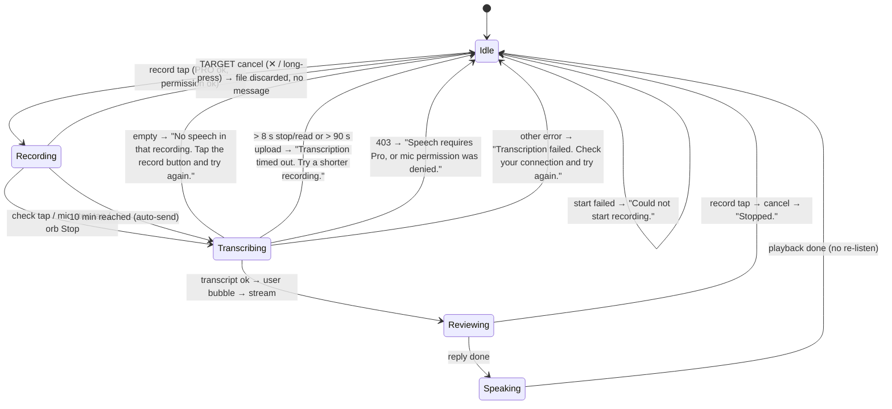

# Dictation mode (record until send)

| | |
|---|---|
| Area | Shifa Intelligence |
| Who sees it | Doctor only · PRO and PREMIUM; needs `speechToText` (PRO) |
| Reached from | Record button (dot icon) in the composer, welcome or thread |
| Screen type | Overlay state inside the composer (the text field is replaced by a live waveform) |
| Current Flutter source | `home_voice_session.dart` (`_toggleDictation`, `_beginDictation`, `_finishListening`, `_ComposerDictationWave`, `_IntelligenceComposer`) |
| Spec | `docs/kmp-spec/02-home-ai-intelligence.md` §3.5 (C) · tickets AI-03, AI-08, INTEL-09 |

## 1. Purpose
Long, thought-out requests or protocol-style notes where pauses are natural ("Book Karimov… hmm… Thursday morning,
and after that show me his last x-ray"). Nothing is sent until the doctor taps the check. Occasional use.

## 2. Entry points
- Record button in the composer while idle. If Shifa is speaking, tapping it first stops the voice, then starts
  recording. If a turn is "Reviewing…", tapping it cancels the turn ("Stopped.") and does **not** start recording.
- Not available while a mic (file 04) take is in progress — there the same button sends the take.

## 3. Layout, top to bottom (phone portrait)
1. Helper line above the composer box (brand, bold caption): "Recording… tap the check when you are done. Pauses
   are fine."
2. **Composer box** with a brand border (1.6 px): the text field is replaced by a **22-bar waveform** (bars 4–28 dp,
   brand colour scaled by level, 80 ms easing); bars keep a soft pulse even in silence so the UI never looks frozen.
3. Buttons: record button becomes a **green check** (26 dp) with tooltip "Tap to send this recording"; mic button
   shows the red stop circle (also sends); send button disabled.
4. The orb panel (file 04) also appears at the end of the thread while recording, with status "Recording… speak,
   then tap stop" and subtitle "Tap Stop when you finish speaking"; its Stop pill sends.
5. After the check: helper line "Transcribing your recording…" with a spinner in the record button; the orb panel
   shows "Transcribing…" / "Sending your recording to Shifa"; then the normal "Reviewing…" flow (file 03).

## 4. Data and formats
| Item | Value |
|---|---|
| Max duration | 10 min, then auto-send |
| Silence handling | ignored — no auto-send, no no-speech cancel |
| Audio | same recorder as file 04 (AAC m4a 16 kHz mono) |
| Transcription | server, auto language, 90 s timeout; 8 s to stop/read the file |
| Reply language | from the transcript words, else STT language, else previous |
| Hands-free | turned **off** when dictation starts; the mic does not re-open after the reply |
| Empty result | "No speech in that recording. Tap the record button and try again." |

## 5. Primary flow (happy path)
1. Tap record → permission check → waveform replaces the field; helper line shows; orb panel appears.
2. Doctor speaks with pauses for up to several minutes; bars follow the voice.
3. Tap the green check → waveform disappears; "Transcribing your recording…"; spinner.
4. Transcript arrives → user bubble with the full text → "Reviewing…" → reply streams → spoken (file 06).
5. Composer returns to idle; no automatic re-listen.

## 6. Screen states
- **First load / Empty / Error on load / Refreshing / Partial:** n/a (composer state).
- **Offline:** recording works; upload fails → "Transcription failed…"; recording discarded (target: keep and
  offer retry).
- **Permission needed:** first tap → system prompt; denied → "Microphone permission is required." Permanently
  denied → same today; target settings dialog.
- **Locked by tier:** tap → "Speech requires Pro. Upgrade to talk with Shifa."
- **Role difference:** doctor only.

## 7. Interactions and secondary flows
- **Check / mic stop / orb Stop** → send. All three do the same thing; there is **no cancel** today (§12).
- **Record tap while speaking** → stops the voice, starts recording.
- **Record tap while reviewing** → cancels the turn with "Stopped." (nothing recorded).
- **Typing** is impossible while recording (field replaced).
- **Back / leave screen** → recording stopped and discarded silently.
- **10 min reached** → auto-send with no warning. Target: a countdown in the last minute and a short banner
  "Recording limit reached — sending."

## 8. Edge cases
- Recording of 0–1 s → usually "(No speech detected)" → the "No speech in that recording…" toast.
- Very long dictation (10 min ≈ 2.4 MB) → upload may approach the 90 s limit on slow networks → timeout toast and
  the take is lost. Target: keep the file until a retry succeeds or the doctor discards.
- App backgrounded → recording continues until the OS stops it; incoming call → mic lost → stop fails →
  "Transcription timed out…". Target: stop and discard on background with a banner on return.
- Mic taken by another app → "Could not start recording."
- Language mix inside one dictation → server picks the dominant language; the reply follows the transcript words.
- Transcript much longer than the model's input budget → backend may truncate; nothing visible to design.
- Double tap on the check → the second tap is ignored (phase already thinking).
- Record tap immediately after a mic take ended (< 160 ms) → a short settle delay exists; fine.
- Device rotation while recording → state kept (widget state), bars re-layout.
- 200 % font → helper lines wrap to two lines; the waveform row keeps 28 dp height.
- Screen reader: record button label toggles "Dictate — records until you tap send. Pauses are OK." ↔ "Tap to send
  this recording"; the helper line should be a polite live region.
- Conversation deleted while recording → discarded.

## 9. Validation and messages
| Action | Rule | When | Message | Where |
|---|---|---|---|---|
| Record tap | tier ≥ PRO | tap | Speech requires Pro. Upgrade to talk with Shifa. | toast → banner |
| Record start | permission | tap | Microphone permission is required. | toast → dialog |
| Record start | recorder ok | tap | Could not start recording. | toast → banner |
| Send | transcript non-empty | after upload | No speech in that recording. Tap the record button and try again. | toast → banner |
| Send | within timeouts | timer | Transcription timed out. Try a shorter recording. | toast → banner |
| Send | not 403 | response | Speech requires Pro, or mic permission was denied. | toast → banner |
| Send | success | response | Transcription failed. Check your connection and try again. | toast → banner |
| Cancel while reviewing | — | tap | Stopped. | toast → banner |
| 10 min cap | — | timer | **NEW** Recording limit reached — sending. | banner |

## 10. Navigation out
- Leaving Intelligence or the thread while recording → recording discarded, nothing sent, no message today
  (target: confirm "Discard recording?").
- After a successful send the flow is the normal thread.

## 11. Copy
| Key | English |
|---|---|
| `intelDictateHint` | Dictate — records until you tap send. Pauses are OK. |
| `intelRecordingHold` | Recording… tap the check when you are done. Pauses are fine. |
| `intelTapToSendRecording` | Tap to send this recording |
| `intelTranscribingRecording` | Transcribing your recording… |
| `intelSendingRecording` | Sending your recording to Shifa |
| `transcribing` | Transcribing… |
| `intelBannerRecording` / `intelBannerManualSubtitle` | Recording… speak, then tap stop / Tap Stop when you finish speaking |
| `intelNoSpeechRecording` | No speech in that recording. Tap the record button and try again. |
| `intelMicPermission` | Microphone permission is required. |
| `intelCouldNotStartRecording` | Could not start recording. |
| `intelTranscriptionTimeout` / `intelTranscriptionFailed` / `intelSpeechProOrDenied` | as file 04 |
| `intelStopped` | Stopped. |
| **NEW** `intelDiscardRecording` | Discard recording? |
| **NEW** `intelRecordingLimitReached` | Recording limit reached — sending. |

## 12. Known problems in the current app (do not carry over)
- No cancel: every way out of a dictation sends it (unlike the speech text field pill, which has ✕).
- 10-minute cap sends silently.
- A failed upload loses the recording.
- Three different controls (check, mic stop, orb Stop) all mean "send"; confusing.
- Snackbars instead of banners.

## 13. Open questions for design
- Merge mic and dictation into one control (tap = talk with auto-send, long-press/hold = dictate) or keep two
  buttons?
- Show elapsed time while dictating?
- Should a dictation also re-arm hands-free after the reply, like a mic turn?
