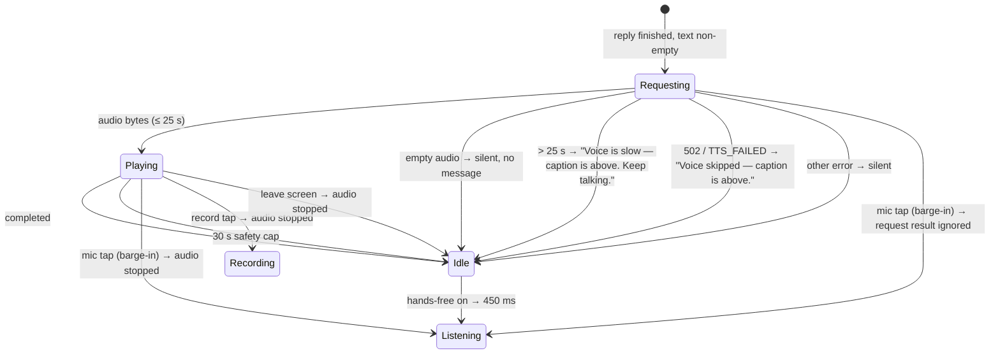

# TTS playback (Shifa speaks)

| | |
|---|---|
| Area | Shifa Intelligence |
| Who sees it | Doctor only · PRO and PREMIUM |
| Reached from | End of every successful turn (typed or spoken) whose reply text or spoken hint is non-empty |
| Screen type | State inside the thread (orb panel "speaking" + composer hint) |
| Current Flutter source | `home_voice_session.dart` (`_speakReply`, `_awaitTtsPlaybackDone`, barge-in in `_toggleListen` / `_toggleDictation`), `core/api/ai_api.dart` (`speak`, `_truncateForSpeech`) |
| Spec | `docs/kmp-spec/02-home-ai-intelligence.md` §3.4 · tickets AI-04, AI-08 |

## 1. Purpose
Read the reply aloud so the doctor can keep their eyes on the patient. Every turn today.

## 2. Entry points
- Automatically after the reply stream ends (or after a backend-booked turn, where the spoken text is the card's
  status line, e.g. "Booked Karimov Anvar at 09:30 on Thursday 30 October.").
- Never from a button; there is no "replay".

## 3. Layout, top to bottom (phone portrait)
1. Orb panel at the end of the thread: orb at high energy (0.46), equaliser icon, status "Shifa is speaking…",
   subtitle "Tap the microphone to interrupt". No Stop pill.
2. Composer: field disabled with hint "Shifa is speaking… tap the mic to interrupt"; mic button is a filled mic
   (26 dp) with tooltip "Interrupt and speak"; record button also interrupts; send disabled.
3. The reply text is already fully visible above; there is no word-by-word highlight.

## 4. Data and formats
| Item | Value |
|---|---|
| What is spoken | reply text, or card status when the backend booked, or the card's spoken hint when the text is empty |
| Length | truncated to 560 characters at the last `. ! ?` after position 40, else at the last space |
| Voice | follows the turn's reply language: UZ → server WAV voice; EN / RU → server MP3 voice |
| Request timeout | 25 s to get the audio |
| Playback | native player from bytes; completion by native callback (target). Today: estimated length (65 ms per character, 2–28 s) + 0.9 s, or real duration + 0.9 s capped at 30 s, polled every 120 ms, extra wait up to 20 s if the position lags |
| Volume | player volume forced to 1.0; system media volume applies |
| Interruption | any new play or a mic/record tap bumps a generation counter so stale audio events are ignored |

## 5. Primary flow (happy path)
1. Reply stream ends → phase switches to speaking **immediately** (orb animates before audio exists).
2. Audio bytes arrive (typically 0.5–3 s) → playback starts.
3. Playback ends → phase idle → if hands-free is on, listening resumes after 450 ms.

## 6. Screen states
- **First load / Empty / Error on load / Refreshing / Partial:** n/a.
- **Offline:** the reply cannot have streamed, so no TTS; if the network drops between reply and audio → "Voice
  skipped — caption is above." (soft).
- **Permission needed:** none (playback). Silent switch on iOS: audio may be muted; target: play through the media
  channel so the ringer switch does not silence it, and show nothing special.
- **Locked by tier:** n/a (reaching here implies PRO).
- **Role difference:** doctor only.

## 7. Interactions and secondary flows
- **Mic tap** → barge-in: stop audio, start listening (file 04).
- **Record tap** → stop audio, start dictation (file 05).
- **Typing** → impossible (field disabled) — target: enable the field; typing interrupts speech.
- **Phone call / other app takes audio focus** → playback paused by the OS; today the wait loop keeps the "speaking"
  state until the cap (≤ 30 s). Target: on focus loss, stop and go idle.
- **Headphones unplugged** → OS pauses; same handling.
- **Leave screen** → stop.

## 8. Edge cases
- Reply > 560 chars → only the first sentences are spoken; the orb returns to idle while the doctor may still be
  reading. Target: nothing to design beyond stating it; optionally a "Read more aloud" chip (open question).
- Reply that is only a card (no text) → the spoken hint is read (e.g. "You have 3 free morning slots on Thursday.
  Which time works?").
- Reply in Uzbek → WAV, slightly longer first-byte latency; the orb is already in speaking state so the doctor sees
  activity.
- Mixed-language reply → one voice (the detected reply language) reads everything.
- Very short reply ("Done.") → audio < 1 s; estimated wait is clamped to ≥ 2 s today (orb stays "speaking" ~3 s).
  Target: native completion removes the lag.
- Two replies finishing back to back (retry while speaking) → the newer play wins; the older audio stops.
- TTS 429 → treated as a generic failure: silent today. Target: show the rate-limit banner once.
- Audio bytes arrive but the player fails to decode (corrupt WAV) → silent idle today; target: "Voice skipped —
  caption is above."
- Device volume at 0 → nothing audible, state still "speaking" for the duration; acceptable.
- Bluetooth output switching mid-play → OS handles; no UI.
- Screen reader on: TalkBack/VoiceOver and the TTS would talk over each other. Target: when a screen reader is
  active, do not auto-play TTS; the live region already reads the status.
- Reduced motion → orb static; the equaliser icon is the only speaking cue.

## 9. Validation and messages
| Condition | Message (English) | Where |
|---|---|---|
| Audio request > 25 s | Voice is slow — caption is above. Keep talking. | toast → banner |
| 502 / synthesis failed | Voice skipped — caption is above. | toast → banner |
| Empty audio / decode error / other | silent today → target "Voice skipped — caption is above." | banner |

## 10. Navigation out
- Any navigation stops playback immediately; nothing to save.

## 11. Copy
| Key | English |
|---|---|
| `voiceSpeaking` | Shifa is speaking… |
| `voiceSpeakingSubtitle` | Tap the microphone to interrupt |
| `intelComposerSpeaking` | Shifa is speaking… tap the mic to interrupt |
| `intelInterruptSpeak` | Interrupt and speak |
| `intelVoiceSlow` | Voice is slow — caption is above. Keep talking. |
| `intelVoiceSkipped` | Voice skipped — caption is above. |
| **NEW** `intelVoiceOff` / `intelVoiceOn` | Voice off / Voice on (setting or toggle) |

## 12. Known problems in the current app (do not carry over)
- Playback end is guessed (65 ms per character, polling) because of web quirks; the orb often stays "speaking" 1–3 s
  after the audio stops, or cuts long audio at 30 s.
- A data-URI playback hack and a 60 ms "settle" delay before every play.
- Typed replies are always spoken; there is no voice toggle.
- Audio focus loss (calls, other apps) is not handled.
- Failures other than timeout/502 are swallowed silently.
- "Caption is above" wording assumes the web caption layout.

## 13. Open questions for design
- Where does the voice on/off toggle live: composer, app bar, or Settings?
- Should speaking show a progress indicator (e.g. a thin bar under the reply)?
- Do we want a "Replay" affordance on assistant blocks?
