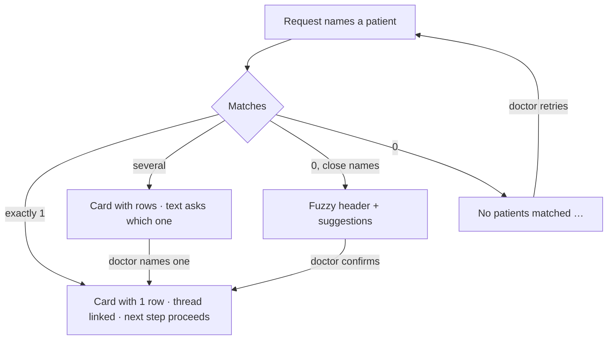

# Patient search card ("did you mean")

| | |
|---|---|
| Area | Shifa Intelligence · action cards |
| Who sees it | Doctor only · PRO and PREMIUM |
| Reached from | Assistant turn with the `patient_search` card (tool `search_patients`), e.g. "Find Karimov" or any request that names a patient the backend could not resolve uniquely |
| Screen type | Inline card inside the chat thread |
| Current Flutter source | `intelligence_action_cards.dart` (`_searchBody`), `intelligence_chat_models.dart` (`IntelligenceChatContext`), `home_voice_session.dart` (`_focusPatientIdFromSearchCards`) |
| Spec | `docs/kmp-spec/02-home-ai-intelligence.md` §4.4, §3.7, §0 · tickets INTEL-05, INTEL-10 |

## 1. Purpose
Disambiguate who the doctor means before anything is booked, moved or opened. Daily; it is the backbone of every
patient-centred request.

## 2. Entry points
- "Find a patient" starter prompt → the model asks for a name → the next turn returns this card.
- Any patient-specific request with a name that matches several or no records.
- Restored from history.

## 3. Layout, top to bottom (phone portrait)
1. **Title** "Patient matches".
2. **Fuzzy header** (bold) only when the match is approximate: "Did you mean…?" or, when the query is known,
   "No exact match for “Karimof”. Did you mean…?".
3. **Rows**: "Patient name · +998 90 123 45 67" (phone only when present). Rows are **not tappable** today.
4. **No match**: a single line — the backend hint translated ("No patients matched "Karimof" in your roster." /
   "No patients found."), else "No patients matched."

## 4. Data and formats
| Field | Source | Format rule |
|---|---|---|
| Rows | `matches[] {patientId, patientName, phone}` | all rows shown (no cap in code; backend limits) |
| Fuzzy | `fuzzy: true` | header shown |
| Query | `query` | quoted in the header |
| Patient link | exactly 1 match → the thread is linked to that patient; several matches → linked, but the **focus** patient for follow-up requests is the match whose name words all appear in the doctor's last 4 messages | context line shows the name only for a single match; "Patient" otherwise |
| Phone | as stored | no formatting on the device |

## 5. Primary flow (happy path)
Backend sentences that accompany this card (translated on the device):

| Case | Sentence |
|---|---|
| one match | Found {name}. |
| several | Found {count} patients matching "{query}". Which one? |
| fuzzy, one | No exact match for "{query}". Did you mean {name}? |
| fuzzy, several | No exact match for "{query}". Closest matches: {names}. Which one did you mean? |
| none | No patients matched "{query}" in your roster. / No patients found. |
| no name given | Please give a patient name to search. |

1. "Book Karimov for Thursday" → backend finds two Karimovs → text "Found 2 patients matching "Karimov". Which
   one?" + card with two rows.
2. Doctor says "Anvar" → backend continues with Karimov Anvar → propose card (file 14).

## 6. Screen states
- **First load:** n/a.
- **Empty:** the no-match line only (no title change).
- **Error on load:** `error` payload → default body.
- **Offline:** restored rows render.
- **Refreshing:** no.
- **Partial data:** missing phone → name only; missing name → "Patient".
- **Permission needed:** none.
- **Locked by tier:** n/a beyond the screen gate.
- **Role difference:** doctor only; the roster searched is the doctor's own patients (backend scope).

## 7. Interactions and secondary flows
- Rows inert today. Target: **tap a row = choose** — sends "{name}" as the doctor's answer so the backend proceeds,
  and sets the context patient. Also a secondary "Open chart" per row (doc 06 patient detail).
- The doctor can answer by voice or text ("the first one", "Anvar", the phone number).

## 8. Edge cases
- Query with typos (fuzzy) → header with the quoted query; quotes are typographic (“ ”) in the strings.
- 1 fuzzy suggestion → header "No exact match for “X”. Did you mean…?" + one row; the backend text may already say
  "Did you mean Karimov Anvar?".
- Many matches (10+) → long card; backend usually caps. Target: cap at 8 + "+N more" that asks to refine.
- Two patients with the same full name → rows differ only by phone; make the phone prominent.
- Name words shorter than 3 letters are ignored by the focus heuristic ("Li" never focuses) → the backend asks.
- Placeholder name "Patient" never links the thread.
- Follow-up "book him" after a multi-match without naming one → the backend keeps asking; nothing is booked.
- Phone numbers: no masking; this is PHI on screen — acceptable for the doctor, but never in logs.
- 200 % font: rows wrap name and phone on two lines.
- Screen reader: header, then one row per sentence "Karimov Anvar, phone +998…".
- Phone stored in different formats (+998…, 998…, 90 …) → shown as stored; target: format E.164 for display.
- Two rows with the same phone (family members) → still distinguishable by name.
- Query containing quotes or special characters → shown inside typographic quotes; escape nothing.
- Voice misrecognition of the name ("Karimof") → fuzzy header does the repair work; design the header to be the
  most prominent line.
- Search by phone number or by birth year → handled by the backend; the card is the same.
- Match list restored from history after the patient was renamed → old name shown (historical); the id still
  focuses the right record.
- Slow network: the sentence streams first ("Found 2 patients…"), the rows appear when the tool event lands.

## 9. Validation and messages
n/a (all copy is informational).

## 10. Navigation out
- None today. Target: "Open chart" → patient detail.

## 11. Copy
| Key | English |
|---|---|
| `intelCardPatients` | Patient matches |
| `intelDidYouMean` | Did you mean…? |
| `intelNoExactMatchFor` | No exact match for “{query}”. Did you mean…? |
| `intelNoPatientsMatched` | No patients matched. |
| `intelPatient` | Patient |
| **NEW** `intelChoosePatient` | Choose |
| **NEW** `openPatientCard` (exists: "Open chart") | Open chart |

## 12. Known problems in the current app (do not carry over)
- Rows are inert; the doctor must repeat the name by voice/text.
- The focus-patient heuristic lives on the client (name words in the last 4 messages); a wrong guess can pin
  bookings to the wrong person silently. Target: the chosen row is explicit and shown in the context line.

## 13. Open questions for design
- Show avatar initials and birth year on rows to tell namesakes apart?
- Should choosing a row also collapse the other rows?
