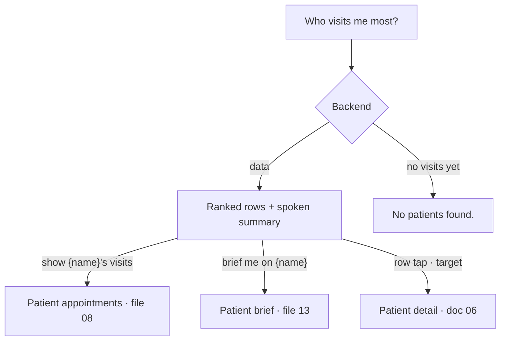

# Most visited patients card

| | |
|---|---|
| Area | Shifa Intelligence · action cards |
| Who sees it | Doctor only · PRO and PREMIUM |
| Reached from | Assistant turn with the `most_visited` card (tool `get_most_visited_patients`), e.g. "Who are my most frequent patients?" |
| Screen type | Inline card inside the chat thread |
| Current Flutter source | `intelligence_action_cards.dart` (`_listNameCountBody` with key `patients`) |
| Spec | `docs/kmp-spec/02-home-ai-intelligence.md` §4.4 · ticket INTEL-05 |

## 1. Purpose
A quick ranking of who comes most often — useful for follow-up planning and clinic insight. Rare (monthly).

## 2. Entry points
- Analytics-style questions. Clinic-wide: never links a patient.
- Restored from history.

## 3. Layout, top to bottom (phone portrait)
1. **Title** "Most visited patients".
2. **Rows**: "Patient name · 12" (name, dot, visit count), in backend order (descending). No rank number, no avatar,
   no bar today.
3. **Empty**: the backend hint translated, else "—".

Target layout: rank number (1., 2., 3.) · initials avatar · name (bold) · "{n} visits" right-aligned; optional thin
bar under each row scaled to the top count; the row is tappable (patient detail).

## 4. Data and formats
| Field | Source | Format rule |
|---|---|---|
| Name | `patients[].patientName` or `label` | "Patient" placeholder when empty |
| Count | `visitCount` or `count` | integer, no unit (target: "12 visits" with plurals: en visit/visits; ru визит/визита/визитов; uz tashrif) |
| Patient id | `patientId` (present, unused) | target: row navigation |
| Window | not sent (backend-defined, presumably all time) | target: backend adds `rangeLabel` so the card can say "last 12 months" |
| Order | backend order (descending by count) | never re-sorted on the device |
| Assistant line | "Your most visited patient is {name} with {count} visits. Next: {rest}." — translated | — |

Backend sentences seen with this card (translated on the device):

| Sentence |
|---|
| Your most visited patient is {name} with {count} visits. Next: {rest}. |
| Your most visited patient is {name} with {count} visits. |
| No patients found. |

## 5. Primary flow (happy path)
1. "Who visits me most?" → text "Your most visited patient is Karimov Anvar with 12 visits. Next: Li Wei (9),
   Saidova Nilufar (7)." + ranked rows.
2. Doctor says "show Karimov's visits" → patient appointments card (file 08).

## 6. Screen states
- **First load:** n/a (payload-driven; the pending block precedes it).
- **Empty:** "No patients found." (translated) or "—" when the backend sent no hint.
- **Error on load:** payload `error` → default body with the error text.
- **Offline:** restored card renders; nothing to fetch.
- **Refreshing:** no; ask again for fresh numbers.
- **Partial data:** a row without a count shows the name and a trailing dot (target: hide the separator); a row
  without a name shows "Patient".
- **Permission needed:** none.
- **Locked by tier:** n/a beyond the screen gate. Note: "advanced analytics" on Home is PREMIUM; this card is
  available to PRO through the chat — product should confirm that is intended.
- **Role difference:** doctor only.

## 7. Interactions and secondary flows
- None today.
- Target: tap a row → patient detail (doc 06); long-press → "Ask about {name}" which sends "Tell me about {name}" to
  the chat; the row name is otherwise just spoken by the doctor as the next question.
- Follow-up questions ("how many of those were video?") are answered by the backend; no client state.

## 8. Edge cases
- Ties → backend order; no rank numbers shown (target: 1., 2., 3.).
- Long list → no cap in the card; backend limits (usually ≤ 10).
- Patient names identical → indistinguishable; acceptable at this rarity.
- Count 0 → row still listed if the backend sends it.
- 200 % font: wraps.
- Screen reader: "Rank 1, Karimov Anvar, 12 visits" (target wording).
- Placeholder "Patient" rows (anonymised or deleted patients) → still ranked; not tappable in the target.
- Restored card months later → stale ranking without an "as of" hint; target: show the turn timestamp.
- A doctor with fewer than 5 patients → short list; no padding rows.
- Language switch → labels re-render; names unchanged.
- Slow network: text streams first; the list pops in — reserve the title row.
- Clinic staff context (a doctor working in a clinic workspace) → counts are the doctor's own visits only; the chat
  never switches to clinic-wide analytics.
- Very long names (three-part Uzbek names) wrap under the rank number; the count stays right-aligned on the first
  line.

## 9. Validation and messages
| Action | Rule | Message | Where |
|---|---|---|---|
| Row tap (target) | `patientId` present (placeholder rows have none) | — (row inert) | — |

## 10. Navigation out
- None today. Target: row → patient detail on top of Intelligence; returning keeps the thread.

## 11. Copy
| Key | English |
|---|---|
| `intelCardMostVisited` | Most visited patients |
| `intelPatient` | Patient |
| **NEW** `visitsCountNoun` (exists on Home as visits/visit) | {n} visits |

## 12. Known problems in the current app (do not carry over)
- Bare number without a unit; no rank, no avatar.
- Rows inert.
- The same "name · count" renderer is shared with the clinic-patterns card, so the two look identical although one
  lists people and the other lists facts.
- `patientId` is in the payload but unused.

## 13. Open questions for design
- Horizontal bars (mini chart) or plain list?
- Time window shown ("last 12 months")? The backend does not send one today.
