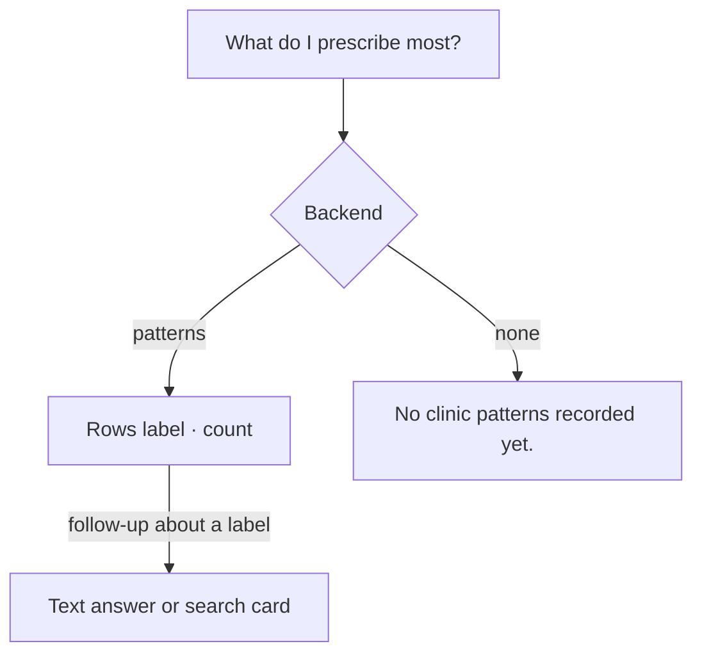

# Clinic patterns card

| | |
|---|---|
| Area | Shifa Intelligence · action cards |
| Who sees it | Doctor only · PRO and PREMIUM |
| Reached from | Assistant turn with the `clinic_patterns` card (tool `get_clinic_patterns`), e.g. "What do I prescribe most?" / "Common diagnoses this month" |
| Screen type | Inline card inside the chat thread; the same "patterns" list also appears inside the visit facts panel and the clinical timeline card (file 21) |
| Current Flutter source | `intelligence_action_cards.dart` (`_patternsBody`), `visit_facts_panel.dart` (patterns block) |
| Spec | `docs/kmp-spec/02-home-ai-intelligence.md` §4.4, §9 (`ClinicPatternDto`) · ticket INTEL-05 |

## 1. Purpose
Surface recurring documented facts (medications, diagnoses, therapies) across the doctor's visits — the clinic's
habits. Rare.

## 2. Entry points
- Analytics-style questions; clinic-wide, never patient-linked.
- Inside the visit facts panel (top 3) and the clinical timeline card (top 4) as a secondary block.

## 3. Layout, top to bottom (phone portrait)
1. **Title** "Clinic patterns".
2. **Rows**: "Label · 14" (pattern label or key, dot, count). In the panels the count has a multiplication sign:
   "Amoxicillin · 14×".
3. **Empty**: backend hint translated ("No clinic patterns recorded yet.") else "—".

## 4. Data and formats
| Field | Source | Format rule |
|---|---|---|
| Label | `patterns[].label`, fallback `key` | shown as sent (backend language) |
| Count | `count` | integer |
| Key | `key` (stable identifier such as `med.amoxicillin`) | fallback label only; never shown when a label exists |
| Source | patterns are aggregated by the backend from **committed** visit facts (file 21), returned with the chat tool, with visit-facts loads and after every commit | the same object everywhere |
| Window | not sent | target: backend adds a period label |
| Fact type | `factType` (MEDICATION / DIAGNOSIS / THERAPY / SYMPTOM) | not shown in the chat card today (target: icon per type as in file 21) |

Where the same list appears and how it is formatted today:

| Surface | Rows shown | Count format | Title |
|---|---|---|---|
| Chat card (this file) | all | `14` | Clinic patterns |
| Visit facts panel (file 21) | top 3 | `14×` | Clinic patterns |
| Clinical timeline card (file 21) | top 4 | `14×` | Clinic patterns |

Target: one shared row component — type icon · label · "{count}×" — in all three places.

Fact-type icons (from the fact cards): medication → pill, diagnosis → shield-plus, therapy → healing, symptom →
sick face, other → notes.

## 5. Primary flow (happy path)
1. "What are my most common diagnoses?" → text + rows.
2. Doctor asks "which patients have {label}?" → the backend answers in text or with a search card (file 10).

## 6. Screen states
- **First load:** n/a (payload-driven).
- **Empty:** "No clinic patterns recorded yet." (translated) or "—".
- **Error on load:** payload `error` → default body.
- **Offline:** restored card renders.
- **Refreshing:** no.
- **Partial data:** label missing → key shown (technical); count missing → trailing dot.
- **Permission needed:** none.
- **Locked by tier:** n/a beyond the screen gate.
- **Role difference:** doctor only.

## 7. Interactions and secondary flows
- None today.
- Target: tap a row → sends "Tell me more about {label}" (a chip-style affordance on the row); no navigation.
- In the visit facts panel and the timeline card the same rows are informational only.

## 8. Edge cases
- Labels arrive in the backend language (often English or the doctor's documentation language) and are **not**
  translated; counts are language-neutral.
- Very long labels (free text from facts) wrap.
- Key shown instead of label when the label is missing → technical-looking strings (e.g. `med.amoxicillin`).
  Target: humanise or hide.
- 100+ patterns → backend limits; no cap on the client.
- Screen reader: one sentence per row "Amoxicillin, 14 times".
- Patterns only exist once visit facts have been committed (file 21); a new doctor sees the empty state for weeks —
  the empty copy should say how patterns appear ("Document visit facts to build patterns." — NEW).
- Same medication spelled differently across visits → separate rows (backend normalisation issue; nothing to design).
- Counts tie → backend order.
- Language switch → title re-renders; labels stay in their documentation language.
- Restored card → stale counts without an "as of" hint.
- Patterns after a commit change immediately in the visit facts panel (returned by the commit call) but the chat
  card from earlier keeps its numbers — expected; cards are snapshots.
- Long labels with dosage text ("Amoxicillin 500 mg 3× daily for 7 days") wrap to two lines; the count must stay on
  the first line.

## 9. Validation and messages
| Action | Rule | Message | Where |
|---|---|---|---|
| Row tap (target) | label present | — | — |

## 10. Navigation out
None.

## 11. Copy
| Key | English |
|---|---|
| `intelCardPatterns` | Clinic patterns |
| **NEW** `intelPatternCount` | {count}× |
| **NEW** `intelPatternsEmptyHint` | Document visit facts to build patterns. |
| **NEW** `factTypeSymptom` / `factTypeDiagnosis` / `factTypeTherapy` / `factTypeMedication` | Symptom / Diagnosis / Therapy / Medication |

## 12. Known problems in the current app (do not carry over)
- Raw keys can appear instead of labels.
- The chat card and the panels format the count differently ("14" vs "14×").
- Fact type is dropped in the chat card although the payload has it.
- Identical renderer to "most visited" — people and facts look the same.

## 13. Open questions for design
- Group by fact type with icons (medication / diagnosis / therapy / symptom)?
- Should the chat card carry a period selector ("last 30 days / 12 months") that re-asks the backend?
