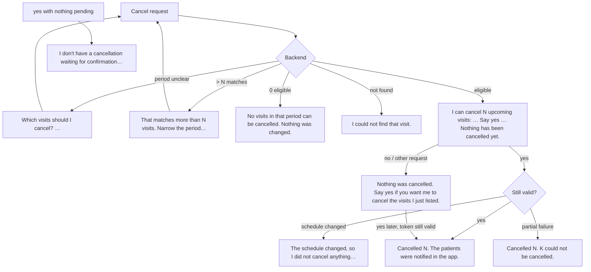

# Cancel appointments by voice (backend-driven confirmation)

| | |
|---|---|
| Area | Shifa Intelligence · conversational action |
| Who sees it | Doctor only · PRO and PREMIUM |
| Reached from | Any request to cancel visits ("Cancel my Friday afternoon", "Cancel Karimov tomorrow", "Clear next week") |
| Screen type | Sequence of assistant text turns in the chat thread (no dedicated card today); optional schedule / patient-appointments card alongside |
| Current Flutter source | `intelligence_card_text.dart` (`localizeIntelligenceHint` exact map + `tooMany` / `cancelPreview` regexes, "Cancelled {count}…" sentences), `home_voice_session.dart` (`_assistantContentForApi` — forwards the `<appointment_action>` cancel token and `<appointment_list>` ids with the history) |
| Spec | `docs/kmp-spec/02-home-ai-intelligence.md` §0 (cancellation flow), §3.3 step 5, §12 INTEL-06 note, INTEL-10 |

## 1. Purpose
Cancel one or many visits safely by voice: the backend first lists exactly what would be cancelled and nothing
happens until the doctor says "yes". Weekly, and critical to get right — a wrong cancel notifies patients.

**The app never cancels locally.** It shows the backend's sentences (translated), sends the doctor's answer, and
carries the backend's pending-cancellation token with the conversation. There is no client timer, no client-side
list of ids to cancel, no local "yes" detection.

## 2. Entry points
- Any cancel wording in a typed or spoken turn.
- The confirmation token is tied to the **conversation id**; a new conversation never inherits a pending cancel.

## 3. Layout, top to bottom (phone portrait)
Plain assistant blocks (file 03). The design target adds a light **cancel preview card** so the list is scannable:
1. Title "Cancel visits" (NEW), rows "Thu 30 Oct · 10:30 · Karimov Anvar", a muted line "{k} cannot be cancelled and
   will be left as they are." when present, and the footer "Say yes to cancel them. Nothing has been cancelled
   yet." Target buttons: **"Yes, cancel {count}"** (sends "yes") and **"Keep them"** (sends "no").
2. After confirmation: green status "Cancelled 3. The patients were notified in the app."
3. When something changed in between: the backend's "The schedule changed, so I did not cancel anything…" text.

## 4. Data and formats
Every variant the backend sends today and how it is shown (English → translated on the device):

| Step | Backend sentence (exact) | Shown as |
|---|---|---|
| Ask which | Which visits should I cancel? Tell me the day, or say all for a period such as next week. | translated |
| Ask which (with list) | Which of those visits should I cancel? {names} | translated, names localised |
| Too many | That matches more than {N} visits. Narrow the period before I cancel anything. | translated with {count} |
| Preview | I can cancel {N} upcoming visit(s): {A}, {B}[, and {k} more]. [{K} cannot be cancelled and will be left as they are.] Say yes to cancel them. Nothing has been cancelled yet. | translated, singular/plural visit word, skipped sentence appended |
| None eligible | No visits in that period can be cancelled. Nothing was changed. | translated |
| Not found | I could not find that visit. / I could not find a matching visit. Nothing was changed. | translated |
| Nothing (doctor said no / something else) | Nothing was cancelled. Say yes if you want me to cancel the visits I just listed. / Nothing was cancelled. | translated |
| No pending ("yes" out of the blue) | I don't have a cancellation waiting for confirmation. Tell me which visits to cancel. | translated |
| Schedule changed | The schedule changed, so I did not cancel anything. Ask me again and I will show the updated list. | translated |
| Found several | I found {count} visits that can be cancelled.{note} Which one should I cancel? | translated |
| Success | Cancelled {count}. The patients were notified in the app. / Cancelled {count}. The patient was notified in the app. / Cancelled {count}. {failed} could not be cancelled. | translated |

Names in the preview are "Name on {weekday} {d} {month} at {time}" fragments; the date words are translated and the
patient placeholder "Patient" localised. The preview is also **spoken** (first 560 chars).

## 5. Primary flow (happy path)
1. "Cancel Friday afternoon" → backend resolves the period → preview sentence (+ the schedule card may accompany).
2. Doctor says "yes" (any language; the backend interprets) → backend cancels → success sentence → calendar providers
   refresh when the doctor leaves Intelligence (target: refresh immediately, like bookings).

## 6. Screen states
- **First load / Empty / Refreshing:** n/a (text turns).
- **Error on load:** stream error → error row + Retry; the pending cancel stays on the backend; a retried "yes"
  still works if the token is valid.
- **Offline:** "yes" cannot be sent → error row; nothing cancelled.
- **Partial data:** success with failures → "Cancelled 2. 1 could not be cancelled."
- **Permission / Locked / Role:** n/a.

## 7. Interactions and secondary flows
- **Say "yes"** → confirm. **Say "no" / anything else** → "Nothing was cancelled…".
- **Target buttons** "Yes, cancel {count}" / "Keep them" send the same words.
- **Retry** after a failed "yes" → resends "yes".
- **Start a new conversation** → the pending cancel is abandoned (backend keyed by conversation id); saying "yes" in
  the new one → "I don't have a cancellation waiting…".
- **Leave and come back** (same app session, same conversation) → the pending state survives on the backend as long
  as the backend keeps it (UNVERIFIED expiry) — the preview text is still in the thread.

## 8. Edge cases
- "Yes" twice → the second gets "I don't have a cancellation waiting…" (token consumed) — not a double cancel.
- "Yes" with nothing pending → the no-pending sentence.
- Preview followed by an unrelated question → "Nothing was cancelled. Say yes if…" and the new question is answered
  (backend behaviour; UNVERIFIED whether the token survives).
- More than N (backend limit) → the too-many sentence; nothing listed.
- Some visits not cancellable (completed, in progress, already cancelled) → the "{k} cannot be cancelled…" sentence.
- Schedule changed between preview and yes (a patient cancelled, a visit started) → the schedule-changed sentence;
  ask again.
- Preview with a long list → "{A}, {B}, and {k} more" (the localiser handles ", and {count} more").
- Doctor says "yes" in Uzbek/Russian ("ha", "да") → backend interprets; the app only forwards the text.
- Doctor types "yes" → identical path to speech.
- Network drop after "yes" was sent but before the reply → unknown outcome; the next question ("did you cancel?")
  is answered by the backend from its state. Target: Retry re-sends "yes" and the backend treats a consumed token as
  no-pending, so no double cancel.
- Voice misrecognition ("yes" heard as "yet") → treated as "other": nothing cancelled; the doctor repeats.
- Language switch between preview and yes → the preview re-renders translated; the answer still works.
- Screen reader: the preview must be read fully before the live region moves on; buttons labelled with the count.
- The schedule card next to the preview is informational; its rows are not the selection.

## 9. Validation and messages
| Condition | Message (English) | Where |
|---|---|---|
| All backend sentences | see §4 | assistant block (translated) |
| Stream failure on "yes" | error row + Retry | thread |
| **NEW** card title / buttons | Cancel visits · Yes, cancel {count} · Keep them | preview card |

## 10. Navigation out
- None specific; leaving Intelligence refreshes appointments and notifications so cancelled visits disappear from
  the calendar.

## 11. Copy
| Key | English |
|---|---|
| `intelCancelAskWhich` | Which visits should I cancel? Tell me the day, or say all for a period such as next week. |
| `intelCancelTooMany` | That matches more than {count} visits. Narrow the period before I cancel anything. |
| `intelCancelPreview` | I can cancel {count} upcoming {visitWord}: {names}. Say yes to cancel them. Nothing has been cancelled yet. |
| `intelCancelVisit` / `intelCancelVisits` | visit / visits |
| `intelCancelSkipped` | {count} cannot be cancelled and will be left as they are. |
| `intelCancelAndMore` | , and {count} more |
| `intelCancelNoneEligible` | No visits in that period can be cancelled. Nothing was changed. |
| `intelCancelNothing` | Nothing was cancelled. Say yes if you want me to cancel the visits I just listed. |
| `intelCancelNotWaiting` | I don't have a cancellation waiting for confirmation. Tell me which visits to cancel. |
| `intelCancelNotFound` | I could not find that visit. |
| `intelWhenAt` | {weekday} {day} {month} at {time} |
| translated sentences without own keys | Cancelled {count}. The patients were notified in the app. · Cancelled {count}. The patient was notified in the app. · Cancelled {count}. {failed} could not be cancelled. · I found {count} visits that can be cancelled.{note} Which one should I cancel? · The schedule changed, so I did not cancel anything. Ask me again and I will show the updated list. · I could not find a matching visit. Nothing was changed. · Nothing was cancelled. |
| **NEW** `intelCancelCardTitle` / `intelCancelYes` / `intelCancelKeep` | Cancel visits / Yes, cancel {count} / Keep them |

## 12. Known problems in the current app (do not carry over)
- The whole flow is prose; the list of visits to be cancelled is a sentence, hard to scan when there are five.
- Translation depends on byte-exact English sentences from the backend; any wording change leaks English into uz/ru
  (raised as a backend request: send codes + data instead of sentences).
- Calendar is refreshed only when the doctor leaves Intelligence, not right after "Cancelled N".
- No visual confirmation state; the only signal is the spoken/written sentence.

## 13. Open questions for design
- Is a confirmation **button** acceptable for a destructive action, or must the doctor say/type "yes"?
- Should the preview card let the doctor untick individual visits before confirming (would need backend support)?
- How do we show "patients were notified" — plain text or a notification icon per row?
