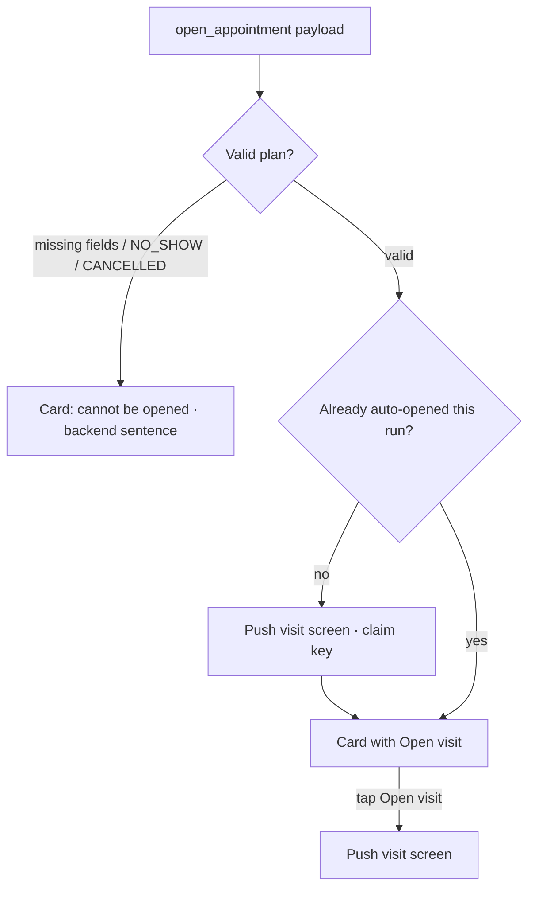

# open_appointment card + auto-open (target; unwired today)

| | |
|---|---|
| Area | Shifa Intelligence · action cards |
| Who sees it | Doctor only · PRO and PREMIUM |
| Reached from | Assistant turn with the `open_appointment` payload after "Open my 10 o'clock" / "Start Karimov's visit" / "Open the chart for the next patient" |
| Screen type | Inline card inside the chat thread + automatic navigation to the in-person or video visit screen |
| Current Flutter source | `lib/features/intelligence/presentation/open_appointment_route.dart` (`planOpenAppointmentRoute`, `OpenAppointmentAutoOpen`) — **tests only, no card case exists, nothing imports it**; backend hint "That visit was more than 24 hours ago and was never opened, so it is a no-show. I did not open the chart." is already translated in `intelligence_card_text.dart` |
| Spec | `docs/kmp-spec/02-home-ai-intelligence.md` §4.8 · ticket INTEL-08 |

## 1. Purpose
Let the doctor jump from the conversation straight into a visit ("open my next patient") — the visit screen opens
once, automatically, with a card left behind in the thread to reopen it later. Daily once built.

## 2. Entry points
- The backend returns `{route: 'inPerson'|'video', appointment: {appointmentId, patientId?, patientName?, location,
  status, day 'yyyy-MM-dd', startLocal 'HH:mm', endLocal, startAt?, reason?}}`.
- Restored from history: the card renders, but auto-open does **not** fire again (one claim per visit + route +
  status + start time per app process).

## 3. Layout, top to bottom (phone portrait)
1. **Title** "Open visit" (NEW).
2. Rows: Patient · name (or "Patient"); Date · "30 Okt 2026"; Time · "10:30–11:00"; Status chip (localised);
   visit type pill: "Video call" or "In clinic" / location label.
3. **Button** "Open visit" (filled). Disabled with a caption when the plan is invalid (missing fields, status
   NO_SHOW or CANCELLED): "This visit cannot be opened." (NEW) — or the backend's no-show sentence when it sent one.
4. Green status after auto-open: "Opened." (NEW) — optional; the navigation itself is the feedback.

## 4. Data and formats
| Field | Rule |
|---|---|
| Route | `inPerson` → in-person consultation screen; `video` → video call screen (doc 05) |
| Validity | all required fields present and parseable; status not NO_SHOW / CANCELLED |
| Auto-open key | `appointmentId | route | status | startAt` — the same visit auto-opens once per app run |
| Day / time | practice-local strings from the backend; displayed as sent, date localised |
| Status | enum → localised (file 07 table) |

## 5. Primary flow (happy path)
1. "Open my 10 o'clock" → backend resolves the visit → payload.
2. Card renders; if valid and not yet claimed → the visit screen is pushed immediately (Intelligence stays
   underneath; returning shows the thread with the card).
3. Doctor finishes the visit → back → thread; tapping "Open visit" reopens it.

## 6. Screen states
- **First load:** n/a (payload-driven).
- **Empty:** n/a (a payload without an appointment is invalid → "cannot be opened").
- **Refreshing:** n/a.
- **Error on load:** payload `error` → card shows it; no navigation.
- **Offline:** card renders; the visit screen itself loads from cache or shows its own error (doc 05).
- **Partial data:** no patient name → "Patient"; no end time → start only.
- **Permission needed:** the video route requests camera/mic on the visit screen, not here.
- **Locked by tier:** video consultation is PRO — same gate as Intelligence; n/a.
- **Role difference:** doctor only.

## 7. Interactions and secondary flows
- **Auto-open** on first render (valid plan).
- **Open visit** button → push the visit screen (allowed any number of times).
- **Back from the visit** → thread, scrolled where it was; the thread does not re-trigger auto-open.
- Hands-free voice: if a voice loop is active when auto-open fires, the recorder is stopped and hands-free turned off
  (visit screens have their own recorder).

## 8. Edge cases
- Visit is NO_SHOW (backend rule: > 24 h ago and never opened) → no navigation; the backend sentence is shown
  translated.
- Visit CANCELLED → same, "This visit cannot be opened."
- Visit already COMPLETED → opens read-only (doc 05 behaviour).
- Two open_appointment payloads in a row (doctor asked twice) → the second auto-opens only if the key differs
  (e.g. status changed to IN_PROGRESS).
- Auto-open while a bottom sheet (history) is open → close the sheet first, then push.
- Auto-open while a dictation is recording → discard the take (ask? see file 05 §13), then push.
- Deep link arrives at the same time → last navigation wins; acceptable.
- Restored thread on a new app run → auto-open would fire again for an old visit (new process = new claim set).
  Target: never auto-open from restored history, only from a live turn.
- Timezone: `day`/`startLocal` are practice-local; the visit screen computes join windows in practice time.
- Appointment deleted meanwhile → visit screen 404 → its own error; card remains.
- Screen reader: announce "Opening visit with Karimov Anvar" before navigating.
- Video visit outside the join window (−5 min … end + 1 h, practice time) → the video screen shows its own
  "not yet" state (doc 05); the card still opens it.
- Visit of another doctor (clinic context) → backend refuses ("That appointment is not on your calendar.").
- Voice: "open my next patient" while hands-free → navigation stops the loop; on return the doctor taps the mic
  again (no auto re-arm).

## 9. Validation and messages
| Condition | Message | Where |
|---|---|---|
| Invalid plan | **NEW** This visit cannot be opened. | card caption |
| No-show rule | That visit was more than 24 hours ago and was never opened, so it is a no-show. I did not open the chart. (backend, translated) | assistant text / card |
| Not on calendar | That appointment is not on your calendar. / That appointment was not found. (backend, translated) | assistant text |

## 10. Navigation out
- Push in-person or video screen (doc 05) on top of Intelligence; on return the thread is intact and hands-free is
  off. Appointments are refreshed when the visit changes status.

## 11. Copy
| Key | English |
|---|---|
| **NEW** `intelCardOpenAppointment` | Open visit |
| **NEW** `intelOpenVisit` | Open visit |
| **NEW** `intelVisitCannotOpen` | This visit cannot be opened. |
| `intelPatient` / `intelDate` / `intelTime` | Patient / Date / Time |
| `videoCall` / `inClinic` | Video call / In clinic |
| status keys | file 07 |

## 12. Known problems in the current app (do not carry over)
- The feature is not wired: the planner exists with tests, but no card and no navigation. Design it as new.
- The one-shot claim is per process, so a restored old thread would re-open a visit on the next launch unless the
  rule above is applied.

## 13. Open questions for design
- Auto-open immediately, or show the card with a 2-second "Opening…" state so the doctor can cancel?
- Should the card also offer "Open patient chart" next to "Open visit"?
