# Patient briefing sheet

| | |
|---|---|
| Area | Shifa Intelligence · AI outside the chat |
| Who sees it | Doctor only · PRO and PREMIUM (`patientBriefing`) |
| Reached from | Patient detail (doc 06): the "AI summary" action on the patient hero header and "Generate briefing" in the hero's more-actions sheet |
| Screen type | Bottom sheet (target). Today: a floating bottom-right panel rendered by the shell — **never shown on Android/iOS** |
| Current Flutter source | `lib/core/widgets/patient_briefing_panel.dart`, `lib/state/patient_briefing_provider.dart`, `lib/core/api/ai_api.dart` (`fetchPatientBriefing`), `lib/core/widgets/ai_response_text.dart`, trigger in `features/patients/presentation/patient_detail_panel.dart` |
| Spec | `docs/kmp-spec/02-home-ai-intelligence.md` §6, §3.2 (errors) · ticket AI-09 |

## 1. Purpose
Before a visit: a one-screen AI summary of what the patient's documents and past appointments say, in the app
language, copyable into notes. Several times a day for PRO doctors.

## 2. Entry points
- Patient detail header → "AI summary" icon button (shown only when the feature is allowed).
- Patient detail → "⋯ more actions" sheet → "Generate briefing" (summarise icon).
- From the chat the same content arrives as a card (file 13); this sheet is the patient-detail surface.
- Generation starts immediately on tap; the sheet opens in the loading state over patient detail.

## 3. Layout, top to bottom (phone portrait) — target bottom sheet
1. **Drag handle**, sheet ~55 % height, expandable to full by drag.
2. **Header** (brand-tinted): title "Patient briefing — Karimov Anvar" (one line, ellipsis), close ✕ (32 dp target).
   Today's panel also has a collapse chevron that shrinks it to a 56 dp bar; on a phone the drag handle replaces it.
3. **Body**:
   - loading: skeleton of a heading bar + 6 text lines, and the caption "Reading documents and generating
     briefing..." (today: centred spinner + caption);
   - success: sources caption "Based on 4 document(s) and 7 appointment(s)." (or documents-only / appointments-only
     variant; hidden when both are 0), then the briefing text (headings with a brand bar, bullets, bold),
     selectable; then a secondary button "Copy";
   - error: error icon + message (server message or "Could not generate briefing."). No retry button today
     (a `retryBriefing` string exists unused) — target: "Retry briefing" button.
4. No footer.

## 4. Data and formats
| Field | Source | Format rule |
|---|---|---|
| Request | `POST /api/ai/patient-briefing/{patientId} {language: en|uz|ru}` — language = **app language** at the time of the tap | — |
| Response | `briefing` (markdown subset), `documentCount`, `appointmentCount` | plurals: strings use "document(s)" today — target proper plurals |
| Errors | 400/403/404 → server message (BRIEFING_ERROR); 429 → "You've reached your daily AI usage limit. Try again tomorrow."; other → "Briefing failed: HTTP {n}" | — |
| Timeout | none in code (default 30 s client) | target: 60 s with the "took too long" message |
| Cache | in memory per patient for the session (dedupes concurrent calls; written, never read by live UI) | target: keep the last briefing per patient for the session so reopening is instant, with "Regenerate" |

## 5. Primary flow (happy path)
1. Tap "AI summary" on the patient header → sheet opens in loading state.
2. 3–15 s later the text appears with the sources line.
3. Doctor reads, taps "Copy" → "Briefing copied to clipboard." → closes the sheet.

```mermaid
stateDiagram-v2
  [*] --> Idle
  Idle --> Loading: Generate (tap)
  Loading --> Success: 200
  Loading --> Error: 400/403/404 → server message
  Loading --> Error: 429 → daily limit
  Loading --> Error: other → Could not generate briefing.
  Success --> Idle: Close
  Error --> Idle: Close
  Error --> Loading: Retry (target)
  Success --> Loading: Regenerate (target)
  Loading --> Idle: Close (request keeps running; result discarded)
```

## 6. Screen states
- **First load:** skeleton + "Reading documents and generating briefing..." (today spinner).
- **Empty:** briefing text empty with 200 → show the text area with "No information to brief on yet." (NEW; today an
  empty body with sources line).
- **Error on load:** icon + message; target Retry.
- **Offline:** request fails → error state with the network message; Retry.
- **Refreshing:** target "Regenerate" in the header overflow.
- **Partial data:** counts 0 → sources line hidden; text present.
- **Permission needed:** none.
- **Locked by tier:** the triggers are hidden below PRO (header icon and sheet item not rendered). Target: show the
  action with a lock and the upgrade line for BASIC so the feature is discoverable.
- **Role difference:** clinic staff reach patient detail through the clinic workspace; the AI summary is doctor-only
  (the whole panel is hidden for staff today).

## 7. Interactions and secondary flows
- **Generate** (either trigger) → loading. Tapping again while loading restarts the request (state reset).
- **Close ✕ / drag down / scrim** → sheet closes; state reset to idle (the text is lost — target: keep for the
  session).
- **Copy** → clipboard → confirmation banner (today SnackBar).
- **Long-press text** → native selection (text is selectable).
- **Generate for another patient** while open → state is replaced (single global state); the sheet shows the new
  name and loading.
- **Navigate away** from patient detail → the panel stays in the shell today (web); on mobile the sheet is modal, so
  it closes.

## 8. Edge cases
- Very long briefing → scrolls inside the sheet; drag to full height.
- Markdown beyond the subset (tables, links) → shown as plain text lines.
- Briefing in the wrong language (model drift) → shown as is; target "Regenerate".
- Patient with no documents and no visits → backend may return 404/400 with a message ("No documents available") →
  error state with that message; design it as an informative empty state, not an error.
- 429 → daily limit message; Retry disabled until tomorrow? Keep enabled; the server answers again.
- Request still running when the sheet is closed → result ignored; a second tap starts a new request (duplicate
  cost). Target: keep the request and show the result if the sheet is reopened for the same patient.
- Language switched after generation → text stays in the old language; sources line re-renders. Target: offer
  Regenerate.
- Patient name very long → header ellipsis; full name on patient detail behind the sheet.
- 200 % font: header title on one line with ellipsis; body scrolls.
- Screen reader: focus moves to the sheet title; loading caption is a live region; the briefing is one readable
  region with headings; Copy announces the confirmation.
- Session expired during generation → 401 → today a raw error line; target logout flow.

## 9. Validation and messages
| Condition | Message (English) | Where |
|---|---|---|
| Loading | Reading documents and generating briefing... | body caption |
| 400/403/404 | server `message` (fallback: raw body) | body |
| 429 | You've reached your daily AI usage limit. Try again tomorrow. | body |
| other failure | Could not generate briefing. | body |
| Copy | Briefing copied to clipboard. | banner |
| Empty text | **NEW** No information to brief on yet. | body |

## 10. Navigation out
- Close → patient detail unchanged; nothing to refresh.
- Copy → stays open.

## 11. Copy
| Key | English |
|---|---|
| `patientBriefingTitle` | Patient briefing |
| `generateBriefing` | Generate briefing |
| `patientBriefingGenerating` | Reading documents and generating briefing... |
| `patientBriefingSources` / `patientBriefingSourcesAppointmentsOnly` / `patientBriefingSourcesWithAppointments` | Based on {n} document(s). / Based on {n} appointment(s). / Based on {docs} document(s) and {appts} appointment(s). |
| `patientBriefingCopy` / `patientBriefingCopied` | Copy / Briefing copied to clipboard. |
| `patientBriefingError` | Could not generate briefing. |
| `retryBriefing` | Retry briefing |
| **NEW** `aiRateLimit` | You've reached your daily AI usage limit. Try again tomorrow. |
| **NEW** `patientBriefingRegenerate` | Regenerate |
| **NEW** `patientBriefingEmpty` | No information to brief on yet. |
| **NEW** `aiSummary` (header icon label) | AI summary |

## 12. Known problems in the current app (do not carry over)
- The panel is never rendered on native mobile: the feature is invisible on the platforms being built.
- Floating bottom-right panel sized for desktop; collapse chevron; no retry; result lost on close.
- Rate-limit sentence hardcoded English; "document(s)" pseudo-plurals.
- Spinner instead of a skeleton; SnackBar for copy confirmation.
- Generation is keyed to one global state: generating for patient B while A is open silently swaps content.

## 13. Open questions for design
- Bottom sheet (modal) or a tab/section inside patient detail ("AI summary" tab) that persists while navigating the
  chart?
- Should the briefing show its generation time ("Generated today 09:12") and a "Regenerate" affordance?
- Do we want "Ask Shifa about this patient" (opens Intelligence with the patient context) from the sheet?
