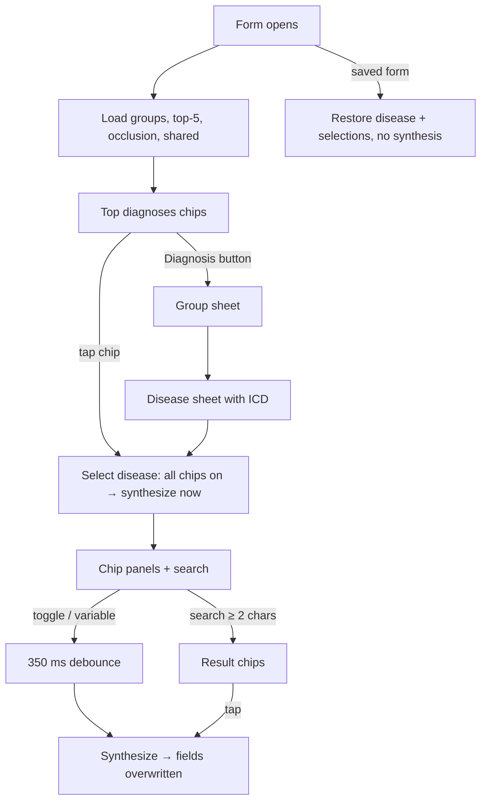

# Clinical engine panel (disease picker + clinical chips)

| | |
|---|---|
| Area | Shifa Intelligence · clinical engine |
| Who sees it | Doctor (and any role that can edit the medical form) · all tiers (no gate in code) |
| Reached from | Patient form screen (medical form 025-2, doc 06) — embedded above the clinical text fields |
| Screen type | Inline panel (card) + two bottom sheets (group picker, disease picker) |
| Current Flutter source | `lib/features/clinical_engine/presentation/clinical_engine_panel.dart`, `clinical_chip_panel.dart`, `data/clinical_engine_api.dart`, `domain/clinical_engine_models.dart`; host `features/patients/presentation/patient_form_screen.dart` |
| Spec | `docs/kmp-spec/02-home-ai-intelligence.md` §5 · tickets CLIN-01, CLIN-02 |

## 1. Purpose
Fill the long clinical text fields of the medical form (complaints, history, objective findings, occlusion, oral
cavity, x-ray, treatment stages, recommendations) by picking a diagnosis and tapping standard phrase chips; the
server composes the sentences in the doctor's language. Dentistry-oriented today. Every form, for dentists daily.

## 2. Entry points
- Opening the patient medical form: the panel loads at once (groups, top-5 diagnoses, occlusion chips, shared
  mucosa and x-ray templates — five requests in parallel).
- Reopening a saved form restores the saved disease and chip selections **without** re-synthesising (fields keep
  their saved text).

## 3. Layout, top to bottom (phone portrait)
1. **Card** "Clinical Engine" (hardcoded English title) with a trailing text button "Diagnosis" (hardcoded English,
   medical-info icon) → opens the group picker.
2. **No disease selected:** caption "Top diagnoses" (hardcoded English) + up to 5 action chips with the doctor's most
   used diagnoses (names in the app language: uz → Uzbek or Russian, en → English or Russian, else Russian).
3. **Disease selected:**
   - disease name (bold);
   - **chip search** field: label "Search chips", hint "Type at least 2 characters" (hardcoded English), spinner in
     the suffix while searching; results as action chips under it — tapping adds the chip and synthesises at once;
   - **chip panels**, in this order, each a caption title + wrapped filter chips (sorted by priority) + text inputs
     for selected chips that have variables (label "{variable} ({chip label})"):
     1. "Complaints"
     2. "KASALLIK RIVOJLANISHI" (**hardcoded Uzbek** — disease history / anamnesis morbi)
     3. "Objective"
     4. "Clinical Engine — Occlusion" (occlusion chips, shared across diseases; variable inputs uncontrolled)
     5. "Oral cavity"
     6. "Shared mucosa variants" (shared templates)
     7. "X-ray"
     8. "Shared x-ray templates"
     9. "Treatment (stage 1)"
     10. "Treatment (stage 2 / epicrisis)"
     11. "Recommendations"
     All eleven titles are hardcoded English except the Uzbek one. Panels with no chips for that field are hidden.
4. **Group picker** bottom sheet: plain list of group names. **Disease picker** bottom sheet (60 % → draggable): list
   of diseases with ICD codes as subtitle.
5. Loading: centred spinner (initial) — target: skeleton of title + 5 chips. Error: red raw error text.

## 4. Data and formats
| Field | Source | Format rule |
|---|---|---|
| Names | `names {ru, uz, en}` | locale fallback: uz → uz or ru; en → en or ru; else ru |
| Chips | per disease, `field` ∈ complaints, morbi, objective, occlusion, oral_cavity, xray, treatment_1, treatment_2, recommendations; `priority` sort; `variables[]` | — |
| Selections | set of chip ids + variable values; shared chips `shared.*`, occlusion `occ.*` | saved with the form |
| Synthesis | `POST /api/clinical-engine/synthesize {locale, diseaseId, selections}` → `{fields: {field: text}}`; the form writes each text into its field (overwriting) | debounced 350 ms after any toggle/variable change; immediate on disease pick / search add |
| Search | `GET …/chips/search?q&locale&limit=15`, ≥ 2 chars, 350 ms debounce | — |
| Top diagnoses | `GET …/doctors/me/top-diagnoses?limit=5` | — |
| Failures | any non-200 → empty list / `{}` silently | no message |

## 5. Primary flow (happy path)
1. Form opens → panel shows "Top diagnoses" chips.
2. Tap "K02.1 Caries dentini" (top chip) → **every** chip of that disease is selected and the synthesis runs at once
   → the complaints / objective / treatment fields fill with text.
3. Doctor untaps two chips and types a value for "tooth number" → 350 ms later the fields update.
4. Saves the form (doc 06); the selections are stored with it.

## 6. Screen states
- **First load:** centred spinner → target skeleton.
- **Empty:** no groups / no top diagnoses → card with only the "Diagnosis" button (no copy). Target: caption
  "Pick a diagnosis to get suggested phrases."
- **Error on load:** red raw error text; target: inline "Could not load the clinical engine · Retry".
- **Offline:** load fails (error) or, if loaded, synthesis fails silently → fields do not update, chips look
  selected. Target: banner "Could not compose text — check your connection" and keep selections.
- **Refreshing:** none.
- **Partial data:** one of the five bootstrap calls fails → today the whole bootstrap fails (all-or-nothing);
  target: show what loaded.
- **Permission needed:** none.
- **Locked by tier:** none (spec lists no gate; `differentialDiagnosis` PREMIUM feature is unrelated to this panel).
- **Role difference:** whoever can edit the form; staff editing forms is a doc 06 question.

## 7. Interactions and secondary flows
- **Top diagnosis chip** → select disease (all chips on).
- **Diagnosis** → group sheet → disease sheet → select (all chips on). Dismissing either sheet changes nothing.
- **Filter chip tap** → toggle → debounced synthesis. Deselecting clears that chip's variable values.
- **Variable text input** → each keystroke schedules synthesis (350 ms).
- **Search** → results → tap adds the chip (even if it belongs to another field — it lands in the panel of its field).
- **Change disease** → previous selections cleared, new disease's chips all on, synthesis.
- **Synthesis overwrites** the form fields every time — manual edits in those fields are lost on the next toggle
  (§12).

## 8. Edge cases
- Disease with 40+ chips → long wraps per panel; fine but tall. Target: collapse panels with a count badge.
- Chip with 2+ variables → stacked inputs.
- Variable left empty → synthesis sends an empty string; the server may leave a blank in the sentence.
- Search for a term in another language than the locale → server decides.
- Fast toggling → debounce coalesces; last state wins; responses can arrive out of order (no request id) → stale
  text could overwrite newer text. Target: ignore responses older than the latest request.
- Restore with a chip id that no longer exists → silently ignored.
- Occlusion inputs are uncontrolled: switching dentition/tab can reset them visually while the value stays stored.
- Form saved while a synthesis is in flight → saved text is the previous one; the late response then changes the
  field after save (unsaved state). Target: cancel in-flight synthesis on save.
- Russian names used as fallback for English/Uzbek when a translation is missing.
- 200 % font: chips wrap; variable labels long ("tooth number (Caries of enamel)") wrap to two lines.
- Screen reader: filter chips announce selected state; the Uzbek title must be a proper localised string.
- Language switch while open → names re-render by fallback rules; already synthesised text stays in the old
  language until the next change.

## 9. Validation and messages
| Action | Rule | Message | Where |
|---|---|---|---|
| Search | ≥ 2 characters | hint "Type at least 2 characters" | field hint |
| Load failure | — | raw error → **NEW** Could not load the clinical engine. · Retry | inline |
| Synthesis failure | — | silent → **NEW** Could not compose the text. Check your connection and try again. | banner |

## 10. Navigation out
- None; part of the form. Form save/discard rules are doc 06's.

## 11. Copy
Everything below is **hardcoded today** (no keys) and must become keys in en/uz/ru:
| Key (NEW) | English | Note |
|---|---|---|
| `clinicalEngineTitle` | Clinical engine | today "Clinical Engine" |
| `clinicalEngineDiagnosis` | Diagnosis | button |
| `clinicalEngineTopDiagnoses` | Top diagnoses | |
| `clinicalEngineSearchChips` / `clinicalEngineSearchHint` | Search phrases / Type at least 2 characters | today "Search chips" |
| `clinicalFieldComplaints` | Complaints | |
| `clinicalFieldMorbi` | Disease history | today Uzbek "KASALLIK RIVOJLANISHI" |
| `clinicalFieldObjective` | Objective | |
| `clinicalFieldOcclusion` | Occlusion | today "Clinical Engine — Occlusion" |
| `clinicalFieldOralCavity` | Oral cavity | |
| `clinicalSharedMucosa` | Shared mucosa variants | |
| `clinicalFieldXray` | X-ray | |
| `clinicalSharedXray` | Shared x-ray templates | |
| `clinicalFieldTreatment1` / `clinicalFieldTreatment2` | Treatment (stage 1) / Treatment (stage 2 / epicrisis) | |
| `clinicalFieldRecommendations` | Recommendations | |
| `clinicalEngineEmpty` | Pick a diagnosis to get suggested phrases. | |
| `clinicalEngineLoadFailed` / `clinicalEngineSynthFailed` | Could not load the clinical engine. / Could not compose the text. Check your connection and try again. | |
| existing `retry` | Retry | |

## 12. Known problems in the current app (do not carry over)
- Every title is hardcoded English, one is hardcoded Uzbek.
- Picking a disease selects **all** its chips and overwrites the form fields immediately, including any manual
  text; later toggles overwrite again.
- All failures are silent (empty lists, `{}`); raw error text on bootstrap failure.
- Out-of-order synthesis responses can overwrite newer text.
- Occlusion variable inputs are uncontrolled.
- Generic Material `Card`/`FilterChip` styling, not the app's design system.

## 13. Open questions for design
- Should picking a disease pre-select all chips (fast) or none (safe)? Or offer "Select typical set"?
- Merge the group → disease two-sheet flow into one searchable disease picker with ICD codes?
- Where does the synthesised text preview live — in the form fields only (today) or in a preview block under the
  panel with "Apply"?
