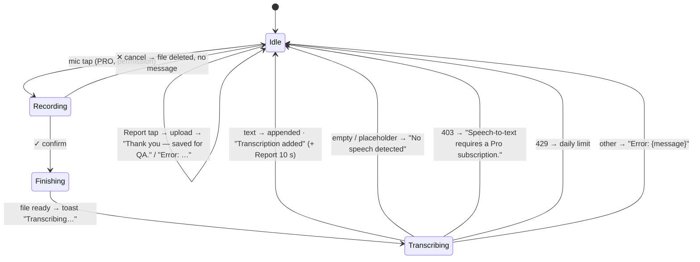

# Speech-enabled text field + inline recorder bar (shared component)

| | |
|---|---|
| Area | Shifa Intelligence · speech inputs (shared) |
| Who sees it | Doctor and clinic staff wherever the host form allows; the mic needs `speechToText` (PRO) — below PRO the field is a plain text field |
| Reached from | Patient form (16 fields), in-person and video visit screens (notes), SOAP section, dental documentation panel; the recorder bar in chat (voice message) and the in-person scribe |
| Screen type | Form component (field with a recording pill overlay) and an inline strip |
| Current Flutter source | `lib/core/widgets/doctor_speech_text_field.dart`, `lib/core/widgets/inline_voice_recorder_bar.dart`, `lib/core/widgets/doctor_voice_recorder_session.dart`, `lib/core/api/doctor_transcription_api.dart` (`completeDoctorTranscriptionFromRecording`, feedback), `lib/core/network/public_backend_config.dart` |
| Spec | `docs/kmp-spec/02-home-ai-intelligence.md` §7.2, §7.3, §10 · tickets AI-03, AI-05, AI-06 |

## 1. Purpose
Dictate into any clinical text field instead of typing: tap the mic, speak, tap ✓ — the transcript is appended to
the field. The same recording strip is reused where the audio itself is the product (chat voice message, scribe).
Many times per visit for dictating doctors.

## 2. Entry points
- **Speech text field**: the mic suffix icon inside the field (standard style) or at the top-right of a borderless
  expanding notes block. Only rendered when the tier allows speech; otherwise the field has no mic.
- **Inline recorder bar**: shown by the host (chat composer "voice message", in-person scribe) and starts recording
  **immediately on appearance**.

## 3. Layout, top to bottom (phone portrait)

**Speech text field — idle**: the host's text field with a mic-outline suffix icon (36 dp target, tooltip "Speak to
type"). Other suffix actions (e.g. "clear ICD") sit left of the mic.

**Speech text field — recording**: the field keeps its text and gains 40–48 dp of bottom padding; a **dark pill**
(near-black 94 %, fully rounded) floats at the bottom inside the field: 40 live bars (3–26 dp, white 22–78 % by
level, 72 ms easing) · ✕ (cancel, 32 dp) · ✓ (confirm, 32 dp; spinner while finishing). The mic suffix is hidden
while recording.

**Inline recorder bar**: optional bold title line above (host-provided, e.g. "Voice message"), the same dark pill
full width, then the caption "Stop when you are done — pauses and filler words are fine." ✓ tooltip is the host's
label or "Process".

Feedback after ✓ (speech field only): "Transcribing…" toast → on success a **green** toast "Transcription added";
if the public config flag `transcriptionFeedbackEnabled` is on, the toast stays 10 s with a second line "If the text
looks wrong, tap Report to send it for QA (optional audio)." and an action "Report" → uploads transcript + audio →
"Thank you — saved for QA."

## 4. Data and formats
| Item | Value |
|---|---|
| Recorder | AAC m4a 16 kHz mono 32 kbps, temp file; level every 60 ms; `recordingId` per take |
| Max duration | **none** (no timer) — target: 10 min like dictation, with a countdown in the last minute |
| Transcription | `POST /api/ai/transcribe` multipart with `languageHint` = **app language** (not auto-detect; Intelligence uses auto-detect) · 90 s timeout; 403 → Pro message; 429 → rate limit; other → server message |
| Append rule | transcript trimmed; a space is inserted unless the field is empty or ends with space/newline; cursor moves to the end; the placeholder "(No speech detected)" is never inserted |
| Feedback | `POST /api/ai/transcription-feedback` (transcript, locale, optional audio); 404 = feature off |
| Recorder bar result | file path + duration in seconds to the host (host uploads / scribes) |
| Permission | mic permission checked on each start |

## 5. Primary flow (happy path — speech field)
1. Tap mic → permission ok → pill appears at the bottom of the field; bars move.
2. Dictate; tap ✓ → ✓ shows a spinner, pill disappears, "Transcribing…" toast.
3. 1–5 s later the text is appended with a leading space; green "Transcription added" (+ optional Report).

Recorder bar: `[*] → Recording (auto) → ✕ → host.onCancel` / `✓ → Finishing → host.onRecordingComplete(path, seconds)`;
start failure → error toast + `onCancel`.

## 6. Screen states
- **First load / Empty / Error on load / Refreshing / Partial:** n/a (component).
- **Offline:** recording works; transcription fails → "Error: …" red toast; the take is lost (target: keep the file
  and offer Retry in the toast/banner).
- **Permission needed:** system prompt on first mic tap; denied → red "Microphone permission denied"; permanently
  denied → same every time (target: settings dialog).
- **Locked by tier:** no mic icon at all below PRO (field is plain). Target: keep it hidden (forms must stay clean)
  but mention speech in the subscription screen.
- **Role difference:** staff editing a form with PRO features of the owning doctor — the gate uses the signed-in
  user's tier; staff tier is undefined → fails open today (spec bug 12). Target: staff never see the mic.

## 7. Interactions and secondary flows
- **✕** → discard; field unchanged; no message.
- **✓** → finish → transcribe → append.
- **Typing while recording** → allowed (the field stays editable under the pill); the transcript appends to whatever
  is there when it arrives.
- **Report** (feedback on) → uploads; one tap only.
- **Host form navigates away while recording** → the recorder is disposed; file discarded silently.
- **Recorder bar ✕ / ✓** → host callbacks; the bar has no own toasts except start failure.

## 8. Edge cases
- Empty transcript → "No speech detected", nothing appended.
- Very long dictation (no cap) → multi-MB upload, likely 90 s timeout → "Error: TimeoutException…" raw. Target: cap
  and friendly message.
- Field already at max length (host validator) → appended text may exceed; host validation shows on submit.
- Cursor was in the middle of the text → transcript always goes to the end (not at the cursor). Target: insert at
  the cursor when the field has focus.
- Two speech fields on one form → each has its own recorder; starting a second while the first records → the first
  keeps recording (two recorders on one mic → the second fails with "Error recording voice"). Target: a form-wide
  single active recorder; starting another cancels the first.
- App backgrounded / incoming call while recording → stop fails on return → "Error recording voice" or a silent
  discard; target banner "Recording stopped".
- Mic used by a video call on the same screen (video visit notes) → start fails → "Error recording voice". Target:
  hide the mic while the call holds the microphone, or route through the call's audio session.
- Language hint = app language: a Russian UI doctor dictating in Uzbek gets worse recognition (Intelligence uses
  auto-detect). Target: auto-detect everywhere, or a per-field language chip.
- Feedback flag fetched once per process from `/api/public/config` (5 s timeout, unauthenticated); failure → no
  Report action.
- Report with audio → uploads the voice recording (PHI) deliberately; the hint says "optional audio" but the client
  always attaches it. Target: make audio attachment a visible checkbox.
- Toast with two lines and an action for 10 s on top of a keyboard → overlaps; target banner under the app bar.
- 200 % font: the pill height is fixed (26–28 dp bars); fine. The extra bottom padding (40/48 dp) must scale so the
  pill never covers the last text line — compute from the pill height.
- Screen reader: mic "Speak to type"; while recording, ✕ "Cancel", ✓ "Process"; result toast announced; the bars are
  decorative (excluded).
- RTL: n/a (no RTL locale).

## 9. Validation and messages
| Condition | Message (English) | Where |
|---|---|---|
| Permission denied | Microphone permission denied | red toast → banner |
| Start failed | Error recording voice | red toast → banner |
| Finishing | Transcribing… | toast → inline spinner only |
| Success | Transcription added | green toast → banner |
| Success + feedback on | Transcription added ⏎ If the text looks wrong, tap Report to send it for QA (optional audio). · action Report | 10 s toast → banner with action |
| Report ok | Thank you — saved for QA. | toast → banner |
| Empty | No speech detected | toast → banner |
| 403 | Speech-to-text requires a Pro subscription. | red toast → banner |
| 429 | You've reached your daily AI usage limit. Try again tomorrow. | red toast → banner |
| Other | Error: {message} | red toast → banner |

## 10. Navigation out
- None; the component lives inside its host. Leaving the host discards any recording.

## 11. Copy
| Key | English |
|---|---|
| `speakToType` | Speak to type |
| `cancel` / `processRecording` | Cancel / Process |
| `voiceRecordingFinishHint` | Stop when you are done — pauses and filler words are fine. |
| `transcribing` / `transcriptionAdded` | Transcribing… / Transcription added |
| `transcriptionReportHint` / `transcriptionReportAction` / `transcriptionReportThanks` | If the text looks wrong, tap Report to send it for QA (optional audio). / Report / Thank you — saved for QA. |
| `noSpeechDetected` | No speech detected |
| `speechToTextRequiresPro` | Speech-to-text requires a Pro subscription. |
| `microphonePermissionDenied` / `errorRecordingVoice` | Microphone permission denied / Error recording voice |
| `error` | Error |
| `voiceMessage` (chat host title) | Voice Message |
| **NEW** `aiRateLimit` | You've reached your daily AI usage limit. Try again tomorrow. |
| **NEW** `transcriptionFailedRetry` | Transcription failed. · Retry |
| **NEW** `transcriptionAttachAudio` | Attach the audio to the report |
| **NEW** `recordingLimitReached` | Recording limit reached — processing. |

## 12. Known problems in the current app (do not carry over)
- No maximum recording length.
- Transcript always appended at the end, never at the cursor.
- Language hint is the UI locale (no auto-detect), unlike Intelligence.
- Several recorders can run on one form; mic conflicts with the video call are unhandled.
- Audio is always attached to QA reports despite "optional" wording.
- Dark pill with hardcoded near-black colour; red/green SnackBars; 10 s snackbar with action.
- "Error: TimeoutException…" style raw messages.
- Tier fail-open lets staff see the mic.

## 13. Open questions for design
- Keep the pill *inside* the field (today) or a bottom bar above the keyboard shared by all fields on the form?
- Should the transcript be inserted as a highlighted "just dictated" span the doctor can undo in one tap?
- Does the QA "Report" action belong in production builds at all?
