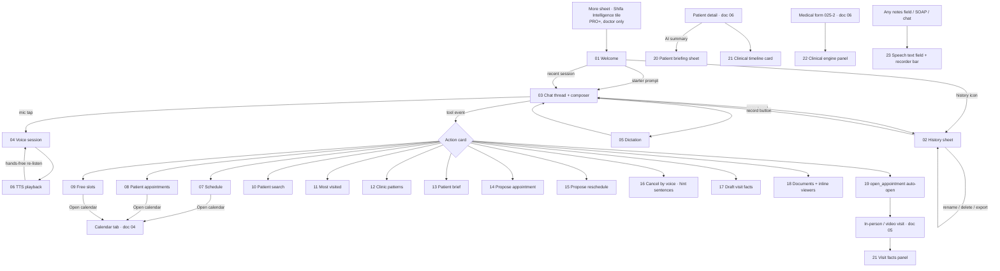

# 03 · Shifa Intelligence — UI/UX flows

Shifa Intelligence is the doctor's AI assistant: one conversational surface (text + voice) that answers questions
about the day, finds patients, proposes and moves bookings, cancels visits after a spoken confirmation, opens
documents and dental charts inline, and turns a recorded visit into documented facts. This folder also covers the
AI surfaces that live outside the chat: the patient briefing, the visit-facts panel, the clinical engine panel and
the shared speech-to-text field.

Conventions: see [`../00-README.md`](../00-README.md) and [`../_TEMPLATE.md`](../_TEMPLATE.md). Spec:
`docs/kmp-spec/02-home-ai-intelligence.md` §0, §3–§7, §11, §12.

## 1. Flow map

## 2. Files

| File | Screen | Role | Tier | Purpose |
|---|---|---|---|---|
| `01-intelligence-welcome.md` | Intelligence welcome | Doctor | PRO+ | Greeting, four starter prompts, five most recent conversations |
| `02-conversation-history-sheet.md` | Conversation history sheet | Doctor | PRO+ | Search, open, create, rename, delete and export saved conversations |
| `03-chat-thread-and-composer.md` | Chat thread + composer | Doctor | PRO+ | Text conversation: streaming reply, card slot, retry, patient context line, timestamps |
| `04-voice-session-mic.md` | Voice session (mic) | Doctor | PRO+ | Tap-to-talk: listening → thinking → speaking, silence auto-send, hands-free loop, barge-in |
| `05-dictation-mode.md` | Dictation mode | Doctor | PRO+ | Record until send (10 min max), pauses allowed, server transcription |
| `06-tts-playback.md` | TTS playback | Doctor | PRO+ | Spoken reply states, per-language voice, timeouts and soft failures |
| `07-card-schedule.md` | Schedule card | Doctor | PRO+ | Today's appointments list with Open calendar |
| `08-card-patient-appointments.md` | Patient appointments card | Doctor | PRO+ | One patient's visits in a period |
| `09-card-free-slots.md` | Free slots card | Doctor | PRO+ | Open times for a day as read-only chips |
| `10-card-patient-search.md` | Patient search card | Doctor | PRO+ | Matches, fuzzy "did you mean", no match |
| `11-card-most-visited.md` | Most visited card | Doctor | PRO+ | Ranked patients by visit count |
| `12-card-clinic-patterns.md` | Clinic patterns card | Doctor | PRO+ | Recurring clinical facts across the clinic |
| `13-card-patient-brief.md` | Patient brief card | Doctor | PRO+ | Inline AI briefing text for one patient |
| `14-card-propose-appointment.md` | Propose appointment card | Doctor | PRO+ | Book a slot: backend-confirmed flow and local-button flow, 409 conflict |
| `15-card-propose-reschedule.md` | Propose reschedule card | Doctor | PRO+ | Move an existing visit to a new slot |
| `16-cancel-appointments-by-voice.md` | Cancel appointments by voice | Doctor | PRO+ | Backend-driven ask-which → preview → "yes" with every hint variant |
| `17-card-draft-visit-facts.md` | Draft visit facts card | Doctor | PRO+ | Review spoken facts and "Document everything" |
| `18-card-documents-inline-viewers.md` | Documents card + inline viewers | Doctor | PRO+ | Document list, inline PDF / image viewer, inline dental chart |
| `19-open-appointment-auto-open.md` | open_appointment auto-open | Doctor | PRO+ | Card that opens the in-person / video visit once (target; unwired today) |
| `20-patient-briefing-sheet.md` | Patient briefing sheet | Doctor | PRO+ | Generate, read and copy an AI briefing from patient detail |
| `21-visit-facts-panel.md` | Visit facts panel + clinical timeline card | Doctor | PRO+ | Keep / reject spoken facts on a visit; committed timeline on the patient chart |
| `22-clinical-engine-panel.md` | Clinical engine panel | Doctor | all | Disease picker and complaint / objective / x-ray / treatment chips that write form fields |
| `23-speech-text-field-recorder-bar.md` | Speech text field + inline recorder bar | both | PRO for mic | Shared dictation pill used in forms, SOAP, chat and visit screens |

## 3. Not designed

- The dead Home AI copilot card, the "Ask Shifa AI" overlay and the `DoctorAiPanel` (nothing in the live app opens them).
- The web wake word ("Hey Shifa" / "Salom Shifa" / "Привет Шифа"), the browser live caption and the 2 s recogniser
  watchdog: they depend on browser speech recognition, which does not exist in the mobile app.
- The non-embedded voice session (big orb header, "Tap once, then speak" button, "You said / Shifa" caption bubbles,
  the spoken "document everything" command): only the embedded Intelligence variant is ever shown.
- The desktop history drawer (300 px side drawer): phones use the bottom sheet in file 02.
- Admin panel AI tooling (none exists; admin stays web).

## 4. Area rules

- **Who sees Intelligence.** Doctors only. Clinic staff never see the More-sheet tile and the shell never shows the
  screen for them. The entry needs the `askShifaAi` feature (PRO and PREMIUM). Today a BASIC doctor who taps the
  tile gets a generic "Error" toast; the target is to show the tile with a lock and an upgrade line, or hide it,
  and never show an error.
- **Tier unknown.** The current app treats an unknown tier as PREMIUM (fails open). The rewrite hides gated entries
  until the profile has loaded (spec decision 2).
- **Speech is PRO.** Every microphone affordance (mic, dictation, speech field) checks `speechToText`. Below PRO the
  mic buttons stay visible but tapping shows "Speech requires Pro. Upgrade to talk with Shifa." Target: show the
  buttons in a locked style with the same copy on tap, so typing still works for BASIC doctors who were granted the
  chat.
- **401 / 403 from AI endpoints.** The AI calls currently bypass the shared API client, so a 401 does not log the
  doctor out and shows a raw error. Target: route them through the API client so 401 behaves like everywhere else
  (logout to login). A 403 on transcription means "no speech-to-text on this tier" → "Speech-to-text requires a Pro
  subscription." A 403 on briefing shows the server's message. 429 on any AI call → "You've reached your daily AI
  usage limit. Try again tomorrow." (banner, not toast).
- **Where conversations live.** On the device only, keyed per doctor (`shifa_intelligence_chats_v1:<doctorId>`),
  unencrypted today, never synced; logging in on another phone starts with an empty history. Target: encrypt at rest
  (threads contain patient names and document ids) and cap the list (none today). Every conversation has a local id
  that is sent with each request as `conversationId`; the backend keys its pending confirmation (e.g. a cancellation
  waiting for "yes") on it, so a new conversation always starts clean.
- **Leaving Intelligence refreshes the calendar.** Bookings, moves and cancellations made in chat change the schedule,
  so returning to the clinic shell reloads today's appointments, notifications and analytics.
- **Language.** Each turn's reply language is detected from what the doctor said (Cyrillic Uzbek letters → UZ, other
  Cyrillic → RU, Uzbek marker words → UZ, two or more English function words → EN, otherwise keep the previous
  language; the first language is the app language). Card labels, dates, statuses and the backend's known English
  hint sentences are translated on the device; free-form AI text is shown as sent. The spoken voice follows the
  reply language (Uzbek = WAV voice, English/Russian = MP3 voice). On mobile there is never a live caption; the
  doctor's words appear once, after the server transcript returns.
- **Feedback style.** Every "snackbar" named in these files is the current app; the design uses the top banner.
