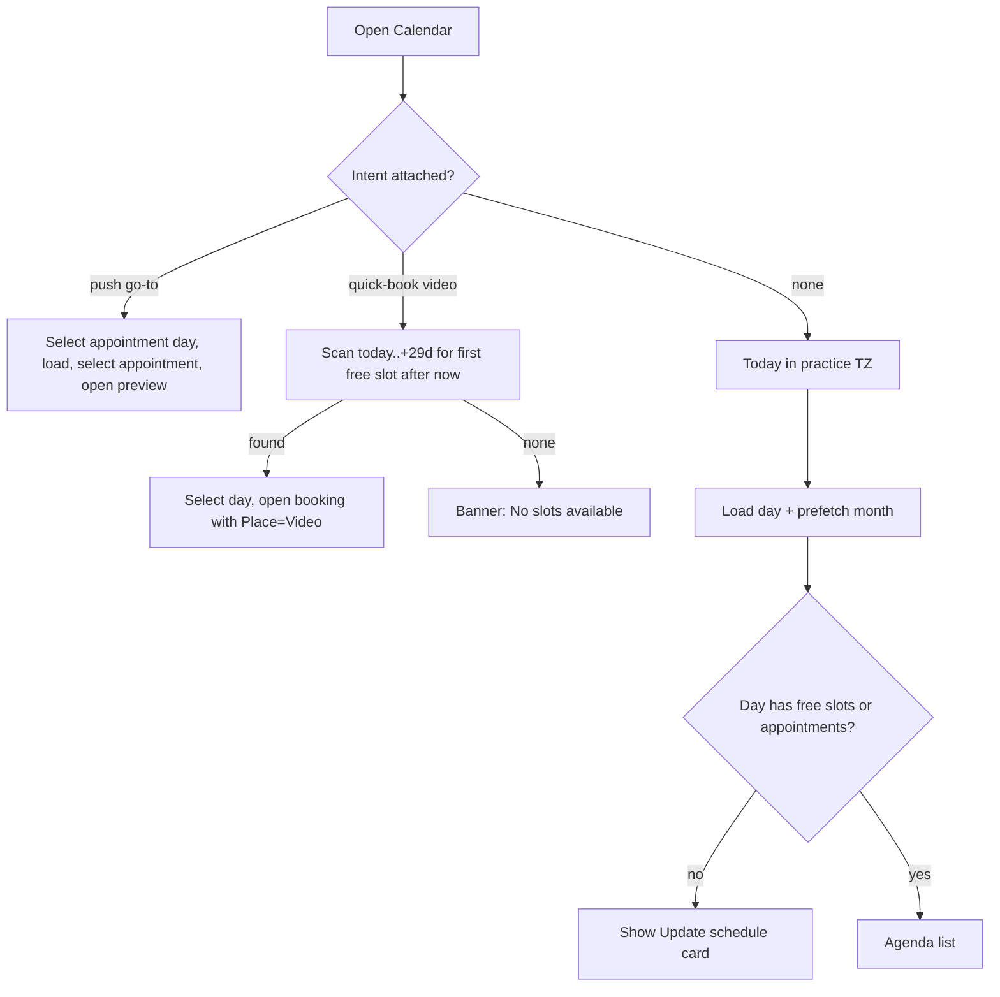

# Calendar tab (month picker + day agenda)

| | |
|---|---|
| Area | 04 Calendar & schedule |
| Who sees it | Doctor only (tab root). Clinic staff never see this tab; they use [14-staff-calendar-switcher](14-staff-calendar-switcher.md). No tier gate. |
| Reached from | Bottom tab "Calendar"; Home quick actions ("New appointment", "Video consultation"); push notification tap on any appointment type; "Today's schedule" card on Home |
| Screen type | Tab root (full screen, tab bar visible) |
| Current Flutter source | `lib/features/calendar/presentation/calendar_screen.dart` (`CalendarScreen`, `CalendarMonthPanel`, `_OccupancyDayCell`), `lib/state/calendar/calendar_controller.dart` |
| Spec | `docs/kmp-spec/03-calendar-schedule.md` §1.1–1.5, §1.11, §4; tickets CAL-3, CAL-4, CAL-9 |

## 1. Purpose
The doctor's daily working surface: see what the day looks like (free slots, booked patients, blocked time), jump between days, and open any item to act on it. Used many times a day, usually on "today".

## 2. Entry points
- **Tab bar → Calendar.** Opens on **today in the practice timezone**, nothing selected. If the tab was already alive (kept in memory), it reopens on the last selected day and refreshes it.
- **Home quick action "New appointment".** Same as tab tap (no preselection).
- **Home quick action "Video consultation".** Carries a *quick-book intent*: the calendar scans forward from today (max 30 days) for the first free slot that starts after "now" (practice TZ), selects that day, opens the booking sheet with Place = "Video Call" preselected. If nothing is found in 30 days: banner "No slots available".
- **Push notification tap (appointment booked / cancelled / changed / rescheduled / assigned / paid).** Carries `appointmentId` + the appointment's day (resolved before navigating so the screen opens on the right day from the first frame). The day loads, the matching appointment is selected and its preview opens on top. Replaces the stack (shell is re-pushed) when the app was not already on the shell.
- **"Today's schedule" on Home → any row.** Opens Calendar on today with that appointment selected (same mechanism as push).
- **Back from Appointment details / booking sheet.** Returns here; the day is refreshed.

## 3. Layout, top to bottom (phone portrait)
1. **Timezone-mismatch banner** (conditional, amber) — see [03-timezone-mismatch-notice](03-timezone-mismatch-notice.md). Pushes everything down; dismissible.
2. **Header row.** Left: title "Calendar" + subtitle with the selected date ("24 October 2026"). Right: small spinner while a day loads, then two tonal icon buttons: **Block time** (disabled until a day is selected — on phone a day is always selected, so effectively always enabled) and **Filter**. Tablet/wide adds a 1–7 day segmented selector (not designed for phone).
3. **Staff calendars chip row** (only when the doctor belongs to a clinic with ≥ 2 schedulable members) — see [14-staff-calendar-switcher](14-staff-calendar-switcher.md).
4. **Month picker card** (white, 16 dp radius). Header: chevron left · "October 2026" · chevron right. Weekday row Monday-first, single letters (M T W T F S S, localised). 6 rows × 7 cells, row height 36, cell 30. Each cell is a day number with **occupancy shading** (see §4). Selected day = filled teal circle with white number. Today = teal number (or teal ring when the cell has a shade). Days outside the month are hidden. Range 2020–2030. Swipe left/right or chevrons change the month; this triggers a background prefetch of every uncached day of that month (batches of 4 requests) so the shading fills in progressively.
5. **"Update schedule" card + "Go To Schedule" button** (conditional) — appears when the selected day has neither free slots nor appointments. See [04-calendar-empty-no-availability](04-calendar-empty-no-availability.md).
6. **Day agenda list** for the selected day, embedded in the page scroll (the whole screen is one vertical scroll). Rows are free slots, appointments and blocks in start-time order, 12 dp apart. Row anatomy in [02-day-agenda-item](02-day-agenda-item.md). Empty: centred grey "No items for this day".
7. Bottom clearance for the tab bar (+16 dp).

Nothing is sticky except the system status bar. There is no FAB and no "Today" button today (target: add one, see §13).

Tapping any row **replaces the whole screen** with the slot/appointment panel (tab bar hidden, no transition animation). Target: present it as a bottom sheet / pushed screen with the standard transition ([05](05-appointment-preview-sheet.md), [06](06-book-appointment.md)).

## 4. Data and formats
| Field | Source | Format rule |
|---|---|---|
| Selected date label | local state | `d MMMM yyyy` with localised month name; tablet multi-day: `d–d MMMM yyyy`, `d MMM – d MMM yyyy`, cross-year variant |
| Month title | local state | `MMMM yyyy`, localised month name |
| Weekday letters | `intl` `EEEEE` for en/uz/ru | one letter; Monday first regardless of locale |
| Day entries | GET `/api/calendar?day=YYYY-MM-DD` (own) · `&doctorId=` (colleague) | each entry has `startAt`/`endAt` UTC ISO; converted once to practice-TZ wall clock. Entries without both timestamps are dropped silently. Response may be a bare array or wrapped in `content`/`data`/`entries`. |
| Entry types | `type` = `FREE_SLOT` · `APPOINTMENT` · `BLOCKED` (anything else is treated as a free slot) | see [02](02-day-agenda-item.md) for row anatomy |
| Occupancy shade | computed per cached day: `free / (free + appointments + blocked)` | ratio ≥ 1 → no fill; 0.5–1 → light grey ramp (grey300→grey100); < 0.5 → dark ramp (grey700→grey300); ≤ 0 → near-black (grey900) with white number; text turns white below 0.35. Day not yet fetched or with zero entries → plain number. |
| "Today" | `todayIn(practiceTz)` | **Target:** practice timezone everywhere. Current app: the month cell "today" ring and the tablet now-line use the *phone* clock (bug 9 in spec 00). |
| Cache | per-day map in memory | a day is not re-fetched within **60 s** unless forced (mutation, pull-to-refresh, push). Cache clears on logout / account switch. |

### Time rules for this screen
- Practice timezone comes from the doctor profile (`profile.timeZone`, IANA). If empty the app falls back to UTC and keeps working.
- "Today" = calendar date in the practice timezone. A doctor in New York with practice TZ Asia/Tashkent sees Tashkent's date highlighted even at 20:00 local when it is already tomorrow in Tashkent.
- DST: entries are converted instant → wall clock per day, so on a DST-change day a 09:00 slot still reads 09:00; a day may contain 23 or 25 hours of slots. Nothing special is drawn today (open question §13).
- An entry that crosses midnight (practice TZ) belongs to the day of its *start* (the backend groups by `day`). Its end reads e.g. "00:30"; the duration badge is suppressed because the wall-clock difference comes out negative. **UNVERIFIED** whether the backend ever emits such entries (schedule rules are intra-day).

## 5. Primary flow (happy path)
1. Tab opens → header + month card render immediately; agenda area shows a **skeleton of 4 rows** (target; today a centred spinner) while profile → timezone → day are loaded.
2. Day arrives (typically < 1 s) → rows fade in; month cells of the current month pick up shading over the next seconds as the prefetch completes.
3. Doctor taps another day → selection circle moves instantly; agenda shows skeleton (if not cached) → rows; header date updates.
4. Doctor taps a row → preview/booking panel ([05](05-appointment-preview-sheet.md) / [06](06-book-appointment.md) / [09](09-block-time.md)).
5. On return, the day is refreshed (one request) and the list updates in place without scroll jump.

## 6. Screen states
- **First load:** month card renders with plain numbers; agenda = 4 skeleton rows (avatar circle, two text bars, right-aligned time bar). Header spinner optional. Never a blank screen.
- **Empty (day has no entries at all):** "No items for this day" centred in the agenda area. If additionally the day has no free slots and no appointments → "Update schedule" card ([04](04-calendar-empty-no-availability.md)).
- **Empty because of filters:** rows hidden client-side; "No items for this day" is shown but the "Update schedule" card is **not** (it is computed on unfiltered data). Target: show "Hidden by filters · Reset" instead.
- **Error on load:** today a bottom SnackBar "Failed to load: <raw exception>". Target: top banner "Couldn't load this day" with **Retry**, agenda keeps the previous content for that day if any, else an inline error row.
- **Offline:** cached days (anything opened in this session) still render; tapping an uncached day → error state above. Booking/blocking actions fail with the error banner. Month shading stays as last known.
- **Refreshing (pull-to-refresh / resume / push):** content stays in place; subtle spinner in the header; rows swap without jump. Target: pull-to-refresh gesture on the page scroll (does not exist today). See [15-refresh-live-updates](15-refresh-live-updates.md).
- **Partial data:** staff calendars — a colleague's day failing to load leaves that colleague's section empty (silent today; target: inline "Couldn't load" row per section). Own day failing → error state.
- **Permission needed:** n/a.
- **Locked by tier:** n/a (no gate on Calendar).
- **Role difference:** Clinic staff never reach this tab. Doctors who are clinic members get the staff chip row; solo doctors never see it.

## 7. Interactions and secondary flows
- **Tap day cell** → selects day, clears any selection, loads the day (cached → instant) → agenda updates. Also sets the month "focused day".
- **Swipe month / chevrons** → month changes, focus moves to the same day-of-month, selection unchanged; background prefetch of the new month for shading. Selection may now be off-screen (no auto-select).
- **Tap Filter** → modal dialog "Filter" with three checkboxes: Show Appointments / Show Free Slots / Show blocked time (all on by default); **Cancel** / **Apply**. Apply filters client-side (target: no refetch; today it refetches). Filters are per session, not persisted, and not reflected in the Filter icon (target: badge dot when any filter is off).
- **Tap Block time** → [09-block-time](09-block-time.md) dialog for the selected day.
- **Tap agenda row** → appointment preview / booking / block details.
- **Tap staff chip** → toggle that colleague's section ([14](14-staff-calendar-switcher.md)).
- **Pull-to-refresh** → target: force-refresh selected day (+ visible colleagues).
- **Back gesture / system back on tab root** → leaves the app / goes to previous tab per shell rules (not handled here).
- **App resumed from background** → selected day is refreshed if the last refresh is older than 5 s.
- **Switching to the Calendar tab from another tab** → selected day refreshed + month prefetch (throttled by the 60 s cache).
- **Target "Today" affordance:** tapping the header date label (or a "Today" pill shown when the selected day ≠ today) jumps to today.

## 8. Edge cases
- **0 entries:** "No items for this day" (+ Update schedule card when no availability at all).
- **1 entry:** single row, list does not stretch; page may be shorter than the screen.
- **30+ entries (e.g. 10-min slots 08:00–20:00 = 72 rows):** page becomes long; month card scrolls away with it. Target: consider pinning the header or collapsing the month card to a week strip on scroll (§13).
- **Overlapping appointments** (double-booked by another channel): both appear as separate rows in time order; no visual overlap cue on phone. Tablet grid draws them side by side with equal width.
- **Back-to-back appointments:** adjacent rows; no gap indication.
- **Cancelled appointments:** backend decides whether they are returned; when present they render as normal rows with the CANCELLED chip only inside the preview — the row itself has no cancelled styling today (target: muted row + "Cancelled" chip on the row).
- **Completed appointments:** strike-through name and time + a red 2.5 px line across the row.
- **Patient without name:** row shows "Appointments" as the title (fallback to a generic word — target: "Patient"). Without photo: grey circle with person icon.
- **Very long reason / patient name:** name wraps to 2 lines then ellipsis; reason is a single line that can overflow the right column (target: 1 line ellipsis).
- **Slow network (> 3 s) when switching days quickly:** each tap starts a load; responses for earlier days still land in the cache; the agenda shows whichever day is *selected* when its data arrives. Spinner stays until the last request finishes. No request cancellation.
- **Tap the same day twice:** second tap re-selects and triggers a reload (throttled to no-op within 60 s).
- **Session expired (401) while loading:** the API client logs out; the screen is torn down.
- **Deep link (push) while a sheet/panel is open:** the panel is replaced — the screen switches to the target day and opens the target appointment; unsaved booking input is lost without warning (target: ask to discard first, or queue the intent until the sheet closes).
- **Push for a different doctor (staff calendars):** only own calendar is targeted; colleague sections are not refreshed.
- **Rotation:** phone landscape keeps the single-pane layout (breakpoint is 720 dp content width, so most phones stay single pane). The month card becomes very wide; cells stay 30 dp.
- **200 % font:** header title and date wrap onto separate lines; weekday letters may clip (they are `clip`, not ellipsis); day numbers overflow the 30 dp circle. Target: cell size scales with text, min 40 dp touch target.
- **Language switch while open:** month name, weekday letters, labels re-render immediately (localised at build time). Weekday order stays Monday-first in all three languages.
- **Phone TZ ≠ practice TZ:** banner shown ([03](03-timezone-mismatch-notice.md)); all times still in practice TZ.
- **Practice TZ missing in profile:** UTC is used silently. Target: show the banner variant "Set your practice timezone in Profile".
- **Year boundary:** month navigation crosses years; title shows the year; range hard-stops at Jan 2020 / Dec 2030 (chevrons disabled).
- **Screen reader:** focus order = banner → title → Block → Filter → month header → day cells (announce "24, Friday, 3 free slots" — target; today the cell announces only the number) → rows.

## 9. Validation and messages
| Field/action | Rule | When checked | Message (English) | Where shown |
|---|---|---|---|---|
| Load day | HTTP 200 and decodable body | on response | "Failed to load" + Retry (target copy: "Couldn't load this day") | top banner (today: SnackBar) |
| Load day | 401 | on response | "Unauthorized: please login again." then logout | handled globally |
| Quick-book scan | at least one free slot in 30 days | after scan | "No slots available" | top banner (today: SnackBar) |
| Filter Apply | at least one toggle on | n/a (not enforced) | — | — (target: Apply disabled when all three are off) |
| Block time button | a day is selected | on tap | button disabled | — |

## 10. Navigation out
- **Row tap →** preview / booking / block panel. Returns here; day refreshed.
- **"Go To Schedule" →** [10-availability-setup](10-availability-setup.md) pushed inside the tab (tab bar hidden). On return the day and month are reloaded (cache throttle still applies — target: force refresh after a schedule save).
- **Block time →** dialog over this screen; on success the affected days are force-refreshed.
- **Other tab →** state (selected day, filters, staff selection) is kept in memory; staff selection is persisted per doctor + clinic.
- Nothing here holds unsaved input.

## 11. Copy
- Title: `calendar` (**key has no English value today — add "Calendar"**).
- Header buttons: `blockTime` "Block time", `filter` "Filter".
- Filter dialog: `filter`, `showAppointments` "Show Appointments", `showFreeSlots` "Show Free Slots", `showBlockedTime` "Show blocked time", `cancel` "Cancel", `apply` "Apply".
- Month: `monthName(n)` table, weekday letters from locale; legend (tablet) `calendarOccupancyLegend` "Dark = fully booked · No fill = open availability".
- Agenda empty: `noItemsForThisDay` "No items for this day".
- Errors: `failedToLoad` "Failed to load", `noSlotsAvailable` "No slots available", `retry` "Retry".
- Staff section header for self: `mySchedule` (**no English value — add "My schedule"**).
- **NEW:** "Today" pill; "Hidden by filters" + "Reset filters"; "Couldn't load this day"; "Set your practice timezone in Profile".

## 12. Known problems in the current app (do not carry over)
- Month-cell "today" and the tablet now-line use the phone clock, not the practice timezone → wrong day highlighted when travelling.
- Tapping a row swaps the entire screen for the detail panel with no transition and hides the month → disorienting; use a sheet/push.
- Applying filters refetches the day although filtering is local.
- Load errors and all confirmations are bottom SnackBars with raw exception text.
- Loading is a centred spinner; no skeleton.
- One booking triggers 2–3 identical day fetches (controller reload + invalidation hub + panel callback).
- Quick-book shows a spinner flicker per scanned day (up to 30 sequential requests).
- Selection highlight is lost after any refresh because identity is object-based, while the panel stays open.
- Filter state is invisible once the dialog closes.
- No pull-to-refresh, no "Today" shortcut.

## 13. Open questions for design
- Month picker vs week strip: keep the full month always visible, or collapse to a week strip when the agenda is long?
- Where does "Today" live — header pill, FAB, or tap on the title?
- Should cancelled appointments be visible in the agenda by default (muted) or only via a filter?
- Occupancy shading uses 5 grey steps; is a simpler 3-state (free / partly booked / full) clearer on a 30 dp cell?
- Should the Filter dialog become a chip row above the agenda (Appointments · Free · Blocked) instead of a modal?
- DST day: show a small "23 h / 25 h day" hint or nothing?
