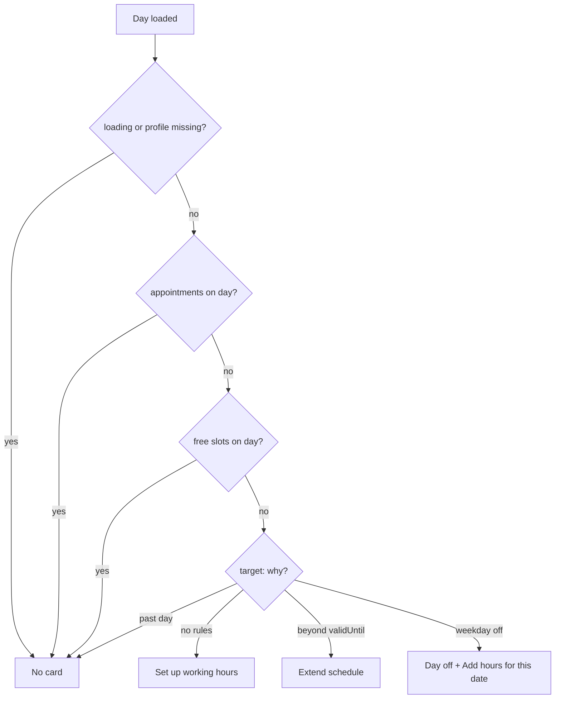

# Calendar empty / first-time state ("no availability yet")

| | |
|---|---|
| Area | 04 Calendar & schedule |
| Who sees it | Doctor (Calendar tab). Clinic staff: never (the card is disabled on the clinic doctor schedule screen). No tier gate. |
| Reached from | Automatically under the month picker in [01-calendar-tab](01-calendar-tab.md) when the selected day has no free slots and no appointments |
| Screen type | Inline card + primary button inside the tab root |
| Current Flutter source | `lib/features/calendar/presentation/calendar_screen.dart` (`_shouldShowUpdateScheduleCard`, `CalendarMonthPanel.showUpdateCard`, `_EmptyCalendarHint`) |
| Spec | `docs/kmp-spec/03-calendar-schedule.md` §1.3 "Month cell occupancy", §2 (route); ticket CAL-3 |

## 1. Purpose
Explain *why* a day shows nothing and route the doctor to fix it. Three different situations are collapsed into one card today: (a) brand-new doctor, no schedule at all; (b) the schedule's validity period ended ("this far ahead"); (c) a normal day off (weekday not enabled) or a fully blocked day. The design must separate them.

## 2. Entry points
- Any selected day where the unfiltered entries contain **no** free slot **and no** appointment (blocked entries do not count). Also true for every day of a brand-new account.
- Not shown while the day or the profile is still loading.
- A second, older empty state ("Select dates to see your schedule", 160 dp circle with a calendar icon) exists only for the tablet pane before any day is selected — on phone a day is always selected, so it is never seen. Not designed.

## 3. Layout, top to bottom (phone portrait)
1. Month picker card (unchanged).
2. **Info card** (white, 12 dp radius): amber info icon + grey text "Update schedule - Your calendar does not provide booking slots this far ahead".
3. **Primary button, full width: "Go To Schedule".**
4. Agenda area below shows "No items for this day" (or blocked rows if the day is blocked).

Target layout — one card with illustration, a headline that names the situation, one line of explanation, one primary action:

| Situation | How detected (target) | Headline | Action |
|---|---|---|---|
| No schedule ever saved | schedule rules list empty (GET `/api/schedule/rules` → `[]`) | "Set up your working hours" | "Set up schedule" → [10](10-availability-setup.md) |
| Validity period ended / day beyond `scheduleValidUntil` | selected day > `profile.scheduleValidUntil` | "Your schedule ends on 23 Dec 2026" | "Extend schedule" → [10](10-availability-setup.md) with the end-date picker focused |
| Day off (weekday not in rules) | rules exist, none for this weekday, day inside validity | "Day off" | secondary: "Add hours for this date" → [11](11-date-specific-hours.md) |
| Fully blocked day | blocked rows cover the day | no card; blocked rows speak for themselves | — |
| Past day with nothing | day < today | no card, just "No items for this day" | — |

## 4. Data and formats
| Field | Source | Format rule |
|---|---|---|
| Has free slots / appointments | unfiltered entries of the selected day (filters are ignored on purpose) | boolean |
| `scheduleValidFrom` / `scheduleValidUntil` | `GET /api/doctors/me` → `profile` | `YYYY-MM-DD`, date-only, no timezone; compare with the selected day as plain dates |
| Rules exist | `GET /api/schedule/rules` (today only fetched inside the setup screen) | **target:** fetched once when the calendar opens, cached with the profile |
| Today | practice timezone | past days never show the card (target) |

Time rules: "beyond the schedule" is a date comparison in the practice timezone; the validity end date is inclusive (the schedule screen's default end is today + 60 days).

## 5. Primary flow (happy path, new doctor)
1. First login → Calendar tab → month renders, agenda skeleton → day arrives empty.
2. Card "Set up your working hours" + button.
3. Tap button → [10-availability-setup](10-availability-setup.md) pushed inside the tab.
4. Doctor saves → returns → calendar force-refreshes today + current month → free-slot rows appear and the card disappears.

## 6. Screen states
- **First load:** card never flashes during loading (explicitly suppressed while the day or profile loads). Target: same; the skeleton occupies the agenda.
- **Empty:** this *is* the empty state.
- **Error on load:** card hidden; error banner instead (an error must never read as "you have no schedule").
- **Offline:** card may show from cached data; the button still navigates to the setup screen, which then shows its own error.
- **Refreshing:** card stays until the refreshed data proves slots exist; then it collapses (animate height).
- **Partial data:** profile loaded but day failed → card hidden (error state wins).
- **Permission needed:** n/a.
- **Locked by tier:** n/a.
- **Role difference:** clinic staff viewing a doctor's calendar never get the card (`showUpdateCard: false`); they see only "No items for this day". Target for staff: "Dr X has no bookable hours on this day" without an action.

## 7. Interactions and secondary flows
- **Tap "Go To Schedule"** → pushes the schedule setup screen inside the Calendar tab (tab bar hidden). Back returns to the same day.
- **Change day while card is visible** → card re-evaluates per day; typically disappears when a working day is selected.
- **Filters hide free slots** → card does **not** appear (correct) but the agenda says "No items for this day" — misleading; target: "Hidden by filters · Reset".

## 8. Edge cases
- **Brand-new account:** every day shows the card; the month has no shading at all. Target first-time variant with illustration.
- **Doctor with rules but today is Sunday:** card says "this far ahead" — wrong copy; must say "Day off".
- **Validity ended yesterday:** every future day shows the card; past days inside the period still show history. The message should name the end date.
- **Day fully blocked (vacation):** no free slots, no appointments → card appears **under** the blocked rows and tells the doctor to update the schedule — wrong; blocked days must suppress the card.
- **Day fully booked:** appointments exist → no card (correct).
- **Only cancelled appointments returned for the day:** they count as appointments → no card even though the day looks empty of work; acceptable.
- **Staff section (colleague) empty:** the card logic looks only at the doctor's own entries; colleague emptiness is silent.
- **Slow network:** card suppressed until the first response; on timeout the error state shows instead.
- **401 mid-load:** logout; nothing to design.
- **200 % font:** card text wraps to 4–5 lines; button label stays one line ("Go To Schedule" is short; Russian "Перейти к расписанию" fits).
- **Language switch:** re-renders.
- **Rotation:** card spans the width; fine.
- **Screen reader:** card text then button; the button should carry the context ("Set up schedule, button").

## 9. Validation and messages
| Field/action | Rule | When checked | Message (English) | Where shown |
|---|---|---|---|---|
| Show card | not loading ∧ day selected ∧ no appointments ∧ no free slots (unfiltered) | per build | `updateScheduleMessage` | inline card |
| (target) Situation | see §3 table | per day | headline per situation | inline card |

## 10. Navigation out
- "Go To Schedule" → [10-availability-setup](10-availability-setup.md). Nothing to keep. On return: force-refresh the selected day and clear the month cache for shading (today the 60 s throttle can leave the card visible for up to a minute after saving — bug).

## 11. Copy
- `updateScheduleMessage` "Update schedule - Your calendar does not provide booking slots this far ahead" (JSON value; the code's fallback has a line break after "Update schedule").
- `goToSchedule` "Go To Schedule".
- `noItemsForThisDay` "No items for this day".
- `selectDatesToSeeSchedule` "Select dates to see your schedule" (tablet-only pane, not designed).
- **NEW:** "Set up your working hours" · "Add the days and hours patients can book." · "Set up schedule" · "Your schedule ends on {date}" · "Extend schedule" · "Day off" · "Add hours for this date" · "Dr {name} has no bookable hours on this day".

## 12. Known problems in the current app (do not carry over)
- One message for three different situations; "this far ahead" is wrong for a Sunday or for a new account.
- Card appears on fully blocked days and tells the doctor to update the schedule.
- After saving a schedule the calendar may keep the card for up to 60 s (cache throttle).
- No illustration / first-run guidance; the copy is a developer sentence with a dash.
- Tablet "Select dates to see your schedule" placeholder is dead on phone.

## 13. Open questions for design
- First-run: a single card, or a short guided "Set up in 3 steps" (location → hours → validity)?
- Should "Day off" offer "Add hours for this date" inline (opens the date-specific flow prefilled with this date) or just stay informational?
- When the validity period ends soon (e.g. within 14 days), should the calendar warn before the empty days arrive — e.g. a dismissible banner "Your schedule ends in 10 days"?
