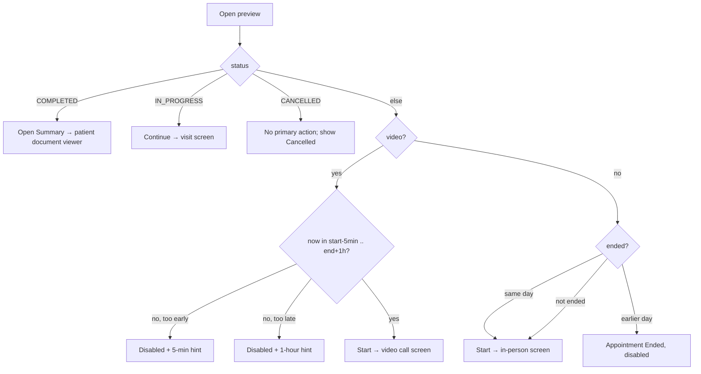

# Appointment preview / quick-view (actions: start, open summary, reschedule, cancel, patient, pay reminder)

| | |
|---|---|
| Area | 04 Calendar & schedule |
| Who sees it | Doctor (own and colleagues' appointments); Clinic staff (receptionist/owner) for a doctor's appointments via the clinic schedule screen. No tier gate. |
| Reached from | Tap on an appointment row in [01](01-calendar-tab.md) / [14](14-staff-calendar-switcher.md); push notification go-to; Home "Today's schedule" |
| Screen type | Today: full-screen replacement of the tab content. **Target: bottom sheet (expandable to full height)** |
| Current Flutter source | `lib/features/calendar/presentation/calendar_screen.dart` (`CalendarSlotDetailsPanel` appointment branch, `AppointmentPlaceDropdown`, `_primaryCtaLabel`, `_buildStatusChip`, `_buildPaymentChip`) |
| Spec | `docs/kmp-spec/03-calendar-schedule.md` §1.7; ticket CAL-6 (AI documentation tabs belong to area 05) |

## 1. Purpose
From the calendar, see who/when/where and do the one thing that matters now: start the visit, continue it, open the summary, move it, or cancel it. Opened several times a day.

## 2. Entry points
- **Agenda row tap** (own calendar) → opens with the entry and its day; context = own doctor, practice TZ.
- **Agenda row tap in a colleague's section** → same, with `clinicDoctorProfileId`, colleague name, clinic TZ, clinic street as venue label.
- **Clinic doctor schedule screen** (staff) → same as colleague context, inside a full-screen dialog route.
- **Push go-to / Home today row** → calendar switches day, selects the appointment, opens this panel on top.
- Opens on top of the calendar; closing returns to the same day.

## 3. Layout, top to bottom (phone portrait)
1. **Header** (not scrollable): title "Appointment Details" (20 pt, 2 lines max; right padding of 72 dp today to leave room for the shell's language toggle — target: standard sheet header with a close/handle). Under it a chip row: **status chip** + (video only) **payment chip** (see [02](02-day-agenda-item.md) §3). Then one grey line "24 October 2026 - 10:00 - 10:30" and "Duration: 30m".
2. **Scrollable body:**
   1. **Patient card** — avatar, patient name (tappable when a patient id exists → patient profile), chevron.
   2. **"Appointment Documentation" expansion tile** (AI notes / Summary PDF tabs) — owned by area 05; reserve the slot. While open it polls notes every 4 s for 2 minutes.
   3. **Date and Time tile** — "Date and Time" / "24 October 2026, 10:00 - 10:30", chevron. Tappable only when the appointment is not in the past → [07-reschedule-sheet](07-reschedule-sheet.md).
   4. **Adjust duration card** (only when adjustable: not past, not cancelled/completed, has id + timestamps): dropdown of possible end times + full-width button "Apply duration change" (disabled until changed) → [07](07-reschedule-sheet.md) §Adjust duration.
   5. **Place card** (read-only): pin or camera icon + label (video → "Video Call"; in-person → clinic street from clinic override → profile address → "Clinic Address"); hint "Booked appointment location is informational and cannot be changed here" (key has no English value).
   6. **"Encourage payment" outlined button** (video + payment PENDING + not past/cancelled/completed) → sends a payment reminder to the patient.
3. **Sticky action box** (grey-50 container with border):
   1. **Primary button (full width)** — label by state (see §4): "Start Appointment" / "Continue Appointment" / "Open Summary" / "Appointment Ended" (disabled).
   2. Hint line under it when disabled: "Past appointments cannot be changed or cancelled." or the video window hints ("You can start 5 minutes before the appointment." / "This video appointment ended more than an hour ago…").
   3. Row of two half-width buttons: **Cancel** (red, disabled when past / completed / cancelled) and **Discard** (secondary red — it closes the panel; asks to confirm when the reason/place/duration fields are dirty).

Target: the same information as a bottom sheet with a drag handle, patient card first, a compact "when / where" block, then a single action bar: primary CTA + overflow (Reschedule, Cancel, Open chat, Call). Chat/Call do not exist here today (open question §13).

## 4. Data and formats
| Field | Source | Format rule |
|---|---|---|
| Live entry | calendar cache for the day, matched by `appointmentId` (falls back to the tapped entry) | status may change while open (after ending a visit elsewhere) |
| Date | panel's `day` | `dd MMMM yyyy` localised |
| Times | `start`/`end` in practice (or clinic) TZ | `HH:mm`; header shows the *adjusted* end while the doctor plays with duration |
| Duration | wall-clock minutes | `1h 30m` / `30m` |
| Status | `status` | chip mapping in [02](02-day-agenda-item.md) |
| Payment | `paymentStatus` | chip; video only |
| Place | `location` / profile address / clinic street | read-only |
| Patient | `patientName` (fallback "Unknown patient" — key missing English), `photoUrl`, `patientId` | name tappable only with id |
| Primary CTA | status + time window | see table below |

| Condition (evaluated in practice TZ) | Primary label | Enabled |
|---|---|---|
| status COMPLETED | "Open Summary" | yes (opens the latest APPOINTMENT_NOTE document of the patient closest to the slot time; "No saved appointment documentation found." if none) |
| status IN_PROGRESS | "Continue Appointment" | yes |
| in-person, ended earlier **today**, not started | "Start Appointment" | yes (same-day grace) |
| ended (any type) on a previous day, or video ended > 1 h ago | "Appointment Ended" | **no** |
| video, now < start − 5 min | "Start Appointment" | **no** + hint "You can start 5 minutes before…" |
| video, start − 5 min ≤ now < end + 1 h | "Start Appointment" | yes |
| otherwise (upcoming in-person) | "Start Appointment" | yes |
| status CANCELLED | "Start Appointment" | button enabled today but the tap is a no-op (bug) → target: hide primary, show "Cancelled" state |

Time rules: "now", "today", "past" and the video window are computed in the practice timezone (clinic TZ for a colleague). An appointment is "past" when its UTC end is before now. Same-day grace for in-person visits is a *date* comparison in practice TZ, so at 00:30 a visit from 23:30 the previous day is already "ended". DST: the window is computed on instants, so a visit across the DST switch has the right window even if the wall clock jumped. Cross-midnight appointments: "today" is the start day; the end instant is used for "past".

## 5. Primary flow (happy path — start an in-person visit)
1. Tap row → sheet slides up (target) with header, chips, patient card.
2. Doctor checks the patient card, taps **Start Appointment**.
3. Pushes the in-person visit screen (area 05) with the appointment object built from the live entry (name fallback "Patient", status default CONFIRMED when unparseable).
4. On return, the day is refreshed; status chip updates (IN_PROGRESS / COMPLETED); notes polling restarts.

## 6. Screen states
- **First load:** everything comes from the already-loaded entry → instant. Notes/PDF section shows its own small spinner (area 05).
- **Empty:** n/a (an appointment always has a time); missing name/photo/place → fallbacks.
- **Error on load:** n/a for the panel itself; "Open Summary" failure → banner "Error: …" (target: "Couldn't open the summary").
- **Offline:** renders from cache; Start/Cancel/Reschedule fail with a banner; notes section shows its error.
- **Refreshing:** after any action the day refreshes; the panel re-reads the live entry (status chip may change); it stays open unless the action closes it (cancel/reschedule close it).
- **Partial data:** no `appointmentId` → Cancel/Reschedule/Adjust hidden/disabled, Start still works for the UI object; no `patientId` → name not tappable, "Patient ID not available" banner on Open Summary.
- **Permission needed:** none here (camera/mic are asked on the video screen).
- **Locked by tier:** n/a. (AI documentation tile is PRO-gated in area 05.)
- **Role difference:** colleague/staff context: same panel; Start pushes the visit screens for *that* doctor's appointment (UNVERIFIED that staff may start a visit — target: hide Start for staff, keep Reschedule/Cancel); patient name opens the patient in the Patients tab and, for staff, closes the full-screen route first and remembers how to come back.

## 7. Interactions and secondary flows
- **Tap patient name** → Patients tab with that patient opened (shell tab switch). For staff: pops the schedule route, pushes the patient, and the patient screen offers "back to Dr X's schedule" (ClinicScheduleReturnInfo).
- **Tap Date and Time** (not past) → [07-reschedule-sheet](07-reschedule-sheet.md).
- **Change the duration dropdown → Apply duration change** → [07](07-reschedule-sheet.md) §Adjust duration; success banner "Slot changed successfully"; panel stays open with the new end.
- **Tap Encourage payment** → spinner in the button → banner "Payment reminder sent" / "Payment reminder failed: …" (keys lack English).
- **Tap Cancel** → [08-cancel-appointment-dialog](08-cancel-appointment-dialog.md).
- **Tap Discard / drag down / scrim / back** → if duration dropdown changed: "Discard" dialog ("You have unsaved changes. Discard them?" Cancel / Discard-red); else closes.
- **Tap Appointment Documentation** → expands notes/PDF tabs (area 05).
- **System back** on phone → same as Discard.

## 8. Edge cases
- **Appointment cancelled by the patient while open:** next refresh changes the chip to Cancelled; primary stays "Start Appointment" (enabled, no-op) today → target: swap to the cancelled state and show a banner "This appointment was cancelled".
- **Appointment moved by someone else (push arrives while open):** the day refresh replaces the entry; the panel still shows the *tapped* entry's time for Date and Time (it reads `widget.entry`), while status reads live → inconsistent. Target: panel fully bound to the live entry; if the id disappears from the day → banner "This appointment was moved or cancelled" and close.
- **Open Summary with several documents the same day:** picks the APPOINTMENT_NOTE closest to the start time (by title match in en/uz/ru when category is missing).
- **Video, payment PENDING, 10 min before start:** Start disabled (hint), Encourage payment enabled — fine.
- **Video exactly at start − 5 min:** enabled (boundary inclusive).
- **In-person visit from 09:00 opened at 23:59 same day:** Start enabled (same-day grace); at 00:00 next day → "Appointment Ended".
- **Status strings in lowercase or with spaces:** trimmed + upper-cased before matching.
- **Status NO_SHOW / REQUESTED:** grey chip with the raw word; primary follows the time rules. Target: NO_SHOW → no primary, chip "No-show"; REQUESTED → primary "Confirm" (needs backend, UNVERIFIED).
- **Very long patient name:** ListTile title wraps; header date line unaffected.
- **Double tap on Start:** `_saving` is not set for Start, so two pushes are possible → target: debounce (disable after first tap until the route returns).
- **401 on any action:** global logout; panel disappears.
- **Deep link to another appointment while open:** panel content is replaced with the new entry (state re-seeded); unsaved duration change lost silently → target: confirm discard first.
- **Rotation:** panel re-lays out; dropdown menus close.
- **200 % font:** header title wraps (2 lines max, ellipsis), chips wrap to a second row, action buttons grow; the two half-width buttons may truncate "Cancel"/"Discard" in Russian ("Отменить"/"Отклонить") → stack vertically at large text.
- **Language switch while open:** labels re-render; the Place dropdown value is recomputed from the (language-independent) `isVideo` flag.
- **Screen reader:** order = title, status chip, payment chip, date line, patient card, date & time, duration, place, payment reminder, primary button, hint, cancel, discard. The hint under a disabled button must be read with the button.

## 9. Validation and messages
| Field/action | Rule | When checked | Message (English) | Where shown |
|---|---|---|---|---|
| Start (video) | start − 5 min ≤ now < end + 1 h (practice TZ) | on build | "You can start 5 minutes before the appointment." / "This video appointment ended more than an hour ago. Open it only if the consultation is already in progress." | hint under disabled button |
| Start (any) | not ended on a previous day | on build | "Past appointments cannot be changed or cancelled." | hint under disabled button |
| Open Summary | patient id present | on tap | "Patient ID not available" | top banner (today SnackBar) |
| Open Summary | a document exists | on tap | "No saved appointment documentation found." | top banner |
| Encourage payment | request OK | on response | "Payment reminder sent" / "Payment reminder failed: {{error}}" (**keys lack English**) | top banner |
| Discard | unsaved duration change | on close | "You have unsaved changes. Discard them?" | dialog (Cancel / Discard red) |

## 10. Navigation out
- **Start / Continue →** visit or video screen (area 05); on return the day refreshes, panel stays open.
- **Open Summary →** Patients tab → document viewer; panel is closed (tab switch). Staff: schedule route popped, return path remembered.
- **Patient name →** Patients tab, same as above.
- **Reschedule success →** panel closes, calendar shows both days refreshed.
- **Cancel success →** panel closes, day refreshed, banner.
- **Discard/back →** calendar, same day; nothing to refresh.

## 11. Copy
- `appointmentDetails` "Appointment Details"; `durationLabelShort` "Duration"; `dateAndTime` "Date and Time"; `place` "Place"; `clinicAddress` "Clinic Address"; `videoCall` "Video Call".
- `appointmentPlaceLockedHint` (**no English** — fallback text "Booked appointment location is informational and cannot be changed here."; target: drop the hint, make the field obviously read-only).
- `unknownPatient` (**no English** — add "Unknown patient").
- CTA: `startAppointment` "Start Appointment"; `continueAppointment` (**no English** — add "Continue Appointment"); `openSummary` (**no English** — add "Open Summary"); `appointmentEnded` = "Appointment ended successfully" (**wrong text for a disabled button label — add a new key "Appointment ended"**).
- Hints: `pastAppointmentNoChange`, `videoCallAvailableFiveMinBefore`, `videoCallTooLateAfterOneHour`.
- `adjustAppointmentDuration` "Adjust duration"; `applyAppointmentDuration` "Apply duration change"; `slotChanged` "Slot changed successfully"; `failedToChangeSlot` "Failed to change slot"; `invalidDuration` "Invalid duration.".
- `encouragePayment` (**no English** — add "Remind patient to pay"); `paymentReminderSent`, `paymentReminderFailed` (**no English**).
- `cancel` "Cancel"; `discard` "Discard"; `unsavedChangesMessage`; `close` "Close".
- `patientIdNotAvailable`; `noSummaryYet` "No saved appointment documentation found."; `error` "Error".
- **NEW:** "This appointment was cancelled" · "This appointment was moved or cancelled" · "Cancelled" (state) · "Reschedule" (button label; today it is the tile "Date and Time").

## 12. Known problems in the current app (do not carry over)
- Full-screen replacement of the tab with no transition; "Discard" is the only way back and is styled destructive.
- Cancelled appointments keep an enabled "Start Appointment" that does nothing.
- "Appointment Ended" reuses a success toast string.
- Date and Time tile is the only entry to rescheduling — not discoverable; duration change is a separate dropdown + button.
- The panel mixes the tapped entry and the live entry (status live, times stale).
- Start has no double-tap protection; `_saving` only guards Cancel/Adjust.
- Video detection by substring "video"; payment chip keys untranslated.
- A 4-second polling timer runs for 2 minutes every time the panel opens, even for next week's appointment.
- Place "dropdown" is a read-only box with a hint explaining that it is read-only.

## 13. Open questions for design
- Sheet vs pushed screen? Sheet keeps the day visible behind; pushed screen gives room for the documentation tile.
- Which secondary actions deserve a visible button: Reschedule, Cancel, Open chat, Call patient? (Chat/Call exist elsewhere but are not wired here.)
- Should staff see Start at all?
- Where does the payment reminder live — inline button, or inside the payment chip tap?
- For REQUESTED appointments: do we need "Confirm / Decline" here (backend support UNVERIFIED)?
