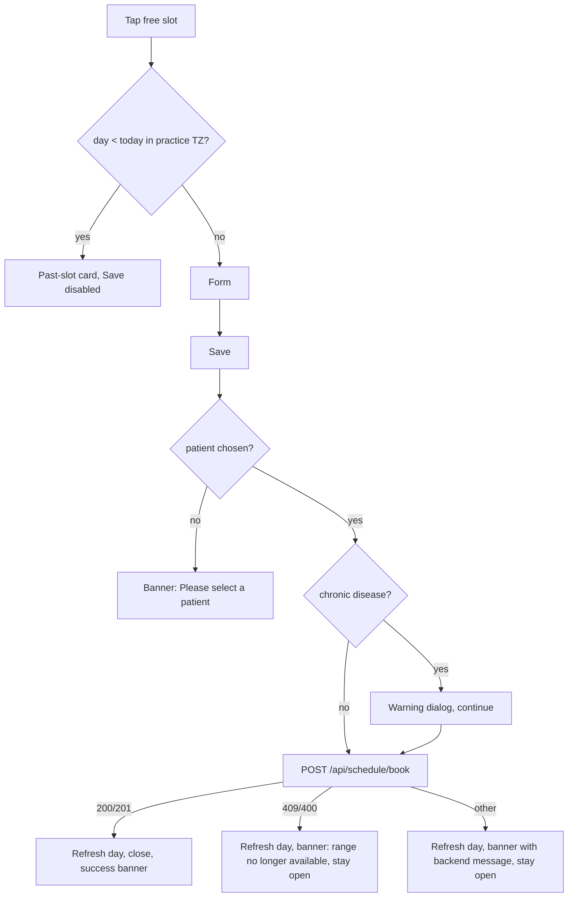

# Book a free slot for a patient (create appointment, incl. walk-in)

| | |
|---|---|
| Area | 04 Calendar & schedule |
| Who sees it | Doctor (own slots and colleagues' slots); Clinic staff (receptionist/owner) via the clinic doctor schedule screen. No tier gate. |
| Reached from | Tap on a free-slot row ([01](01-calendar-tab.md)); Home quick action "Video consultation" (auto-selects the first free slot); clinic schedule screen ([14](14-staff-calendar-switcher.md)) |
| Screen type | Today: full-screen replacement. **Target: bottom sheet / pushed form** + nested patient picker sheet |
| Current Flutter source | `lib/features/calendar/presentation/calendar_screen.dart` (`CalendarSlotDetailsPanel` free-slot branch, `_assignOnSave`, `_AssignPatientSheet`), `lib/features/calendar/domain/consecutive_slot_range.dart`, `lib/state/calendar/calendar_controller.dart` (`bookFreeSlotRemote`) |
| Spec | `docs/kmp-spec/03-calendar-schedule.md` §1.6, §1.10, §6 (POST `/api/schedule/book`); ticket CAL-7 |

## 1. Purpose
Put a patient into an open slot — phone bookings, walk-ins, follow-ups. The doctor picks who, where (clinic or video), optionally stretches the booking over several consecutive slots, writes a reason, saves. Several times a day for busy practices.

Order of steps today: **slot first** (tap the free slot) → patient → place → start/end → reason → Save. There is no "patient first → pick a date → pick a slot" flow (the brief's order). Target keeps slot-first as the main path (it is what the calendar affords) and adds a "patient-first" entry from the patient profile later (area 06, open question §13).

## 2. Entry points
- **Free-slot row tap** → panel for that slot, day, location; Place defaults to "Clinic Address".
- **Quick-book intent (Home → Video consultation)** → first free slot from today forward (≤ 30 days; today only slots starting after now) is selected automatically; Place preset "Video Call". If none: banner "No slots available", no panel.
- **Colleague's free slot** (staff calendars / clinic schedule) → same panel; booking is sent with `resourceDoctorId`; venue label = clinic street; TZ = clinic TZ.
- Opens on top of the calendar; nothing else is replaced.

## 3. Layout, top to bottom (phone portrait)
1. **Header:** "Slot Details"; grey line "24 October 2026 - 09:00 - 09:30"; "Duration: 30m" (both update live as start/end change).
2. **Past-day guard card** (orange-50, info icon): "This slot is in the past. You cannot assign a patient." — replaces items 3–7 when the slot's day is before today (practice TZ). Save disabled.
3. **Assign Patient tile** (card, person-add avatar, chevron). Subtitle "Selected: Anna Karimova" once chosen. Tap → patient picker sheet (§3b).
4. **Place card:** label "Place"; dropdown with exactly two options — "Clinic Address", "Video Call"; helper line below: "Will be booked at clinic" / "Will be booked as video call".
5. **Start time card** (only when the day has ≥ 1 free slot at the same location): dropdown listing every free slot start of the day **at the same location** ("09:00", "09:30", …), preselected with the tapped slot. Changing it resets the end.
6. **End time card** (only when a chain exists): dropdown of reachable ends by chaining consecutive free slots at the same location ("09:30", "10:00", "10:30", …), preselected with the slot's own end; "Duration: 1h" under it.
7. **Reason card:** single-line text field labelled "Reason for visit", prefilled "Check Up" (hard-coded English — target: localised default or empty with placeholder).
8. **Date and Time tile** (read-only for free slots; chevron but no action).
9. **Sticky action box:** primary **Save** (full width, spinner while saving); secondary red **Discard** (asks to confirm when dirty).

**3b. Patient picker sheet** (draggable bottom sheet, opens at 70 % height, min 50 %, max 95 %):
1. Drag handle.
2. Search field "Search by name or ID" (filters the already-downloaded list by name or id substring) + filled **"+"** button "New patient".
3. Divider, then the list: avatar, name, "ID: 123". Tap → returns to the form with the patient selected. Empty filter → "No patients found".
4. "+" → opens the create-patient sheet (area 06); on success the new patient is selected immediately and the picker closes.

Target: merge 5–6 into one "Time" row ("09:00 → 10:00 · 1 h") that opens a compact slot chooser; show Place as two segmented buttons; keep Save sticky.

## 4. Data and formats
| Field | Source | Format rule |
|---|---|---|
| Slot | tapped free-slot entry (`startAt` UTC, `locationId`, `location`) | start fixed to the chosen free slot; the request sends the slot's UTC `startAt` |
| Start options | free slots of the day with the same `locationId` | `HH:mm`, practice TZ |
| End options | chain of free slots that start exactly where the previous ends, same `locationId`, max 400 hops | `HH:mm` wall clock; `slotMinutes` sent = minutes between the UTC start and the chosen wall-clock end interpreted on that day in practice TZ (clamped 0–2880) |
| Place | local; "Clinic Address" / "Video Call" | sent as `isVideo` + `location` = "Video Consultation" / "Clinic Address" (hard-coded English — **target: send `isVideo` + `locationId`, let the backend label**) |
| `locationId` | slot's location, **only for in-person** | video bookings carry no location |
| Patient | picker (id + name + photo) from GET patients-for-assignment (whole list downloaded, then filtered locally) | numeric id required |
| Reason | text | trimmed; empty → "Check Up" |
| Acting doctor | `resourceDoctorId` when booking for a colleague | otherwise omitted |
| Chronic disease | `GET /api/patients/{id}` (already cached) | if set and ≠ "None": non-blocking warning dialog before booking |

### Time and booking rules
- **Past days cannot be booked** (date comparison in practice TZ). **Any slot on today is bookable, including ones that already started or ended** (walk-in that happened at 09:00 can be recorded at 14:00). No minimum notice.
- **How far ahead:** limited only by the schedule's validity period (default 60 days, max 365 from today — see [10](10-availability-setup.md)); the month picker runs to 2030 but days beyond the period simply have no free slots.
- **Double booking is prevented by the backend** (409 when the range is no longer free); the UI offers only FREE_SLOT entries, and chains only through free slots at the same location, so a booking can never span a venue boundary or an existing appointment.
- **Slot sizes** come from the schedule rules (10/15/20/30/45/60 min); a booking may cover 1…n consecutive slots. Minimum = one slot. Maximum = chain length (practically until the next appointment/break).
- **DST:** `slotMinutes` is computed instant → wall clock, so a chain crossing a DST switch gets ±60 min; the backend decides what it accepts. Add a test (CAL-7 "DST case").
- **Midnight:** chains stop at the last slot of the day (rules are intra-day); an end of 00:00 would compute as 0 minutes and be rejected client-side ("Selected end must be after the slot start").

## 5. Primary flow (happy path)
1. Tap free slot 09:00–09:30 → sheet opens with "Slot Details", Place = Clinic Address, Start 09:00, End 09:30, Reason "Check Up", Save enabled.
2. Tap **Assign Patient** → list loads (spinner on the tile; errors → banner) → picker sheet → type "Kar" → tap "Anna Karimova" → picker closes, tile shows "Selected: Anna Karimova".
3. (Optional) End → 10:00 ("Duration: 1h"). (Optional) Place → Video Call.
4. Tap **Save** → button spinner; if the patient has a chronic condition: info dialog (OK) first.
5. Request succeeds → day refreshed → sheet closes → banner "Patient assigned: Anna Karimova" → the new appointment row is in place of the slots.

## 6. Screen states
- **First load:** instant (data already in the day cache). Patient list loads only when the tile is tapped — target: prefetch when the sheet opens so the picker is instant.
- **Empty:** no free slots at the same location besides this one → Start dropdown hidden; no chain → End dropdown hidden (single-slot booking). Patient list empty → picker shows "No patients found" with the "+" still available.
- **Error on load (patients):** banner: 401 → "Unauthorized: please login again."; 403 → "Failed to load patients. Please try again."; else first 80 chars of the error. Target: single friendly message + Retry.
- **Offline:** form opens; patient list fails (banner); Save fails → "Selected time range is no longer fully available" (misleading — target: "No connection. Try again.").
- **Refreshing:** if the day refreshes while the sheet is open (push), the start/end options recompute from the new entries; the selected slot may vanish → dropdown falls back to the first option silently (target: banner "This slot was just taken" and reset).
- **Partial data:** slot without `startAt` → Save throws "Slot has no startAt…" (never shown nicely) — target: such rows are not rendered at all.
- **Permission needed:** n/a.
- **Locked by tier:** n/a.
- **Role difference:** staff/colleague context identical; request carries `resourceDoctorId`; venue label = clinic street; TZ = clinic TZ; patient picker lists the clinic's patients (UNVERIFIED scope of the assignment endpoint for staff).

## 7. Interactions and secondary flows
- **Assign Patient tap** → load list → picker. Search is instant local filtering. "+" → create patient (area 06) → auto-select.
- **Place change** → helper text updates; marks the form dirty; `locationId` is dropped for video.
- **Start change** → end resets to that slot's own end; header/duration update.
- **End change** → header/duration update.
- **Reason edit** → dirty.
- **Save** → validation → chronic warning → request. Double tap guarded by `_saving`.
- **Discard / back / drag down** → confirm when dirty ("You have unsaved changes. Discard them?"), else close.
- **Keyboard Done** on Reason → dismisses keyboard (no submit).

## 8. Edge cases
- **Slot just taken by a patient (409):** day refreshed, banner "Selected time range is no longer fully available — calendar refreshed.", sheet stays open with recomputed options; the tapped slot may no longer exist → target: close the sheet and highlight the new appointment.
- **Network drop on Save:** generic exception → same "range unavailable" message (bug) → target: "No connection…" with Retry, form kept.
- **Double tap Save:** second tap ignored while saving.
- **Leaving mid-flow** (tab switch): the panel is kept in memory with its state; coming back shows it still open. Target: sheet is dismissed on tab switch with the dirty check, or state kept — decide.
- **Patient picked then deleted elsewhere:** backend 400/404 → error banner; target shows the backend message.
- **Patient without name:** picker shows "" → target "Patient #123".
- **500 patients:** whole list downloaded on tile tap (slow on bad network: several seconds) → target: server-side search with debounce 300 ms.
- **Very long reason:** single line field, no max length client-side (backend limit UNVERIFIED) → target: 200-char counter.
- **Booking across two locations** (09:00 Clinic A free, 09:30 Clinic B free): chain stops at 09:30 — correct, cannot span venues.
- **Overlapping free slots from two locations at the same time:** Start dropdown lists only same-location slots; the tapped slot decides the location; the location is not shown anywhere on the form (target: show the location chip in the header).
- **Chronic disease warning:** non-blocking, shown every time for that patient; failure to fetch the patient is silent.
- **Quick-book with filters hiding free slots:** filter is switched back on automatically.
- **Quick-book finds a slot at 23:50 today:** fine; "after now" is instant-based.
- **401 mid-flow:** logout.
- **Deep link while open:** panel re-seeded with the new entry; typed reason and selected patient lost → target: confirm discard first.
- **Rotation:** dropdown menus close; state kept.
- **200 % font:** dropdown items wrap; helper lines wrap; Save stays full width; picker list rows grow.
- **Language switch while open:** Place option labels change; the selected option is re-matched (falls back to Clinic if the label no longer matches — bug; target: store `isVideo`, not the label).
- **Screen reader:** header → past-day card or patient tile → place → start → end → reason → Save → Discard. Dropdowns must announce their current value.

## 9. Validation and messages
| Field/action | Rule | When checked | Message (English) | Where shown |
|---|---|---|---|---|
| Day | not before today (practice TZ) | on open | "This slot is in the past. You cannot assign a patient." | inline card, Save disabled |
| Patient | selected | on Save | "Please select a patient" | top banner (today SnackBar) — target: inline under the tile |
| Place | selected (always true; default Clinic) | on Save | "Please choose a place" | banner |
| End | after start (slotMinutes > 0) | on Save | "Selected end must be after the slot start. Please refresh the calendar." (raw, never localised) | banner |
| Save → 409/400 | range still free | on response | "Selected time range is no longer fully available — calendar refreshed." | banner |
| Save → other error | — | on response | today same message; **target:** backend `message` or "Couldn't book. Try again." | banner |
| Success | — | on response | "Patient assigned: {name}" | banner |
| Patients load | 200 | on tile tap | "Unauthorized: please login again." / "Failed to load patients. Please try again." | banner |
| Chronic disease | `chronicDisease` set and ≠ "None" | before request | area-06 dialog text | dialog, OK |

## 10. Navigation out
- **Save success →** sheet closes; calendar day force-refreshed (one request — target); Home today list / next appointment / analytics invalidated.
- **Discard →** sheet closes; nothing refreshed.
- **"+" New patient →** create-patient sheet on top; returns here with the patient selected; patient list refreshed.
- **Tab switch →** state kept in memory (today).

## 11. Copy
- `slotDetails` "Slot Details"; `durationLabelShort` "Duration"; `assignPatient` "Assign Patient"; `selected` "Selected"; `place` "Place"; `choosePlace` "Choose Place"; `clinicAddress` "Clinic Address"; `videoCall` "Video Call"; `willBeBookedAtClinic` "Will be booked at clinic"; `willBeBookedAsVideoCall` "Will be booked as video call"; `startTime` "Start Time"; `bookingEndTime` "End time"; `reason` "Reason for visit"; `dateAndTime` "Date and Time"; `save` "Save"; `discard` "Discard".
- Guard/errors: `pastSlotCannotAssign`; `pleaseSelectPatient`; `pleaseChoosePlace`; `bookingRangeUnavailable`; `patientAssigned` "Patient assigned"; `patient` "Patient"; `unauthorizedPleaseLoginAgain`; `failedToLoadPatients`; `noSlotsAvailable`; `unsavedChangesMessage`.
- Picker: `searchByNameOrId` "Search by name or ID"; `newPatient` "New patient"; `noPatientsFound` "No patients found"; `id` "ID".
- Default reason "Check Up" is hard-coded — **NEW key** `defaultVisitReason` "Check-up" (or leave empty with placeholder).
- **NEW:** "This slot was just taken" · "No connection. Try again." · "Book" (primary label instead of "Save") · "Couldn't book. Try again."

## 12. Known problems in the current app (do not carry over)
- Every failure (network, 500, validation) shows the same "range no longer available" message.
- Hard-coded English sent to the backend: "Clinic Address", "Video Consultation", "Check Up"; video decided by label.
- Full patient list downloaded on tap, filtered locally; no server search.
- Three stacked dropdown cards (place / start / end) for what is one time range; "Date and Time" tile shows a chevron that does nothing for free slots.
- Primary button says "Save" for a booking.
- Form state survives tab switches and deep links silently overwrite it.
- Same-day past slots are bookable without any hint that the time has passed (intended for walk-ins, but invisible).
- The selected place is stored as a localised label, so switching language can flip it.

## 13. Open questions for design
- Should "patient first" booking exist (from the patient profile → pick date → slot)? If yes it belongs to area 06 and reuses this form.
- Walk-in: a dedicated "Walk-in now" action that books the current/next slot with one tap?
- Place as segmented control vs dropdown; should the clinic location name (for multi-location doctors) appear instead of the generic "Clinic Address"?
- Time range: one row opening a slot grid (like the reschedule sheet) vs two dropdowns?
- Show a subtle "this time has already passed" note for same-day past slots?
- Reason: free text, or chips of common reasons + free text?
