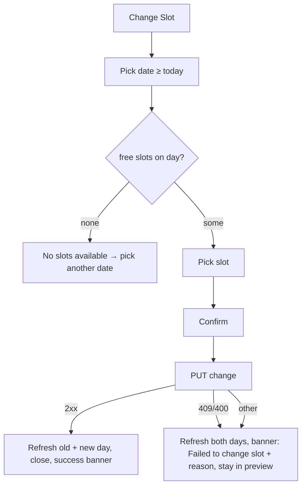

# Reschedule (change slot) and adjust duration

| | |
|---|---|
| Area | 04 Calendar & schedule |
| Who sees it | Doctor (own and colleagues' appointments); Clinic staff via the clinic doctor schedule screen. No tier gate. |
| Reached from | [05-appointment-preview-sheet](05-appointment-preview-sheet.md): "Date and Time" tile (change slot) and "Adjust duration" card |
| Screen type | Today: alert dialog (change slot) + inline dropdown/button (duration). **Target: one bottom sheet "Reschedule" with date strip + slot grid + duration** |
| Current Flutter source | `lib/features/calendar/presentation/calendar_screen.dart` (`_showChangeSlotDialog`, `_loadAvailableSlots`, `_buildAppointmentAdjustEndChoices`, `_persistAppointmentDuration`), `lib/features/calendar/domain/consecutive_slot_range.dart`, `calendar_controller.dart` (`changeAppointmentSlot`) |
| Spec | `docs/kmp-spec/03-calendar-schedule.md` §1.7 (Change slot, Adjust duration), §1.10, §6 (PUT `/api/appointments/{id}/change`); ticket CAL-6 |

## 1. Purpose
Move a booked appointment to another free slot (same or another day), or make it longer/shorter without moving its start. Weekly to daily use; often while the patient is on the phone, so it must be fast.

## 2. Entry points
- **Preview → "Date and Time" tile** (enabled only when the appointment has not ended). Opens the change-slot dialog preselected on the appointment's day.
- **Preview → "Adjust duration" dropdown + "Apply duration change"** (only when not past, not cancelled/completed, has id and timestamps).
- Colleague/staff context: slot lists come from the colleague's calendar (`doctorId` query); PUT body is the same (no `resourceDoctorId` on change — UNVERIFIED whether the backend infers the doctor from the appointment).

## 3. Layout, top to bottom (phone portrait)
**A. Change slot dialog (today)**
1. Title "Change Slot".
2. **Select Date** tile: subtitle = chosen date ("24 October 2026") or "Not selected"; calendar icon. Tap → system date picker, first selectable date = today (practice TZ), last = 2030.
3. Divider; "Available Slots" heading.
4. Slot list (max height 300, scrolls): one row per free slot of that day: "10:00 - 10:30" + subtitle "30m"; selected row shows a blue check. Loading → spinner; error → "Error loading slots: …"; none → "No slots available".
5. Actions: **Cancel** / **Change Slot** (primary, disabled until a slot is picked).

**B. Adjust duration (today, inside the preview)**
1. Label "Adjust duration".
2. Dropdown of end times: the current end, shorter ends stepping back by the venue's slot grain, and longer ends reachable by chaining free slots after the appointment at the same location.
3. Full-width button "Apply duration change" (disabled until changed).

**Target — one "Reschedule" sheet:**
1. Header "Reschedule" + current "Fri 24 Oct · 10:00–10:30".
2. Horizontal date strip (7 days from today, swipe for more) with a dot on days that have free slots (from the month cache); a "Pick date" calendar icon opens the full month.
3. Slot grid for the chosen day: chips "09:00", "09:30"…, grouped by location when the doctor has several; the current slot shown greyed with "current".
4. Duration row: "Keep 30 min" / stepper limited to what fits (same chain rule).
5. Sticky primary "Move to 10:30" (label reflects the choice) + secondary "Cancel".

## 4. Data and formats
| Field | Source | Format rule |
|---|---|---|
| Date picker bounds | today (practice TZ) … 2030-01-01 | past days not selectable |
| Free slots of a day | GET `/api/calendar?day=` (own: cached/throttled; colleague: live preview request) filtered to FREE_SLOT | `HH:mm - HH:mm` + duration `30m` |
| New start | chosen slot's wall-clock start on the chosen day → UTC ISO in practice TZ | sent as `startAt` |
| `slotMinutes` (change slot) | duration of the **picked free slot** (not the original appointment length) | an hour-long visit moved into a 30-min slot becomes 30 min — target: keep the original length when the chain allows, else ask |
| `slotMinutes` (adjust) | minutes from the appointment's UTC start to the chosen wall-clock end (min 5) | computed instant → wall clock |
| Grain | GCD of free-slot durations at the same venue that day, clamped 5–240 (default = appointment length) | step for shortening |
| Extend options | free slots starting exactly at the appointment's end, same `locationId`, chained | each chain hop adds one end option |
| Result | PUT `/api/appointments/{id}/change` `{startAt, slotMinutes}` | 200/204 ok; 409/400 → both days refreshed then error |

### Time rules
- Everything in practice TZ (clinic TZ for a colleague). "Today" lower bound is the practice date; a slot earlier today than "now" is still offered (consistent with booking).
- Moving across a DST change: start is converted from wall clock on the new day, so "10:00" stays 10:00 locally; the duration is sent in minutes.
- Moving to a slot at another location: allowed by the dialog (slots of all locations are listed) — the appointment silently changes venue; nothing tells the doctor. Target: show the location on each slot chip and confirm when it differs.
- Cross-midnight: not reachable (slots are intra-day).
- No minimum notice; no limit on how far ahead besides schedule validity.

## 5. Primary flow (happy path — move to another day)
1. Preview → Date and Time → dialog on the appointment's day with its free slots.
2. Tap Select Date → picker → pick Monday → slots reload (spinner) → list.
3. Tap "11:00 - 11:30" → check mark; Change Slot enabled.
4. Tap Change Slot → dialog closes; preview shows a saving spinner on its buttons; PUT.
5. Success → both days refreshed → preview closes → banner "Slot changed successfully" → calendar shows the original day (the appointment is gone from it). Target: jump to the new day and highlight the moved appointment.

## 6. Screen states
- **First load (dialog):** date preselected; slot list spinner → list (own day usually cached → instant).
- **Empty:** "No slots available" for the chosen day; Change Slot disabled. Target: date strip dots steer the doctor to days with slots.
- **Error on load:** "Error loading slots: <exception>" inside the dialog (own calendar errors are swallowed and shown as an empty list — bug). Target: inline error + Retry.
- **Offline:** cached day lists its slots; other days error; PUT fails → banner.
- **Refreshing:** the dialog re-runs the slot fetch on every rebuild (every tap re-triggers the loader — spinner flicker, bug 16). Target: load once per date.
- **Partial data:** no `appointmentId` → tile disabled.
- **Permission needed:** n/a.
- **Locked by tier:** n/a.
- **Role difference:** colleague/staff: slot list from the colleague's calendar; same PUT.

## 7. Interactions and secondary flows
- **Select Date** → system date picker (localised); picking resets the chosen slot.
- **Tap slot row** → select (single).
- **Change Slot** → confirm immediately (no second confirmation).
- **Cancel / back / scrim** → dialog closes, nothing changed.
- **Adjust duration dropdown** → header time/duration preview updates live; preview becomes dirty (Discard asks).
- **Apply duration change** → PUT with unchanged start; success banner; preview stays open with the new end; dropdown options recomputed.
- **Keyboard:** none.

## 8. Edge cases
- **Target slot shorter than the appointment** (60-min visit → 30-min slot): silently becomes 30 min. Target: offer "Keep 60 min" when the next slot is free, else warn "This slot is 30 min; the visit will be shortened".
- **Target slot at another location:** silently moves venue (see §4).
- **Slot taken meanwhile (409):** both days refreshed; banner "Failed to change slot: …" with the raw exception; dialog already closed → doctor has to reopen. Target: keep the sheet open, refresh the grid, mark the chip as taken.
- **Moving to the same slot:** allowed; PUT with identical values; harmless.
- **Appointment ended while the dialog is open:** PUT may be rejected by the backend (UNVERIFIED); UI shows the error.
- **Extend duration into a slot of another location:** impossible (chain requires the same `locationId`).
- **Extend to the end of the day / until the next appointment:** the chain stops at the first non-free entry.
- **Shorten below 5 min:** rejected client-side: "Invalid duration.".
- **Video appointment, no `locationId`:** chaining uses `null` venue → extends only through free slots that also have no location id (effectively none when locations exist) → shorten only. Target: for video, chain through any location's free slots or use time only (decide with backend).
- **Double tap Apply / Change Slot:** guarded by the preview's `_saving`.
- **Network drop on confirm:** error banner; state unknown until refresh → both days are force-refreshed in the error path (good).
- **Leaving the dialog mid-flow:** nothing sent.
- **401:** logout.
- **Deep link while the dialog is open:** the calendar under it switches day and selects another appointment; the dialog still belongs to the old appointment → confirm applies to the old id (correct but confusing). Target: close dialogs on deep link.
- **Rotation:** dialog persists; slot list max height 300 may be taller than the landscape screen → the dialog scrolls.
- **200 % font:** slot rows grow; "Change Slot" / "Cancel" buttons may wrap; date subtitle wraps.
- **Language switch:** labels update; months in the date picker follow the app locale.
- **Screen reader:** title → date tile (value) → list rows ("10:00 to 10:30, 30 minutes, selected") → Cancel → Change Slot (state disabled/enabled announced).

## 9. Validation and messages
| Field/action | Rule | When checked | Message (English) | Where shown |
|---|---|---|---|---|
| Date | ≥ today (practice TZ) | picker bounds | — (dates disabled) | picker |
| Slot | one chosen | on build | Change Slot disabled | button |
| Day has slots | list non-empty | after load | "No slots available" | inline in dialog |
| Slots load | request ok | after load | "Error loading slots: …" | inline in dialog |
| Duration | ≥ 5 min | on Apply | "Invalid duration." | top banner |
| PUT ok | 200/204 | on response | "Slot changed successfully" | top banner |
| PUT fail | — | on response | "Failed to change slot: <reason>" (target: backend `message`) | top banner |
| Preview dirty | duration changed and not applied | on close | "You have unsaved changes. Discard them?" | dialog |

## 10. Navigation out
- **Success (change slot) →** preview closes → calendar on the original day, both days refreshed; Home today/next appointment invalidated. Target: calendar jumps to the new day.
- **Success (adjust) →** stays in the preview with the new end.
- **Cancel →** back to the preview, nothing changed.

## 11. Copy
- `changeSlot` "Change Slot" (title and button); `selectDate` "Select Date"; `notSelected` "Not selected"; `availableSlots` "Available Slots"; `noSlotsAvailable` "No slots available"; `errorLoadingSlots` "Error loading slots"; `pleaseSelectDateFirst` "Please select a date first"; `cancel` "Cancel".
- `adjustAppointmentDuration` "Adjust duration"; `applyAppointmentDuration` "Apply duration change"; `invalidDuration` "Invalid duration."; `slotChanged` "Slot changed successfully"; `failedToChangeSlot` "Failed to change slot".
- **NEW:** "Reschedule" · "Move to {time}" · "Keep {n} min" · "This slot is {n} min; the visit will be shortened" · "This slot is at {location}" · "Current" (chip tag) · "This slot was just taken".

## 12. Known problems in the current app (do not carry over)
- Two separate mechanisms (dialog for date/time, dropdown + button for duration) for one mental action.
- Moving picks up the *target slot's* length, dropping the original duration silently.
- Slot list re-fetches on every dialog rebuild (spinner flicker); own-calendar load errors are swallowed into "No slots available".
- Location change is invisible; video appointments cannot be extended.
- After a successful move the calendar stays on the old day with nothing selected.
- Raw exception text in the failure banner; dialog already closed when the error arrives.

## 13. Open questions for design
- Date strip + slot grid in one sheet, or reuse the month picker?
- Should "keep duration" be the default and single-slot the exception?
- Confirm step before the move (shows old → new) or move immediately with an Undo banner?
- Expose "Move to next free slot" as a one-tap shortcut?
