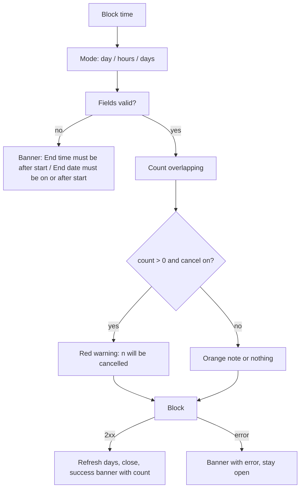

# Block time (breaks, days off, vacations) and blocked-period details

| | |
|---|---|
| Area | 04 Calendar & schedule |
| Who sees it | Doctor (own calendar; a colleague's calendar when the block is created from a colleague's section — UNVERIFIED that the Block button acts on the colleague). Clinic staff: cannot create blocks (no Block button on the clinic schedule screen) but can **remove** one from the blocked-entry panel. No tier gate. |
| Reached from | [01-calendar-tab](01-calendar-tab.md) header "Block time" (create); tap on a blocked row (details / remove) |
| Screen type | Dialog (create) · panel/sheet (details) |
| Current Flutter source | `lib/features/calendar/presentation/calendar_screen.dart` (`_showBlockTimeDialog`, blocked branch of `CalendarSlotDetailsPanel`, `_removeScheduleBlock`), `lib/state/calendar/calendar_controller.dart` (`createScheduleBlock`, `countOverlappingAppointmentsForBlock`, `deleteScheduleBlock`) |
| Spec | `docs/kmp-spec/03-calendar-schedule.md` §1.8, §6 (POST `/api/schedule/blocks`, GET `/api/schedule/blocks/overlapping-count`, DELETE `/api/schedule/blocks/{id}`); ticket CAL-8 |

## 1. Purpose
Take time out of the bookable schedule: a lunch break today, a conference afternoon, a two-week vacation, an emergency. Optionally cancel the appointments that fall inside and let patients know. Weekly for breaks, rarely for vacations. There is no separate "recurring break" or "vacation" feature — one block dialog covers all three; recurring breaks must be modelled as schedule rule gaps ([10](10-availability-setup.md)).

## 2. Entry points
- Calendar header → **Block time** icon (needs a selected day; always true on phone). The dialog is pre-anchored on the selected day.
- Blocked row tap → blocked details panel (reason + "Remove block").
- Not reachable from Home, Profile or the schedule setup screen (open question: a "Days off" entry in setup).

## 3. Layout, top to bottom (phone portrait)
**A. Block time dialog**
1. Title "Block time".
2. Three radio rows: **Block entire day** (default) · **Block time range** · **Block multiple days**.
3. Conditional fields:
   - Time range: "Start" 09:00 · "End time" 17:00 (text buttons opening the system time picker).
   - Multiple days: "From date" / "To date" (text buttons opening the date picker; values shown as `d.M.yyyy`, e.g. "3.11.2026"; picker bounds = selected day −1 year … +2 years; picking a From after To drags To along).
4. Text field **Reason (optional)**, prefilled "Emergency", hint "Emergency, personal, etc.".
5. Checkbox **Cancel overlapping appointments** (default **on**), subtitle "Patients will be notified automatically."
6. Live overlap preview: thin progress line while counting; then red "3 appointment(s) will be cancelled." when the checkbox is on, or orange "Some existing appointments fall within this period." when off. Hidden when 0.
7. Actions: text **Cancel** · primary **Block** (spinner while saving; all inputs disabled).

**B. Blocked details panel** (same scaffold as the preview sheet)
1. Header "Block time", date and time range, "Duration: 8h".
2. Red-50 card: block icon + reason ("Vacation" / "Blocked") + line "Patients cannot book new appointments during this blocked period."
3. Sticky actions: primary **Remove block** (spinner) · secondary **Close**.

Target: present the create dialog as a bottom sheet with segmented "Day · Hours · Several days", date/time chips, reason chips (Break · Vacation · Sick · Emergency · Other) + free text, the cancel-overlapping switch with the live count, a red primary "Block {n} appointments and time" when n > 0.

## 4. Data and formats
| Field | Source | Format rule |
|---|---|---|
| Mode | local | entire day → 00:00–23:59 of the selected day (**target 00:00–24:00**); time range → same day start/end; multiple days → from 00:00 of From to 23:59 of To |
| Start/end instants | wall clock in practice TZ → UTC ISO | sent as `startAt`/`endAt` |
| Reason | text, trimmed | omitted when empty; shown on rows and in the panel |
| Cancel overlapping | bool | `cancelOverlappingAppointments` |
| Overlap count | GET overlapping-count with the same instants (+ `doctorId` for a colleague) | integer; failures → 0 (silent) |
| Response | `{cancelledAppointmentCount}` | shown in the success banner |
| Refresh | every day from From to To force-refreshed sequentially after success | a 30-day vacation = 30 requests, one after another |
| Delete | DELETE `/api/schedule/blocks/{blockId}` (+ `?doctorId=` for a colleague) | 200/204 |

### Time rules
- All boundaries are wall-clock in the **practice timezone** and converted per day, so a multi-day block over a DST change keeps 00:00–24:00 locally each day (today 23:59 → the last minute stays bookable when a slot ends exactly at midnight).
- "Entire day" is the *selected* day; a day in the past can be blocked (date picker allows −1 year) — pointless but harmless; target: lower bound = today.
- Blocks are returned by the calendar as `BLOCKED` entries sliced per day; a block crossing midnight shows on both days.
- Breaks recurring every day are **not** blocks; they come from gaps between schedule rule ranges (e.g. 09:00–13:00 and 14:00–18:00).

## 5. Primary flow (happy path — vacation)
1. Select any day → Block time → dialog (Entire day, count for that day loads).
2. Choose **Block multiple days** → From/To default to the selected day → set To = +13 days → count reloads → "2 appointment(s) will be cancelled."
3. Reason → "Vacation". Keep "Cancel overlapping" on.
4. Tap **Block** → spinner → POST → 14 days refreshed one by one (several seconds) → dialog closes → banner "Time blocked. 2 appointment(s) cancelled." → month cells turn dark; agenda shows a red "Vacation 00:00 - 23:59" row.

## 6. Screen states
- **First load:** dialog opens instantly; overlap count loads in the background (thin progress line).
- **Empty:** n/a.
- **Error on load (count):** silently 0 → the doctor may block without knowing appointments will be cancelled. Target: show "Couldn't check for appointments" and keep the primary neutral, never red-silent.
- **Offline:** count fails (silent 0); Block fails → banner with the raw exception; dialog stays open.
- **Refreshing:** after success, days refresh sequentially behind the closed dialog; the agenda updates when its day arrives.
- **Partial data:** block entry without `blockId` → "Remove block" does nothing (button enabled but no-op) → target: hide the button, show "Managed elsewhere".
- **Permission needed:** n/a.
- **Locked by tier:** n/a.
- **Role difference:** staff cannot create blocks in their screen; they can remove one (DELETE with `doctorId`). The Block button in the doctor's calendar always acts on the **doctor's own** calendar, even when a colleague's section is being looked at (no `actingAsDoctorProfileId` is passed from the dialog) — target: when ≥ 2 staff are visible, ask "Whose calendar?".

## 7. Interactions and secondary flows
- **Change mode / any field** → count recomputed immediately (no debounce; a request per tap — target: 300 ms debounce).
- **Toggle Cancel overlapping** → only the warning text/colour changes; count unchanged.
- **Block** → validate → POST → refresh → close → banner.
- **Cancel / back / scrim** → closes; nothing sent (no dirty check; target: none needed, the form is small).
- **Blocked row → Remove block** → confirm dialog "Remove block" / "Remove this block? Free slots will become available again." (Cancel · Remove block) → DELETE → day refreshed → panel closes → banner "Block removed".
- **Blocked row → Close** → back to calendar.

## 8. Edge cases
- **Time range end ≤ start:** Block shows banner "End time must be after start time."; count not requested.
- **Overnight break (22:00–02:00):** impossible in one time-range block (end must be after start on the same day) → use two blocks or multiple days. Target: allow end < start meaning next day? (open question).
- **Multiple days with To before From:** picker clamps To to From; if the user picks From later than To afterwards, To is moved. Save-time check also exists.
- **Blocking a day that is already fully blocked:** backend behaviour UNVERIFIED (duplicate blocks or 409); UI shows whatever error text comes back.
- **Overlap count large (e.g. 40 over a vacation):** red text; no list of who. Target: tap the count to see the list of affected patients before confirming.
- **Cancel overlapping off, appointments exist:** block is created *around* them? or rejected? UNVERIFIED — the UI shows an orange note and lets the request through.
- **Appointment in progress inside the range:** would be cancelled if the flag is on (UNVERIFIED) — target: backend excludes IN_PROGRESS; UI warns.
- **Reason very long:** single-line field; row title shows max 2 lines then ellipsis.
- **Reason empty:** rows and panel show "Blocked".
- **Slow network while refreshing 30 days:** the dialog has closed; the header spinner runs; the agenda for the selected day updates when its own refresh completes. Target: one batched refresh (first visible day first).
- **Double tap Block:** `saving` guard.
- **Network drop on confirm:** banner with the exception; the block may exist server-side; nothing refreshes until the next action → target: force-refresh the selected day in the error path.
- **401:** logout.
- **Deep link while the dialog is open:** calendar changes under the modal; the dialog still targets the *originally selected day* (captured at open) — fine.
- **Rotation:** dialog persists; the scrollable body handles the height.
- **200 % font:** radio labels wrap; From/To rows put the value button under the label (ListTile trailing) — may overflow; target: stacked layout.
- **Language switch:** n/a while modal.
- **Screen reader:** title → three radios (group) → fields → reason → checkbox with subtitle → warning (live region) → Cancel → Block.
- **Staff calendars: blocking while viewing two doctors:** the block lands on the own calendar silently (see §6).

## 9. Validation and messages
| Field/action | Rule | When checked | Message (English) | Where shown |
|---|---|---|---|---|
| Time range | end > start | on Block (and count skipped) | "End time must be after start time." | top banner (today SnackBar) → target inline |
| Date range | To ≥ From | on Block | "End date must be on or after start date." | banner → inline |
| Overlap warning | count > 0, cancel on | live | "{{count}} appointment(s) will be cancelled." | inline red |
| Overlap note | count > 0, cancel off | live | "Some existing appointments fall within this period." | inline orange |
| Success | 2xx | on response | "Time blocked successfully" / "Time blocked. {{count}} appointment(s) cancelled." | top banner |
| Failure | — | on response | raw exception → target "Couldn't block this time. Try again." | banner |
| Remove block | confirm | dialog | "Remove this block? Free slots will become available again." | dialog |
| Remove ok | 2xx | on response | "Block removed" | banner |

## 10. Navigation out
- **Block success →** calendar; all days in range force-refreshed; if any appointment was cancelled, Home/analytics invalidated.
- **Cancel →** calendar unchanged.
- **Remove block →** calendar, day refreshed.

## 11. Copy
- `blockTime` / `blockTimeTitle` "Block time"; `blockEntireDay` "Block entire day"; `blockTimeRange` "Block time range"; `blockDateRange` "Block multiple days"; `start` "Start"; `bookingEndTime` "End time"; `fromDate` "From date"; `toDate` "To date"; `blockReason` "Reason (optional)"; `blockReasonHint` "Emergency, personal, etc."; `emergencyBlock` "Emergency"; `blockCancelOverlapping` "Cancel overlapping appointments"; `blockCancelOverlappingHint` "Patients will be notified automatically."; `blockOverlapWillCancel`; `blockOverlapWarning`; `blockTimeConfirm` "Block"; `blockEndDateMustBeOnOrAfterStart`; `endTimeMustBeAfterStartTime`; `blockTimeSuccess`; `blockTimeSuccessWithCancel`; `cancel` "Cancel".
- Details: `blockedTime` "Blocked"; `blockOverlapInfo` "Patients cannot book new appointments during this blocked period."; `unblockTime` "Remove block"; `unblockConfirm`; `unblockSuccess` "Block removed"; `close` "Close".
- **NEW:** "Break" · "Vacation" · "Sick leave" · "Other" (reason chips) · "Whose calendar?" · "Couldn't check for appointments" · "All day" (row label instead of 00:00 - 23:59) · "Block {n} appointments and time".

## 12. Known problems in the current app (do not carry over)
- "Entire day" ends at 23:59, not 24:00.
- Overlap count failure is silent (0) while the default is to cancel overlapping appointments — a doctor can cancel visits without being warned.
- Count request fires on every keystroke/tap without debounce.
- Default reason "Emergency" is wrong for a lunch break or a vacation.
- Dates shown as `3.11.2026` (unlocalised), times from the system picker (may be 12 h on some phones while the app shows 24 h everywhere).
- 30 sequential refresh requests after a long block.
- No "whose calendar" when staff sections are visible; no entry from the schedule setup screen.
- Remove block enabled without an id.

## 13. Open questions for design
- Separate "Day off / Vacation" entry in schedule setup vs only from the calendar header?
- Should recurring breaks (lunch every day) be a first-class setting in the weekly template instead of two time ranges per day?
- Show the list of affected patients before blocking?
- Allow an overnight time range (end next day)?
